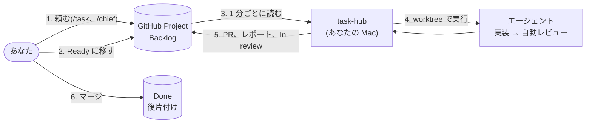

<picture>
  <source media="(prefers-color-scheme: dark)" srcset="assets/brand/banner-dark.svg">
  
</picture>

# task-hub

[English](README.md) | 日本語

**AI に任せて、離れていい。確かめてから届くから。**

<picture>
  <source media="(prefers-reduced-motion: reduce) and (prefers-color-scheme: dark)" srcset="assets/media/list-dark.png">
  <source media="(prefers-reduced-motion: reduce)" srcset="assets/media/list-light.png">
  <source type="image/avif" srcset="assets/media/flow.avif">
  
</picture>

1 枚のカードの一生を層に分けて見せる紹介ページ: [jyoka.github.io/task-hub](https://jyoka.github.io/task-hub/?lang=ja)

[](https://github.com/jyoka/task-hub/actions/workflows/windows.yml)
[](LICENSE)

頼みたいことを Goal に書いて渡すだけです。手元の AI エージェントが作ります。作っていない新しい目が Goal と
突き合わせて確かめ、直してから届けます。あなたが決めるのは 2 つだけです。

- **何をやるか**: Goal を GitHub Project のカードに書き、Ready に移す
- **出してよいか**: PR をマージする

頼んだことから決めたことまで、全部が Issue と PR にあとからたどれます。エージェントは Claude Code、Codex、Pi、Kiro など、
非対話モードを持つ CLI なら何でも使えます。届ける前の確かめは既定で入ります。`reviewer = off` で外すと、確かめずに届きます。

> **Kiro IDE で使う人は [docs/kiro-quickstart.md](docs/kiro-quickstart.md)(Mac)か
> [docs/windows-quickstart.md](docs/windows-quickstart.md)(Windows)へ。** このリポジトリを Kiro IDE で開き、
> チャットに「セットアップして」と言うだけで入ります(ターミナルも管理者権限も要りません)。

## しくみ



- 状態はすべて GitHub にあります。スマホから Ready に移しても始まります
- エージェントがするのは「ファイルを編集し、テストし、レポートを書く」ことだけです。git、PR、Issue へのコメントは
  task-hub がコードで行うので、どのエージェントでも同じ形の PR になります
- LLM を使うのは、実装、レビュー、止まった理由の仕分けの 3 か所だけです。いつ始めるか、通知、後片付けはコードが決めます

## 特長

<table>
  <tr>
    <td width="50%" valign="top">
      <a href="docs/agents.md#自動レビュー"><picture><source media="(prefers-color-scheme: dark)" srcset="assets/media/review-dark.png"></picture></a><br>
      <b>届ける前の確かめ</b><br>
      既定で入る。PR の前に、新しい文脈のエージェントが受け入れ条件を 1 つずつ確かめて差し戻す。
    </td>
    <td width="50%" valign="top">
      <a href="docs/agents.md#blocked-の仕分けreplanner"><picture><source media="(prefers-color-scheme: dark)" srcset="assets/media/claude-board-dark.png"></picture></a><br>
      <b>Blocked の仕分け</b><br>
      確かめに通らない作業は、届けずに止まる。止まった理由はボードに出る。
    </td>
  </tr>
  <tr>
    <td width="50%" valign="top">
      <a href="docs/kiro-ide.md#10-ボードをサイドバーとステータスバーに出す拡張"><picture><source media="(prefers-color-scheme: dark)" srcset="assets/media/kiro-board-dark.png"></picture></a><br>
      <b>ボードを横に</b><br>
      Claude Code のペイン、Kiro のサイドバー、<code>task list --watch</code> で、いつでも見える。
    </td>
    <td width="50%" valign="top">
      <a href="docs/usage.md#見え方と手元に残るもの"><picture><source media="(prefers-color-scheme: dark)" srcset="assets/media/list-dark.png"></picture></a><br>
      <b>カードごとの作業場所</b><br>
      カードごとに、ブランチ、worktree、PR が 1 つずつ。頼んだことと届いたものが並ぶ。
    </td>
  </tr>
</table>

どの画像も、task-hub が架空のボードで自分で撮ったものです([docs/media.md](docs/media.md))。

- **Ready の前に Goal を確かめる**: `task check <番号>` で、Goal とコードしか知らないエージェント([Goldfish](https://egm.dev/))が GO / NO-GO を出します([詳しく](docs/task-format.md#ready-の前の確かめtask-check))
- **止まっても続きから**: クラッシュや再起動で止まった実行は 1 回だけ再開し、利用の上限で止まった実行は上限が戻るのを待ちます([詳しく](docs/operations.md#利用の上限で止まった))
- **通知**: 見張らなくても、In review、Blocked、予算超えを、LLM を使わずに OS かスマートフォンに知らせます([詳しく](docs/notifications.md))
- **マージキュー**: `task merge` で承認した PR を、base に追いつかせ、チェックを待ってマージします。1 つのリポジトリで 1 度に 1 本です([詳しく](docs/operations.md#マージキュー))
- **前後関係**: GitHub の「Blocked by」の待ち先が終わるまで、カードは始まりません
- **コードが残す記録**: git、PR、Issue へのコメントは、エージェントではなく task-hub のコードが行うので、どのエージェント CLI でも同じ形で残ります。`task stats` がトークンと費用を集計します([詳しく](docs/task-format.md#task-hub-のレポートコメント))
- **軽い**: Python 標準ライブラリだけ。インストールするのは clone 1 つです

## はじめる

必要なもの: macOS(Windows は [docs/windows.md](docs/windows.md))、Python 3.10 以上、git、ログイン済みの `gh`、
ログイン済みのエージェント CLI 1 つ以上。

```sh
# 1. 動かす用の clone を入れる
git clone https://github.com/jyoka/task-hub.git ~/.local/lib/task-hub
ln -sfn ~/.local/lib/task-hub/bin/task ~/.local/bin/task

# 2. GitHub Project を使う権限
gh auth refresh -s project

# 3. 設定を書いて(下)、確かめる
task list
```

```ini
; ~/.config/task-hub/config.ini
[board]
project = <owner>/<Project の番号>
issues = <owner>/<Issue を置くリポジトリ>

[runner]
agent = claude
```

実行は PR の前に、同じエージェントが新しいコンテキストでレビューします。外すときは `[runner]` に `reviewer = off` を書きます。
GitHub Project の準備(列と欄)、スキルのインストール、常駐のさせ方は [docs/setup.md](docs/setup.md) にあります。

## 使い方

使い方は 3 通りで、混ぜても構いません。

| 使い方 | やること |
|---|---|
| **総指揮と話す**(おすすめ) | エージェントで `/chief`。話した作業をタスクに分けて提案し、「うん」で登録と開始をし、In review や Blocked になると知らせてきます |
| **会話から登録** | 普段の会話で `/task`。Backlog にカードができるので、やってほしいときに Ready へ移します |
| **ターミナルだけ** | `task new` で登録、`task start <番号>` で開始、`task list` で様子を見ます |

Ready のカードを自動で始めるには、`task watch` を動かしておきます(1 分ごとに確認)。
設定に `[triggers]` を書くと、`task watch` は CI の失敗、あなたに割り当てられた Issue、繰り返しの目標のカードを
自分で作ります。カードは Backlog に入り、承認するのはあなたです([docs/triggers.md](docs/triggers.md))。
繰り返しの目標は drift report にもできます。文脈を持たないエージェントが、文書とコードの食い違いを一覧にします。

例: 「ログインを直す」を頼んで、マージするまで。

```
あなた      /task(または /chief に話す)            → Issue you/tasks#12、Backlog
あなた      カードを Ready に移す                    → task-hub が開始                 In progress
worker      編集し、テストし、レポートを書く
reviewer    受け入れ条件を PR 全体と照らし合わせる   → pass(needs changes なら差し戻し。2 回まで)
task-hub    task/12 を push し、PR を作り、レポートと判定を Issue にコメント   In review
あなた      PR をレビューしてマージ                  → Issue が閉じる                  Done
```

Goal の書き方、タスクの分け方、前後関係、調べもののタスク、設定の詳細は [docs/usage.md](docs/usage.md) にあります。

## タスクの一生

| 列 (Status) | 何が起きているか | あなたの対応 |
|---|---|---|
| **Backlog** | 登録済み、未承認 | やってほしいときに Ready へ |
| **Ready** | 承認済み。枠(最大 5)が空けば始まる。待ち先があれば、終わるまで待つ | なし |
| **In progress** | worker が作業中。自動レビューと差し戻しもこの間 | なし |
| **In review** | PR ができた(調べものはレポートだけ) | PR をレビューしてマージ |
| **Blocked** | エージェントが何かを必要としている、自動レビューが通らなかった、または実行が失敗した | 答えを Goal に書き足すか、Issue や PR にコメントして Ready へ |
| **Done** | PR がマージされた。後片付けが済み、これを待っていたタスクが始まる | なし |

列の上にあるのは、最後に動いたカードです。カードが 100 枚を超えると、古い Done のカードをアーカイブします。

## コマンド

| コマンド | すること |
|---|---|
| `task` | ボードと同期し、Ready のカードを始め、あなたの対応が必要なものを出す |
| `task list [--watch] [--max-age 秒]` | 開いているカードの一覧(読むだけ) |
| `task new --title ... --repo owner/name --goal ...` | タスクを登録する(`--base`、`--agent`、`--research`、`--blocked-by 12,14`) |
| `task start [<番号>] [--agent 名前]` | Backlog を承認する、Blocked を再実行する |
| `task watch` | Ready のカードを自動で始める(1 分ごと) |
| `task intake` | スマートフォンから [ntfy](https://ntfy.sh) で送った文を Backlog のカードにする。In review の通知の Merge と Reject のボタンも受ける([operations.md](docs/operations.md#スマートフォンからカードを作るtask-intake)) |
| `task check <番号> [--no-write]` | Ready の前に Goal を確かめる。GO / NO-GO を Issue と Project の Readiness 欄に書く(`[runner] readiness` で開始に GO を求められる) |
| `task review <番号> --no-write --ref <コミット>` | カードのコードのあるコミットで自動レビューを試し、判定を表示する。過去のカードで `[runner] review_mode` や安いレビューを比べる用。何も書かない |
| `task show <番号> [--full \| --digest]` | Issue と最新のレポート |
| `task log <番号> [--full]` | このマシンでの実行の出力 |
| `task open <番号>` | worktree を IDE で開く(`[ide] open`) |
| `task events [--follow \| --next]` | 最近の出来事(列の移動、仕分け、長引いている実行) |
| `task stats` | 実行の集計(レビュー、差し戻し、Blocked の理由、トークン数、費用) |
| `task merge [<番号>] [--cancel]` | PR をマージキューに入れる(`[merge] queue = on`。既定はオフ)。`task watch` が base に追いつかせ、競合はエージェントが解き、チェックが通ったらリポジトリごとに 1 つずつマージする([operations.md](docs/operations.md#マージキュー)) |
| `task done <番号>` | 手で閉じる・取り消す |
| `task share <番号> --to owner/name [--project owner/番号]` | 選んだタスクをチームの Issue と Project に出す。その後の Status と Report も写す |
| `task update` | 最新のリリースに更新する |
| `task feedback [--feature]` | バグ報告・機能の要望のフォームを開く |

すべてのフラグは `task help` と各コマンドの `--help` で見られます。

## ドキュメント

| はじめる | 使う | 仕組み | 開発する |
|---|---|---|---|
| [setup.md](docs/setup.md) セットアップ | [usage.md](docs/usage.md) 使い方の詳細 | [architecture/hld.md](docs/architecture/hld.md) 全体図 | [CONTRIBUTING.md](CONTRIBUTING.md) PR とテスト |
| [windows.md](docs/windows.md) Windows | [operations.md](docs/operations.md) 運用とトラブル | [architecture/lld.md](docs/architecture/lld.md) 詳細設計 | [architecture/feature-design.md](docs/architecture/feature-design.md) 機能の設計 |
| [kiro-quickstart.md](docs/kiro-quickstart.md) Kiro IDE | [agents.md](docs/agents.md) エージェント | [design.md](docs/design.md) なぜこの作りか | [release.md](docs/release.md) リリース |
| [kiro-ide.md](docs/kiro-ide.md) Kiro の中身 | [task-format.md](docs/task-format.md) Issue と PR の形式 | [lessons.md](docs/lessons.md) わかったこと | [SECURITY.md](SECURITY.md) 脆弱性の報告 |
| [windows-quickstart.md](docs/windows-quickstart.md) Windows の Kiro IDE | [issue-tracker.md](docs/issue-tracker.md) ほかのスキルから登録 | | [brand.md](docs/brand.md) 伝え方と見た目 |
| | [slack-triage.md](docs/slack-triage.md) Slack から登録 | | [media.md](docs/media.md) 画像の撮り直し |
| | [triggers.md](docs/triggers.md) task-hub が自分で作るカード | | |
| | [autopilot.md](docs/autopilot.md) オートパイロット(選んだリポジトリの承認とマージを task-hub がする) | | |
| | [sandbox.md](docs/sandbox.md) サンドボックス(Linux) | | |
| | [architecture-brief.md](docs/architecture-brief.md) Architecture Brief(新しいプロダクトで決める 7 つの関門) | | |

## バグ報告と要望

`task feedback`(機能の要望は `task feedback --feature`)で、版と OS を入れたフォームが開きます。
質問や相談は [Discussions](https://github.com/jyoka/task-hub/discussions) へ。脆弱性は [SECURITY.md](SECURITY.md) の手順で知らせてください。

## ライセンス

[MIT](LICENSE)
