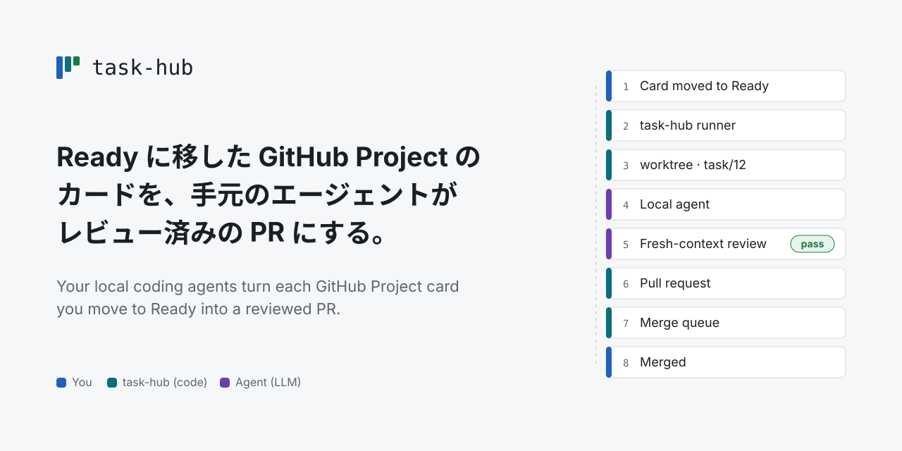
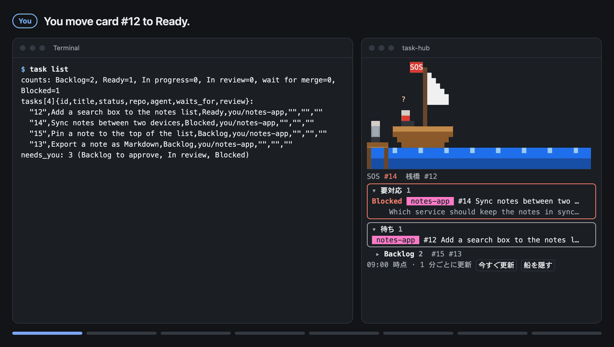
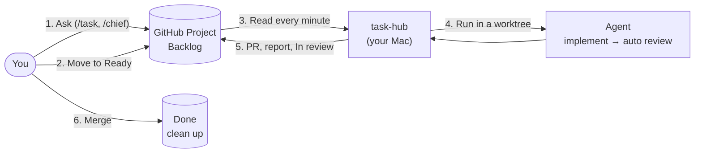
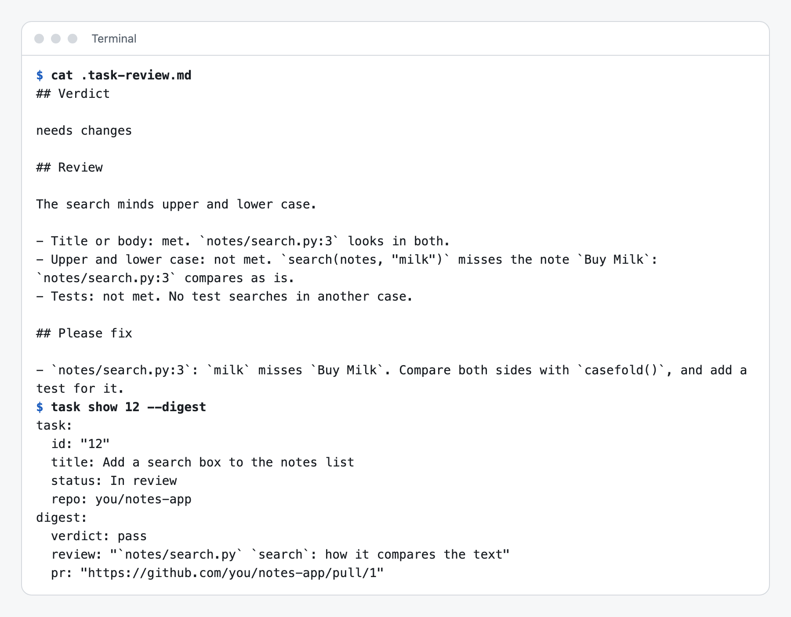
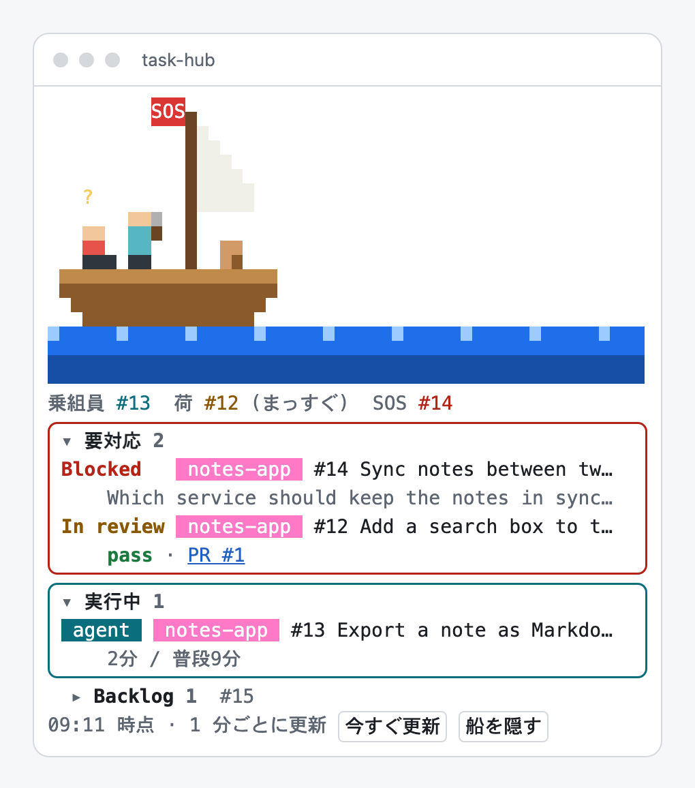
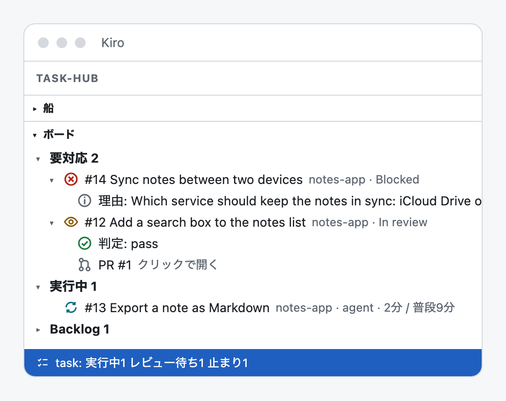
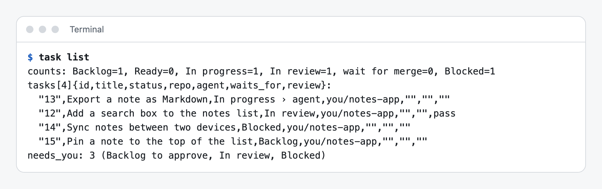

<picture>
  <source media="(prefers-color-scheme: dark)" srcset="assets/brand/banner-dark.svg">
  
</picture>

# task-hub

English | [日本語](README.ja.md)

**Hand work to AI agents and walk away. Nothing reaches you unchecked.**

<picture>
  <source media="(prefers-reduced-motion: reduce) and (prefers-color-scheme: dark)" srcset="assets/media/list-dark.png">
  <source media="(prefers-reduced-motion: reduce)" srcset="assets/media/list-light.png">
  <source type="image/avif" srcset="assets/media/flow.avif">
  
</picture>

See one card's life, layer by layer, on the landing page: [jyoka.github.io/task-hub](https://jyoka.github.io/task-hub/)

[](https://github.com/jyoka/task-hub/actions/workflows/windows.yml)
[](LICENSE)

Write what you want as a Goal and hand it over. An AI agent on your machine builds it. A fresh pair of eyes that
did not build it checks the work against the Goal, and it is fixed before it reaches you. You decide only two things:

- **What to do.** Write the Goal on a GitHub Project card and move it to Ready.
- **Whether it may ship.** Merge the PR.

Everything, from what you asked to what you decided, can be traced later on the Issue and the PR. Any agent CLI
with a non-interactive mode works: Claude Code, Codex, Pi, Kiro, and others. The check before delivery is on by
default; if you turn it off with `reviewer = off`, work reaches you unchecked.

> **Kiro IDE users: see [docs/kiro-quickstart.md](docs/kiro-quickstart.md) (Mac) or
> [docs/windows-quickstart.md](docs/windows-quickstart.md) (Windows).** Open this repository in Kiro IDE and
> say "セットアップして" ("set it up") in the chat. You need no terminal and no admin rights.

The detailed docs in `docs/` are in Japanese.

## How it works



- GitHub holds all the state. Move a card to Ready from your phone, and the task starts.
- The agent only edits files, runs tests, and writes a report. task-hub does git, the PR, and the Issue comments in
  code. So every agent produces the same kind of PR.
- An LLM does only three jobs: implement, review, and sort out why a task stopped. Code decides when to start, when
  to notify, and when to clean up.

## Features

<table>
  <tr>
    <td width="50%" valign="top">
      <a href="docs/agents.md#自動レビュー"><picture><source media="(prefers-color-scheme: dark)" srcset="assets/media/review-dark.png"></picture></a><br>
      <b>Check before delivery</b><br>
      On by default: before the PR, an agent in a fresh context checks each acceptance criterion and sends the work back.
    </td>
    <td width="50%" valign="top">
      <a href="docs/agents.md#blocked-の仕分けreplanner"><picture><source media="(prefers-color-scheme: dark)" srcset="assets/media/claude-board-dark.png"></picture></a><br>
      <b>Blocked triage</b><br>
      Work that fails the check stops instead of reaching you, and the board shows why.
    </td>
  </tr>
  <tr>
    <td width="50%" valign="top">
      <a href="docs/kiro-ide.md#10-ボードをサイドバーとステータスバーに出す拡張"><picture><source media="(prefers-color-scheme: dark)" srcset="assets/media/kiro-board-dark.png"></picture></a><br>
      <b>Board at your side</b><br>
      See the board in a Claude Code pane, the Kiro sidebar, or <code>task list --watch</code>.
    </td>
    <td width="50%" valign="top">
      <a href="docs/usage.md#見え方と手元に残るもの"><picture><source media="(prefers-color-scheme: dark)" srcset="assets/media/list-dark.png"></picture></a><br>
      <b>A workspace per card</b><br>
      Each card gets its own branch, worktree, and PR, so what you asked for and what came back line up.
    </td>
  </tr>
</table>

task-hub took every picture here itself, on a made-up board ([docs/media.md](docs/media.md)).

- **Goal check before Ready.** `task check <id>` has agents that know only the Goal and the code ([Goldfish](https://egm.dev/)) say GO or NO-GO ([how](docs/task-format.md#ready-の前の確かめtask-check)).
- **Continue after a stop.** A run stopped by a crash or a restart resumes once; one stopped by the usage limit waits for the reset ([how](docs/operations.md#利用の上限で止まった)).
- **Alerts.** You need not watch: In review, Blocked, and runs over budget reach the OS or your phone without an LLM ([how](docs/notifications.md)).
- **Merge queue.** `task merge` approves a PR. task-hub brings it up to date, waits for its checks, and merges it, one per repository at a time ([how](docs/operations.md#マージキュー)).
- **Dependencies.** A card does not start until the tasks in its GitHub "Blocked by" list are done.
- **Records kept by code.** task-hub, not the agent, does git, the PR, and the Issue comments, so every agent CLI leaves the same kind of record; `task stats` sums tokens and cost ([how](docs/task-format.md#task-hub-のレポートコメント)).
- **Light.** Python standard library only. You install one clone.

## Get started

You need: macOS (Windows: [docs/windows.md](docs/windows.md)), Python 3.10 or later, git, `gh` logged in, and at
least one agent CLI logged in.

```sh
# 1. Install the clone that runs task-hub
git clone https://github.com/jyoka/task-hub.git ~/.local/lib/task-hub
ln -sfn ~/.local/lib/task-hub/bin/task ~/.local/bin/task

# 2. Give gh access to GitHub Projects
gh auth refresh -s project

# 3. Write the config (below), then check it
task list
```

```ini
; ~/.config/task-hub/config.ini
[board]
project = <owner>/<project number>
issues = <owner>/<repository that holds the Issues>

[runner]
agent = claude
```

Each run is reviewed before its PR by the same agent in a fresh context. To turn that off, add `reviewer = off`
under `[runner]`. After a send-back, the next review checks only the findings and what changed since; `re_review = full`
reads the whole PR again ([how](docs/task-format.md#差し戻しの後のレビューrunner-re_review)).
A PR that changes only documents gets a light review of the Goal and the diff; `light_review = off` reviews it in full
([how](docs/task-format.md#docs-だけの変更の軽い確かめrunner-light_review)).
[docs/setup.md](docs/setup.md) tells you how to prepare the GitHub Project (columns and fields), install the
skills, and keep `task watch` running.

## Usage

Use any of the three ways, or mix them.

| Way | What you do |
|---|---|
| **Talk to the chief** (recommended) | Run `/chief` in your agent. It splits what you describe into tasks and proposes them. Say yes, and it registers and starts them. It tells you when a task is In review or Blocked |
| **Register from a chat** | Run `/task` in a normal chat. A card appears in Backlog. Move it to Ready when you want the work done |
| **Terminal only** | Register with `task new`, start with `task start <id>`, and watch with `task list` |

To start Ready cards automatically, keep `task watch` running. It checks every minute.
With `[triggers]` in the config, `task watch` also makes cards on its own: for failing CI, for Issues assigned to
you, and for recurring goals. They go to Backlog for you to approve ([docs/triggers.md](docs/triggers.md)).
A recurring goal can be a drift report: an agent with no other context lists where the docs and the code disagree.

Example: you ask to fix the login, then merge.

```
You         /task (or tell /chief)                    → Issue you/tasks#12, Backlog
You         Move the card to Ready                    → task-hub starts it           In progress
worker      Edits, tests, writes the report
reviewer    Checks each acceptance criterion          → pass (needs changes: sent back, 2 times at most)
task-hub    Pushes task/12, opens the PR, comments the report and verdict on the Issue   In review
You         Review and merge the PR                   → the Issue closes             Done
```

[docs/usage.md](docs/usage.md) explains how to write a Goal, how to split tasks, dependencies, research tasks, and
the full config.

## Task lifecycle

| Column (Status) | What happens | What you do |
|---|---|---|
| **Backlog** | Registered, not approved | Move to Ready when you want it done |
| **Ready** | Approved. Starts when one of the 5 slots is free. Waits until its dependencies are done | Nothing |
| **In progress** | The worker runs. The auto review and its send-back also happen here | Nothing |
| **In review** | The PR is ready (a research task has only a report) | Review and merge the PR |
| **Blocked** | The agent needs something, the auto review failed, or the run failed | Add the answer to the Goal, or comment on the Issue or the PR, and move to Ready |
| **Done** | The PR is merged. task-hub cleans up, and tasks that waited for this one start | Nothing |

The card at the top of a column is the one that moved last. When the board has more than 100 cards, task-hub
archives the oldest Done cards.

## Commands

| Command | What it does |
|---|---|
| `task` | Syncs with the board, starts Ready cards, and shows what needs you |
| `task list [--watch] [--max-age seconds]` | Lists the open cards (read only) |
| `task new --title ... --repo owner/name --goal ...` | Registers a task (`--base`, `--agent`, `--research`, `--blocked-by 12,14`) |
| `task start [<id>] [--agent name]` | Approves a Backlog card, or runs a Blocked card again |
| `task watch` | Starts Ready cards automatically (every minute) |
| `task intake` | Turns messages you send from your phone through [ntfy](https://ntfy.sh) into Backlog cards, and handles the Merge and Reject buttons of In review notifications ([operations.md](docs/operations.md#スマートフォンからカードを作るtask-intake)) |
| `task check <id> [--no-write]` | Checks the Goal before Ready: GO or NO-GO on the Issue and in the Project's Readiness field (`[runner] readiness` can require a GO to start) |
| `task review <id> --no-write --ref <commit>` | Tries the automated review on a card's code at a commit and prints the verdict, to compare `[runner] review_mode` and cheaper reviews on past cards. Writes nothing |
| `task show <id> [--full \| --digest]` | Shows the Issue and the latest report |
| `task log <id> [--full]` | Shows the output of the run on this machine |
| `task open <id>` | Opens the worktree in your IDE (`[ide] open`) |
| `task events [--follow \| --next]` | Shows recent events (column moves, triage, long runs) |
| `task stats` | Sums up the runs (reviews, send-backs, Blocked reasons, tokens, cost) |
| `task merge [<id>] [--cancel]` | Approves the PR for the merge queue (`[merge] queue = on`, off by default): `task watch` brings it up to date with its base, has an agent fix conflicts, waits for its checks, and merges it, one PR per repo at a time ([operations.md](docs/operations.md#マージキュー)) |
| `task done <id>` | Closes or cancels a task by hand |
| `task share <id> --to owner/name [--project owner/number]` | Copies a task you choose to a team's Issue and Project, then keeps its Status and reports in step |
| `task update` | Updates task-hub to the newest release |
| `task feedback [--feature]` | Opens the bug report or feature request form |

`task help` and `--help` on each command show all the flags.

## Documentation

The docs are in Japanese.

| Get started | Use | How it works | Develop |
|---|---|---|---|
| [setup.md](docs/setup.md) Setup | [usage.md](docs/usage.md) Usage details | [architecture/hld.md](docs/architecture/hld.md) High-level design | [CONTRIBUTING.md](CONTRIBUTING.md) PRs and tests |
| [windows.md](docs/windows.md) Windows | [operations.md](docs/operations.md) Operations and troubleshooting | [architecture/lld.md](docs/architecture/lld.md) Low-level design | [architecture/feature-design.md](docs/architecture/feature-design.md) Designing a feature |
| [kiro-quickstart.md](docs/kiro-quickstart.md) Kiro IDE | [agents.md](docs/agents.md) Agents | [design.md](docs/design.md) Design decisions | [release.md](docs/release.md) Releases |
| [kiro-ide.md](docs/kiro-ide.md) Kiro internals | [task-format.md](docs/task-format.md) Issue and PR formats | [lessons.md](docs/lessons.md) Lessons learned | [SECURITY.md](SECURITY.md) Reporting vulnerabilities |
| [windows-quickstart.md](docs/windows-quickstart.md) Kiro IDE on Windows | [issue-tracker.md](docs/issue-tracker.md) Registering from other skills | | [brand.md](docs/brand.md) Messaging and look |
| | [slack-triage.md](docs/slack-triage.md) Registering from Slack | | [media.md](docs/media.md) Taking the pictures again |
| | [triggers.md](docs/triggers.md) Cards task-hub makes on its own | | |
| | [autopilot.md](docs/autopilot.md) Autopilot: task-hub approves and merges for chosen repos | | |
| | [sandbox.md](docs/sandbox.md) Sandboxed runs (Linux) | | |
| | [architecture-brief.md](docs/architecture-brief.md) Architecture Brief: seven gates to decide for a new product | | |

## Bug reports and feature requests

Run `task feedback` (or `task feedback --feature`). It opens a form with your version and OS filled in. Ask
questions in [Discussions](https://github.com/jyoka/task-hub/discussions). Report vulnerabilities as
[SECURITY.md](SECURITY.md) describes.

## License

[MIT](LICENSE)
