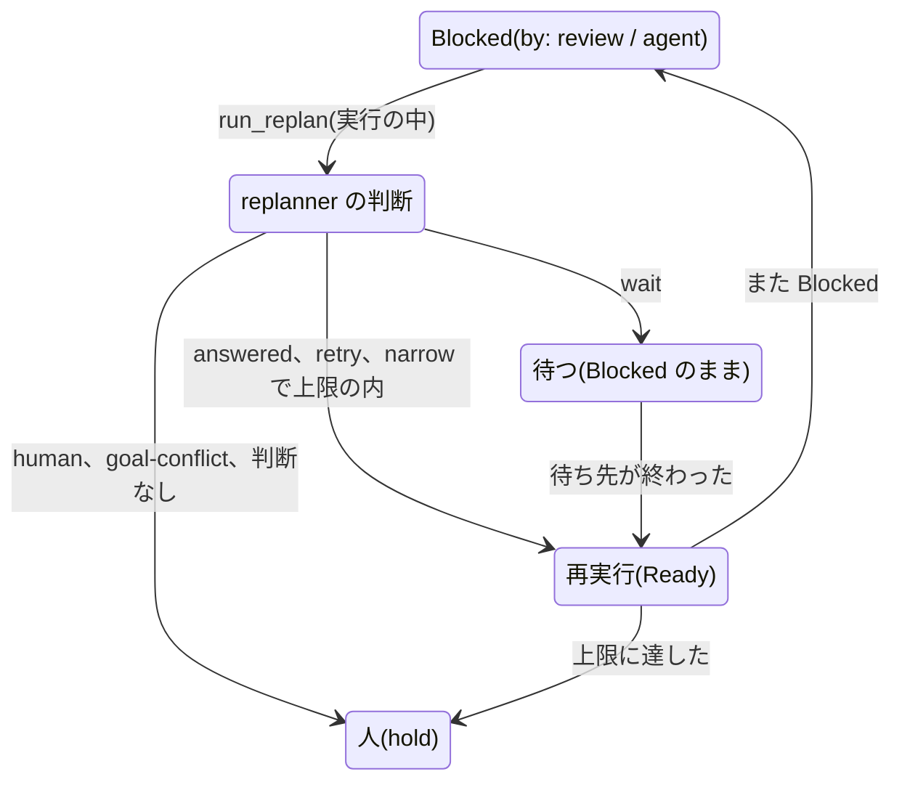
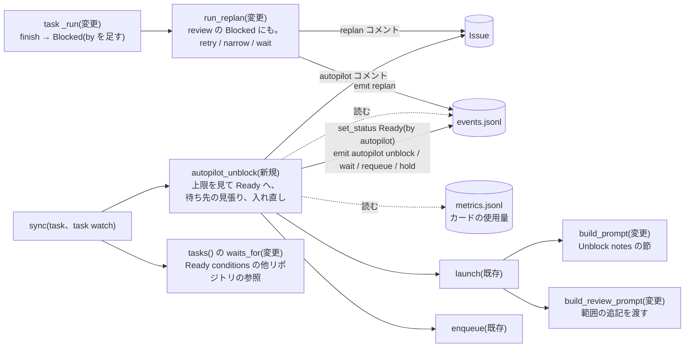
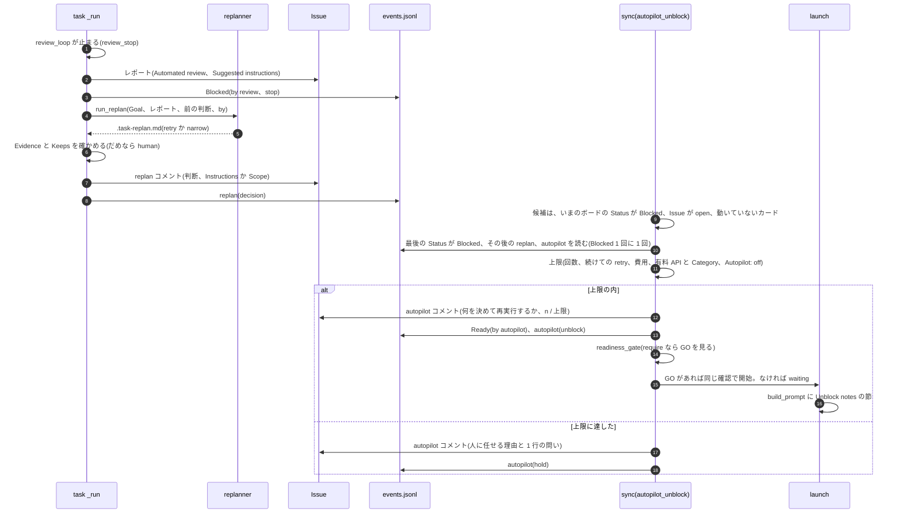
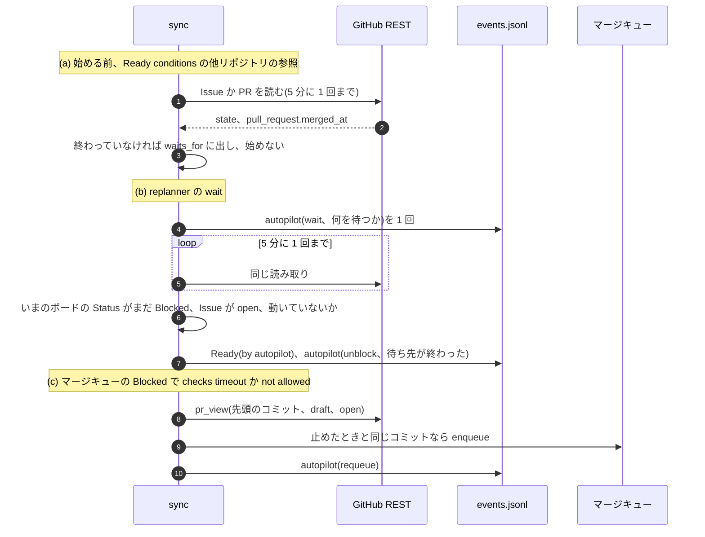
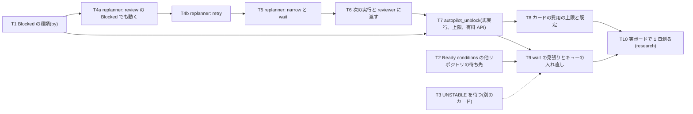

# オートパイロット: Blocked を片付ける(3 つ目の判断)

設計メモです(2026-10-27、タスク 283)。コードはまだ書いていません。実装の PR で、hld.md、lld.md、design.md も直します。

## 何を、なぜ

- 困っていること: オートパイロット([docs/autopilot.md](../../autopilot.md))が代わりにするのは、Ready に移すこととマージキューに
  入れることの 2 つだけで、Blocked はすべて人を待つ。利用者の要望(2026-10-27、要旨)は「なんでずっとブロックに
  なるのか。対策があれば自動で再開すればよい。毎回利用者を通すのは意味が分からない」。
- 2026-10-26〜27 の jyoka/tasks では、下の 5 種類の Blocked が出た。人(エージェント)は毎回、理由を読み、直し方か範囲を
  決めて Issue にコメントし、`task start` で再開した。決めた内容は、予算の承認を除けば、Goal、レビューの指摘、
  リポジトリの中身から決められるものだった。
- やること: オートパイロットに 3 つ目の判断「Blocked を片付ける」を足す。理由を種類に分け、決められるものは
  replanner が決めて Issue に書き、task-hub が自動で再実行する。待ち先を待つものは、終わったら再実行する。
  人に回すのは、秘密、費用、法務、製品の判断と、上限に達したものだけにする。そのときの問いは 1 行にする。
- やらないこと:
  - 機能を足す、安全・法務・費用の決まりを緩める、本番を切り替える、受け入れ条件を消す追記(人に回す)
  - Goal の本文の書き換え(決めたことは Issue のコメントに置く。理由は「決めたこと」)
  - レビューなしのマージ、マージキューを通らないマージ(決定事項 30 のまま)
  - setup の失敗、残高不足、開始の失敗、finish の失敗、報告なし、watchdog、CI のテストの失敗、競合の解決の失敗の
    自動の再実行(今回の 5 例になく、原因が別。フォローアップ)
  - 1 日あたりの全体の上限(カードごとの上限と `[runner] parallel` で抑える。要るかは「決めてほしいこと」)

## 今の作り(コードで確かめたこと)

| 部品 | 今の動き | 場所 |
|---|---|---|
| 自動レビューの差し戻し | `needs changes` なら `[runner] review_retries` 回(既定 2)まで差し戻す。指摘がまた出た、変更が小さくならない、などで早めに止める。止めたら Blocked にし、`## Suggested instructions` をコードで組み立てて Issue のレポートに書く | `review_loop`、`review_stop`、`ReviewResult.suggested_instructions` |
| replanner | エージェント自身の `## Blocked` のときだけ動く(`run_task` の `not review_blocked`)。決めるのは `answered`、`human`、`goal-conflict`。`answered` は根拠の行を `unverified_evidence` で確かめる。コメントするだけで、再実行は人。`answered` は 1 枚に `MAX_REPLAN_ANSWERS = 2` 回まで。前回と同じ Blocked の理由なら動かない | `run_replan`、`worker/REPLAN.md` |
| 次の実行に渡すもの | Goal、前回のレポート(Suggested instructions を含む)、最後の `answered` の replan、前回の開始より後の人のコメント | `build_prompt`、`human_comments` |
| オートパイロット | 一度も Backlog から出ていないカードを Ready に移す。レビューが `pass` の In review をマージキューに入れる。「1 回」は `events.jsonl` で決める | `autopilot_ready`、`autopilot_merge` |
| 待ち先 | GitHub の Blocked by と、本文の `Blocked by` / `Ready conditions` の見出しの下の **同じ Issue リポジトリの** `#12` だけ。`jyoka/aica#114` のような他のリポジトリの参照は読まない | `tasks()` の `waits_for`、`mentioned_blockers` |
| マージキュー | `UNSTABLE` は `MERGE_WAIT` に入っていないので、チェックが終わる前でもすぐ Blocked にする(`[merge] checks = all` のとき) | `merge_ci`、`merge_block` |
| Blocked の出来事 | `reason` と digest だけ。なぜ止まったかの種類(`blocked_by`)は `metrics.jsonl` にしかない | `set_status`、`record_run` |

## 理由の分け方と、それぞれの動き

Blocked の出来事に種類(`by`)を足し、種類ごとに動きを決める。replanner に判断させるのは `review` と `agent` だけで、
`merge` はコードの決まりで扱う。

| 種類 | 見分け方 | 動き(オートパイロットのリポジトリ) | 上限 |
|---|---|---|---|
| 1. 直し方がはっきりした不具合 | `by: review`。replanner が、Goal とリポジトリに根拠があり、Goal の範囲で直せると決めた | replanner が `retry` と直し方(原因、回帰テスト)を書く。次の確認で再実行 | 続けて 2 回は `retry` にしない |
| 2. 同じ所の指摘が続く | `by: review` で、前回の判断(人の開始より後)が `retry`、`review_stop` が `repeated` か `not converging`、または指摘が「言い方を表に足す」形 | replanner が `narrow` と範囲の追記(何をやめるか、安全側の既定、残りは PR の「要確認」に挙げる)を書く。次の確認で再実行 | `narrow` は人の開始より後に 2 回まで |
| 3. 待ち先が終わっていない | (a) `Ready conditions` に `owner/name#n` がある。(b) `by: agent` で、replanner が待ち先を機械で確かめられる形で書けた | (a) 始める前に待つ(Blocked にならない)。(b) replanner が `wait` と待ち先を書く。task-hub が 5 分ごとに確かめ、終わったら再実行 | (b) は再実行の回数に数える |
| 4. マージキューのチェック待ち | `by: merge`、`merge_reason` が `checks timeout` か `not allowed`(UNSTABLE、BLOCKED、UNKNOWN) | PR の先頭のコミットが止めたときのままなら、キューに 1 回入れ直す | 先頭のコミットごとに 1 回 |
| 5. 本当に人が要る | replanner が `human` か `goal-conflict` を選んだ。または上限に達した | 今までどおり人。問いは 1 行で、`Category`(`secret`、`cost`、`legal`、`product`、`access`)を付ける | - |

### replanner の判断(`worker/REPLAN.md` を広げる)

replanner は新しい役にせず、今の replanner を広げる。仕事(1 つの Blocked を読み、人にしか決められないかを決める)が
同じで、根拠の確かめ(`unverified_evidence`)、書き換えの取り消し(`hold_snapshot`)、コメントの印(`REPLAN_MARK`)、
出来事(`replan`)をそのまま使えるためです。

| 判断 | 選んでよいとき | 書く節 | task-hub の確かめ |
|---|---|---|---|
| `answered`(今のまま) | エージェントの問いの答えがリポジトリにある | Answer、Evidence | Evidence の各行が git の追うファイルの行と一致 |
| `retry`(新規) | `by: review` で、指摘が Goal かリポジトリの決まりに反する具体的な不具合で、Goal の範囲で直せる。前回の判断(人の開始より後)が `retry` でない | Instructions(原因と直し方、足す回帰テスト)、Evidence | Evidence は今と同じ確かめ。加えて `Goal: \`引用\`` の形の行は Goal の本文にあるか確かめる |
| `narrow`(新規) | 同じ所の指摘が続く、または言い方や例外の表を足し続ける形。範囲を絞れば受け入れ条件を満たせる | Scope(やめること、安全側の既定、PR の「要確認」に挙げるもの)、Keeps(守り続ける Goal の決まりの引用 1 つ以上) | Keeps の各行が Goal の本文にある。人の開始より後に 2 回まで |
| `wait`(新規) | `by: agent` で、止まった理由が終わっていない待ち先で、それを機械で確かめられる | Wait for(`owner/name#n merged`、`owner/name#n closed`、`#n done` のどれか 1 行) | 形が合わなければ `human` に変える |
| `human`(今のまま) | 秘密、アクセス、費用、法務、製品の判断、リポジトリにない事実。迷ったらこれ | For the human(1 行の問い)、Category(`none` 以外) | - |
| `goal-conflict`(今のまま) | Goal が自分自身かリポジトリと食い違う | Proposed goal change | - |

`answered`、`retry`、`narrow`、`wait` にも `### Category` の節を 1 行書かせる。値と使い方は「有料 API の関門」です。

指示に足す決まり(`never` に当たるもの):

- 機能を足さない。ただし、Goal かリポジトリの決まり(ポリシー、設計メモ)が求めることに作りを合わせるのは、根拠の行を
  Evidence に書けば `retry` にしてよい(#255 の形)
- 安全・法務・費用の決まりを緩めない。範囲を絞るときは、はっきりしない入力を安全側(止める、聞き直す)に倒す
- 受け入れ条件を消さない。満たせないなら `goal-conflict`
- 本番の切り替え、有料 API の呼び出しを足さない
- レビューの直し方は手がかりとして扱い、原因を書く(決定事項 32 の #242 の教訓)

replanner のプロンプトには、今の Goal とレポートに加えて、次を渡す。

- レポートの `## Automated review` の節(Please fix、Suggested instructions)。今は agent の Blocked だけなので渡していない
- このカードの、人の最後の開始より後の replan のコメント(判断と、そのあとまた Blocked になった理由)。続けて同じ所が
  指摘されているかを replanner が見られるように。範囲は「上限」の「数える範囲」で、`run_replan` が確かめる範囲と同じ
- `by` と `review_stop`

### Blocked の理由を `run_replan` に渡す

今の `run_replan` は、Blocked の理由を `AgentReport(report).blocked`(レポートの `## Blocked` の 1 行目)から取り、
空なら何もしない。review の Blocked のレポートには、ふつう `## Blocked` の節がない。だから、今の `run_replan` を
review の Blocked で呼ぶだけでは動かない。そこで、理由は呼ぶ側が引数で渡す。

- 形: `run_replan(t, report, say, usage=None, blocked="", by="agent", stop="")`。`blocked` が空なら、今と同じく
  `AgentReport(report).blocked` を使う
- `by: agent`(今と同じ): `run_task` が `AgentReport(report).blocked` を渡す
- `by: review`: `run_task` が `review_loop` の返す `review_blocked`(`ReviewResult.blocked_line(stop)` の文)と、
  `review_stop` の語(`repeated`、`no change`、`not converging`、`limit`。`review_loop` が `record["review_stop"]` に
  入れたもの)を渡す。`finishing` から再開した実行では `record` が新しく、語が消えるので、`finish_file` に `stop` も書く
- replan コメントの見出しの下は `Blocked: <理由>`、`Blocked by: review (<stop の語>)`、`Decision: <判断>` の 3 行にする。
  `Blocked by:` の行は新しい。`by: agent` では `Blocked by: agent` と書く

「前回と同じ理由なら動かない」(今の `run_replan` の決まり)は、`by: agent` だけに残す。`by: review` には当てない。

- 理由: review の `blocked_line` は reviewer の 1 行目を含む。reviewer は毎回、別の文で書くので、文で比べても一致しない。
  `stop` の語で比べると、`limit` や `repeated` はほぼ毎回同じなので、2 回目の review の Blocked がいつも止まる
  (人の開始を挟まない 2 回目の review の Blocked で `narrow` ができなくなる)。指摘の文(`finding_key`)の集まりで比べても、別の reviewer が書く文は
  一致しないので、同じ所の指摘が続いても止まらない
- 代わりに、review の Blocked は次の上限で止まる。どれも文の一致に頼らない
  - 続けての `retry` は `human` に変える(人の最後の開始より後の replan のうち、いちばん新しいものの `Decision:` の行で
    決める。範囲は「上限」の「数える範囲」)
  - `narrow` は人の開始より後に 2 回まで
  - 自動の再実行は `unblock_runs` 回まで。カードの費用の上限
- 「同じ所の指摘が続いているか」は、replanner が前の replan コメント(判断と範囲)とレビューの指摘を読んで決める。
  コードはその判断の種類と回数だけを数える

`MAX_REPLAN_ANSWERS` の決まり(`answered` が 1 枚に 2 回あれば動かない)も、`by: agent` だけに当てる。
review の Blocked では `answered` を選ばせない(`worker/REPLAN.md` に書き、選んだら `human` に変える)。今のままだと、
`answered` が 2 回あったカードでは、review の Blocked でも replanner が `skipped` になるためです。

## 変わる部品(HLD)

hld.md の 3 章の表で変わる行:

- 実行(`task _run`): Blocked の出来事に種類を付ける。replanner を自動レビューの Blocked でも動かす
- 止まった理由を仕分ける(replanner): `retry`、`narrow`、`wait` を足す。決めるだけで、カードは動かさない(今と同じ)
- オートパイロット: 3 つ目の判断として、replanner の決めた再実行と待ち先の見張り、マージキューの入れ直しをする

## 流れ(LLD)

### 再実行(種類 1、2)

### 待ち先(種類 3)と入れ直し(種類 4)

### Status の遷移

`StatusLifecycle.transitions` に新しい組はない。`Blocked → Ready`(`task start`)と `Blocked → wait for merge`
(`task merge`)はもとからある。design.md の図の矢印の名前に「autopilot unblock」「autopilot requeue」を足す。

## 上限

| 上限 | 既定 | 数え方 | 超えたら |
|---|---|---|---|
| 自動の再実行の回数 | `[autopilot] unblock_runs = 3` | 人の最後の開始(`by` のない `Ready` の出来事)より後の `autopilot`(`unblock`)の数 | `hold` |
| 続けての `retry` | 1 回 | 人の最後の開始より後の replan のうち、いちばん新しいものが `retry` なら、今回の `retry` を `run_replan` が `human` に変える。replanner にも同じ範囲の replan を渡す。人の開始で 0 に戻る | `human` |
| `narrow` | 人の開始より後に 2 回 | 人の最後の開始より後の `narrow` の replan | `human` |
| 同じ理由(`by: agent` だけ) | 1 回 | 今の `run_replan` の「前回と同じ Blocked の理由なら動かない」。エージェントの `## Blocked` の 1 行目を比べる。`by: review` には当てない(理由は「Blocked の理由を `run_replan` に渡す」) | 判断なし → `hold` |
| `answered`(`by: agent` だけ) | 1 枚の一生で 2 回(`MAX_REPLAN_ANSWERS`、今のまま) | Issue のすべての replan コメントの `Decision: answered`。人の開始でも 0 に戻らない。ほかの上限は人の開始で 0 に戻るので、ここだけ違う | `skipped` → 判断なし → `hold`(安全側。人が `task start` しても、3 回目の `answered` は自動では出ない) |
| カードの費用 | 1 回の実行の上限の 2 倍 | 人の最後の開始より後の、そのカードの `metrics.jsonl` の `run_used` の合計と、`budget_limits` の 2 倍を比べる | `hold` |
| 予算を超えた実行 | 0 回 | 人の最後の開始より後に `over budget` の出来事がある | `hold` |
| 有料 API(主) | 再実行しない | Goal の `Budget` に有料 API がある(`goal_budget` の `paid`)。下の「有料 API の関門」 | `hold` |
| 有料 API(予備) | 再実行しない | 自動の再実行につながる replan(`answered`、`retry`、`narrow`、`wait`)の `Category` が `none` でない。`cost` のとき、行がないとき、読めないとき | `hold`(fail-closed) |
| マージキューの入れ直し | 先頭のコミットごとに 1 回 | `autopilot`(`requeue`)の `sha` | 今までどおり人 |

### 数える範囲

`answered` の上限のほかは、どれも同じ範囲「人の最後の開始より後」で数え、人の開始で 0 に戻る。replanner に渡す replan、
`run_replan` の確かめ、`autopilot_unblock` の回数は、この範囲を 1 つの関数
(`replans_since_start` と、同じ境目を使う出来事の数え方)から取る。次の実行に渡す `# Unblock notes` は、この範囲を
使わない(下の「引き継ぐ範囲」)。replanner に渡す範囲と `run_replan` が確かめる範囲がずれると、replanner が
見ていない `retry` でコードが `human` に変える、またはその逆が起きるためです。

- 人の開始は、そのカードの `by` のない `Ready` の出来事で見分ける。境目はそのうち最後の出来事の時刻
- replan コメントは、`createdAt` が境目より後のものだけを数える。`issue()` は今、レポートのコメントの `createdAt` だけを
  持ち、replan コメントは本文だけを持つ。replan コメントの `createdAt` も持つように直す(タスク 4b)
- `by` のない `Ready` の出来事がない(古い `events.jsonl`、または一度も `task start` していない)ときは、Issue のすべての
  replan を数える。数えすぎる側(`human`、`hold` に倒れる側)に倒すため
- 続けての `retry` も人の開始で 0 に戻る。人の開始の前の `retry` は、開始の後の `retry` を `human` に変えない。
  人が `task start` で費用や中身を確かめて再開したら、そこからは新しい一続きとして扱う
- GitHub の画面で Ready にドラッグしただけでは出来事がないので、数え直さない(既知の制限)

### 引き継ぐ範囲

`build_prompt` の `# Unblock notes` と、`build_review_prompt` に渡す Scope は、数える範囲と別の範囲から取る。

- `retry` の Instructions と `answered` の Answer: カードのいちばん新しい `Blocked` の出来事より前の、最後の人の開始より
  後の replan。そのうちいちばん新しい `retry` か `answered` を渡す。今の実行を始めた `Ready` の出来事は境目にしない
- `narrow` の Scope と Keeps: Issue のすべての `narrow` の replan。人の開始でも消さない
- `Blocked` の出来事がない、またはその前に `by` のない `Ready` の出来事がない(古い `events.jsonl`)ときは、Issue の
  すべての replan から取る。今の `build_prompt` が、すべての replan の `answered[-1]` を渡すのと同じ

範囲を分けるのは、問いが違うためです。

- 数える範囲は「人が最後に見てから、自動で何回再開したか」を数える。人の開始は、人が見て決め直した印なので 0 に戻す
- 引き継ぐ範囲は「この実行が再開する Blocked について、replanner が何を決めたか」を渡す。人の開始はその判断を受けての
  再開なので、判断を消してはいけない。`task start` は実行の直前に `by` のない `Ready` を書く(`cmd_start` の
  `set_status(t, READY)` のあとに `sync`)。数える範囲を使うと、`hold` のあと人が `task start` で再開した実行に、
  直前の `retry` の Instructions も `narrow` の Scope も渡らない。今の `answered` の引き継ぎ(すべての replan の
  `answered[-1]`)より悪くなる
- 境目を「いちばん新しい Blocked より前の人の開始」にするのは、replan コメントが Blocked の出来事の前後どちらに付いても
  拾うため。オートパイロットの `unblock` で再開した実行(`Ready` の `by` が `autopilot`)でも、人の開始で再開した実行でも、
  同じ replan を拾う
- `narrow` を全部渡すのは、範囲の追記が Goal の追記で、人が Goal を直すまで効き続けるため(#242 は人の開始を挟んで 3 回、
  範囲を足した)。人が範囲をやめたいときは Goal を直す。`build_review_prompt` は「Goal の決まりはこの追記より強い」と書くので、
  直した Goal が勝つ

### 有料 API の関門

有料 API を使うカードは、自動で再実行しない。承認した予算を、人の知らない再実行でもう一度使うおそれがあるためです。
見分け方は 2 段にする。

- 主: `goal_budget` の `paid`。Goal の `## Budget`(`## 予算`)の見出しの下の `paid api:` 行だけを読む。コードで決まり、
  replanner の判断に頼らない
- 予備: replanner の `Category`。自動の再実行につながる判断(`answered`、`retry`、`narrow`、`wait`)でも、replanner は
  `### Category` を 1 行書く。値は `none`、`secret`、`cost`、`legal`、`product`、`access` のどれか。`cost` は「この再実行が
  有料 API を呼ぶか、承認された予算を使うかもしれない」とき。たとえば、Goal がこのカードの費用の上限を決めている(#242 の
  `上限 $8`)、受け入れ条件か Instructions、Scope に実 API での実行がある。費用の書き方を説明する共通の前提の行があっても、
  このカードの上限がなく、受け入れ条件が「実 API なし」なら `none`(#247 の形)。どちらか迷ったら `cost`
- `autopilot_unblock` は、`Category` が `none` のときだけ再実行する。`cost` のとき、行がないとき、値が読めないときは
  `hold` にする(fail-closed)。判断がつかないときに再実行へ倒さないためです
- `run_replan` は判断を変えない。`retry` で `cost` なら、replan コメントは `retry` のまま残り、次の実行で人が Ready に
  移したときに Instructions が使われる

予備の段があるのは、主の段が `paid api:` 行のないカードを見逃すためです。jyoka/tasks の #242 は、実 LLM の測定の予算
(上限 $8)を `## ユーザーが決めたこと` の文で承認しており、`## Budget` の見出しがない。主の段だけでは、こうした
カードは自動で再実行される。

#243、#246、#247、#255 は、同じ「実 API の費用: 台帳 ... 上限は Issue の Ready conditions に書く」の共通の前提の行を
持つ(2026-10-27 に `gh issue view` で読んだ)。どれもこのカードの上限がなく、受け入れ条件に実 API での実行がないので、
上の基準では予備の段は `none` になり、自動で再実行される。実 API を呼ばないカードの再実行は費用がかからないので、
これでよい(利用者が 2026-10-27 に決めた)。この 4 枚は「何をするか」で実 API を呼ばないので、移行の手順でも
`paid api:` を足さない。

予備の段は replanner の読みに頼るので、止めすぎることがある。replanner が基準を外れて `cost` に倒せば、この 4 枚も
`hold` になり人に回る。安全側の失敗なので許し、タスク 10 で数える。

移行の手順(この設計の PR ではカードを直さない。タスク 7 の PR の説明と docs/autopilot.md に書く):

- `## Budget` の見出しと `paid api: <名前>` 行は、「何をするか」で実 API を呼ぶカードだけに足す。共通の前提に費用の
  台帳の行があるだけでは足さない(利用者が 2026-10-27 に決めた。前の「#242、#243、#246 に足す」を改めた)。
  今の本文では jyoka/tasks の #242 だけが当たる。#243 と #246 も同じ決まりで扱い、移行のときに本文を見て決める
  (2026-10-27 に読んだ本文では、どちらも実 API を呼ばない)
- その名前の `[balance]` のコマンドが jyoka/aica の設定にあるかを確かめる。ないと、`paid api:` を足したカードは
  開始の前に Blocked になる(`check_balance`、docs/task-format.md の「予算」)
- 予算を文で書き、実 API を呼ぶ別のカードがあれば、同じく `paid api:` を足す。足すまでは予備の段が止める

1 枚のカードで、人の開始から人に回るまでの最大は、実行 4 回(最初と再実行 3 回)です。1 回の実行は
エージェントを最大 `1 + review_retries` 回、reviewer を同じ回数、replanner を 1 回動かすので、既定ではエージェントが
最大 12 回動きます。費用の上限(2 倍)が先に効くことが多い、と見ています(推測。実績で確かめる)。

## 次の実行に渡すもの

- `build_prompt`: 前回のレポートのあとに `# Unblock notes` を足す。最後の `retry` の Instructions か `answered` の
  Answer と、すべての `narrow` の Scope と Keeps。範囲は「上限」の「引き継ぐ範囲」で、人の開始で再開した実行にも
  渡る。範囲の追記は次の実行でも効くので、最後の 1 つでなく全部を渡す(#242 は 3 回、範囲を足した)
- `build_review_prompt`: `narrow` の Scope と Keeps を(`build_prompt` と同じ範囲で)渡し、「Goal の決まりはこの追記より強い」と書く。範囲の外として
  PR の「要確認」に挙げたものを、reviewer がまた blocking にしないようにするため。jyoka/tasks#253 の Goldfish 方式でも、
  これは Goal の追記として渡す(レポートではないため)

## 見えるようにすること

| どこ | 何を | いつ |
|---|---|---|
| Issue の replan コメント(今の印) | 判断と、Instructions、Scope、Keeps、Wait for、1 行の問い | replanner が決めたとき |
| Issue の autopilot コメント(新しい印 `<!-- task-hub autopilot -->`) | 再実行する、待つ、入れ直す、人に任せる、と理由、回数(`2 / 3`) | sync が動いたとき |
| `events.jsonl` | `Blocked`(`by`)、`replan`(`decision`)、`autopilot`(`unblock`、`wait`、`requeue`、`hold`) | 同上 |
| 通知 | `autopilot` は既定の `[notify] events` にある。`hold` は Blocked と同じ強さで鳴らす | 同上 |
| PR の本文 | 再実行の PR の「Please review」の先頭に、自動で決めた範囲(narrow の Scope)を 1 行ずつ | finish |

利用者は `task events`、毎朝のまとめ、Issue のコメントで、何を自動で決めたかを後から読める。

## データ

| もの | 書く者 | 読む者 | 形 |
|---|---|---|---|
| `Blocked` の出来事の `by`(新規の欄) | `set_status`(`finish`、`run_task` の setup と残高、`sync` の止まった実行と開始の失敗、`merge_block`) | `autopilot_unblock`、`task events` | `review`、`agent`、`no report`、`no changes`、`setup`、`balance`、`start`、`finish error`、`run stopped`、`merge`。`review` には `stop`(`review_stop` の語)、`merge` には `merge_reason`(`checks failed`、`checks timeout`、`not allowed`、`conflict`)と `sha` |
| `Ready` の出来事の `by`(新規の欄) | `set_status` | `autopilot_unblock`(人の開始を見分ける) | `autopilot`。人の `task start` は書かない |
| `replan` の出来事の `decision` | `run_replan` | `autopilot_unblock`、digest | `retry`、`narrow`、`wait` を足す。`wait` には `wait_for` |
| `autopilot` の出来事の `action` | `autopilot_unblock` | 通知、`task events` | `unblock`、`wait`、`requeue`、`hold` を足す。`reason` に理由と回数 |
| replan コメントの節 | `run_replan` | `build_prompt`、`build_review_prompt`、`autopilot_unblock`、人 | 見出しの下に `Blocked by: <by> (<stop>)` の行を足す。`### Instructions`、`### Scope`、`### Keeps`、`### Wait for`、`### Category` を足す |
| autopilot コメント | `autopilot_unblock` | 人 | `<!-- task-hub autopilot -->` の印。`human_comments` は `<!-- task-hub` で始まるので読まない |
| 設定 | 人 | `autopilot_config` | `[autopilot] unblock = on`(既定)、`unblock_runs = 3` |

- 新しい手元のファイルはない。「1 回」と回数は、今のオートパイロットと同じく `events.jsonl` で決める
- 待ち先の確かめの間隔(5 分)は、確認するプロセスのメモリに持つ。`task` を手で打つたびに読むのは許す(手で打つ回数は少ない)
- `RUN_KEYS`、`board-cache.json` は変わらない。`finish_file` に `stop` を足すが、`rust/` に `finish` を読む所はない
  (2026-10-27 に確かめた)。task-rs(`rust/`)は直さない。task-rs は出来事の決まった欄だけを読む。
  `task-rs events`(`rust/src/main.rs` の `event_line`)は `id`、`event`、`title`、`repo` と `reason`、`decision`、`pr`。
  TUI の詳細(`rust/src/tui.rs`)は `event` と `time`、`digest` の中の `verdict`、`reason`、`decision`、`question`、`answer`、
  `goal_change`、`review`、`report`。`by`、`stop`、`wait_for` などの新しい欄は読まないので無視される。`decision` の
  新しい値(`retry` など)はそのまま文字として出る

## 外部の呼び出しと費用

| 呼び出し | いつ | 回数 |
|---|---|---|
| replan コメント(REST) | review の Blocked のあと(新規)。agent の Blocked は今と同じ | Blocked 1 回に 1 |
| replanner のエージェント | 同上 | Blocked 1 回に 1 起動(トークンは実行の記録に入る) |
| `set_status`(GraphQL の mutation と `move_to_top`) | 自動の再実行のとき | 再実行 1 回に 2。人がドラッグするのと同じ |
| autopilot コメント(REST) | `unblock`、`wait`、`requeue`、`hold` のとき | 判断 1 回に 1 |
| 待ち先の読み取り(REST `repos/o/n/issues/n`) | Ready conditions の他のリポジトリの参照があるカード、`wait` のカード | 1 つの参照に 5 分に 1 回まで。1 時間に 12 回 |
| `pr_view`(REST) | マージキューの入れ直しの前 | 先頭のコミットごとに 1 |

- `task watch` の 1 時間の GraphQL の費用(約 60 ポイント)は、再実行の mutation のぶんしか増えない。待ち先の読み取りは
  REST(1 時間 5000 回の別の枠)なので、待つカードが 10 枚でも 1 時間に 120 回
- いちばん大きい費用はエージェントのトークンです。上の「上限」で 1 枚あたりを抑える

## 失敗したとき

| 場面 | 動き |
|---|---|
| replanner が書かない、書き換えた、未知の判断を書いた | 今と同じ `ignored`。実行が終わっても(`alive` でない)Blocked のあとに replan の出来事がないので、sync は `hold`(「replanner が決めなかった」)を 1 回出す。`[runner] replanner` がないときは `hold` も出さない(Blocked の通知で足りる) |
| Evidence、Keeps、Wait for が確かめられない | `human` に変え、使わなかった理由をコメントに書く(今の `answered` と同じ) |
| replan に `Category` の行がない、値が読めない、`cost` | 判断(`retry` など)はそのままコメントに残し、sync は `hold`(「有料 API の関門」)。人が Ready に移せば、次の実行はその判断を読む |
| replanner が GitHub で失敗(`run_replan` の RuntimeError) | 今と同じ `failed`。sync は `hold` |
| Ready への移動、コメントが GitHub で失敗 | `github_errors` に出す。出来事は成功のあとに書くので、次の確認でもう一度 |
| 待ち先の読み取りが失敗 | `github_errors` に出し、5 分後にもう一度。カードは Blocked のまま |
| 待ち先が終わらない(閉じたがマージされない、not planned) | 待ち続け、`waits_for` か `autopilot`(`wait`)の理由に「closed without merge」と出す。人が決める |
| `task` と `task watch` が同時に確かめる | `autopilot_unblock` は `launch_lock(id)` を取り、取ったあとで出来事を読み直してから動かす。取れなければ次の確認 |
| 人が途中で動かした(Backlog に戻した、`task start` した、`Autopilot: off` を書いた、Issue を閉じた) | 候補は、いまのボードの Status が Blocked で、Issue が open で、動いていない(`t["running"]` でも `alive` でもない)カードだけ。`autopilot_merge` が `t["status"]` を見るのと同じです。GitHub の画面でドラッグしただけでは出来事が残らない(`set_status` を通らない)ので、出来事だけを見ると、Backlog に移したカードを `wait` の待ち先が終わったときに始めてしまうためです。`task start` は出来事も残るので、出来事でも分かる。`Autopilot: off` は見るたびに確かめる |
| `[runner] readiness = require` で、移したカードの GO がない、古い | Ready のまま `waiting` に readiness の理由を出し、始めない(人が Ready に移したときと同じ)。人が `task check` する |
| 再実行の開始が失敗 | 今と同じ `Blocked`(`by: start`)。replanner は動かないので人 |

どれも、実行、`task watch`、コマンドを止めない。`events.jsonl` を書くのは今と同じく `append_jsonl` だけで、
新しいファイルを 2 つのプロセスが書くことはない(lld.md の 6 章)。

## 互換性

- `[autopilot]` がない、または `unblock = off`: カードは動かない。ただし `[runner] replanner` があれば、review の
  Blocked でも replanner が動き、決めたことをコメントする。人は Ready に移すだけで、次の実行はそれを読む
  (`# Unblock notes`)。費用が増えるので「決めてほしいこと」に挙げる
- `[runner] replanner` がない: 自動で片付けるのは、待ち先の(a)とマージキューの入れ直しだけ。`task watch` は始めるとき
  1 行で知らせる。`fail` にはしない(片付けないだけで、危なくないため)
- 古い `events.jsonl`(`by` のない Blocked): 種類が分からないので動かさない(人)。入れたときに今ある Blocked は動かない
- 古い `events.jsonl` の `Ready`(タスク 1 の前に `autopilot_ready` が書いたもの)にも `by` がなく、「数える範囲」では
  人の開始に見える。ただ、`retry`、`narrow` の replan と `unblock` の出来事は、タスク 4b と 7 より後にしか出ない。境目が
  タスク 1 より前の出来事になっても、それらはすべて境目より後にあるので、数え漏れは出ない
- 古い replan コメント(`retry` などの節がない): `build_prompt` は今と同じく `answered` だけを読む
- 古い bin/task が同じ `events.jsonl` を書いても、`by` がないだけで壊れない
- Windows: 新しいプロセスや外部コマンドはない。replanner は今の `run_agent_process` で動く

## 5 つの例を新しい設計で流すと

| 例 | 今(人が決めた) | 新しい設計 | 人に回るか |
|---|---|---|---|
| #266 聞き直した時間帯が検索に効かない | 「drop から外す、回帰テストを足す」とコメントして再実行 | `by: review` → replanner が `retry`(Instructions: 聞き直した条件を `drop` から外す。回帰テスト。Evidence: Goal の該当行)→ 次の確認で再実行(1/3) | 回らない |
| #247 切り出した数が保存される | 「保存のときも確かめる、`from=saved` も確かめる」と決めて再実行 | 同上。Keeps に関門「数字を作った: 0 件」を引く。共通の前提に実 API の台帳の行があるが、受け入れ条件は「実 API なし」なので `Category: none` | 回らない(replanner が `cost` に倒すと回る) |
| #255 LINE のトークで直せない | 「ポリシーは変えない。作りを合わせる」と Goal に足して再実行 | `retry`。直し方は機能を足すように見えるが、リポジトリのポリシー 1.4 §7 の行を Evidence に引けるので許す。引けなければ `human`(推測: replanner が引けるかは実物で確かめる)。#247 と同じ共通の前提の行があり、`Category` は同じ読み方 | 回らない(根拠を引け、`Category: none` なら) |
| #256「しにたい」が表に無い | 「表に足し続けない。NFKC とかなの揃え、当たらない言い方は PR の要確認」と Goal に足した | 指摘が「言い方を表に足す」形なので、1 回目でも `narrow`(Scope: 読む前に揃える、残りは要確認に挙げて差し戻さない。Keeps: 窓口の案内の決まり)→ 再実行。reviewer にも Scope が渡る | 回らない |
| #258「中学」の例外の表 | 「表をやめ、ボタンで 1 回聞き直し、だめなら中学生として止める」と Goal に足した | `narrow`(Scope: はっきりしない答えは聞き直し、2 回目は止める。Keeps:「中学生は推薦に進まない」)。安全側に倒すので許す | 回らない |
| #242 年齢の文の読み取り(3 回) | 1、2 回目は直し方、3 回目は利用者が PRD v4 を書くと決めた | Goal に実 LLM の予算($8)の文がある間(今の本文): 1 回目は replanner が `retry`(直し方)。Goal がこのカードの費用の上限を決めているので `Category: cost` になり、有料 API の関門の予備の段で `hold`。人が費用を確かめて `task start 242` で再開する(人の開始)。2 回目は人の開始で 0 に戻った後なので、replanner に渡る replan はなく、`run_replan` も `human` に変えない。replanner は `retry` を選べる(指摘が「言い方を表に足す」形なら `narrow`)。どちらにしても 2 回目の実行は、1 回目の `retry` の Instructions を `# Unblock notes` で受け取る(「引き継ぐ範囲」。境目は 2 回目の実行の `Ready` でなく、1 回目の Blocked より前の人の開始)。2 回目の判断も `Category: cost` で、また `hold`。3 回目の実行も 2 回目の判断を受け取り、`narrow` があれば Issue のすべての `narrow` の Scope を受け取る。3 回目の判断も同じで、製品の判断(全区分で年齢を聞く)が要れば `human`。PRD を書き直す判断は人に回る、と見ている(推測)。直し方と範囲は replan コメントに残り、人が `task start` で再開した実行と reviewer に渡るので、人の仕事は「再実行に費用を使ってよいか」を決めて再開することだけ。予算の文がない場合: 1 回目の `retry` で自動で再実行(1/3)。2 回目は人の開始を挟まないので、続けての `retry` は `human` に変わる。replanner は前の `retry` を見て `narrow`(年齢は自由文から読まずボタンで聞く)を選び、再実行(2/3)。3 回目は 2 つ目の `narrow` か `human`(予算の文がいつ Goal に入ったかは不明。承認は 2026-10-27) | 予算の文がある間は毎回回る(問いは費用だけ)。ない間は、3 回目が回るかもしれない |
| #243 設計メモの PR がまだ | 人が PR をマージして再実行 | `Ready conditions` の `jyoka/aica#114` が待ち先になり、マージされるまで始まらない(Blocked にならない)。マージされた次の確認で始まる。待ち先は始める前の関門なので、有料 API の関門は当たらない。始まった後に Blocked になっても、共通の前提の行だけで、このカードの上限がなく受け入れ条件は「実 API なし」なので、予備の段は `Category: none`(#247 の形)で再実行される。移行の手順でも、実 API を呼ばないので `paid api:` は足さない(移行のときに本文を見て決める) | 回らない(PR のマージ自体は人の仕事のまま) |
| #246 キューのチェック待ち(UNSTABLE) | 人が入れ直した | 別のカードの直し(UNSTABLE をチェック待ちとして待つ)で、まず Blocked にならない。なっても `merge_reason: not allowed` で、先頭のコミットが同じなら 1 回入れ直す。入れ直しはエージェントを動かさないので、有料 API の関門は当たらない | 回らない |
| #242 実 API の予算の承認 | 利用者に聞いた | 承認の前: replanner が `human`(Category: `cost`。問い:「P3 の実 LLM の測定に $8 まで使ってよいか」)。承認の後: レビューの `needs changes` で replanner が `retry` を選んでも、Goal に実 LLM の予算($8)があるので `Category: cost` になり、`hold` で止まる。移行の手順で `paid api:` を足せば、主の段(`goal_budget`)でも止まる | 回る(承認の後の再実行も人) |

5 種類のうち、人が中身を決めるのは予算の承認だけになる。ほかに人に回るのは次の 2 つです。

- 有料 API のカード(#242 のように Goal に予算がある)の再実行。直し方や範囲は replanner が決めてコメントに残すので、
  人が決めるのは「もう一度費用を使ってよいか」だけ。承認した予算を人の知らない再実行で使わないため、利用者がこう決めた
- #242 の 3 回目のような製品の判断(PRD を書き直す)。今回の 5 種類の表では「同じ所の言い方」に入っていた例の一部で、
  範囲を絞っても足りないとき

## jyoka/tasks#253(自動レビューを Goldfish 方式に)と重なるところ

- #253 は reviewer の中身(レポートを渡さない、2 つの視点、`Review` の欄、機械の読める 1 行)を変える。この設計は reviewer の
  後(Blocked の扱い)を変える。`review_loop` と `review_stop` はどちらも変えない
- 重なるのは `build_review_prompt` だけです。`narrow` の Scope は、Goldfish 方式でも Goal の追記として渡す。
  後から入る方の PR が合わせる
- #253 の機械の読める 1 行(`blocking` の数)があれば、replanner に渡す材料が増える。なくても動く
- #253 の利用者の決定(Goldfish の評価ループは最大 3 回、Blocker が 0〜3 件で止めて人に回す)は、`review_loop` の
  上限と一本化するもの。この設計の `unblock_runs` は、その外側(Blocked から再実行するか)の上限で、別のものです。
  2 つを掛けた最大の起動の数を docs/autopilot.md に書く
- 順はどちらが先でもよい。#253 の比べる実験(4.)は、この設計で再実行が増える前に測る方が、数字が混ざらない

## 確かめ方

`tests/test_task.py` の偽物の GitHub と偽物のエージェントで、利用者から見た動きを確かめる
(`python3 tests/run.py unblock`、`python3 tests/run.py replan`、`python3 tests/run.py autopilot`)。

- 自動レビューが止めたカード: replanner が `retry` を書き、次の確認で Ready に移って始まる。次の実行のプロンプトに
  `# Unblock notes` がある。Issue に replan と autopilot のコメントがある
- 人の開始を挟まずに 2 回続けて review で止まると `retry` は使えず、`narrow` になる。`narrow` の Scope が reviewer の
  プロンプトにある
- 人の開始をまたぐ: replanner が `retry` を書き、人が `task start` で再開し、また review で止まって replanner が `retry` を
  書く。2 回目は `human` にならず `retry` のまま。2 回目の replanner のプロンプトに、開始の前の replan は入らない
- 人の開始で再開しても引き継ぐ: replanner が `retry` と `Category: cost` を書き、`hold` が出る。人が `task start` で
  再開すると、その実行のプロンプトの `# Unblock notes` に、その `retry` の Instructions がある。`narrow` と
  `Category: cost` でも同じで、プロンプトと reviewer のプロンプトの両方に Scope がある。もう一度 `hold` と
  `task start` を挟んでも、前の `narrow` の Scope は消えない
- オートパイロットの `unblock` で再開した実行と、人の `task start` で再開した実行で、`# Unblock notes` が同じ
- Keeps の引用が Goal にない、Evidence が合わない: `human` になり、カードは動かない
- `unblock_runs` に達した、`over budget` が出た、Goal に有料 API がある、カードの費用が 2 倍を超えた: `hold` が 1 回出て、
  カードは Blocked のまま
- `## Budget` の `paid api:` 行がなく、実 LLM の予算を文で承認した Goal(#242 の形): replanner が `retry` と
  `Category: cost` を書くと `hold` が 1 回出て、カードは Blocked のまま。`Category` の行がない、値が読めない replan でも
  `hold`。`Category: none` のときだけ再実行する
- `[autopilot]` がない、`unblock = off`、`Autopilot: off`: replanner はコメントするが、カードは動かない
- 人が Backlog に戻したカード、`task start` したカードは動かさない。人の `task start` で回数が 0 に戻る
- replanner が `wait` を書いたあと、人が GitHub の画面で Backlog にドラッグした(出来事なし)カード: `events.jsonl` の
  最後は `Blocked` と `replan(wait)` のままでも、待ち先が終わったときに Ready に移さない。`retry` のあとにドラッグした
  カードも同じ
- `Ready conditions` に `owner/name#n` がある: 開いている間は `waits_for` に出て始まらず、マージされると始まる
- `wait`: 待ち先が終わると再実行する。5 分より短い間に 2 回読まない
- マージキューの `not allowed` で止まったカード: 先頭のコミットが同じなら 1 回だけ入れ直す。push されていたら入れない
- `task` と `task watch` が同時に確かめても、開始と出来事が 1 回
- `[runner] readiness = require` で、Blocked の間に Goal を直したカード: replanner が `retry` を選んでも、Ready に移ったあと
  `waiting` に readiness の理由が出て始まらない。`task check` で GO が出た次の確認で始まる

lld.md の 9 章に足す約束:

- オートパイロットが Blocked を Ready に移すのは、replanner の `answered`、`retry`、`narrow`(確かめた根拠つき)か、
  確かめた待ち先が終わったときだけ。上限の内で、Blocked 1 回に 1 回
- replanner の書いた範囲の追記は、Goal の本文を変えない

実際のボードで確かめること: jyoka/aica で 1 日動かし、Blocked の数を種類ごとに数え、自動で片付いたもの、人に回ったもの、
自動で決めた範囲が後で人に直されたものを数える(タスク 10)。

## タスクの分け方

1 タスク = 1 つの関心事 = 1 PR。どれも 10〜15 分で読める大きさを目安にした。docs(autopilot.md、task-format.md、
agents.md、hld.md、lld.md、design.md)は、それぞれの PR で一緒に直す。

| # | 中身 | 待ち先 | 受け入れ条件 |
|---|---|---|---|
| 1 | Blocked と Ready の出来事に `by` を足す(`stop`、`merge_reason`、`sha` も)。`set_status` に引数を足し、Blocked にするすべての場所で渡す | なし | 種類ごとに出来事の `by` を確かめるテスト。lld.md の 5 章の表。`task events` で読める |
| 2 | `Ready conditions` と `Blocked by` の見出しの下の `owner/name#n` を待ち先にする。REST で 5 分に 1 回まで読み、マージか完了で閉じるまで `waits_for` に出す | なし | #243 の形(開いた PR)で始まらず、マージで始まるテスト。task-format.md の「開始の条件」 |
| 3 | `merge_ci` で、`[merge] checks = all` の `UNSTABLE` を `ci_minutes` まで待つ | なし | brief によると別のカードで直す予定。そのカードがあれば、ここでは新しく登録しない |
| 4a | replanner を自動レビューの Blocked でも動かす。`run_replan` に `blocked`、`by`、`stop` の引数を足し、`run_task` が review の Blocked では `review_blocked` の文と `record["review_stop"]` の語を渡す(`finishing` からの再開のため、`finish_file` に `stop` も書く)。replan コメントに `Blocked by:` の行。「前回と同じ理由」と `MAX_REPLAN_ANSWERS` の決まりは `by: agent` だけに当て、review の Blocked の `answered` は `human` に変える。判断は今の `answered`、`human`、`goal-conflict` のまま | 1 | レポートに `## Blocked` のない review の Blocked で replan コメントが付き、`Blocked by: review (limit)` がある。2 回続けて review で止まり、reviewer の 1 行目も `stop` の語も同じでも、2 回目の replanner が `skipped` にならない。`answered` が 2 回あるカードでも review の Blocked で動く。`by: agent` で同じ理由なら今と同じく `skipped`。review の Blocked で `answered` を書くと `human`。agents.md と task-format.md の「replanner のコメント」(`Blocked by:` の行) |
| 4b | `retry` を足す。判断(Instructions、Evidence)、`Goal:` の引用の確かめ、続けての `retry` を `human` に変える決まり(「数える範囲」の `replans_since_start` もここで足す)。プロンプトの入力(Automated review の節、人の開始より後の replan、`by` と `stop`)。`answered` と `retry` に `### Category` を書かせる | 4a | review の Blocked で `retry` の replan コメントが付く。`Goal:` の引用が Goal にないと `human`。人の最後の開始より後のいちばん新しい replan が `retry` なら `human`。人の開始の前に `retry`、後にまた `retry` なら `human` にならない(開始をまたぐテスト)。`by` のない `Ready` の出来事がなければ Issue のすべての replan で決める。replanner のプロンプトに渡す replan と `run_replan` が確かめる replan が同じ(`replans_since_start`)。プロンプトに Automated review の節がある。`Category` の行が replan コメントに残る。REPLAN.md、agents.md |
| 5 | `narrow`(Scope、Keeps の確かめ、人の開始より後に 2 回)と `wait`(Wait for の形の確かめ)を足す。どちらにも `### Category`。`human` の Category の値をそろえる | 4b | Keeps が Goal にないと `human`。`wait` の形が違うと `human`。続けての `retry` の代わりに `narrow` を選べる |
| 6 | `build_prompt` の `# Unblock notes`(最後の retry か answered、すべての narrow)と、`build_review_prompt` への Scope。範囲は「引き継ぐ範囲」(数える範囲と別の関数)。PR の「Please review」の先頭に narrow を出す | 5 | プロンプトの中身を確かめるテスト。`Category: cost` で `hold` になった `retry`、`narrow` が、人の `task start` で再開した実行のプロンプトにあり、`narrow` の Scope は reviewer のプロンプトにもある。人の開始を 2 回挟んでも `narrow` が全部渡る。`Blocked` の前に `by` のない `Ready` がなければ、今と同じくすべての replan から取る |
| 7 | `autopilot_unblock`: `[autopilot] unblock`、`unblock_runs`。Blocked → Ready、`launch_lock`、autopilot コメント、`unblock` と `hold` の出来事、人の開始で数え直す。有料 API の関門(主: `paid api:`、予備: `Category` が `none` でない、行がない、読めない → `hold`)もここに入れる。カードを自動で動かす最初の PR なので、安全の決まりを後に回さない。`unblock` の既定は、8 が入るまで `off` | 1、6 | 「確かめ方」のうち、`retry` で再実行される、続けて止まると `narrow`、Keeps と Evidence が合わないと動かない、`unblock_runs` で `hold`、Goal に `paid api:` があると `hold`、#242 の形(`paid api:` なし、`Category: cost`)と `Category` の行がない replan で `hold`、`[autopilot]` がない・`unblock = off`・`Autopilot: off` で動かない、人が Backlog に戻した・`task start` したカードを動かさない、`retry` のあと GitHub の画面で Backlog にドラッグしたカードを動かさない、`task` と `task watch` が同時でも 1 回、`readiness = require` で GO が古いカードが始まらない。候補はいまのボードの Status が Blocked、Issue が open、動いていないカードだけで、出来事は「Blocked 1 回に 1 回」に使う。`autopilot_unblock` を `readiness_gate` の前に置く。autopilot.md に「Blocked を片付ける」の節と、「何をするか」で実 API を呼ぶカード(今の本文では jyoka/tasks の #242 だけ)に `paid api:` を足す移行の手順。design.md の決定事項 34 |
| 8 | 費用の上限: `over budget` のあと、カードの使用量が 1 回の上限の 2 倍 → `hold`。`[autopilot] unblock` の既定を「決めてほしいこと」1 で決めた値にする | 7 | 2 つの `hold` のテスト。autopilot.md の上限の表 |
| 9 | `wait` の見張り(2 の読み取りを使う)と、マージキューの `checks timeout`、`not allowed` の入れ直し(先頭のコミットごとに 1 回) | 2、7(3 があるとよい) | `wait` のテスト、入れ直しのテスト、push されていたら入れないテスト。どちらも候補は 7 と同じ(いまのボードの Status が Blocked、Issue が open、動いていない)で、待つ間に GitHub の画面で Backlog に移したカードは動かさない |
| 10 | 実ボードで 1 日動かし、種類ごとの Blocked、自動で片付いた数、人に回った数、費用を `docs/lessons.md` に書く(research) | 8、9 | 人が読める数字と、上限の既定を変えるかの提案 |

1、2、3 は同時に始められる。4a から 7 は 1 本の列で、7 が入るまでカードは自動では動かない(4a から 6 は、人が Ready に
移したときに効く)。

## HLD・LLD に入れる変更

- hld.md 4.1: replanner は自動レビューの Blocked でも動き、`retry`、`narrow`、`wait` を決める。オートパイロットの
  リポジトリでは task-hub がそれを再実行する(タスク 4a、4b、5、7)
- hld.md 3 章の表: replanner とオートパイロットの行(タスク 4a、7)。4.2 の出来事の図に `autopilot` の新しい action
- lld.md 4.3: `run_task` が review の Blocked でも `run_replan` を呼ぶ。`finish` が `by` を渡す(タスク 1、4a)
- lld.md 4.1: `sync` の中の `autopilot_unblock` の位置。`autopilot_merge` のあと、`readiness_gate` の前に置く(タスク 7)。
  - 理由: `readiness_gate` が `require` を当てるのは、その時点で Ready(とオートパイロットの Backlog)のカードだけ。
    gate のあとで Blocked を Ready に移すと、そのカードは gate を通らずに同じ確認で始まる。たとえば、Blocked の間に人が
    Goal を直し(GO が古くなる)、replanner が `retry` を選ぶと、`readiness = require` でも GO なしで始まってしまう
  - gate の前なら、`set_status` が手元の `t["status"]` を Ready にするので、gate は人が Ready に移したカードと同じに扱う。
    GO がなければ `waits_for` に readiness の理由が出て、始まらない。`autopilot_unblock` は動かしたカードを `changed` に
    足すので、`board_` も読み直したものになる
  - GO を待っているカードは Ready のまま `waiting` に出る。人が `task check` で GO を出せば始まる。`unblock` の出来事は
    移したときに 1 回なので、待っている間に回数は増えない
- lld.md 4.9: `autopilot_unblock` の節(タスク 7、8、9)
  - 候補: いまのボードの Status が Blocked、Issue が open、動いていない(`t["running"]`、`alive`)、`Autopilot: off` がない。
    `autopilot_merge` が `t["status"]` を見るのと同じ。GitHub の画面のドラッグは出来事を残さないので、出来事だけでは決めない
  - 「1 回」: 最後の Status の出来事が Blocked で、そのあとに replan があり、そのあとに autopilot(`unblock`、`hold`)がない。
    Blocked 1 回に 1 回
  - 上限: 「上限」の表
- lld.md 5 章: 出来事の `by`、`stop`、`merge_reason`、`decision` と `action` の新しい値。コメントの印(タスク 1、4a、4b、5、7)
- lld.md 7 章: 待ち先の REST、autopilot コメント(タスク 2、7、9)
- lld.md 9 章: 「確かめ方」の 2 つの約束(タスク 7)
- design.md: 決定事項 34(Blocked を片付ける。Goal の本文を変えない、replanner を広げる、上限)、Status の遷移の図の
  矢印の名前(タスク 7)。決定事項 30 の「Blocked の答えは決めません(replanner のまま)」を直す

## ドキュメントとのずれ

- タスクの brief は「1 回だけやり直させる」と書くが、コードの既定は `REVIEW_RETRIES = 2` で、早めに止める条件もある
  (決定事項 32)。例の Blocked の理由は「did not pass after one retry」で、これは回数の上限で止まったときの文なので、
  利用者の設定が `review_retries = 1` なのだと思われる(推測。設定のファイルは読んでいない)
- lld.md 5 章の出来事の説明は、オートパイロットの `action` を「`ready` か `merge`」と書くが、コードには `skip` もある
  (`autopilot_merge`。docs/autopilot.md の表には `skip` がある)
- task-format.md は「本文の `#12`」を待ち先にすると書き、他のリポジトリの参照(`jyoka/aica#114`)には触れていない。
  コードも読まない(`mentioned_blockers` の `(?<![\w/])#`)。ずれではないが、#243 が始まって Blocked になった原因

## 決めたこと

- replanner を広げ、新しい役を作らない。根拠の確かめ、書き換えの取り消し、印、出来事を使い回せるため
- 決めたことは Goal の本文でなく Issue のコメントに置く。Goal を書き換えると readiness の判定(Goal のハッシュ、決定事項 33)が
  古くなり、`[runner] readiness = require` で始まらなくなる。人の書いた本文も残る。次の実行と reviewer にはコメントから渡す
- カードを動かすのは sync だけ。`task _run` は決めて書くだけ。今のオートパイロット(決定事項 30)と同じ分け方で、
  上限と「1 回」を 1 か所(`events.jsonl`)で決められる
- 待ち先は、まず始める前に待つ(#243 は Blocked にならない)。replanner の `wait` は、本文に書かれていない待ち先のための残り
- 自動で決めるときは、Goal かリポジトリの行を引かせ、コードで確かめる。引けない判断は `human` にする
- 有料 API のカードは自動で再実行しない。`paid api:` と replanner の `Category` の 2 段で見分け、判断がつかないときも `hold`
- 自動で動かす候補は、いまのボードの Status で選ぶ。GitHub の画面のドラッグは出来事を残さないため。出来事は「Blocked 1 回に 1 回」に使う
- 以下は利用者が 2026-10-27 に決めた(Issue のコメント)
  - review の Blocked に「同じ理由」の上限を当てない。続けての `retry` → `human`、`narrow` 2 回、`unblock_runs`、費用で止める
  - `MAX_REPLAN_ANSWERS` は `by: agent` だけに当て、review の Blocked の `answered` は `human` に変える
  - GO が古いカードは Ready のまま `waiting` に残す。人が Ready に移したカードと同じ扱いで、作りが 1 つで済むため
  - 続けての `retry` は人の開始で 0 に戻す。ほかの上限と同じ扱いにするため。replanner に渡す範囲と `run_replan` が
    確かめる範囲は、どちらも「人の最後の開始より後」(「数える範囲」)
  - 次の実行と reviewer に渡す範囲は、数える範囲と分ける(「引き継ぐ範囲」)。人の開始で再開した実行にも、
    直前の判断が渡るようにするため(自動レビューの指摘を受けて決めた。`narrow` を全部渡すのは worker の判断)
  - `paid api:` は「何をするか」で実 API を呼ぶカードだけに足す。実 API を呼ばないカードは、予備の段で `none` になり
    自動で再実行されてよい(費用がかからないため)

## 決めてほしいこと

1. `[autopilot] unblock` の既定を `on` にするか。`on` だと、今オートパイロットを使っているリポジトリで、入れた日から
   カードが自動で再実行される(案: `on`。要望どおり。タスク 7 では `off` で入れ、タスク 8 で既定を変える)
2. replanner を、オートパイロットの外のリポジトリでも自動レビューの Blocked で動かすか。費用は Blocked 1 回に
   replanner 1 回(案: 動かす。人は Ready に移すだけになる)
3. `narrow` で範囲を絞って再実行し、レビューが `pass` になった PR を、今までどおり自動でマージしてよいか。
   それとも `skip` にして人がマージするか(案: 自動でマージし、PR の「Please review」の先頭に範囲を出す)
4. (決めた、2026-10-27)有料 API のカードは自動で再実行しない。見分け方は `paid api:` と replanner の `Category` の 2 段で、
   判断がつかないときも `hold`(「有料 API の関門」)
5. 上限の既定: `unblock_runs = 3`、`narrow` 2 回、カードの費用は 1 回の上限の 2 倍、待ち先の読み取りは 5 分に 1 回
6. 1 日あたりの全体の上限(全部のカードで自動の再実行は 1 日に何回まで)を足すか(案: まず足さず、タスク 10 の数字で決める)
7. CI のテストの失敗(`merge_reason: checks failed`)と finish の失敗(GitHub の 502 など)も、後で自動の再実行に入れるか
