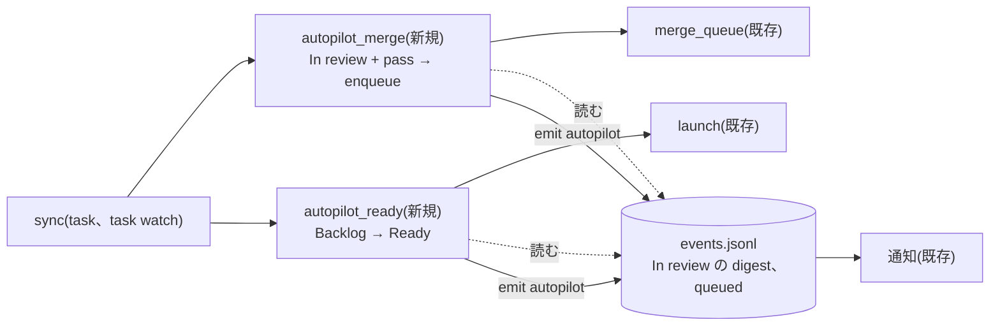
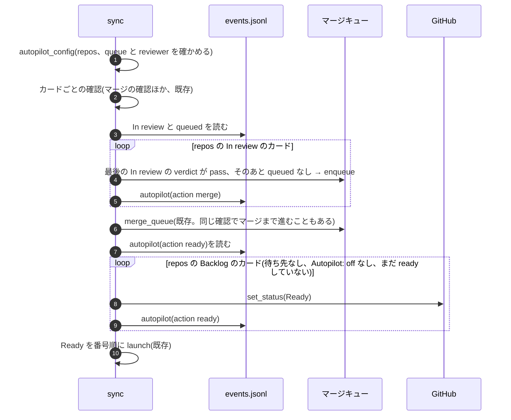

# オートパイロット(承認とマージを task-hub がする)

設計メモです(2026-10-21)。実装と同じ PR で、hld.md、lld.md、design.md(決定事項 30)も直しました。

## 何を、なぜ

- 困っていること: 大きなプロジェクト(jyoka/aica)では、カードを Ready に移すことと PR をマージすることの 2 つを、
  人が毎回しないと先に進まなかった。人が見られない間は、終わった PR と始められるカードがたまり、開発が止まっていた
- やること: リポジトリごとに opt-in(`[autopilot] repos`)で、Backlog のカードを待ち先が終わったら Ready に移し、
  自動レビューが `pass` の In review の PR をマージキューに入れる。どちらも出来事(`autopilot`)と通知を出す
- やらないこと: Blocked の答えを自分で決める(replanner の範囲のまま)、レビューなしのマージ、マージキューを通らない
  マージ、毎分の GitHub への新しい問い合わせ、ボードの外の Issue をカードにすること(`[triggers]` の役目)

## 変わる部品(HLD)

## 流れ(LLD)

## データ

- 設定: `[autopilot] repos`(カンマか空白区切りの owner/name)。既定は空
- カード: `tasks()` が ITEMS_QUERY ですでに取っている Issue の本文から `autopilot_off`(Goal の `Autopilot: off` の行)を
  求める。保存はしない(`RUN_KEYS` に入れない)。board-cache の形は変わらないので、task-rs は直さない
- 出来事: `autopilot`(`action`: `ready`、`merge`、`skip`、`reason`、merge と skip なら `pr`)。判定は既存の Status の
  出来事(Backlog から出たか、最後の Status、`In review` の digest の `verdict` と `pr`、`sha`)、`queued`、この出来事と、
  実行の記録(`runs/<id>.json`)があるかで行う。新しい手元のファイルはない

## 外部の呼び出しと費用

- Ready に移すのは `set_status` の mutation 1 回(人がドラッグするのと同じ)。キューに入れる前に `gh pr view` を
  1 回読む(draft、開いているか、先頭のコミット)。レビューごとに 1 回で、入れても skip しても次からは読まない
- マージキューの費用は既存のまま(`gh pr view`、`gh pr checks`、`gh pr merge`)

## 失敗したとき

| 場面 | 動き |
|---|---|
| `repos` の書き間違い、`[merge] queue` がオフ、`[runner] reviewer` が空 | `task` は `error:` で止まり、何も変えない。`task watch` は始めたときに止まる。動いている間に書き換えたときは、その回だけ飛ばす(`fail` の SystemExit を watch が受ける) |
| Ready への移動が GitHub で失敗 | `github_errors` に出し、次の確認でもう一度(出来事はまだ書いていないので) |
| `enqueue` が ValueError(PR がない、実行が戻った) | 何もしない。次の確認でもう一度見る |
| `enqueue` が RuntimeError(GitHub) | `github_errors` に出し、次の確認でもう一度 |
| キューでの失敗(競合が解けない、チェックが落ちた) | 既存のとおり Blocked。オートパイロットは Blocked を動かさない |

## 互換性

- `[autopilot]` がなければ、GitHub の呼び出し、カードの動き、出来事は前と同じ。通知の既定に `autopilot` を足したが、
  出来事が出ないので何も増えない
- `StatusLifecycle.transitions` は変わらない(Backlog → Ready、In review → wait for merge はもとからある)

## 確かめ方

`tests/test_task.py` の偽物の GitHub で、利用者から見た動きを確かめる(`python3 tests/run.py autopilot`)。

- 設定がなければ、Backlog も In review も人を待つ
- repos のカードだけが始まり、ほかのリポジトリ、`Autopilot: off`、待ち先のあるカードは Backlog のまま。待ち先が
  終わると始まる。`autopilot` の通知が出る
- 人が Backlog に戻したカードは、もう始めない
- レビューが pass の PR は、次の確認でキューに入り、マージされて Done になる(チェックのない PR)
- レビューが blocked のカード、人がキューから外した PR は動かさない
- `Autopilot: off` のカードは、人が始めても PR を入れない。箇条書き、強調、句点つきの書き方でも効く
- 前の実行の `pass` では入れない(差し戻した実行が Blocked のまま、カードだけ In review に動かした)
- レビューのあとに push した PR、draft にした PR、競合の解決が動いている PR は入れず、`skip` を 1 回出す
- 前に動いて Backlog に戻したカード、Issue を閉じたカードは始めない
- Ready に移すのが GitHub で失敗したら `github_errors` に出る
- 書き間違い、キューがオフ、reviewer がないときは、`task` も `task watch` も止まる

## 決めたこと

- 承認とマージを別々に選べるようにはしなかった。マージだけ人がするなら、今までの `[merge] queue` だけで足りる。
  始めるだけ自動にしたいときは、`repos` を書かずに Ready に移す手間が残るが、要望が出てから足す
- 「1 回」は出来事で決める(`watch_conflict` と同じ)。新しい状態のファイルを足さない
- 人が Backlog に戻したカードを動かさないのは、止める手段を人に残すため。「一度も Backlog から出ていない」で決めるので、
  前に動いたカードや人が `task start` したカードも動かさない。入れたときに今ある Backlog のカードは動く
- マージはレビューした中身だけ: カードの最後の Status がその In review で、PR がその実行の PR、先頭のコミットが
  実行の push したもの(In review の出来事の `sha`)、draft でない。違えば `skip` を 1 回出して人に任せる。
  `[merge] prefix = on` の競合の解決も PR を変えるので、そのカードは人に任せる(安全側)

## 既知の制限(フォローアップ)

- `task` と `task watch` が同時に確認すると、どちらも同じカードを Ready に移したりキューに入れようとすることがある。
  開始は `launch_lock`、キューは `task merge` と同じ「もう入っている」の判定で 2 重にはならないが、出来事と通知が
  2 回出ることがある
- `events.jsonl` を確認のたびに読む(候補があるときだけ)。ファイルが大きくなると重くなる。今の `watch_conflict` と同じ
- GitHub の画面でのドラッグは出来事に残らない。人が Backlog → Ready → Backlog と手で動かしただけ(実行なし)のカードは
  「一度も出ていない」に見え、Ready に移す
- 通知の文(`#12 autopilot: ...`)は、ほかの出来事と同じ形で、何をしたかは本文の reason を読む
