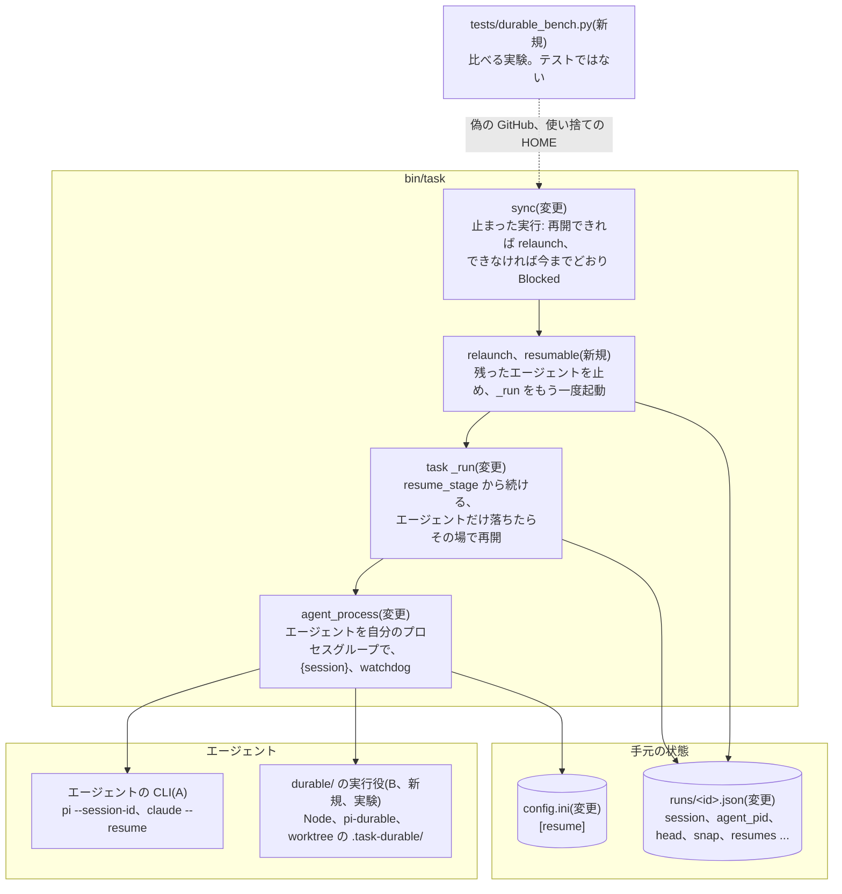
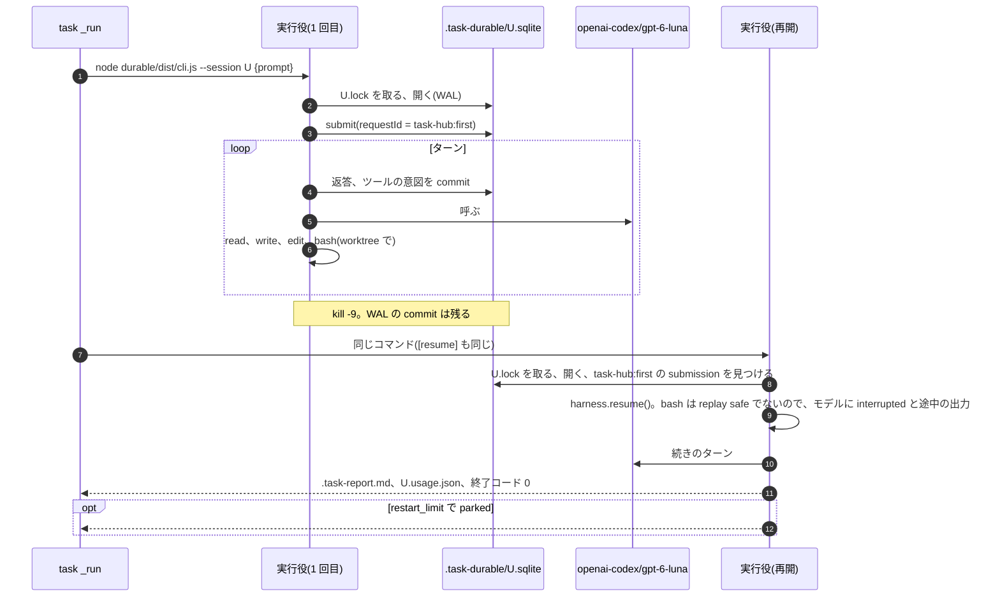
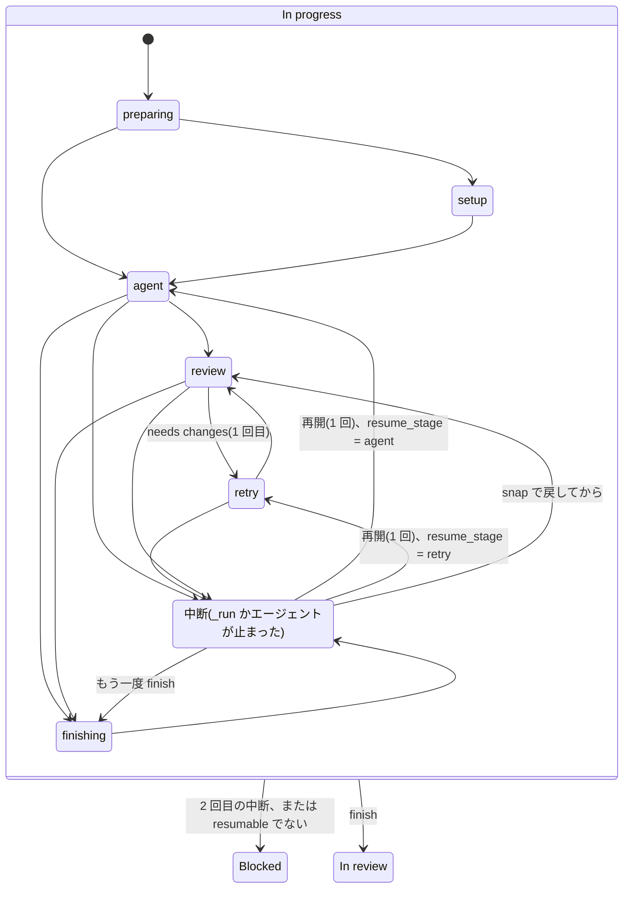

# 止まった実行を続きから再開する(A: CLI の会話の保存、B: Pi Durable の実行役)

設計メモです(2026-10-25、ブランチ `design/durable-runs`)。コードはまだありません。実装の PR で hld.md、lld.md、
design.md も直します。

## 何を、なぜ

### 困っていること

- エージェントの実行が途中で止まると、今は最初からやり直しになる。止まり方は、プロセスのクラッシュ、kill、
  Mac の再起動、herdr のペインを閉じた、など
- 今の流れ: `sync` が「In progress なのに `_run` が生きていない」を見つけ、Blocked「the run stopped unexpectedly」にする
  (決定事項 7)。人が Ready に戻すと、新しいセッションで最初から始まる。前回の報告は「# Earlier run」で渡るが、
  止まった実行はレポートを書いていないことが多い
- 人が気づくまで止まったままで、それまでの会話(調べたこと、試したこと)も捨てる

### やること

1. 予期せず止まった実行を、task-hub(Python)が 1 回だけ自動で再開する。2 回目は今までどおり Blocked。
   「誰が再開を起こすか」は A と B で共通にする
2. 再開のやり方を 2 つ作る
   - **A**: エージェントの CLI 自身の会話の保存を使う。task-hub が会話の ID を決めて `runs/<id>.json` に残し、
     再開のときにその ID で起動する。コアは Python 標準ライブラリのまま、エージェントはコマンドのひな形のまま
   - **B**: Pi Durable(`@earendil-works/pi-durable` 1.4.0、実験版)で小さな実行役(Node/TypeScript の CLI)を作る。
     `[agents]` に 1 つのエージェントとして登録する。会話と途中のツールの呼び出しを SQLite に残し、
     2 回目の起動で `harness.resume()` で続ける
3. A、B、それと「新しいセッションで再開するだけ」(C、1 の仕組みだけ)を、同じ課題と同じ落とし方で比べる。
   結果を文書に残し、本採用を人が決める
4. 関係する安い直し: 出力のないまま止まったコマンドの watchdog、スリープと再起動で実際にどうなるかの確認

### やらないこと

- 人が Ready に戻した再実行で、前の会話を引き継ぐこと(今までどおり新しいセッションと「# Earlier run」)
- 何回でも再開すること(1 回だけ。回数は定数)
- 複数のマシンでの持ち主(リース)。roadmap の Phase 3 の後半
- task-hub 自身の段階(review、finish など)を Durable の部品で動かすこと。段階は今の `stage` の記録で足りる
- codex と kiro-cli の会話の ID を出力から拾うこと(最初に ID を決めるオプションが見当たらない。後で足す)
- 本採用の判断そのもの(比べた結果を見て人が決める)

### 前提(Ready conditions に書く)

- **pi が PATH にない**: 2026-10-25 14:00 に pi が自分で 1.1.0(npm のグローバル)から 1.4.0 の managed install に
  更新した。今は `~/.pi/agent/bin/pi` にあり(確認済み: `which -a pi` は見つからない、`~/.pi/agent/bin/pi --version` は
  1.4.0)、組み込みの `pi -p --mode json {prompt}` は起動できない。比べる前に、pi を PATH に置くか、`[agents]` に
  絶対パスを書く。task-hub のコードの直しは要らない(`step_format` はパス付きの `pi` も認める)
- **`PiSteps` は pi 1.1.0 で確かめたもの**(lld.md 7 章、`bin/task` の `PiSteps` の docstring)。1.4.0 の `--mode json` の
  出来事の形が同じかは不明。違ってもログの見え方だけで、実行は止まらない(`Steps.read` の約束)。A のタスクで確かめる
- pi 1.4.0 の会話のフラグは 1.1.0 と同じ: `--session-id <id>`(その ID の会話を使い、なければ作る)、
  `--session <path|id>`、`--continue`、`--resume`、`--session-dir <dir>`、`-p`、`--mode json|rpc`(`--help` で確認)
- 比べるモデルは `openai-codex/gpt-6-luna`(ChatGPT のサブスクリプションのログイン)。A も B も明示して渡す
  (pi: `--model openai-codex/gpt-6-luna`、B: pi-ai の provider `openai-codex`、modelId `gpt-6-luna`)

## 変わる部品(HLD)



hld.md の 3 章の表で変わる行:

| 部品 | 足す責任 |
|---|---|
| `bin/task`(同期) | In progress で `_run` が死んだカードを、1 回だけ再開する(`relaunch`)。2 回目は Blocked |
| `task _run <番号>` | 記録の段階(`resume_stage`)から続ける。エージェントが外から kill されたら、その場で 1 回だけ再開する。止められたとき(SIGHUP、SIGTERM)はエージェントのプロセスグループも止める |
| エージェントの CLI | `{session}` を受けると、その ID で会話を保存する。`[resume]` のコマンドで同じ会話を続ける |
| B の実行役(実験) | エージェントの 1 つ。worktree の `.task-durable/` に SQLite を持ち、自分で続きから動く。書くのは worktree のファイルと `.task-report.md` と自分の `.task-durable/` だけ |

## 流れ(LLD)

### 再開を起こす者(A、B、C で共通)

再開の入口は 2 つです。

| 止まり方 | 見つける者 | すること |
|---|---|---|
| エージェントだけが外から kill された(`_run` は生きている。POSIX で終了コードが負、task-hub が止めたのではない) | `_run`(`cmd_run`、`review_loop`) | `resumes` が上限未満なら、同じ `_run` の中で再開のコマンドを 1 回起動する |
| `_run` ごと止まった(kill -9、クラッシュ、ペインを閉じた、再起動) | `sync`(1 分ごと) | `resumable(t)` が通れば `relaunch(t)`。通らなければ今までどおり Blocked |

Ctrl-C は再開しません。今までどおり `agent_process` がエージェントを止め、`finish` が途中までを push して Blocked にします
(カードが In progress のままにならないので、`sync` も再開しません)。

`resumable(t)` の条件(どれかが欠けたら再開せず、その理由を Blocked の理由に足す):

- `stage` が `preparing`、`setup`、`agent`、`review`、`retry`、`finishing` のどれか
- `resumes` が `MAX_RESUMES`(1)未満
- worktree がある。`stage` が `finishing` 以外なら、HEAD が記録の `head` と同じ(人やほかの者がコミットしていない)
- `review` なら `snap` がある(reviewer の書き換えを戻せる)。`preparing` ならプロンプトのファイルがある

`relaunch(t)` は `launch_lock` を持ち、実行が生きていないことを確かめてから(`launch` と `launch_fix` と同じ持ち主の決まり):

1. `agent_pid` のプロセスグループが残っていれば止める(同じ worktree と同じ会話に 2 つのエージェントを動かさない)。
   pid の使い回しは、`ps -o lstart` の開始時刻を記録の `agent_started` と比べて避ける
2. `runs/<id>.json` に `resumes`(+1)、`resume_stage`(今の `stage`)、`resumed_at`、空の `pid` を書く
3. 出来事 `resumed`(`stage`、`why` = `interrupted` か「the run process is gone」)
4. 古いタブを閉じ(`close_herdr`)、`task _run <id>` を `launch` と同じ起動の部分(`start_run` に切り出す)で始める。
   コマンドの形は変えない(`alive` の正規表現と task-rs の `_run` の判定をそのまま使えるように)

`_run` は記録の `resume_stage` を読んだら消し(`save_run`)、次の表のところから続けます。

| `resume_stage` | 続け方 |
|---|---|
| `preparing`、`setup` | 最初から(`[setup]` は何度動かしても同じ結果になる約束。プロンプトは作り直さない) |
| `agent` | エージェントを再開のコマンドで起動(下)。そのあとは今までどおり review、finish |
| `review` | `snap` で worktree を戻し、reviewer を新しく起動。`review_attempt` が 1 なら 2 回目のレビューとして扱う(差し戻しは増えない) |
| `retry` | 差し戻しのプロンプト(`prompts/<id>-retry.md`)で、エージェントを再開のコマンドで起動。そのあと 2 回目のレビュー |
| `finishing` | `finish` をもう一度。commit と push は同じ結果になる。Issue のコメントは、`issue()` の最後のレポートが同じ本文なら書かない |

再開のコマンドとプロンプト:

- エージェントのコマンドは `[resume] <名前>` があればそれ、なければ `[agents] <名前>`(C: 新しいセッション)
- プロンプトは元のプロンプト全体に「# Resumed」の節を足したもの。会話が残っていなくても、それだけで仕事ができる
  (会話のファイルが消えていても、エージェントの名前で分けずに済む)。節の文面は `worker/PROMPT.md` の 3 つ目の部分に置く
  (`instruction_parts` が `---` で分ける形に合わせる)。中身の案: 中断された段階と理由、worktree に途中の仕事があるので
  `git status` と `git diff` を先に見ること、会話を覚えていれば続きから、worktree の外を変えるコマンドや 2 回走らせて
  まずいコマンドは終わったかを確かめてから、レポートはいつもどおり
- `{session}` は `_run` がエージェントの起動ごとに作る UUID(claude は UUID が必須)。`agent` と `retry` の起動だけ
  `runs/<id>.json` の `session` と `session_role` に残し、再開で同じ値を渡す。reviewer と replanner は読むだけなので、
  再開でも新しく起動する
- 再開のコマンドが、手順を 1 つも出さず(`Steps` がツールの呼び出しを見ない)、レポートもなく 0 以外で終わったら
  (例: claude の `--resume` が会話を見つけられない。推測)、同じ再開の中で 1 回だけ `[agents]` のコマンドで起動し直す

### A: CLI の会話の保存で再開

```mermaid
sequenceDiagram
    autonumber
    participant W as task watch(sync)
    participant L as runs/&lt;id&gt;.json
    participant R1 as task _run(1 回目)
    participant P1 as pi(1 回目)
    participant R2 as task _run(再開)
    participant P2 as pi(再開)
    participant GH as GitHub
    R1->>L: pid、stage=agent、session=U、agent_pid、agent_started、head
    R1->>P1: pi -p --mode json --model openai-codex/gpt-6-luna --session-id U {prompt}
    Note over R1,P1: kill -9(_run ごと)、再起動、ペインを閉じる
    W->>L: In progress なのに alive でない
    W->>W: launch_lock、resumable(段階、回数、worktree、HEAD)
    W->>P1: 残っていれば agent_pid のグループを止める
    W->>L: resumes=1、resume_stage=agent、resumed_at、pid=""
    W->>W: emit resumed
    W->>R2: start_run(herdr のタブ、またはバックグラウンド)
    R2->>L: pid
    R2->>P2: [resume] pi: 同じ --session-id U、{prompt}+「# Resumed」
    P2-->>R2: ファイルの変更、.task-report.md
    R2->>R2: review、finish
    R2->>GH: commit、push、PR、コメント(Resumed: once, at agent)、In review
    opt エージェントだけが kill された(_run は生きている)
        R1->>R1: 終了コードが負、task-hub は止めていない
        R1->>L: resumes=1、interrupted
        R1->>P2: [resume] pi(同じ U)
    end
```

組み込みのコマンドの案(`--help` で確かめたフラグ。動きは A のタスクで確かめる):

| エージェント | `[agents]`(初回) | `[resume]` |
|---|---|---|
| `pi` | `pi -p --mode json --session-id {session} {prompt}` | 同じ(`--session-id` はなければ作る、あれば続ける) |
| `claude` | 今のコマンドに `--session-id {session}` | 今のコマンドに `--resume {session}` |
| `codex`、`kiro` | 変えない | なし(C: 新しいセッション) |

比べるときの A は `[agents] pi-a = <pi の絶対パス> -p --mode json --model openai-codex/gpt-6-luna --session-id {session} {prompt}`
と、同じ形の `[resume] pi-a` です。C は同じコマンドから `--session-id {session}` を除いたもので、`[resume]` を書きません。

### B: Pi Durable の実行役



実行役の決まり:

- 置き場所はリポジトリの `durable/`(`pi/`、`kiro/board-extension/` と同じくコアの外。`rust/` と同じく実験)。
  `package.json` で `@earendil-works/pi-durable`、`@earendil-works/pi-ai`、`@earendil-works/chord`(と認証の
  `@earendil-works/pi-coding-agent`)の版を固定する
  (README の冒頭が「The API changes without notice between releases」のため)。Node は 22.19.0 以上(pi-durable の
  `engines`。手元は 23.11.0)
- 登録: `[agents] durable = node <clone>/durable/dist/cli.js --session {session} {prompt}`、`[resume] durable` も同じ。
  再開かどうかは実行役が SQLite で判断する(task-hub はエージェントの名前で分けない)
- SQLite は worktree の中の `.task-durable/<session>.sqlite`。カードごと(worktree ごと)の置き場所で、`cleanup` が
  worktree を消すと一緒に消える。実行役が `.task-durable/.gitignore`(`*`)を書くので、task-hub の `NEVER_COMMIT` は
  変えない。`[sandbox] mode = user` でも、エージェントのユーザーが worktree に書けるのでそのまま動く
- pi-durable は「1 つのストレージを持つのは 1 プロセス、プロセスをまたぐロックはない」。実行役は `<session>.lock` を
  O_EXCL で作り(中身は pid)、生きている持ち主がいれば 2 で終わる。task-hub 側の `relaunch` も残ったエージェントを先に止める
- 初回の入力は `requestId: "task-hub:first"`。再開では、その submission が残っていれば新しいプロンプトを送らずに
  `resume()` して待つ。`unanswered`(モデルの失敗)で終わっていたら「続けて」を 1 回送る。答えのあとに
  `.task-report.md` がなければ「レポートを書いて」を 1 回送る
- ツールは `@earendil-works/pi-durable/tools` の `CodingTools`(`read`、`write`、`edit`、`bash`)、環境は worktree を cwd に
  した `NodeExecutionEnv`
- (作って分かったこと)`NodeExecutionEnv` は bash のコマンドを自分のプロセスグループで動かす(`detached`)。エージェントの
  グループを kill -9 しても(K1、K2)コマンドは残り、続きの実行の横で worktree を書き続ける。実行役はシェルを
  `durable/scripts/group-shell` にして、コマンドが動いている間そのグループを `.task-durable/<session>.groups/` に残し、同じ `{session}` の次の起動が
  続ける前にそれを止める(グループの先頭がまだその `group-shell` のときだけ。古い番号が別のプロセスに渡っていても止めない)。pi 1.4.0 の `bash` も同じ(lld.md 7 章)で、A と C には同じ手当てがまだない
- 出力は手順ごとの短いテキストの行(`· bash: npm test` の形)と最後の答え。task-hub の `step_format` は変えず、
  `Steps` がそのままログに書く
- 終了コード: 0 は答えた、1 はモデルの失敗、2 はロックが取れない、3 は parked(`restart_limit`)。parked のときは
  実行役が `## Blocked` のレポートを書くので、カードは Blocked になる。1 回の実行の中の起動は最大 2 回(再開 1 回)なので、
  `restartLimit`(既定 5)に届くのは `MAX_RESUMES` を上げたときだけ
- 使った量は `harness.usage()` を `.task-durable/<session>.usage.json` に書く(比べる実験が読む。`agent_usage` には足さない)

### B の認証の spike(B を作る前に確かめる)

B が pi のログイン(`~/.pi/agent/auth.json` の `openai-codex`)を使えるかは未確認です。1.4.x のソースで分かったこと:

- pi-ai は `createModels({ credentials })` に `CredentialStore`(`read`、`list`、`modify`、`delete`)を渡す作り。
  OAuth の更新は `modify` の中で行い、更新したトークンを書き戻す(pi-ai の README の Credential Store)
- `openai-codex` の provider は `openaiCodexProvider()`(`packages/ai/src/providers/openai-codex.ts`、`lazyOAuth`)。
  README では「OpenAI Codex (legacy)」で、ChatGPT の Plus か Pro が要る
- pi CLI の `auth.json` の読み書きは `@earendil-works/pi-coding-agent` 1.4.0 の `core/auth-storage.ts`。
  `AuthStorage`(`proper-lockfile` で auth.json をロックして読み書き)と `ReadOnlyAuthStorage` があるが、
  パッケージの入口(`src/index.ts`)から出しているのは `readStoredCredential` だけ(→ spike で違うと分かった。下の「結果と決定」)。
  置き場所は `getAgentDir()` の `~/.pi/agent/auth.json`(`PI_CODING_AGENT_DIR` で変えられる)

spike の手順(`durable/spike/auth.ts`。auth.json の中身は表示しない、コピーしない、ログに出さない):

1. 読むだけの `CredentialStore` を作る(`readStoredCredential("openai-codex")` を `read` で返し、`modify` は断る)。
   `openai-codex/gpt-6-luna` に短い入力を 1 回送り、「ok」か失敗の種類(認証、モデルがない、そのほか)だけを出す
2. 1 が通っても、トークンが切れたあとは更新を書けないので失敗する(推測)。切れる時刻を確かめるには中身を読む必要が
   あるので、確かめない。代わりに、失敗の種類が認証なら実行役は理由つきで 1 で終わる、とする
3. 結果を利用者に見せて選んでもらう

| 結果 | 案 |
|---|---|
| 1 が通る | (a) 読むだけで使う。トークンの更新は pi CLI に任せる(切れたら B は失敗する)。または (c) |
| 1 が通らない、または (a) を嫌う | (c) B 専用のログイン(`npx @earendil-works/pi-ai login openai-codex`)で、B 自身の auth.json(0600)を持つ。2 つ目の OAuth のログインが pi のログインを無効にするかは不明 |
| どれも使えない | 利用者に相談する。API キー(`openai` provider)にすると比べる条件(同じモデル、同じログイン)が変わるので、利用者が決める |

`AuthStorage` の中身を写して書き戻す案は採らない。入口から出ていない内部のコードに頼り、pi CLI と同じファイルを
2 つの実装で書くことになるため。

結果と決定(2026-10-26、タスク 2 の spike と、利用者の代わりに監督役が決めたこと。タスク 7 で書き足した):

- 手順 1 は通った(`openai-codex/gpt-6-luna` から返答があり、`modify` は呼ばれなかった)。偽の値の切れたトークンでは、
  読むだけの store が `modify` を断り、すぐ `model_error`(`ModelsError` の code `auth`)で終わった。pi-ai は残りが 5 分を
  切ったときだけ `modify` で更新する
- 上の「入口から出しているのは `readStoredCredential` だけ」は事実と違った。pi-coding-agent 1.4.0 の入口は
  `ModelRuntime` も出している。`credentials` を渡さない `ModelRuntime.create()` は、pi CLI と同じ `AuthStorage`
  (`proper-lockfile` のロック)で auth.json を読み書きする
- 決めたのは **(a) 読むだけ**。pi のログインを書き換えないので、pi CLI の更新やロックと衝突せず、切れたときはすぐ理由つきで
  分かるため。`ModelRuntime` は今は採らない。公開の入口ではあるが、自分で更新する pi CLI と、B に固定した版の
  pi-coding-agent の 2 つが同じファイルを書くことになるため。タスク 8 の実験でトークン切れの失敗が目立ったら見直す
- 実行役(`durable/src/auth.ts`)は、始める前に `getAuth` を呼び、ログインがない、または code が `auth` か `oauth` なら理由つきで
  1 で終わる。auth.json の場所は `--auth` で明示して受け取れる(既定は `PI_CODING_AGENT_DIR` か `~/.pi/agent`。タスク 8 は
  使い捨ての HOME で動かすため)。pi は auth.json をその場で書き換える(rename でない)ので、読めなかったときは 1 回だけ読み直す
- `@earendil-works/pi-coding-agent`(`readStoredCredential`)も版を固定する(pi-ai の README で `openai-codex` は legacy とされ、
  後の版で消える恐れがある)

### Status と段階

Status の遷移は増えません(再開の間もカードは In progress のまま)。In progress の中に「中断」と「再開」が入ります。



`StatusLifecycle.transitions` は変わりません。

## データ

### runs/&lt;id&gt;.json に足す欄(`RUN_KEYS`)

| 欄 | 書く者 | 意味 |
|---|---|---|
| `session`、`session_role` | `_run`(`agent` と `retry` の起動の前) | `{session}` に渡した UUID と、その起動(`agent` か `retry`) |
| `agent_pid`、`agent_started` | `_run`(エージェントを起動した直後) | エージェントのプロセス(とそのグループ)と開始時刻。残ったエージェントを止めるため |
| `head` | `_run`(`agent` と `retry` の起動の前) | そのときの HEAD。再開の前に、ほかの者がコミットしていないかを見る |
| `snap` | `_run`(`snapshot` の直後。`restore` のあとに消す) | `<tree> <head>`。今はメモリにしかなく、reviewer の途中で落ちると書き換えが worktree に残る(下の「ドキュメントとのずれ」) |
| `review_attempt` | `_run`(`run_review` の前) | `0` か `1` |
| `resumes` | `_run`(その場の再開)、`relaunch`(実行が生きていないとき) | この実行で再開した回数。`launch` が空に戻す |
| `resume_stage`、`resumed_at` | `relaunch` が書き、`_run` が読んで消す(`resumed_at` は残す) | どこから続けるか、いつ起動し直したか |
| `interrupted` | `_run`(SIGHUP、SIGTERM を受けたとき、エージェントが kill されたとき、watchdog が止めたとき) | 前の起動が止まった理由 |

書く者の決まりは今と同じです。`launch` が作り、そのあとは `_run` だけ。`relaunch` は `launch_fix` と同じく、実行が生きて
いないことを `launch_lock` を持って確かめてから書きます(lld.md 6 章)。`alive` は pid がまだ空のとき、`started` の代わりに
`resumed_at` があればそれから 2 分を待ちます。

古い `runs/*.json`(欄がない)は空として読みます。`snap` のない `review` は再開しません。`agent_pid` がなければ止める
ものはないとみなします。

task-rs(`rust/src/main.rs`)は `runs/<id>.json` を欄の名前で読み、知らない欄は読み飛ばすので、形式の直しは要りません。
ただし task-rs の `alive` は pid が空のとき `started` で 2 分を待つので、再開の直後の数秒は「動いていない」と出ます
(表示だけ)。合わせないと決めた(決めたこと 9)。

### ほかのファイルと設定

| ファイル、設定 | 書く者 | 読む者 | 形式 |
|---|---|---|---|
| `config.ini` の `[resume]` | 人(組み込みは `DEFAULT_RESUME`) | `agent_command` | INI。`名前 = コマンド`。`{prompt}` と `{session}` は 1 つの引数ごと置き換える(今の `{prompt}` と同じ) |
| `[agents]` の `{session}` | 人、`DEFAULT_AGENTS` | `agent_command` | 同上。書かなければ会話の ID を渡さない(C になる) |
| `share/prompts/<id>-retry.md` | `_run`(`review_loop`、差し戻しの前) | 再開した `_run` | Markdown(今メモリで作っている差し戻しのプロンプト) |
| `state/events.jsonl` の `resumed` | `emit`(`relaunch`、`_run`) | /chief、mod など(フィルタで要るものだけ) | JSON Lines。`stage`、`reason`。既定の `[notify] events` には入れない |
| `state/metrics.jsonl` の `resumed`、`interrupted` | `record_run` | `task stats`(表示は後で) | `resumed` は再開した段階の列。再開した実行の `reviews` は再開のあとの分だけ(前の `_run` のメモリにあったため) |
| `share/worktrees/<id>/.task-durable/` | B の実行役だけ | B の実行役、比べる実験(`*.usage.json`) | `<session>.sqlite`(と `-wal`、`-shm`)、`<session>.lock`、`<session>.usage.json`、`.gitignore` |
| B の認証 | spike の結果による(上) | B の実行役(pi-ai を通して) | pi の auth.json の形式。task-hub のコードは読まない |
| `docs/durable-runs-comparison.md` | 比べる実験のタスク | 人 | Markdown。条件、版、試行ごとの表、まとめ |

GitHub に増える欄や設定はありません。

## 外部の呼び出しと費用

| 呼び出し | 費用 | いつ |
|---|---|---|
| `relaunch` | GitHub は 0(Status を変えない、Issue を読まない) | `_run` が死んだのを見つけた同期で、1 実行に 1 回まで |
| 再開した `_run` の終わり(`take_card`、`finish`) | 普通の実行の終わりと同じ。止まった実行の Blocked(コメント、`item-edit`、`MOVE_TO_TOP`)の代わりに出るので、増えない | 再開した実行の終わり |
| `finishing` からの再開での `issue()` | GraphQL 1 前後(gh) | `finishing` で止まったときだけ |
| `ps`(残ったエージェント、watchdog の CPU) | GitHub は 0 | `relaunch` のとき、watchdog は静かな間だけ |
| B: npm のレジストリ | GitHub は 0 | `durable/` を入れるときだけ |
| モデル(ChatGPT のサブスクリプション) | A は再開ごとに元のプロンプト(数 KB)を 1 回送り直す。B は送り直さない | 再開ごと |

`task watch` の 1 時間の費用は今の約 60 ポイントのままです(毎分の同期で増える呼び出しはありません)。

比べる実験は GitHub を呼びません(偽の `gh`)。モデルの使用量は増えます。試行の数は「確かめ方」の表で約 63 回、
1 回 10 万から 30 万トークンなら全体で 600 万から 1,900 万トークンです(1 回の量は推測)。

## 失敗したとき

| 失敗 | 扱い |
|---|---|
| 再開も止まった(2 回目) | 今までどおり Blocked。理由は「the run stopped unexpectedly again, after resuming once at <段階>」。残ったレポートは今までどおりコメントに載せる |
| `resumable` でない(段階、worktree がない、HEAD が動いた、`snap` がない) | 今までどおり Blocked。理由にどれかを足す |
| `relaunch` の起動の失敗(herdr のタブが開かない、ファイルが書けない) | 開始の失敗と同じく Blocked とコメント。同期の残りは止めない |
| 会話のファイルが消えていた | A: 再開のプロンプトだけで仕事ができる。エージェントが会話を見つけられずに何もせず失敗したら、同じ再開の中で 1 回だけ新しいセッションで起動し直す。B: SQLite がなければ初回として送る |
| worktree が変わっていた | HEAD が `head` と違えば再開しない(Blocked)。push の先が動いていたら、今までどおり `finish` の push が断られて Blocked |
| 残ったエージェントを止められない(権限、`[sandbox] mode = user`) | `[sandbox] mode = user` では `as_agent` で同じユーザーから止める。それでも止まらなければ再開せず Blocked(2 つ目のエージェントを始めない) |
| B のロックが取れない(終了コード 2) | レポートなしなので Blocked(`agent exited without a report`)。ログに理由 |
| B の `restart_limit` | B が `## Blocked` のレポートを書き、カードは Blocked。人が Ready に戻すと新しい実行(新しい `{session}`、新しい SQLite)なので、`retryTask` は使わない |
| B の認証の失敗 | B が理由をログに出して 1 で終わる。レポートなしで Blocked(`[check] durable` に認証の確認を書けば、始める前に止められる) |
| 出来事 `resumed`、metrics、通知の失敗 | 無視する(実行とコマンドを止めない) |
| 2 つの task-hub(`task watch` と `task`)が同時に見つけた | `launch_lock` を取った 1 つだけが再開する(約束 4 と同じ) |

watchdog(タスク 6)の失敗の扱い: `ps` が使えない(Windows)ときは、エージェントの子を選んで止める段を飛ばします。
子の CPU が分からないので、エージェントを止める段も飛ばします(受け入れ条件「CPU を使って黙っている子は止めない」のため)。

## 互換性

- 古い `runs/*.json`: 上のとおり空として読む。更新の前から動いている `_run` は古いコードのままで、止まれば新しい
  `sync` が再開を判断する(`snap` がなければ `review` は再開しない)
- 設定: `[resume]` も `{session}` もない設定は、C(新しいセッションで 1 回再開)になる。独自の `[agents] pi` を書いた人は
  `{session}` を足さない限り A にならない
- 組み込みの `pi` と `claude` のコマンドに `--session-id {session}` が足される。pi は `--session-id` で会話を
  保存するので、`~/.pi/agent` の会話のファイルが実行ごとに増える(今も既定で保存していると推測。A のタスクで確かめる)
- herdr のペインを閉じたときの意味が変わる: 今は止め方として案内している(operations.md「実行中のタスクを止める」)。
  再開すると決めたので、止めるのは Ctrl-C か `task done` になる(決めたこと 1)
- Windows: 終了コードからシグナルでの終了を見分けられないので、「エージェントだけが kill された」のその場の再開は
  しない。`_run` が死んだときの `relaunch` は同じに動く。プロセスグループの代わりに `taskkill /T /F /PID` で止める。
  SIGHUP はない
- task-rs: 上の「データ」のとおり、形式の直しは要らない
- 古い mod、Kiro の拡張: 知らない欄と出来事を読み飛ばす(`resumed` は表示しない)

## 確かめ方

### 再現テスト(tests/test_task.py、偽の GitHub と偽のエージェント)

本物のボードと GitHub には向けません。`FAKE_AGENT` に `MODE:` を足し、`_run` とエージェントを外から止めます。

| テスト | 確かめること |
|---|---|
| `_run` を kill -9(`MODE:slow` の途中) | 次の `task` でカードは In progress のまま、新しい `_run` が動き、プロンプトに「# Resumed」、最後は In review、`resumed` の出来事、metrics の `resumed: ["agent"]` |
| 再開した `_run` も kill -9 | 次の `task` で Blocked、理由に「after resuming once」 |
| エージェントだけを kill -9(`_run` は生きている) | 同じ `_run` がその場で再開する(POSIX)。Ctrl-C(今のテスト)は再開しない |
| `_run` だけを kill -9、エージェントは残る | `relaunch` が古いエージェントのグループを止めてから始める。2 つのエージェントが同時に書かない |
| reviewer の途中で `_run` を kill -9 | 再開で `snap` に戻してからレビュー。reviewer の書き換えは PR に入らない(約束 2) |
| `finishing` の途中で止める | Issue のレポートのコメントが 2 つにならない |
| worktree を消す、HEAD を動かす | 再開せず Blocked、理由つき |
| `{session}` | 偽の pi(`FAKE_STEPS`)が初回と再開で同じ `--session-id` を受ける。`[resume]` のコマンドを使う。`{session}` のない独自のコマンドは C になる |
| SIGHUP、SIGTERM を `_run` に送る | エージェントのグループも止まり、`interrupted` が残る |

lld.md 9 章に足す約束:

- 17\. 予期せず止まった実行は 1 回だけ自動で再開し、2 回目は Blocked にする。Ctrl-C で止めた実行は再開しない。同じ worktree で 2 つのエージェントは動かない
- 18\. 再開しても、reviewer と replanner の書き換えは結果に残らず、Issue のレポートは 1 つ

### 比べる実験(tests/durable_bench.py、テストではない)

`tests/bench.py` と同じく、使い捨ての HOME、偽の `gh`(`test_task.FAKE_GH`)、手元の bare リポジトリで動かします。
エージェントだけが本物(A と C は pi 1.4.0、B は実行役)で、モデルは `openai-codex/gpt-6-luna`。thinking の段階も
A と B でそろえて明示します(決めたこと 7)。

課題(実験のスクリプトが作る小さな Python のリポジトリ):

- 落ちているテストを直す Goal(答えは pytest で確かめる)
- 20 秒ほどかかるテスト。始まると worktree の外の数えるファイルに 1 行足し、走っている間 `.running` を置く
- 2 回動かすと壊れるスクリプト(CHANGELOG に 1 行足す)。Goal は「1 回だけ動かす」
- テストが全部通ると `.tests-passed` を置く

落とし方(タイミング × 止め方):

| タイミング | 合図 |
|---|---|
| T1 モデルの返答の途中 | ログにツールの呼び出しの行が出てから 2 秒後(次のターンの途中のはず。実際の段階はあとで会話の記録から分ける。近似) |
| T2 bash の実行中(長いテスト) | `.running` がある間 |
| T3 ファイルを書いた直後 | 直す対象のファイルの mtime が初めて変わったとき |
| T4 レポートを書く前 | `.tests-passed` が現れたとき |

| 止め方 | すること |
|---|---|
| K1 | エージェントのプロセスグループだけを kill -9(`_run` のその場の再開) |
| K2 | `_run` とエージェントを kill -9(`sync` の `relaunch`) |
| K3 | 再起動のまね: `task watch` も含めて全部 kill -9、そのあと `task watch` を起動し直す(T2 だけ) |

試行: 3 つの方式(A、B、C)それぞれ、落とさない 3 回 + T1〜T4 × K1、K2 を 2 回ずつ(16)+ K3 を 2 回 = 21 回、全体で 63 回。

測るもの(試行ごとに 1 行):

| 項目 | 読むところ |
|---|---|
| 続きから再開できたか(最後が In review か) | 偽の GitHub の Status |
| 最終結果がテストに通るか | push したブランチを取り出して pytest |
| やり直した作業の量、時間、トークン | 落とさない試行との差。A と C は pi の会話の記録の usage(形式は A のタスクで確かめる)、B は `usage.json` |
| 副作用の二重の実行 | 数えるファイルの行数(長いテストを何回走らせたか)、CHANGELOG の重複 |
| ファイルの壊れ | `git diff` が読めるか、Python のファイルが compile できるか |
| 実装と保守の重さ | A は `bin/task` の差分の行数、B は行数、依存の数、`node_modules` の大きさ、使った pi-durable の API の数 |
| エージェントの差し替えの決まり | 名前で分ける処理がないか、`[agents]` と `[resume]` だけで入れ替えられるか |

結果は `docs/durable-runs-comparison.md` に置きます(`docs/benchmark.md` と同じく、条件と版と表とまとめ。試行ごとの表も載せる)。

(タスク 8 で書き足した)結果は [durable-runs-comparison.md](../../durable-runs-comparison.md) です。63 回すべてでテストが通り、
決めたこと 10 の順を字面どおりに当てると B が先に立ちます。案は、その順から外れて、A に前の起動のコマンドを止める作りが
入り確かめられたら A、だめなら B です(理由と前提は結果の文書)。B が Goal を終えなかった 2 回は、同時に動かした
ほかの試行の影響の恐れがあり、A を推す根拠としては弱めています。本採用は、A(条件つき)か B かを人が決めます。

### スリープ、再起動、ペインを閉じる(research)

本物のボードには向けず、上と同じ使い捨ての HOME と偽の GitHub で、偽の遅いエージェントと本物の pi で 1 回ずつ確かめます。

- ふたを閉じて 10 分後に開く: `_run` とエージェントは止まったまま続くか、モデルへの接続が切れたときエージェントが
  自分でやり直すか、`slow` が開いた直後に出るか(`seconds_since(started)` はスリープの時間も数える)
- 再起動: launchd の `task watch` が起きた最初の同期で再開するか、herdr のタブはどうなるか
- herdr のペインを閉じたとき `_run` に届くシグナル(SIGHUP と推測)。使っていない workspace で試す(lessons.md「人が使っているペインに文字を送らない」)

結果は lessons.md の「まだ検証できること 8」と design.md の「既知の制限」を書き直すのに使います。

## タスクの分け方

| # | タスク | 種類 | 待つもの(`--blocked-by`) |
|---|---|---|---|
| 1 | スリープ、再起動、ペインを閉じたときの実測 | research | なし |
| 2 | B の認証の spike | research | なし |
| 3 | 再開の土台: エージェントを自分のプロセスグループで動かし、`agent_pid`、`head`、`snap` を残す。SIGHUP と SIGTERM で子も止める | 実装(bin/task) | なし |
| 4 | 1 回だけの自動再開(C): `resumable`、`relaunch`、`resume_stage`、その場の再開、「# Resumed」 | 実装(bin/task、worker/PROMPT.md) | 3 |
| 5 | A: `{session}` と `[resume]`、組み込みの pi と claude | 実装(bin/task) | 4 |
| 6 | watchdog: 出力も CPU もないコマンドを止める | 実装(bin/task) | 3 |
| 7 | B の実行役(`durable/`) | 実装(TypeScript) | 2、5 |
| 8 | 比べる実験と結果の文書 | research(実験のスクリプトは tests/ に置く) | 1、5、7 |

本採用は 8 の結果を見て人が決め、採らなかった方を消すタスクをそのときに作ります。

### 1. スリープ、再起動、ペインを閉じたときの実測

- 受け入れ条件: 上の 3 つの問いに、確かめた結果(ログ、`ps`、出来事)で答えている。確かめられなかったものは「不明」と書く
- 本物のボードを使っていない(偽の GitHub、使い捨ての HOME)
- レポートに、lessons.md と design.md に入れる文の案がある

### 2. B の認証の spike

- 受け入れ条件: 上の spike の手順 1 を動かし、`openai-codex/gpt-6-luna` に 1 回送れたかと、失敗の種類を書いている
- auth.json の中身を表示、コピー、ログ、コミットのどれもしていない(spike のコードとログで確かめる)
- 表の (a)、(c)、相談、のどれを勧めるかと理由がある。利用者の答えを待つ(この答えまで 7 は始めない)

### 3. 再開の土台

- エージェントを POSIX は `start_new_session`、Windows は `CREATE_NEW_PROCESS_GROUP` で起動し、Ctrl-C と止めるときは
  グループごと止める
- `cmd_run` が SIGHUP、SIGTERM を受けたら、エージェントのグループを止めて `interrupted` を書いて終わる
- `agent_pid`、`agent_started`、`head`、`snap`、`review_attempt` を記録する。次の `launch` は、残った `snap` があれば
  worktree をそれに戻してから始める(今ある、reviewer の途中で落ちたときの書き換えの持ち込みを直す)
- 受け入れ条件: 「SIGHUP、SIGTERM」のテストと、「reviewer の途中で kill -9 → Ready に戻す → reviewer の書き換えが PR に
  入らない」の再現テスト(先に書いて、今のコードで落ちることを確かめる)。今の Ctrl-C のテストが通る

### 4. 1 回だけの自動再開(C)

- 上の「再開を起こす者」と「再開のコマンドとプロンプト」(`{session}` 以外)を実装する。`start_run` を `launch` から切り出す
- `resumed` の出来事、metrics の `resumed` と `interrupted`、Issue のレポートに「Resumed once at <段階>」の 1 行
- 受け入れ条件: 「確かめ方」の再現テストの表のうち `{session}` の行以外が通る。lld.md の約束 17、18 を足す
- docs: design.md の決定事項 7 を変え、新しい決定事項を足す。operations.md(止め方、`the run stopped unexpectedly`)、
  hld.md と lld.md(下の一覧)。使い方が変わるので README(英語と日本語)の該当の 1 行も

### 5. A: `{session}` と `[resume]`

- `agent_command` が `{session}` を置き換える。`[resume]` を読む(`DEFAULT_RESUME`)。組み込みの pi と claude に足す
- 受け入れ条件: `{session}` のテストが通る。本物の pi 1.4.0 で、`-p --mode json --session-id <uuid>` の 2 回目の起動が
  前の会話を読むこと、kill -9 したあとの再開で何が起きるか(終わっていないツールの呼び出しの扱い)、会話の記録の
  usage の形式、`PiSteps` が 1.4.0 の出来事で同じに直せるかを、偽の GitHub で確かめてレポートに書く。claude の
  `--session-id` と `--resume` も -p で 1 回ずつ確かめる
- docs: agents.md(`{session}`、`[resume]`、組み込みのコマンドの表)、lld.md 7 章の `pi` の確かめた版

### 6. watchdog

- `agent_process` が出力を別のスレッドで読み、エージェントの出力が `SILENT_LIMIT`(45 分。claude の Bash は 30 分まで
  黙りうるため。テストは環境変数で短く)ない、かつエージェントの子孫が前の確認から CPU を使っていない(`ps -o time`)ときだけ、
  エージェントの子孫(エージェント自身ではない)を SIGTERM、10 秒後に SIGKILL。ログに `== watchdog: ...`
- それでも 10 分黙っていたら、エージェントのグループを止め、`interrupted: silent` として 4 の再開に回す
- 受け入れ条件: 黙って止まる子(`sleep` を待つ偽のテスト)が止められ、エージェントが続けてレポートを書く。CPU を使って
  黙っている子は止めない。lessons.md の「ログが静かなだけでハングとは決めず、プロセスで確かめる」に合う
- docs: design.md の決定事項 19 の変更(下の「決めたこと」の 8)

### 7. B の実行役

- 上の「実行役の決まり」を `durable/` に作る。`npm test`(pi-ai の faux provider)で、ツールの途中でプロセスを kill → 開き直し →
  `resume()` → レポート、ロック、`restart_limit` のレポート、を確かめる
- 受け入れ条件: `[agents] durable` と `[resume] durable` で、偽の GitHub の task-hub から 1 回 In review まで動き、K1 と K2 で
  続きから再開する。`bin/task` にエージェントの名前で分ける処理を足していない。版を固定している
- docs: `durable/README.md`(入れ方、実験版であること、認証)。agents.md に 1 行とリンク

### 8. 比べる実験と結果の文書

- 受け入れ条件: `tests/durable_bench.py` が 63 回を動かし、試行ごとの 1 行を残す。本物のボードと GitHub を呼んでいない
- `docs/durable-runs-comparison.md` に、条件(モデル、thinking、各 CLI とライブラリの版、マシン)、試行ごとの表、方式ごとの
  まとめ、本採用の案と理由がある。落とさない試行で失敗した方式があれば、その数も書く

## HLD・LLD に入れる変更

実装の PR(主にタスク 4、5、7)で入れます。

- hld.md
  - 3 章の図に `durable/` の実行役(エージェントの 1 つ)。表の `bin/task`、`task _run <番号>`、エージェントの CLI の行(上の表)
  - 4.1 の「止まったとき」に、予期せず止まったら 1 回だけ再開すること
  - 8 章の「止まらない」の行に、止まった実行の再開と、2 つのエージェントを同じ worktree で動かさないこと
  - 9 章の「エージェント」の行に `[resume]` と `{session}`
- lld.md
  - 1 章: 行数(約 2,900 → 実数)。run state に `resumable`、`relaunch`。starting a run に `start_run`
  - 2 章: エージェントは自分のプロセスグループ。`_run` の SIGHUP、SIGTERM。`sync` の `relaunch`
  - 4.1 の図: In progress で死んだとき、再開か Blocked
  - 4.3 の図と表: 再開の入口(`resume_stage`)と、エージェントだけが落ちたときの再開
  - 5 章: `runs/<id>.json` の欄、`prompts/<id>-retry.md`、`[resume]`、`.task-durable/`(B)。出来事 `resumed`、metrics の欄
  - 6 章: `relaunch` が書くときの決まり
  - 7 章: エージェントの CLI の行に再開の起動、`pi` の確かめた版、watchdog の `ps`
  - 8 章: 再開の失敗の行(上の表)
  - 9 章: 約束 17、18
  - 10 章: 偽のエージェントの新しい `MODE:`、`tests/durable_bench.py`
- design.md
  - 決定事項 7 を変える(止まった実行は 1 回だけ再開、2 回目は Blocked)
  - 決定事項 19 に watchdog(長さではなく、出力も CPU もない静けさで止める)
  - 新しい決定事項: 再開の作り(task-hub が起こす、段階から続ける、会話はエージェントに任せる)。本採用のときに A か B の理由
  - 「In progress の段階」の表に、再開で続ける段階と `snap`
  - 「既知の制限」のスリープの行(タスク 1 の結果)
- roadmap-statecharts.md: Phase 3 の「段階ごとに記録を残し、途中から再開する」は、この設計で 1 つの実行の中だけ入ったと書く。
  Durable execution は B の実行役の中(エージェントのターンとツールの単位)に限り、task-hub の段階は今の `stage` の記録で
  続ける。Temporal などを入れない方針(「やらないこと」)は変えない
- lessons.md: 「まだ検証できること 8」をタスク 1 の結果で、教訓に移すか書き直す
- operations.md、agents.md、README.md と README.ja.md: 上の各タスクのとおり

## ドキュメントとのずれ

- lld.md 1 章は `bin/task` を「約 2,900 行」と書くが、今は 5,347 行
- lld.md 9 章の約束 2「reviewer と replanner の書き換えは結果に残らない」は、`_run` が reviewer の途中で死んだときに
  守られない(コードを読んで確認。テストはない)。`snapshot` の `(tree, HEAD)` はメモリにしかなく、`sync` は Blocked にするだけで
  worktree を戻さない。人が Ready に戻すと、次の実行の `finish` が `add -A` で reviewer の書き換えをコミットする。
  replanner の途中も同じ(カードはもう Blocked なので `sync` は何もしない)。タスク 3 で直す
- lld.md 7 章と `PiSteps` の docstring は pi 1.1.0 で確かめたと書くが、手元の pi は 1.4.0 になり、PATH から消えた
- operations.md「実行中のタスクを止める」はペインを閉じることを止め方として案内している。この設計で意味が変わる
- roadmap-statecharts.md の `bin/task:119` などの行番号は 0.6.0 のもので、今のコードと合わない(日付の入った記録なので直さなくてよい)

## 決めたこと

2026-10-25 に、利用者が下の 11 項目をすべて案のとおりに決めた(6 の、採らなかったときの扱いは 8 の結果を見て決める)。

1. **ペインを閉じたときも再開するか。** 利用者の挙げた止まり方に入っているので、案は「再開する」。そのときの止め方は
   Ctrl-C か `task done` になり、operations.md の案内を変える。ペインを閉じたら止まる方がよければ、`_run` が SIGHUP を受けたら
   `interrupted: SIGHUP` を書き、`resumable` で断る(ただし herdr が落ちたときも再開しなくなる)
2. **再開の回数と設定。** 案は 1 回、定数(決定事項 19 と同じく設定なし)。オフにする設定が要るか
3. **比べるのに C を入れるか。** 案は入れる。C が A とほぼ同じなら、A も B も要らないという答えになりうるため
4. **実験の大きさ。** 63 回、ChatGPT のサブスクリプションで数百万から 2,000 万トークン(推測)。減らすなら、くり返しを 1 回にして 33 回
5. **B の認証。** spike の結果を見て (a)、(c)、相談のどれか。API キーにするなら比べる条件が変わる
6. **B の置き場所と後始末。** 案は `durable/`(実験)。採らなかったら消すか、`rust/` のように残すか
7. **thinking の段階。** 案は pi の既定に合わせ、A と B で同じ値を明示する
8. **watchdog を入れるか。** 決定事項 19(止めるのは人)を一部変える。しきい値 45 分、CPU の条件、エージェント自身を止める
   までの 10 分でよいか
9. **task-rs の `alive` を `resumed_at` に合わせるか。** 表示だけの数秒のずれなので、案は合わせない
10. **本採用の基準。** 案は、最終結果がテストに通る割合、副作用の二重の実行の少なさ、やり直した量、保守の重さ(依存、実験版の API)の順
11. **再開したことの知らせ方。** 案は Issue のレポートに 1 行と出来事 `resumed`(既定の通知には入れない)。通知も要るか
