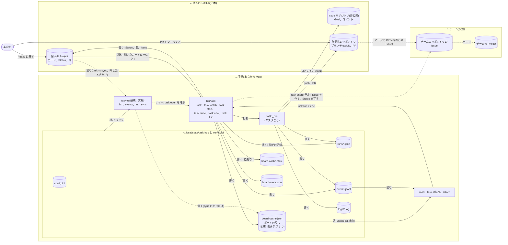
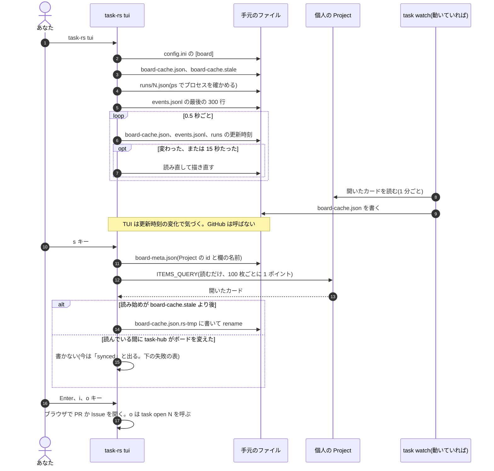
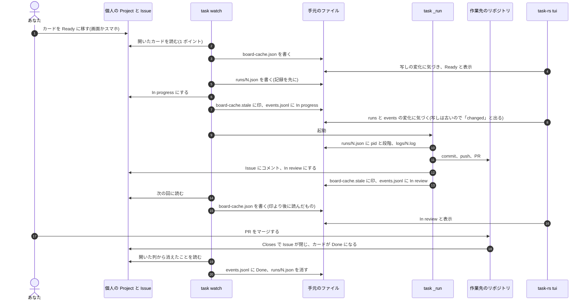
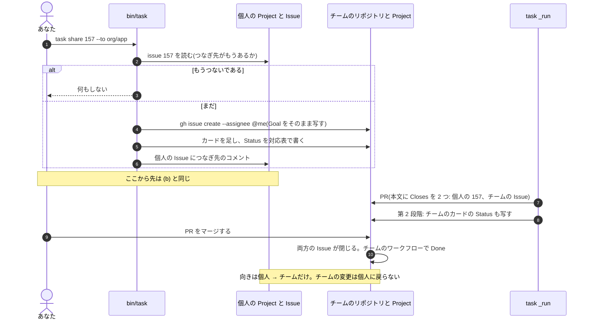

# 手元、個人の GitHub、チームの 3 つの層と task-rs

設計メモです(2026-10-11)。今の作りと、実験中の task-rs と、予定の `task share` が、どの向きに何を読み書きするかを
1 枚にまとめます。task-rs の行く先は案として並べ、決めるのは人です。

task-rs v0.2(2026-10-11)で `task-rs sync` を `task-rs fetch` に改めました(古い名前も動きます)。このメモの
`sync` は `fetch` と読み替えてください。決まったことは末尾の「決まったこと」にあります。

## 何を、なぜ

- 困っていること: 層が 3 つになり、つながりが見えにくい。利用者は「これを GitHub Project に同期するコマンドは?」と
  聞いた。`task-rs sync` は GitHub を読むだけで、書かない。向きが伝わっていない
- やること: すべての向きを明示する。コマンドごとに、読むもの、書くもの、触る層を表にする。task-rs の LLD を書き、
  `board-cache.json` を 2 つのプログラムが書くことが安全かを判断する
- やらないこと: task-rs の実装の変更、main への取り込み、hld.md と lld.md の編集(task-rs を取り込むときに直す)

### 先に答え: GitHub に「同期する」コマンドはない

手元の `board-cache.json` は、個人の Project の写し(キャッシュ)です。正本は個人の Project です
(決定事項 1、team-sync.md の決まったこと 1)。手元にだけあって GitHub にないボードの変更は、ありません。
だから GitHub に送るものがありません。

| したいこと | すること |
|---|---|
| 手元の写しを新しくする(GitHub → 手元) | `task-rs sync`、`task list`(90 秒より古いとき)、または動いている `task watch` に任せる |
| ボードを変える(手元 → GitHub) | GitHub の画面かスマホでカードを動かす。`task new`、`task start`、`task done` |
| Ready のカードを始める | `task watch` が 1 分以内に始める。今すぐなら `task` か `task start` |

`task-rs` のどのコマンドも、GitHub を変えません。

## 変わる部品(HLD)

### 3 つの層の全体図

矢印の向きは、データが流れる向きです。読むときは「読む元 → 読む者」、書くときは「書く者 → 書く先」です。
点線は予定、または人が押したときだけの流れです。

図から読めること:

- GitHub に書くのは `bin/task` と `task _run` と、あなただけです。task-rs から GitHub への矢印はありません
- task-rs が書くのは `board-cache.json` だけで、`sync` のときだけです
- チームへの向きは、個人 → チームだけです(team-sync.md の決まったこと)。チームから個人への矢印はありません
  (第 3 段階で「知らせるだけ」を足すかは未定)
- task-rs はチームの層を見ません。つなぎ先は Issue のコメントにあり、`ITEMS_QUERY` はコメントを取らないためです

### 部品の表(hld.md 3 章に足す行の案)

| 部品 | 役割 | 書いてよいもの |
|---|---|---|
| task-rs(新規、実験) | 端末でボード、実行、出来事を表示する。速く、軽い | `board-cache.json` だけ(`sync` のとき)。GitHub には何も書かない |

hld.md 3 章の「入口と表示」は「読むだけ、または task を呼ぶだけ」です。task-rs は `board-cache.json` を
自分で書くので、今はこの決まりから外れます。「一人の書き手」の節で扱います。

### 「local-first」は案 B ではない

task-rs の README の「local-first」は「まず手元を読む」という意味です。手元を正本にする案 B
(team-sync.md 2 章)ではありません。案 B は採らないと決まっています(決まったこと 1)。task-rs は正本を
動かしません。

## 流れ(LLD)

### コマンドごとの読み書き

「GitHub を変える」の列が、この表の要点です。

| コマンド | 読むもの | 手元に書くもの | GitHub | 触る層 | GitHub を変える |
|---|---|---|---|---|---|
| `task` | config、GitHub のボード、runs | runs、events、asked、board-cache、board-cache.stale、board-meta | 読む。開始、Done、片付けで Status を書く | 1、2 | 変える |
| `task watch` | 同上(1 分ごと) | 同上 | 同上 + 開始時のアーカイブの確認 | 1、2 | 変える |
| `task start <id>` | config、GitHub のボード | runs、events、asked、board-cache.stale | Ready にし、Ready のカードを枠の数だけ始める | 1、2 | 変える |
| `task done <id>` | runs、GitHub | runs を消す、events、board-cache.stale | Issue を閉じる、Done、アーカイブ | 1、2 | 変える |
| `task new`(参考) | config | events、asked、board-cache.stale | Issue、カード、欄、Blocked by | 1、2 | 変える |
| `task list` | config、board-cache、stale、board-meta、runs | board-cache(古いときだけ)、board-cache.fetching、board-meta、update.json | 写しが古いときだけ読む | 1、2 | 変えない |
| `task share`(予定) | config の `[share]`、個人の Issue | なし(つなぎ先は個人の Issue のコメント) | チームの Issue とカードを作る。個人の Issue にコメント | 2、3 | 変える(チーム、個人の Issue のコメント) |
| `task-rs list` | config、board-cache、stale、runs | なし | なし | 1 | 変えない |
| `task-rs list --watch` | 同上(60 秒ごと) | なし | なし | 1 | 変えない |
| `task-rs events`(参考) | events.jsonl | なし | なし | 1 | 変えない |
| `task-rs sync` | config、board-meta、stale | board-cache | 開いたカードを読む | 1、2 | 変えない |
| `task-rs tui` | config、board-cache、stale、runs、events、runs の記録にあるログ | なし(`s` キーだけ board-cache) | `s` キーのときだけ読む | 1(`s` で 2) | 変えない |

`task-rs list` は写しをどれだけ古くても表示し、古さを stderr に出します。`task list` は 90 秒より古いと GitHub を
読みます。ここが 2 つの一番大きな違いです。

### (a) task-rs sync と TUI

### (b) カードを Ready に移して実行する(今)

task-rs はこの流れのどこにも書きません。見ているだけです。

### (c) task share(予定、team-sync.md の第 1、2 段階)

`task share` は `bin/task` のコマンドです。task-rs には入りません。

## task-rs の LLD

コードは `experiment/rust` ブランチの未コミットの `rust/` にあります(main にない)。`rust/src/main.rs`
(592 行)、`rust/src/tui.rs`(426 行)、依存は `ratatui` と `serde_json` です。

### 読むファイル

| ファイル | 読む関数 | 使い方 |
|---|---|---|
| `~/.config/task-hub/config.ini` | `board_config` | `[board]` の `project` と `issues` だけ。configparser の一部を自分で読む |
| `state/board-cache.json` | `load_local` | `{key, fetched_at, items}`。`key` が `[owner, number, issues]` と合わなければ使わない。古さは問わない |
| `state/board-cache.stale` | `load_local`、`sync` | 表示では「changed」の印だけ。`sync` では書くかどうかの判定 |
| `state/board-meta.json` | `project` | `sync` で Project の id と欄の名前。`key` が合えば古さを問わず使う |
| `state/runs/<id>.json` | `tasks` | `pr`、`log`、`started`、`stage`、`pid` |
| `state/events.jsonl` | `cmd_events`、`App::reload` | `events` は最後の 20 行、TUI は最後の 300 行 |
| `state/logs/<id>.log` | `log_tail` | TUI の `l` キー。パスは `runs/<id>.json` の `log` から取る。最後の 64 KB |

### 書くファイル(1 つ)

`state/board-cache.json` を `sync` だけが書きます(`task-rs sync`、`list --sync`、TUI の `s`)。

- 形式は `bin/task` の `fetch_items` と同じ `{"key": [owner, number, issues], "fetched_at": <読み始めの UNIX 時刻>, "items": [...]}`
- `PROJECT_QUERY` と `ITEMS_QUERY` は `bin/task` の文字列と完全に同じ(2026-10-11 に main の `bin/task` と比べて確認)
- `fetched_at` は読む前に取る。読み終えて `fetched_at > board-cache.stale` のときだけ書く(`fetch_items` と同じ)
- 一時ファイル `board-cache.json.rs-tmp` に書いて `rename` する

### 外への呼び出し

| 呼び出し | いつ | 費用 |
|---|---|---|
| `gh api graphql`(`ITEMS_QUERY`) | `sync` のとき | 100 枚ごとに 1 ポイント |
| `gh api graphql`(`PROJECT_QUERY`) | `sync` で `board-meta.json` がない、または別のボードのとき | 1 ポイント |
| `ps -p <pid> -o command=` | 一覧のたび、pid のある実行ごと | - |
| `date` | `list --watch` の見出し、TUI の起動時(時差) | - |
| `open`(macOS)、`xdg-open`、`cmd /C start` | TUI の Enter、`i` | - |
| `task open <id>` | TUI の `o` | - |

`gh` は `TASK_GH` で差し替えられます(`bin/task` と同じ。テストの偽物の `gh` が使える)。

### 失敗の扱い

| 失敗 | 扱い |
|---|---|
| config がない、`[board]` が正しくない | `error:` と `help:` を出して終了 1。TUI は画面を取る前に止まる |
| `board-cache.json` がない、別のボード | `list` は「`task-rs sync` を」と出して終了 1。TUI は下の行にエラーを出して動き続ける |
| 写しが古い、stale の印より前 | 表示する。stderr に古さと「task-hub changed the board since」。TUI は「(changed: s)」 |
| `runs/<id>.json` がない、壊れている | 実行なしとして扱う |
| `events.jsonl` の壊れた行 | 飛ばす |
| `gh` がない、失敗した | `sync` は終了 1(help は `gh auth status`)、写しは変わらない。`list --sync` は stderr に 1 行出して手元を表示。TUI は下の行に出す |
| 写しを書けない | `gh` の失敗と同じく `sync` の失敗。`board-cache.json.rs-tmp` が残ることがある |
| 読んでいる間に task-hub がボードを変えた | 書かない。ただし「synced: N open card(s)」と成功のように出る(直すべき点) |
| `ps`、`date` が失敗 | 動いていない扱い、時差 0(UTC で表示) |
| ログがない | 「no log at <パス>」 |

通知、キャッシュ、表示の失敗で止めない、という決まり(lld.md 8 章)に沿っています。止まるのは設定がないときと、
人が頼んだ `sync` が失敗したときだけです。

### bin/task と違うところ

| 項目 | bin/task | task-rs |
|---|---|---|
| 古い写し | `task list` は 90 秒より古い、または stale の印より前なら GitHub を読む | どれだけ古くても表示し、古さを出すだけ。GitHub は `sync` のときだけ |
| `board-meta.json` の古さ | 1 時間(`META_MAX_AGE`)まで | 古さを見ない。欄の名前を変えると、古い名前で読み続ける(下の危険) |
| 足りない欄の確認 | `board()` が `missing_required_options` で止める | しない。欄がなければ既定の名前で読む |
| 失敗のあとの Project の id | `forget_board` で `board-meta.json` を消す | 消さない(書き手を増やさないので、これはよい) |
| 一時ファイル | `.board-cache.json.<pid>.tmp`。失敗しても消す。Windows は置き換えを 50 回試す | 名前が 1 つに決まっている。失敗すると残る。試し直さない |
| 読み取りの相乗り | `board-cache.fetching` で 1 つの窓だけが読む | 使わない(正しさには関わらない) |
| 更新の知らせ | `UpdateCheck` で新しい版を出す | なし。版は `0.9.0` に固定 |
| `events` | `--digest`、`--follow`、`--next` がある | ない(`task events` を使うよう出す) |
| 並び | 最後に変えたカードが先 | `list` は同じ。TUI は人がすることの順(In review、Blocked、In progress ...) |

### 危険: 欄の名前を変えたあとの sync

`board-meta.json` を古さを見ずに使うので、ボードで欄の名前を変えると、`fieldValueByName` は空を返します。
Status が空のカードは Backlog として扱われます(`canonical`)。この写しは `bin/task` の `task list` も 90 秒まで
使います。カードを始める判断は写しを使わないので、実害は表示だけです(下の「一人の書き手」)。

### Windows で足りないところ

| 項目 | 今の task-rs | bin/task | 影響 |
|---|---|---|---|
| ホームの場所 | `HOME` の環境変数 | `Path.home()`(ユーザーフォルダー) | Windows はふつう `HOME` がない。config が見つからず止まる(PowerShell の `$HOME` は環境変数ではない) |
| 動いているタスク | Windows では常に「動いていない」。macOS と Linux は `ps` | `windows_command_line` で `_run <id>` を確かめる | 実行中の段階と経過が出ない |
| 時差 | `date +%z`、`date +%Y-...` | Python の `datetime` | Windows に `date` の実行ファイルはない(推測: Git for Windows を PATH に入れていれば動く)。UTC で表示 |
| `task open` | `Command::new("task")` | - | Windows の `task` は `task.cmd`。拡張子なしでは見つからないと推測(確かめていない) |
| URL を開く | `cmd /C start "" <URL>` | `os.startfile` | `cmd` は URL の `&` で切る(`bin/task` のコメント)。Issue と PR の URL に `&` はないので影響は小さい |
| `rename` | 試し直さない | 読む側が開いている間は試し直す | 窓が `task list` で写しを開いた瞬間だと `sync` が失敗する |

### 測った値

利用者が 2026-10-11 にこの Mac で測った値です(私は測り直していません)。写しが新しく、GitHub を呼ばない場合です。

| 測ったもの | task-rs | bin/task |
|---|---|---|
| `list` の時間 | 5 ms | 58 ms |
| `list` の最大メモリ | 2 MB | 27 MB |
| TUI の待機中 | 4.0 MB、CPU 0.1% | (相当するものなし。`task list --watch` は team-sync.md の測定で 32 MB 程度) |

バイナリは 835,744 バイト(約 0.8 MB)、Mach-O arm64 で、つながるのは `/usr/lib/libiconv.2.dylib` と
`/usr/lib/libSystem.B.dylib` だけです(`file`、`otool -L` で確認)。team-sync.md 4 章の推測(起動は 2 ms の桁、
メモリは 3〜5 MB)と合っています。

## データ

### 一人の書き手(lessons.md)と board-cache.json

今でも `board-cache.json` を書くプロセスは複数あります(`task watch`、`task`、各窓の `task list`)。ただし書く
コードは `fetch_items` の 1 か所で、形式の持ち主は 1 つです。task-rs は、同じ形式を書く 2 つ目のコードです。

判断: 今は安全です。理由は 4 つあります。

1. 写しは正しさに関わらない(lld.md 6 章)。写しを読むのは `task list` と `task list --watch` だけで、
   `task`、`task watch`、`task start`、`task done` は必ず GitHub から読む(`tasks()` の `max_age` が 0)。
   壊れた写しで始まるカードはない
2. 形式が同じ。問い合わせの文字列が完全に同じで、包みの `{key, fetched_at, items}` も同じ
3. stale の印の約束(lld.md 9 章の 5)を守る。`fetched_at` を読む前に取り、印より後のときだけ書く。読む側の
   `cached_items` も印より前の写しを捨てる。順番が入れ替わって古い写しが新しい写しを上書きしても、
   90 秒以内に `task list` が読み直す。今の `bin/task` の複数プロセスでも同じことが起きている
4. `rename` は macOS と Linux で原子的。読む側は古いか新しいかの完全なファイルだけを見る

ただし、形式の持ち主が 2 人になります。直すべき点と、変える案は次のとおりです。

| 危険 | いつ起きる | 影響 |
|---|---|---|
| 形式のずれ | `bin/task` が `ITEMS_QUERY` を変える(例: `task share` のつなぎ先やラベルを足す) | task-rs の写しに新しい欄がない。`task list`、mod、Kiro の拡張の表示が 90 秒まで欠ける。`content["repository"]` のように欄を直接引く行があれば `task list` が落ちる |
| 一時ファイルの取り合い | TUI の `s` と `task-rs sync` を同時に動かす | 同じ `board-cache.json.rs-tmp` に 2 つが書く。片方の `rename` が書きかけのファイルを置くことがある。もう片方は失敗する |
| 欄の名前の変更 | 上の「危険」 | Backlog だらけの写しを 90 秒まで `task list` が使う |
| Windows の `rename` | 窓が写しを読んでいる瞬間 | `sync` の失敗(写しは古いまま) |

変える案:

| 案 | 中身 | 利点 | 費用 |
|---|---|---|---|
| A. 今のまま共有し、約束にする | task-rs の書き方を `write_atomic` に合わせる(pid 付きの一時ファイル、失敗で消す、Windows で試し直す)。`board-meta.json` の古さを 1 時間で切る。問い合わせの文字列が同じことを Python のテストで確かめる | Python がなくても `sync` できる。案 3(置き換え)に向く | テスト 1 本と task-rs の小さな変更。形式を変える PR は 2 か所を直す |
| B. 書くのは bin/task だけにする(推奨: task-rs が表示のままなら) | `task-rs sync` は `task list --max-age 0` を呼ぶだけにする。task-rs から GraphQL のコードを消す | 書き手のコードが 1 つに戻る。task-rs が hld.md の「読むだけ、または task を呼ぶだけ」に入る。形式のずれが起きない | `sync` のたびに Python の起動(58 ms、27 MB)。ネットワークの 1〜2 秒に比べて小さい。Python と `bin/task` が要る |
| C. task-rs は別のファイルに書く | `board-cache-rs.json` に書き、表示は 2 つの新しいほうを使う | ファイルごとの書き手が 1 つ | `bin/task` は task-rs の読み取りを使えない。読む側の合わせ方が要る |

推奨は「行く先」の案で変わります。表示のまま(案 1、2)なら B、bin/task の置き換え(案 3)に進むなら A です
(決めてほしいこと 2)。

### 増える、変わるファイル

| ファイル | 書く者 | 読む者 | 形式 |
|---|---|---|---|
| `state/board-cache.json` | `fetch_items`(bin/task)、案 A なら `sync`(task-rs) | `task list`、task-rs | 変えない |
| `state/.board-cache.json.<pid>.tmp`(案 A で task-rs も) | 書いている最中のプロセス | なし | 一時 |
| `state/board-cache.json.rs-tmp`(今) | task-rs の `sync` | なし | 一時(案 A でなくす) |

GitHub に増える欄や設定はありません。

## 外部の呼び出しと費用

| 呼び出し | 費用 | いつ |
|---|---|---|
| `task-rs sync` の `ITEMS_QUERY` | GraphQL 1(100 枚ごと) | 人が `sync`、`list --sync`、TUI の `s` を押したとき |
| `task-rs sync` の `PROJECT_QUERY` | GraphQL 1 | `board-meta.json` がない、別のボードのとき(案 A なら 1 時間より古いときも) |
| 案 B の `task list --max-age 0` | GraphQL 2(`forget_board` のあと Project を読み直す 1 + カード 1) | 同上 |
| `task share`(予定) | `gh issue create` 1、mutation 2、`gh issue comment` 1、Project の読み取り 1 | team-sync.md のとおり |

task-rs は自分からは GitHub を呼びません。`list --watch` も TUI も手元のファイルを読むだけです。REST は使いません。
`task watch` の 1 時間あたりの費用は約 60 ポイントのままです。task-rs が `task watch` の代わりに写しを新しく
することはないので、watch を止めても費用は減らず、写しが古くなるだけです。

## 失敗したとき

- task-rs の失敗(GitHub、写し、`ps`、`date`)で、`task watch`、実行、ほかのコマンドは止まりません。task-rs は
  実行にもボードの変更にも関わらないからです
- 同じファイルを書くプロセス: 上の「一人の書き手」の表。`runs/*.json`、`events.jsonl`、`logs/`、
  `board-cache.stale`、`board-meta.json` を task-rs は書きません
- 写しが古いまま気づかない: `task-rs list` は古さを stderr に出しますが、stdout だけを見ると分かりません。
  `task watch` が動いていなければ、写しは人が `sync` するまで古いままです(決めてほしいこと 4)

## 互換性

- 古い `bin/task`(写しを持たない版): `task-rs list` は「`task-rs sync` を」と出す。`sync` のあとは表示できる
- 新しい `bin/task` が `ITEMS_QUERY` を変えたとき: 案 A ではテストが落ちて気づく。案 B では起きない
- mod、Kiro の拡張: `task list` の出力は変わらない。案 A の写しも同じ形式
- 決定事項 15(動かす用の clone から動かす): task-rs は開発用の clone の `rust/target/release` から動いている。
  カードを始めないので、決定事項 15 が防ぐ「マージ前のコードで本物のタスクが動く」は起きない。起きうるのは
  開発中のコードが写しを書くことだけ。main に入れるなら、置き場所と配り方を決める(決めてほしいこと 5)
- Windows: 上の「Windows で足りないところ」。今のままでは Windows で動かない

## 確かめ方

- 再現テスト(利用者から見た動き)
  - 偽物の `gh`(`TASK_GH`)の記録に、task-rs からの mutation がない。`api graphql` の `query=mutation` も、
    `project item-edit` もない
  - `task-rs sync` のあと、`bin/task` の `task list` が GitHub を呼ばずに同じ行を出す(案 A)
  - `sync` の最中に `board-cache.stale` を進めると、写しは書かれず、成功とも出ない
  - TUI の `s` と `task-rs sync` を同時に動かしても、`board-cache.json` は常に読める JSON(案 A)
  - `rust/bench.py` の「両方が同じ行を出す」確かめ
- 守る約束(lld.md 9 章に足す案)
  - 「task-rs は GitHub に書かない」
  - 「task-rs が書くのは `board-cache.json` だけ」(案 B なら「何も書かない」)
  - 「`PROJECT_QUERY` と `ITEMS_QUERY` は bin/task と task-rs で同じ」(案 A。cargo がなくても Python のテストで確かめられる)
- 実際のボードで: `task-rs sync` のあと `task list`(どちらも読むだけ)。GitHub の画面でカードが動いていないこと

## タスクの分け方

task-rs を main に入れると決めた場合だけです。0 は人が決めることで、PR はありません。

| # | 中身 | 前(`--blocked-by`) | 受け入れ条件 |
|---|---|---|---|
| 0 | (人)行く先の案と、書き手の案(A か B)を決める | - | - |
| 1B | (案 B)`task-rs sync` を `task list --max-age 0` の呼び出しにし、GraphQL のコードを消す | 0 | 偽物の `gh` の記録が `task list --max-age 0` と同じ。`rust/src` に `gh` の呼び出しがない。`gh` が失敗したときの出力と終了コードが今と同じ |
| 1A | (案 A)task-rs の書き方を `write_atomic` に合わせる。`board-meta.json` を 1 時間で切る。書かなかったときは成功と出さない | 0 | 「確かめ方」の再現テストの 3 つ目と 4 つ目 |
| 2A | (案 A)問い合わせの文字列と包みの形が同じことを確かめる Python のテスト | 1A | `bin/task` か task-rs の `ITEMS_QUERY` を 1 文字変えるとテストが落ちる |
| 3 | `sync` の名前(決めてほしいこと 3)と README の言葉。「local board」を「ボードの写し」にし、向きの表(このメモの「先に答え」)を README に入れる | 0 | README に「task-rs は GitHub を変えない」と、ボードを変えるコマンドが書いてある |
| 4 | main に入れる準備: CI で `cargo build` と `bench.py` の同じ行の確かめ。hld.md、lld.md、design.md の変更(下)。AGENTS.md と CONTRIBUTING.md の確かめ方 | 1B か 2A、3 | CI で task-rs のビルドと同じ行の確かめが通る。HLD と LLD が下の変更を含む |
| 5 | (Windows で使うなら)Windows の 4 点: ユーザーフォルダー、動いているタスク、時差、`task.cmd` | 4、team-sync.md のタスク 6 | GitHub Actions の windows-latest で `list` と `events` が bin/task と同じ行を出す |
| 6 | (案 2 を選んだら)TUI から `task start`、`task done` を呼ぶ | 4 | 確かめの一言を挟む。`task start` が Ready のカードをすべて始めることを画面に出す(lessons.md「本物のボードでの試験は」) |

## task-rs の行く先(案)

| 案 | 中身 | 今の決まりとの関係 | 費用 | 危険 |
|---|---|---|---|---|
| 0. 実験のまま残す | ブランチに置いたまま。測る道具として使う | 変わらない | なし | なし |
| 1. 読むだけの表示 | mod、Kiro の拡張と同じ「表示」の部品にする。端末で動く軽い常駐の画面 | hld.md 3 章の「入口と表示」に合う(書き手の案 B なら完全に) | タスク 1、3、4 | Rust の道具(cargo)が開発に増える。AGENTS.md の「Python 標準ライブラリだけ」は `bin/task` の決まりとして残す |
| 2. task を呼ぶ操作を足す | TUI から `task start`、`task done`、`task open` を呼ぶ。GitHub に書くのは今と同じ `bin/task` | 書き手は変わらない(決定事項 1)。「入口と表示」の「task を呼ぶだけ」に合う | 案 1 + タスク 6 | TUI が GitHub を変える入口になる。「read only」の表示を変える。`task start` は Ready のカードをすべて始める |
| 3. bin/task を置き換える | `bin/task` の約 2,900 行を Rust にする | 決まりを変える: AGENTS.md と hld.md 8 章の「Python 標準ライブラリだけ」。team-sync.md の決まったこと 9 が条件 | team-sync.md 4 章の評価(テストは別プロセスなので流用できる。偽物の `gh` に頼る部分は HTTP の偽物に) | 2 つの実装が並ぶ期間に、形式とふるまいがずれる |

案 3 の判断の材料: team-sync.md の決まったこと 9 は「速さは理由にしない。理由は古い Windows での配布とメモリ。
`task share` のあとで、同僚の Windows の PC で測ってから決める」です。task-rs の測定は、メモリの差
(1 プロセスあたり約 25 MB)を Mac で裏付けました。Windows では測っていません。task-rs の今の範囲は読む側
(`list`、`events`、表示)だけで、開始、実行、PR、片付けは含みません。

## HLD・LLD に入れる変更

task-rs を main に入れる PR で入れます。入れないなら不要です。

- hld.md 3 章: 「入口と表示」に task-rs の箱、部品の表に行(書いてよいもの: 案 A なら `board-cache.json`、案 B なら何も)
- hld.md 4.3: ボードの読み取りの図に task-rs(読む)と、案 A なら `sync`(書く)
- hld.md 7 章: task-rs のバイナリの置き場所と配り方
- hld.md 8 章: 「軽い」の行に、Python 標準ライブラリだけなのは `bin/task` であることと、task-rs の依存(ratatui、serde_json)
- hld.md 2 章か新しい節: このメモの 3 つの層の図(チームは `task share` の実装の PR で)
- lld.md 3 章: `task-rs list`、`sync`、`events`、`tui` の行
- lld.md 5 章: `board-cache.json` の書く者(案 A)、`board-meta.json` の読む者に task-rs
- lld.md 6 章: 写しの形式の持ち主が 2 つになること(案 A)と、その確かめ方
- lld.md 7 章: `task-rs sync` の費用
- lld.md 9 章: 「task-rs は GitHub に書かない」と、上の約束
- lld.md 10 章: 偽物の `gh` での task-rs のテスト、`rust/bench.py`
- design.md の決定事項: 「手元の写しはキャッシュで、正本は個人の Project(決定事項 1)。task-rs は表示で、GitHub を変えない」と、選んだ書き手の案の理由

## ドキュメントとのずれ

- このブランチ `experiment/rust` は a93f02d から分かれていて、main より古い。team-sync.md、`[runner] parallel`、
  tests/bench.py は手元のブランチにない。このメモは origin/main の hld.md、lld.md、design.md、team-sync.md、
  `bin/task` を読んで書いた。main との `bin/task` の差に写しの関係はない
- rust/README.md は「three `task` commands」と書くが、コマンドは `list`、`sync`、`events`、`tui` の 4 つ。
  main.rs の先頭のコメントも 3 つ(`list`、`list --watch`、`events`)のまま
- rust/README.md は `board-cache.json` を「The local board」と呼ぶ。lld.md 5、6 章では写し(キャッシュ)で、
  正しさに関わらないもの。この言葉が「GitHub に同期する」という問いを招いたと推測する
- team-sync.md 4 章の「メモリ」は `MAX_PARALLEL = 5`、設定できない、と書く。task 159 で `[runner] parallel` に
  なった(lld.md 5 章と design.md は直っている)
- `bin/task` の `sync()` は開始と Status の変更を含む(lld.md 4.1)。`task-rs sync` は読むだけ。同じ言葉で向きが違う

## 決まったこと(2026-10-11)

| # | 問い | 決まったこと |
|---|---|---|
| 1 | task-rs の行く先 | 案 1、読むだけの表示。task を呼ぶ操作(新規、承認、Done)は足さない。コマンドとキーを増やすと、覚えることが増えて同僚が使わなくなるため |
| 3 | `sync` の名前 | `fetch`。v0.2 で改めた。TUI のキーも `s` から `f` |
| 5 | main に入れるか、配り方 | 入れた(#40)。バイナリは `task-rs-v*` の pre-release に付ける。`task update` は `v1.2.3` の形のタグしか見ないので入れない。使うのは当面、利用者だけ |
| 7 | Windows | 今はしない。利用者が手元と仕事の Mac で試す |
| 新 | 手元で下書きを作り、あとで GitHub に送るか | しない。Backlog が下書きの役をする(Ready に移すまで始まらない)。下書きと送る仕組みは、手元の番号と Issue の番号の対応、途中の失敗、二重の防止、複数のマシンが要り、得は 1 件 2 秒ほど。正本は 1 つ(個人の Project)、読むのは手元の写し、書くのは正本、のまま。オフラインで登録したくなったら、そのときに「送れなかった `task new` をためて後で送る」だけを足す |

v0.2 でメモのタスク 1A の直しも入れました。一時ファイルに pid を付けて失敗したら消す、`board-meta.json` を 1 時間で
切る、書かなかったときに成功と出さない。問い合わせの文字列が `bin/task` と同じことを確かめるテストは、まだありません
(決めてほしいこと 2 が決まってから)。

## 決めてほしいこと

残りは 2、4、6 です。

1. (決まった)task-rs の行く先: 案 0(実験のまま)、1(読むだけの表示)、2(task を呼ぶ操作を足す)、3(置き換え)のどれか
2. `board-cache.json` の書き手: 案 A(共有して約束にする)、B(`bin/task` だけ)、C(別のファイル)のどれか。
   推奨は、表示のままなら B、置き換えに進むなら A
3. (決まった)`task-rs sync` の名前: `bin/task` の `sync()` は GitHub に書くので、同じ言葉は向きを誤らせる。`fetch`、
   `refresh` などに変えるか(推測: `fetch` が git の「読むだけ」に近く、伝わりやすい)
4. 古い写しの見せ方: `task-rs list` は今、写しの古さを stderr にだけ出す。90 秒より古い、または stale の印より前のとき、
   stdout にも出すか。`task watch` が動いていないときの既定の動き(古いまま表示する、で足りるか)
5. (決まった)main に入れるか。入れるなら、配り方(リリースにビルド済みのバイナリを付けるか、各自が cargo でビルドするか)と、
   `task update` で入れるか
6. `task share` のあと、task-rs でつなぎ先(チームに出したタスク)を見せたいか。見せるには `ITEMS_QUERY` に
   コメントか別の欄を足すことになり、`bin/task` も変わる
7. (決まった)Windows: 同僚の PC で task-rs を使う予定が、`task share` と Windows の測定(team-sync.md のタスク 6)より前にあるか
