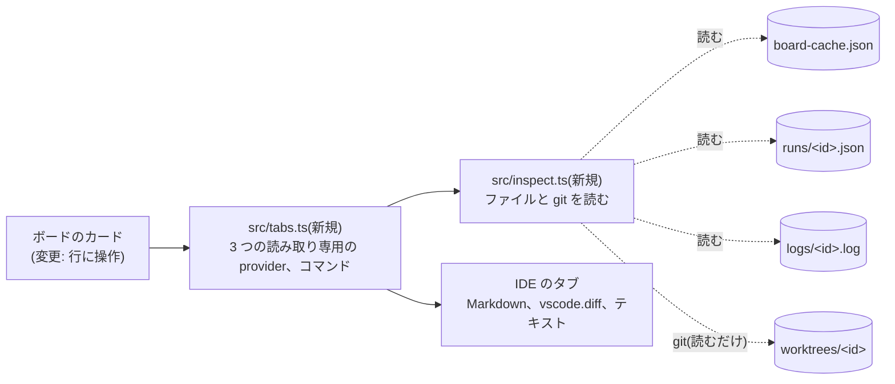
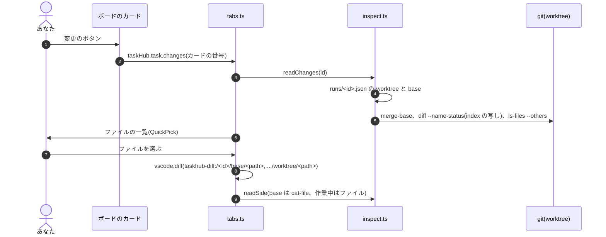

# カードの Goal、変更、ログを IDE のタブで読む

設計メモです(2026-10-12、タスク 176)。実装と同じ PR で、hld.md、lld.md、kiro-ide.md も直しました。

## 何を、なぜ

- 困っていること: エージェントの仕事を確かめるのに、ファイルのサイドバーで worktree を探し、ターミナルで
  `task show` と `task log` を打っていた。タスクの文脈(どの Goal、どの base、どのログ)が手元でばらばらだった
- やること: Kiro の拡張(`kiro/board-extension/`)のカードから、Goal、変更、ログを、IDE が元から持つタブ
  (Markdown、差分、テキスト)で読み取り専用で開く。VS Code でも同じ拡張が動く
- やらないこと: Issue やボードの書き込み、PR のコメントやレビュー(GitHub の公式の拡張に任せる)、ブランチの
  checkout、エージェントの開始や停止、独自の差分の描画、GitHub への新しい問い合わせ、エージェントの出力の新しい取り方、
  Lazygit の組み込み、task-rs への依存

## 変わる部品(HLD)

hld.md の 3 章の表の「mod、Kiro の拡張」の行に、タブで開くことと、git で読むだけのことを足しました。

## 流れ(LLD)

Status、段階、出来事は増えません。

## データ

- 増えるファイルも欄もありません。読むのは lld.md の 5 章の表の既存のファイルだけです(読む者に「Kiro の拡張」を足した)
- `board-cache.json` の形式は変えません(task-rs も読むので、変えるなら `rust/` も合わせる約束)

## 外部の呼び出しと費用

- GitHub の呼び出しは増えません。Goal はキャッシュの本文を出し、何分前に読んだかを書きます
- 増えるのは、人が変更のタブを開いたときの手元の git(`READ_ONLY` の 6 つのサブコマンド、各 30 秒まで)だけです

## 失敗したとき

- `runs/<id>.json` がない、worktree が消えた: 理由と次にすることを知らせ、何も開かない。別の checkout で代わりをしない
- カードがキャッシュにない: `task show <id> --full` を案内する。開いているタブはそのまま残る
- ログがまだない: そう書いて待ち、できたら出す
- 信頼していないワークスペース: 変更(git)だけ出さない
- バイナリ、1 MB を超えるファイル: 中身の代わりに 1 行の説明。ログは最後の 1 MB
- 同じファイルを書く者は増えません(拡張は何も書かない)。`git diff` が index を書き直すのは、index の写しを
  `GIT_INDEX_FILE` で読ませて防ぎます(テストで index のバイトと時刻、HEAD、ref が変わらないことを確かめる)。
  clean フィルタ(Git LFS など)は、属性を空の tree から読ませて動かしません。IDE の環境の `GIT_*` は渡しません

## 互換性

- `engines.vscode` は `^1.90.0` のまま。使う API(`TextDocumentContentProvider`、`vscode.diff`、`createQuickPick`、
  `workspace.isTrusted`)はそれより前からあります。Kiro 専用の API は使いません
- `capabilities.untrustedWorkspaces` を `true` から `"limited"` にしました(変更だけ出さない)
- 古い `bin/task` が書いた `runs/<id>.json` も同じキーなので読めます

## 確かめ方

- `npm test`: 偽物の `vscode` と一時的な git リポジトリで、カードの行からのコマンド、コミットだけの worktree、
  作業中・追加・削除・未追跡・バイナリ・大きいファイル、index と ref が変わらないこと、ログの追従と停止、閉じたあとの後始末、
  ログのコマンドを通らずに戻ってきたログのタブ
- `node test/host/check.mjs <IDE の CLI>`: VSIX を本物の VS Code と Kiro の使い捨てのプロファイルに入れて動かす
  (kiro-ide.md の 10 章に結果)

## ドキュメントとのずれ

- kiro-ide.md の 10 章は「VS Code でも動くはずですが、確かめていません」でした。VS Code 1.141.0 で確かめた結果に直しました

## 決めてほしいこと

- Kiro でタブを出すところは、ログインしていない使い捨てのプロファイルでは確かめられませんでした。ログインした Kiro で
  人が確かめるか(kiro-ide.md の 8 章に足した項目)
