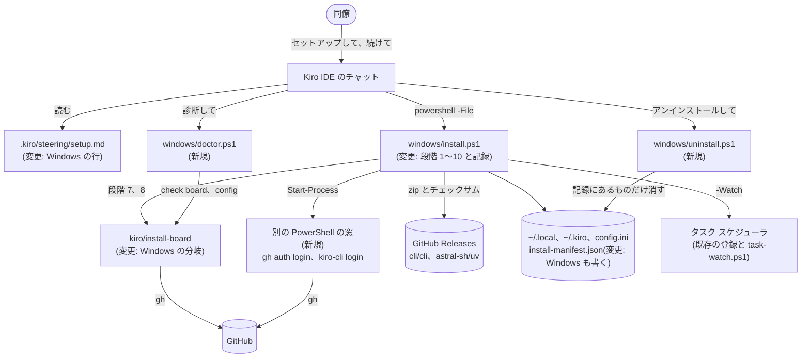
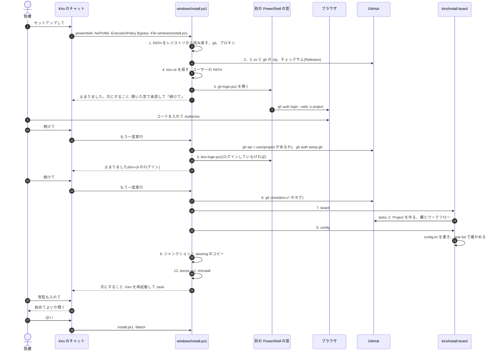

# Windows 版のかんたんセットアップ

設計メモです(2026-10-12)。Mac の Kiro IDE のかんたんセットアップ([kiro-quickstart.md](../../kiro-quickstart.md)、
`kiro/install.sh`)と同じ手順で、Windows の PC にも task-hub を入れられるようにします。決めるのは人です。
推測には「推測」、実機で確かめていないことには「未確認」と書きます。

## 何を、なぜ

### 困っていること

- 誰が: 会社の同僚。エンジニアではなく、IT に詳しくない。PC の管理者権限はない
- いつ: Windows 11 の PC で task-hub を使いはじめるとき
- 何に: 今の Windows の手順([windows.md](../../windows.md))は、PowerShell に手でコマンドを貼る作りです。
  2026-10-12 の実機の試験(main v0.11.0、agent claude)では、10 章の試した項目はすべて通りましたが、次の手間と
  間違いが出ました

| # | 起きたこと | このメモでの直し方 |
|---|---|---|
| 1 | gh を入れたあと、開いている画面から gh が見えない(PATH が古い) | インストーラがフルパスで呼び、PATH をレジストリから読み直す。「窓を開き直す」を求めない |
| 2 | GitHub のログインが手打ちの 2 つのコマンド(`gh auth login`、`gh auth refresh -s project`)。貼り付けの間違いで 2 つがつながった | `-s project` 付きの 1 回のログインを、別の PowerShell の窓で開く(Mac の段階 5 と同じ) |
| 3 | config.ini をメモ帳で手書きし、UTF-8 を選ぶ。一番間違えやすい | `kiro/install-board config` で作り、`task list` で確かめる(Mac の段階 8) |
| 4 | ボードの tasks リポジトリと Project を手で作る | `kiro/install-board board` で作る(Mac の段階 7) |
| 5 | スキルのジャンクションを作るループを手で貼る | インストーラがジャンクションを作る。steering はコピー |
| 6 | 常駐(`-Watch`)が別の実行 | 「常駐も入れて」で、本人が「はい」と言ってから `-Watch` |
| 7 | 診断がない。`-Uninstall` のあとに本体、状態、設定、gh が残る | `windows/doctor.ps1` と、記録(`install-manifest.json`)に従う `windows/uninstall.ps1` |
| 8 | CLI からカードを動かせない | セットアップではないので扱わない |
| 9 | 見張りを途中で外した実行が、finish で一度だけ gh の「check your internet connection」で止まった。やり直すと通った | 範囲外。「決めてほしいこと」の後ろの「残るリスク」に書く |
| 10 | kiro-cli は `[check] kiro = kiro-cli whoami`、`KIRO_API_KEY` はユーザー環境変数 | 今の形のまま。設定は段階 8 が書く |

### やること

- 入口は Mac と同じ Kiro IDE です。本人はこのリポジトリを Kiro IDE で開き、チャットで「セットアップして」と言い、
  ブラウザでログインを承認し、「続けて」と言います。タスクを動かすエージェントは kiro-cli です(2.0 から
  Windows 11 で動く)
- `windows/install.ps1` を、Mac の `kiro/install.sh` と同じ「段階を順に確かめ、足りないものだけ行う」形にします
- 診断 `windows/doctor.ps1` と、記録に従うアンインストール `windows/uninstall.ps1` を足します
- `.kiro/steering/setup.md` を、Mac と Windows の両方で使える形にします

### やらないこと

- 管理者権限(UAC)が要ることは一切しません。winget も MSI も使いません。実機で、winget の GitHub CLI(MSI)は
  静かなアンインストールが 1603 で失敗し、UAC を求めました
- WSL は使いません。`bin/task` は Python 標準ライブラリだけのままです。Windows PowerShell 5.1 で動かします
- Slackトリアージ(段階 11)は Mac だけです(swiftc と launchd を使う)
- herdr、Claude Code の task-board mod は今までどおり Windows では使いません

## 変わる部品(HLD)

hld.md の 3 章の表には、セットアップの部品の行がありません(Mac の `kiro/install.sh` もありません)。
7 章「配置」に Windows のインストーラを書き足します(「HLD・LLD に入れる変更」)。



### PowerShell と Python の分け方

決めたこと: インストーラ、診断、アンインストールは PowerShell(5.1)、ボードと設定は今の `kiro/install-board`
(Python)を使い回します。Mac の「sh + Python の helper」と同じ分け方です。

理由:

- 段階 1 と 2 は、まだ Python がない PC で動く必要があります
- アンインストールは、uv で入れた Python を消します。その Python で動くプログラムは、動いている `python.exe` を
  消せません(Windows は使用中のファイルを消せない)
- タスク スケジューラ、プロセスの一覧(CIM)、ユーザーの PATH(レジストリ)、ジャンクションは PowerShell の
  標準の機能で扱えます。今の `windows/install.ps1` の `Stop-Watch` と `-Watch` はテスト済みで、そのまま使えます
- ボードと設定は GraphQL と INI で、Python のほうが書きやすい。Mac と同じコードを通すので、ボードの形が OS で
  変わりません

代わりに気をつけること(PowerShell 5.1 の癖):

- 日本語の文字列を含む `.ps1` は、BOM 付きの UTF-8 で保存します。5.1 は BOM のない `.ps1` を ANSI(日本語の
  Windows では CP932)として読み、文字が化けます。テストで確かめます
- ネイティブのコマンドの stderr で止まらないよう、`$ErrorActionPreference` を局所的に `Continue` にします
  (今の `Find-Python` と同じ)
- 出力は `[Console]::OutputEncoding` を UTF-8 にしてから出します。Kiro のチャットが日本語を読めるかは未確認です

## 流れ(LLD)

### 段階の対応

Mac の段階の番号をそのまま使います。ドキュメントと診断の一覧を OS で見比べやすくするためです。

| 段階 | Mac(`kiro/install.sh`) | Windows(`windows/install.ps1`) |
|---|---|---|
| 1. 前提の確認 | macOS、CPU、git、プロキシ、GitHub に届くか | Windows 10/11、CPU(x64、arm64)、`FullLanguage`、git、プロキシ、GitHub に届くか |
| 2. Python | 3.10 以上がなければ uv で 3.12 | 同じ。探す順は記録、`py -3`、`python`(Microsoft Store の偽物は除く)、なければ uv |
| 3. gh | なければ zip をチェックサムで確かめて `~/.local/bin` | 同じ(`gh.exe`) |
| 4. kiro-cli | あればリンク、なければ DMG を `~/Applications` に | あれば、そのフォルダをユーザーの PATH に足す。なければ止まって案内する |
| 5. ログイン | Terminal の窓で gh と kiro-cli | 別の PowerShell の窓で gh と kiro-cli |
| 6. task-hub 本体 | clone(`kiro-v*` の規則)、wrapper、`~/.zprofile` | clone(同じ規則)、`task.cmd` と Git Bash 用の `task`、ユーザーの PATH |
| 7. ボード | `install-board board` | 同じ |
| 8. 設定 | `install-board config`、`task list` | 同じ(Windows の分岐あり) |
| 9. Kiro との連携 | スキルと steering はリンク、フックとワークフローはコピー、Workflows を有効に | スキルはジャンクション、steering はコピー。フックとワークフローはコピーし、コマンドを Windows の形に書き換える。Workflows を有効に(Mac と同じ helper) |
| 10. 常駐 | `--with-launchd`、`--start-launchd` | `-Watch`(本人が「はい」と言ってから) |
| 11. Slackトリアージ | swiftc と launchd | なし(行を出さない) |
| 12. 診断 | `kiro/doctor.sh` | `windows/doctor.ps1` |

各段階の中身:

1. **前提の確認**
   - Windows の版と CPU。Windows 10 は止めずに注記を出します(kiro-cli は Windows 11 とされている)
   - `$ExecutionContext.SessionState.LanguageMode` が `FullLanguage` でなければ、情シスへの依頼文で止まります
   - **PATH の読み直し**: 最初に、プロセスの PATH の前に、レジストリのマシンとユーザーの PATH を足します。
     Kiro を開いたあとに情シスが git を入れても、ここで見えます(実機の 1)
   - git: `Get-Command git` で探します。なければ Git for Windows の Releases から MinGit の zip
     (`MinGit-<ver>-64-bit.zip`、arm64 なら `MinGit-<ver>-arm64.zip`)を取り、Release のチェックサムで確かめ、
     `~/.local/lib/git` に展開して、その `cmd` をユーザーの PATH に足し、記録します(管理者なし。「決めたこと」の 3)。
     Kiro IDE の「Clone Repository」自体が git を使うので、ふつうは git がある PC でここまで来ます
   - プロキシ: `HTTPS_PROXY` がなければ、`[System.Net.WebRequest]::GetSystemWebProxy().GetProxy('https://github.com')`
     で、Windows の設定(PAC も含む)から github.com へのプロキシを聞き、このプロセスの `HTTPS_PROXY` にします。
     gh、git、uv は Windows の設定を読まないためです。.NET が PAC を評価できるのは推測で、未確認です。
     評価できなければ、Mac と同じく「情シスにホストとポートを聞く」で止まります
   - GitHub に届くか: `TASK_INSTALL_GITHUB`(既定 `https://github.com`)に HEAD を送ります
2. **Python**: 記録の `python` がまだ動けばそれを使います。なければ今の `Find-Python`(`py -3`、`python`)。
   それもなければ `uv-<triple>.zip`(`x86_64-pc-windows-msvc` か `aarch64-pc-windows-msvc`)と `.sha256` を取り、
   `Get-FileHash` で確かめ、`~/.local/bin/uv.exe` に置きます。`uv python install 3.12` のあと、
   `uv python find 3.12` の答えのフルパスを記録します(uv が `~/.local/bin` に `python3.12.exe` を置くかに頼らない)。
   会社の SSL の検査の証明書のため、`UV_NATIVE_TLS=1` を付けます(Mac の `UV_SYSTEM_CERTS` に当たる。
   uv の版での名前は実装のときに確かめる)
3. **gh**: PATH(1 で読み直したもの)の gh が動けば使います。winget で入れた gh もそのまま使い、記録しません。
   なければ `gh_<ver>_windows_<amd64|arm64>.zip` と `gh_<ver>_checksums.txt` を取り、確かめてから
   `Expand-Archive` し、`bin/gh.exe` を `~/.local/bin/gh.exe` に置きます。最新の版は Mac と同じく
   `releases/latest` のリダイレクト先から読みます(API を使わない)。以後はフルパス `$Gh` で呼び、
   `$env:Path` の先頭に `~/.local/bin` を足します(実機の 1)
4. **kiro-cli**: PATH と、Kiro CLI が Windows で入る場所(実装の前に公式の手順で確かめる。推測では
   `%LOCALAPPDATA%` の下)を探し、`kiro-cli --version` が動くものを使います。そのフォルダがユーザーの PATH に
   なければ足し、記録します。リンクは作りません(ファイルのシンボリックリンクは管理者か開発者モードが要る。
   `.cmd` の中継は、`bin/task` が「npm の .cmd でないバッチファイル」として断る)。なければ公式の配布物を
   管理者なしで自分のフォルダに置き、記録します(「決めたこと」の 2。形式と置き方はタスク 3 の最初に確かめる)
5. **ログイン**
   - gh: `gh api -i user` の `X-OAuth-Scopes` に `project` があれば済み。git が gh のログインを使っていなければ
     `gh auth setup-git -h github.com` を動かします(Mac と同じ)
   - 済んでいなければ、ログイン用のスクリプト `~/.local/state/task-hub/gh-login.ps1` を書き、
     `Start-Process powershell.exe -ArgumentList '-NoProfile','-ExecutionPolicy','Bypass','-File',<それ>` で別の窓を
     開き、止まります。スクリプトは最初に自分を消し、プロキシの変数を移し、`& '<gh.exe のフルパス>' auth login
     --web -s project -h github.com -p https`(ログイン済みで権限だけないときは `auth refresh -h github.com -s project`)
     を 1 回だけ動かし、「終わったら、この窓を閉じて、Kiro のチャットで「続けて」と言ってください」と出して
     `Read-Host` で待ちます(PowerShell の窓は、スクリプトが終わると閉じるため)
   - `GH_TOKEN`、`GITHUB_TOKEN` があれば、Mac と同じ文で止まります
   - kiro-cli: `kiro-cli whoami` が通れば済み。通らなければ `kiro-login.ps1` で同じように `kiro-cli login` の窓を
     開いて止まります
   - task-hub の clone より前に行います(Mac と同じ順。リポジトリが private でも clone できるように)
6. **task-hub 本体**
   - clone の場所と版の決め方は Mac と同じです。新しい clone は origin の一番新しい `kiro-v<数字>`、なければ
     既定のブランチ。インストーラの clone(記録にある、またはタグの上)は `fetch --tags` して新しいタグに切り替え。
     ブランチの上の手で入れた clone(今の windows.md の手順の人)は `pull --ff-only` だけ。`-Ref` で開発者が版を選ぶ
   - `GIT_TERMINAL_PROMPT=0` で、パスワードを待たずに失敗させます
   - `~/.local/bin/task.cmd` と Git Bash 用の `~/.local/bin/task` を書きます(今の形に、1 行の印
     `task-hub: made by windows/install.ps1` を足す)。印のないものは、中身が今の install.ps1 の形と同じときだけ
     書き換えます。違えば止まります
   - ユーザーの PATH に `~/.local/bin` を足し、変わったことを知らせます(今のコード)。足したときだけ記録します
   - 版が変わり、常駐が動いているときは、見張りだけを新しい版で始め直します(`Stop-Watch` と開始。実行中の作業は
     止めない。今の `-Watch` と同じ手順)。推測で足す小さな改善なので、要らなければ外します
7. **ボード**: `& $Py kiro/install-board board <label> <login> <work>`。中身は Mac と同じです
8. **設定**: `& $Py kiro/install-board config <label> <work>`。Windows の分岐は「データ」の節
9. **Kiro との連携**
   - `~/.kiro/skills/task`、`~/.kiro/skills/chief` に、clone の `skills/task`、`skills/chief` へのジャンクション
     (`New-Item -ItemType Junction`。管理者権限は要らない)。すでにあり、同じところを指していれば何もしません。
     別のところを指していれば残して注記します(Mac の `link_into` と同じ)
   - `~/.kiro/steering/task-hub.md` は clone の `kiro/steering/task-hub.md` のコピーです。SHA-256 を記録し、
     記録と同じときだけ更新します(Mac の `copy_into` と同じ)
   - 何か変えたら「Kiro を再起動」を最後の行にします。再起動した Kiro は新しいユーザーの PATH を読むので、
     スキルの `task` が `task.cmd` で見つかります(未確認)
10. **常駐**: `-Watch` のときだけ、今のコード(タスク スケジューラ、拒まれたらスタートアップ フォルダ)で登録して
    始めます。登録はそのまま次のサインインでの開始なので、Mac のように「置く」と「始める」を分けません。
    `-Watch` なしのときは「飛ばしました(任意です)」と出します
12. **診断**: 最後に `windows/doctor.ps1 -InInstall` を呼びます

### 1 回目の「セットアップして」から終わりまで



### コマンドの形

| 本人が言うこと | Kiro が動かすもの |
|---|---|
| 「セットアップして」「続けて」 | `powershell -NoProfile -ExecutionPolicy Bypass -File windows\install.ps1` |
| 「常駐も入れて」(本人の「はい」のあと) | 同じものに `-Watch` |
| 「診断して」 | `powershell -NoProfile -ExecutionPolicy Bypass -File windows\doctor.ps1` |
| 「アンインストールして」 | `windows\uninstall.ps1`(一覧だけ)。本人の「はい」のあとに `-Yes` |
| 開発者が版を選ぶ | `-Ref main` など |

`powershell.exe` を明示するので、Kiro がコマンドを cmd、PowerShell 7、Git Bash のどれで動かしても同じです。
今の `install.ps1 -Uninstall` は、`uninstall.ps1 -Yes` を呼ぶ別名として残します(windows.md に書いてあるため)。

## データ

### 手元のファイル(lld.md の 5 章に足す行)

| ファイル | 書く者 | 読む者 | 形式 |
|---|---|---|---|
| `state/install-manifest.json` | Windows では `windows/install.ps1` だけ | `install.ps1`、`doctor.ps1`、`uninstall.ps1` | Mac と同じ JSON(`version`、`python`、`installed`、`sha256`)に `"platform": "windows"` を足す。BOM のない UTF-8。一時ファイルから `Move-Item -Force` で置き換える |
| `state/gh-login.ps1`、`state/kiro-login.ps1` | `install.ps1` | ログインの窓(読んだら自分を消す) | BOM 付き UTF-8 の PowerShell。プロキシの値を含むことがあるので、本人だけが読める ACL にする(既定のプロファイルの権限で足りるかは実装で確かめる) |
| `~/.local/bin/gh.exe`、`uv.exe` | `install.ps1` | すべて | Releases の実行ファイル |
| `~/.local/bin/task.cmd`、`task` | `install.ps1` | 本人、Kiro、Git Bash | 今の形に印の 1 行を足す |
| `~/.config/task-hub/config.ini` | `kiro/install-board config`(足りない項目だけ足す)、人 | すべて | 今の INI |
| `~/.kiro/skills/task`、`chief` | `install.ps1` | Kiro | ジャンクション |
| `~/.kiro/steering/task-hub.md` | `install.ps1` | Kiro | コピー(SHA-256 を記録) |
| ユーザーの PATH(レジストリ `HKCU\Environment`) | `install.ps1`(足す)、`uninstall.ps1`(足した項目だけ外す) | Windows | 項目を記録する |

`installed` の鍵(Windows): `uv`、`uv-python`、`gh`、`kiro-cli-path`(足した PATH の項目)、`task-hub`、`task`
(`task.cmd`)、`task-sh`(Git Bash 用)、`user-path`(足した `~/.local/bin`)、`config`、`kiro-skill-task`、
`kiro-skill-chief`、`kiro-steering`、`watch`(`scheduled-task:task-hub watch` か、スタートアップの `.lnk` のパス)。

1 つのファイルに 1 者だけ: `install-manifest.json` は、Mac では `kiro/install.sh` と `bin/task` の
`note_install_copy`(`kiro-hook`、`kiro-workflow` の SHA-256 だけ)の 2 者が書いています。Windows も同じ 2 者です。
Windows のコピーはコマンドを書き換えるので、リポジトリのファイルとは中身が違います。記録する SHA-256 は、置いた
コピーのものです(更新とアンインストールの確認は、Mac と同じく置いたものとの比較)。
`uninstall.ps1` は消し終えたあとにファイルごと消すだけで、中身は書き換えません(Mac と同じ)。

### `kiro/install-board` の Windows の分岐

| 場所 | 今 | Windows |
|---|---|---|
| `tilde` | `/` で区切る | `os.sep` も見る(表示だけ) |
| `config` の確かめ | `~/.local/bin/task list` を動かす | `~/.local/bin/task.cmd list` を動かす(本人が使うもので確かめる。Mac と同じ考え。`task` は Git Bash 用の `sh` で、Windows からは直接動かない)。`task.cmd` が `PYTHONUTF8=1` を付ける |
| `config` の項目 | `[board]`、`[runner] agent = kiro`、`[check] kiro`、`[ide] open = kiro {path}` | `[ide] open` は書かない(「決めたこと」の 5)。`check_config` も Windows では求めない。見出しのコメントと tasks の説明の「作りました」は `windows\install.ps1` |
| 次にすることの文 | `sh kiro/install.sh を実行してください` | `powershell -ExecutionPolicy Bypass -File windows\install.ps1 を実行してください` |
| `kiro-settings` | macOS の settings.json | タスク 9 で Windows の場所(`%APPDATA%\Kiro\User\settings.json` と推測。実機で確かめる)と、コマンドパレットのキー(Ctrl+Shift+P)を足す。タスク 1 では変えない |
| `subprocess` の出力 | `text=True` | `encoding="utf-8", errors="replace"` にする(日本語の Windows の CP932 で読まない) |
| 自分の出力 | 端末の文字コード | 標準出力を UTF-8 に固定する。`install.ps1` は UTF-8 として読む(実装済み。中国語の cp936 の PC で、固定しないと読めないことをテストで確かめた) |

### GitHub に増えるもの

Mac と同じです。private の `<login>/tasks`、Project「task-hub」、Status の 7 つの選択肢、3 つのテキスト欄、
ボード表示。人が画面ですることも同じで、Project のワークフローの「Item closed」を有効にします。

## 外部の呼び出しと費用

| いつ | 呼び出し | 費用(推測。`rateLimit { cost }` で測っていない) |
|---|---|---|
| 毎回の実行(段階 5) | `gh api -i user` | REST 1 回 |
| 初回(段階 7) | `repo view`、`repo create`、ボード表示の作成 | REST 3 回 |
| 初回(段階 7) | `project list`、`project create`、`project view`、`STATE_QUERY`、`SET_OPTIONS`、`field-create` ×3、`project link`、`DELETE_WORKFLOW` ×3 | GraphQL 約 12 ポイント |
| 2 回目から(段階 7) | `project list`、`project view`、`STATE_QUERY` | GraphQL 約 3 ポイント |
| 毎回(段階 8 の `task list`) | `PROJECT_QUERY`、`ITEMS_QUERY` | GraphQL 約 2 ポイント |
| 診断のたび | `gh api -i user`、`project view`、`STATE_QUERY` | REST 1 回、GraphQL 約 2 ポイント |
| 段階 2、3 | `releases/latest` のリダイレクト、zip のダウンロード | API の上限に数えない(github.com と objects の取得) |
| 段階 6、診断 | `git clone`、`fetch --tags`、`ls-remote` | API ではない |

`task watch` の費用は変わりません。1 時間に約 60 ポイントです(5000 ポイントの約 1.2%)。セットアップは 1 回きりで、
診断を何度動かしても 1 回 3 ポイント前後です。段階 7 の初回の費用は、実装(タスク 4)で `rateLimit { cost }` を
測って、kiro-ide.md と windows.md に書きます。

## 失敗したとき

- どの段階も、止まるときは Mac と同じ 2 行(`<段階>: 止まりました。<理由>`、`次にすること: <1 つ>`)で終わります。
  何度実行しても安全で、止まったところから続きます
- チェックサムが合わないものは置きません。`~/.local/bin` には一時ファイルから置き換えます
- 実行ファイルを置いたあとに `--version` が動かなければ、「情シスに、ホームの下に置いた実行ファイルを止めて
  いないか(AppLocker、WDAC、Defender)確かめてください」で止まります
- ログインの窓を開けなければ、スクリプトのパスを出して「エクスプローラーで右クリック、PowerShell で実行」を
  案内します
- タスク スケジューラに拒まれたら、スタートアップ フォルダに切り替えます(今のコード)
- ジャンクションを作れなければ、その行を × にして先に進みます(スキルがなくてもボードと実行は動く)
- 診断は何も変えません。どの確かめが例外を出しても、その行を × にして一覧を最後まで出します
- アンインストールは、消せなかったものがあれば記録を残し、「もう一度」を案内します。使用中のファイル
  (動いている `task _run` が使う Python や clone)は消せないので、`-Yes` の前に、clone の `bin/task` で動く
  `_run` のプロセス(CIM のコマンドライン)を探し、あれば何も消さずに「作業が終わってから」と止まります
- **ジャンクションの消し方に注意**: PowerShell 5.1 の `Remove-Item -Recurse` はジャンクションの先の中身まで消す
  ことがあります。ジャンクションは `[IO.Directory]::Delete(<パス>, $false)` で、それ自体だけを消します。
  テストで、消したあとに clone の `skills/task` が残っていることを確かめます
- 複数のプロセスが同じファイルを書かないか: 記録は `install.ps1` だけが書きます。Kiro が同時に 2 回動かすことは
  想定しませんが、2 回目は作業フォルダを別にするので壊れません(Mac と同じ。記録の書き込みは最後のほうが勝つ)
- 通知、キャッシュ、集計には触りません。実行と `task watch` は止めません(常駐を始め直すとき以外)

## 互換性

- **今の windows.md の手順で入れた人**: clone はブランチ(main)の上なので、`pull --ff-only` だけで、タグに切り替え
  ません(Mac の「手で入れた clone」と同じ)。印のない `task.cmd` は、中身が今の形と同じなら書き換えて記録します。
  記録のない clone は、アンインストールでは消さず「消さないもの」に出します
- **`install.ps1 -Watch`、`-From`**: そのまま動きます。`-Uninstall` は `uninstall.ps1 -Yes` の別名になります。
  記録がないとき(古い入れ方)は、今と同じく常駐と `task.cmd`、`task` を外します
- **Mac**: `kiro/install.sh`、`doctor.sh`、`uninstall.sh` は変えません。`kiro/install-board` の変更は Windows の
  分岐だけで、Mac の `tests/test_install.py` がそのまま通ることを受け入れ条件にします
- **`bin/task`**: 変えるのは `cmd_update` の文だけです(Windows でタグの上の clone のとき、`kiro/install.sh` ではなく
  `windows\install.ps1` を案内する)
- **task-rs**: 読むファイルの形式(`board-cache.json` など)は変えません
- **古い Kiro の拡張、mod**: 関係しません
- **Windows PowerShell 5.1**: 使う機能は 5.1 にあるもの(`Get-FileHash`、`Expand-Archive`、`ConvertTo-Json`、
  `New-Item -ItemType Junction`、ScheduledTasks モジュール)だけにします。PowerShell 7 にしかないもの
  (`-AsHashtable`、三項演算子など)は使いません

## 確かめ方

### 自動テスト(GitHub Actions の windows-latest)

`tests/test_windows.py` に `SetupTest` を足します。今の `InstallTest` と同じく、ユーザーの PATH とタスク
スケジューラに触るものは `TASK_TEST_WINDOWS_INSTALL=1`(CI)のときだけ動かします。偽物は `tests/test_install.py`
のものを使い回します。

- Releases: `test_install.Releases` を、Windows の zip(`gh_<ver>_windows_amd64.zip` の `bin/gh.exe`、
  `uv-x86_64-pc-windows-msvc.zip` の `uv.exe`)とチェックサムを出すように広げる。`.exe` は `write_exe` で作る
- gh: `test_install.FAKE_GH` を `write_exe` で包む(`fcntl` の代わりは `test_windows.FCNTL`)
- kiro-cli: 印のファイルがある間ログイン済みの偽物
- 窓: 新しい `TASK_INSTALL_OPEN_WINDOW`(テスト用)に、開くスクリプトのパスを書き残すだけの偽物を指定する。
  CI で本物の窓を開くと、ログインを待って止まるため
- ユーザーの PATH: 新しい `TASK_INSTALL_USER_ENV`(テスト用)で、書くレジストリの鍵を
  `HKCU\Software\task-hub-test\Environment` に変える。これで手元の Windows でも、本物の PATH を変えずに大半の
  テストを動かせる
- `USERPROFILE` は一時フォルダ。日本語の名前のフォルダ(例 `ユーザー`)でも 1 回通す
- 呼び出しは `powershell.exe`(5.1)。`pwsh` ではない

再現テスト(利用者から見た動き):

1. 何もない PC で 1 回目は、段階 5 で止まり、窓に渡したスクリプトに `auth login --web -s project` が 1 回だけある
2. ログインの印を置いて 2 回目は、最後まで進み、`config.ini` ができ、`task list` が通り、最後の行が「Kiro を再起動」
3. 3 回目は「すべて済みです。変えたものはありません」
4. 起動したプロセスの PATH に git のフォルダがなく、レジストリにはあるとき、段階 1 が git を見つける(実機の 1)
5. zip のチェックサムが合わないとき、`gh.exe` を置かず、記録も変えない
6. 新しい `kiro-v<数字>` のタグを origin に足すと、2 回目で切り替わる。ブランチの上の clone は切り替わらない
7. `.ps1` のうち日本語を含むものは BOM 付き(ファイルの先頭のバイトを見る)
8. 診断はすべて ○。gh の印を消すと「5. GitHub のログイン」が ×
9. アンインストールは一覧だけで何も消さない。`-Yes` で記録にあるものだけ消し、ジャンクションの先(clone の
   `skills/task`)を消さない。記録にない clone と、人が作った `~/.kiro/skills/other` は残る
10. 今の windows.md の入れ方(ブランチの clone、印のない `task.cmd`)のあとに実行して、clone をタグに変えず、
    `task.cmd` を引き継ぐ
11. 動いている `_run` があると、`uninstall.ps1 -Yes` は何も消さずに止まる

`tests/test_install.py` の `SteeringTest` に、`windows\install.ps1` の行があることを足します。CI の時間は、今の
20 分の上限に収まるかをタスク 2 で測ります。

lld.md の 9 章に足す約束: 「アンインストールは、インストーラが記録したものだけを消す。ジャンクションの先は消さない」。

### Windows の PC を借りずに確かめる

Windows の実機を毎回借りなくて済むように、確かめ方を 3 段に分けます。クラウドの仮想マシンは使いません
(アカウントと、動かしている間や消し忘れたディスクの費用の管理が要るため)。

| 段 | いつ | 何で | 確かめること |
|---|---|---|---|
| 1. CI | push のたび(自動、無料) | GitHub Actions の windows-latest | 上の再現テスト。加えて「管理者でないユーザー」の通し(下) |
| 2. CI の手動の実行 | 版を出す前(Actions の画面のボタン) | 同じ。`workflow_dispatch` | 本物の GitHub の試験用ボードで、偽物のエージェントのカードが PR まで進む。トークンは Secrets に置く |
| 3. 人の確認 | 版を出す前に 1 回、10 分ほど | Kiro IDE を毎日使っている同僚の PC、または M1 Mac の UTM(無料)の Windows 11 for ARM | 下の「人が確かめること」のうち、画面を見ないと分からないものだけ |

**管理者でないユーザーの通し(CI)**: CI の Windows は管理者で、git と Python が最初から入っています。そのままでは
「何もない、管理者でない PC」を再現できないので、ジョブの中で `New-LocalUser` で標準ユーザーを作り、そのユーザーで
インストーラを動かします(PATH から Python を外し、uv と gh は偽物の Releases から取る)。UAC の要ることをすると
失敗するので、「UAC が一度も出ない」をここで確かめられます。標準ユーザーでの起動(`Start-Process -Credential` か、
そのユーザーのタスク スケジューラ)が CI の上で動くかは、タスク 2 で最初に試します。動かなければ、この行だけ
段 3 に回します。

**通知(実機の 4)**: 画面に出たかは CI で見られませんが、通知を出す PowerShell が失敗しないこと(終了コードと
エラー出力)は CI で確かめます。

### 人が確かめること(管理者でない Windows 11 のユーザーで)

CI では Kiro IDE を動かせないので、次は人が確かめます。windows.md の 10 章の表に入れます。Kiro IDE そのもの
(チャット、拡張)は、社内の Windows で毎日使われていて動いています。確かめるのは、task-hub のセットアップが
Kiro IDE の上でどう見えるかです。

1. Kiro IDE の「Clone Repository」から「セットアップして」で最後まで進み、UAC が一度も出ない。時間が 30 分以内
2. Kiro がコマンドを何で動かすか(PowerShell 5.1 か)。長いコマンド(uv の Python のダウンロード)を待つか
3. チャットに返る日本語が化けない
4. ログインの窓が前に出る。gh のコードを入れて通る。`kiro-cli login` のメニューが矢印キーで選べる
5. 会社のプロキシ(明示、PAC)で GitHub に届く
6. AppLocker や Defender が、`~/.local/bin` の `gh.exe`、`uv.exe`、uv の Python を止めない
7. Kiro CLI の Windows での入り方と場所(段階 4 が見つけるか)
8. Kiro を再起動すると、`/task` と `/chief` が候補に出る(ジャンクション)。steering が読まれる。スキルの `task` が
   `task.cmd` で動く
9. 常駐を入れて、カードを Ready にすると 1 分ほどで In progress になる
10. アンインストールのあとに、記録にあったものが残っていない。UAC が出ない
11. arm64 の PC(あれば)

## タスクの分け方

1 タスク = 1 PR。HLD と LLD の変更は、その部品を入れる PR で一緒に直します。

| # | タスク | 待ち先 | 受け入れ条件 |
|---|---|---|---|
| 1 | `kiro/install-board` を Windows で動くようにする | なし | 「データ」の表の分岐が入る。Windows で `board`、`config`、`check board`、`check config` が偽物の gh で通る(`test_windows.py` に小さなテスト)。`tests/test_install.py` が変わらず通る |
| 2 | `install.ps1` の段階 1〜3 と記録(PATH の読み直し、git(無ければ MinGit の zip)、プロキシ、Python と uv、gh の zip、`install-manifest.json`) | なし | 再現テストの 4、5 と、段階 3 までの冪等が通る。BOM のテスト(7)。CI の時間を測って PR に書く |
| 3 | 段階 4〜6(kiro-cli(無ければ公式の配布物を管理者なしで置く)とユーザーの PATH、別の窓のログイン、`kiro-v*` の clone、印つきの `task.cmd`、常駐の始め直し) | 2 | 再現テストの 1、6、10 が通る。`-Watch`、`-From` の今のテストが通る。lld.md の 5 章に記録と、ログインのスクリプトの行 |
| 4 | 段階 7〜10(`install-board` の呼び出し、ジャンクションと steering のコピー、`-Watch` を段階 10 に) | 1、3 | 再現テストの 2、3 が通る。段階 7 の初回の費用を `rateLimit { cost }` で測って PR に書く |
| 5 | `windows/doctor.ps1` と、インストーラの最後の診断 | 4 | 再現テストの 8 が通る。何も書かない(実行の前後で `USERPROFILE` の下が同じ) |
| 6 | `windows/uninstall.ps1` と `-Uninstall` の別名 | 4 | 再現テストの 9、11 と、記録がないときの今の動きが通る。lld.md の 9 章に約束 |
| 9 | フックとワークフローを Windows でも: `task-events-since` を Python に、Windows のコピーのコマンドの書き換え、Workflows を有効に、`/chief` の文 | 4 | Mac の今のテスト(`tests/test_install.py` のフックとワークフロー)が変わらず通る。Windows で、偽物の出来事から `task-events-since` と `task-events-watch` が Mac と同じ出力を出す(`test_windows.py`)。置いたコピーのコマンドが、記録した python と clone のフルパス。同僚の Kiro IDE で、カードが In review になったあとの最初のチャットに出来事が入る |
| 8 | CI: 管理者でないユーザーの通しと、版を出す前の手動の実行(本物の試験用ボード、Secrets のトークン、偽物のエージェント) | 4 | push のたびに標準ユーザーの通しが通る(動かせなければ理由を PR に書き、人の確認に回す)。Actions の画面のボタンで、試験用ボードのカードが PR まで進み、終わると片付く |
| 7 | 入口の切り替え: `.kiro/steering/setup.md`、スキルの Windows の `task` の行、`bin/task` の `cmd_update` の文、`docs/windows-quickstart.md`(新規)、windows.md、README の両方、kiro-ide.md の版の出し方に Windows の確認 | 5、6 | `SteeringTest` が両方の OS の行を確かめる。README の 2 つが同じ内容。人が実機で「確かめ方」の 1〜10 を通す(この PR のマージの前) |

登録の例(番号は登録したときのもの):

```
task new --title "Windows かんたんセットアップ 1: install-board を Windows で" --repo jyoka/task-hub --goal "..."
task new --title "Windows かんたんセットアップ 3: 段階 4〜6" --repo jyoka/task-hub --blocked-by <2 の番号> --goal "..."
```

## HLD・LLD に入れる変更

- hld.md 7 章「配置」: Windows の行を「Task Scheduler で `task watch` を常駐させます」から、「Kiro IDE のチャットから
  `windows\install.ps1` が入れ、`-Watch` で Task Scheduler に常駐させます(windows-quickstart.md)」に。
  動かす用の clone が `kiro-v*` のタグを使うことも、Mac と並べて書く(タスク 3、7)
- hld.md 8 章「品質の目標」に 1 行: 「管理者権限なし: インストーラは UAC の要ることをしない(Mac、Windows)」(タスク 7)
- lld.md 5 章の表: `state/install-manifest.json`(Mac と Windows の書く者を分けて)、`state/gh-login.ps1`、
  `state/kiro-login.ps1` の行を足す(タスク 2、3)。Mac の `install-manifest.json` の行がないのは今のずれなので、
  同じ PR で足す
- lld.md 10 章: `tests/test_windows.py` に「Windows のインストーラ、診断、アンインストール」を足す(タスク 2)
- lld.md 9 章: 約束 9「アンインストールは記録したものだけを消し、ジャンクションの先を消さない」(タスク 6)
- design.md の決定事項に 1 つ足す(タスク 7): 「Windows のセットアップも Kiro IDE のチャットから行い、管理者権限を
  使わない。gh と uv は Releases の zip をチェックサムで確かめて入れる(winget の MSI は消すときに UAC が要った)。
  インストーラは PowerShell 5.1、ボードと設定は Mac と同じ Python の helper」
- kiro-ide.md 9 章「配布する版を出す」: `kiro-v*` を Windows にも配るなら、通しの確認に Windows を足す
  (「決めてほしいこと」の 1 による)

## ドキュメントとのずれ

- windows.md 4-1 は「task-hub は公開リポジトリなので、ログインなしで取れます」と書き、`kiro/install.sh` の
  コメントは「task-hub's repo is private」と書いています。このメモの作業では確かめられませんでした(gh が手元に
  ない)。どちらでも動くように、clone はログインのあとにします
- origin には `kiro-v*` のタグがまだ 1 つもありません(`git ls-remote --tags origin` に `v0.11.0` などの `v*` だけ)。
  今の Mac のインストーラは、新しい clone を既定のブランチ(main)にします。kiro-ide.md 9 章の「配るのはタグを
  付けた版」は、まだ始まっていません
- lld.md 5 章の表に `install-manifest.json` がありません。コードでは `kiro/install.sh` と `bin/task` の
  `note_install_copy` の 2 者が書いています(書く鍵は分かれている)
- windows.md 12 章は「Kiro IDE の … かんたんセットアップ(`kiro/` の中身。mac 用です)」と書いています。この変更で
  直します
- windows.md 3 章は gh を winget で入れるよう勧めています。実機では、その MSI を消すときに UAC が要りました。
  手で入れる人向けの説明として残すかは、タスク 7 で決めます

## 決めたこと

利用者(2026-10-12): 入口は Kiro IDE、管理者権限は使わない、クラウドの仮想マシンは使わない。残りは、IT に
詳しくない人が迷わない側を既定にしました。実機で困ったら変えます。

1. **配る版のタグ**: Mac と同じ `kiro-v<数字>` を使い、版を出す手順に Windows の確認(上の段 2 と 3)を足す。
   最初のタグを付けるまでは main が入る
2. **Kiro CLI がないとき**: インストーラが入れる(利用者 2026-10-12: Kiro は社内の既定のエージェントで、
   情シスに聞かなくてよい)。Mac の DMG と同じく、公式の配布物を管理者なしで自分のフォルダ
   (`~\.local\lib\kiro-cli` など)に置き、記録して、アンインストールで外す。公式の Windows の配布物の形式、
   チェックサム、管理者なしで置けるかは、タスク 3 の最初に確かめる。管理者なしで置けない形なら、そのとき止まって
   相談する
3. **git がないとき**: インストーラが入れる(利用者 2026-10-12: 社内では皆 git を使っている)。Git for Windows の
   Releases の MinGit の zip(管理者なし、`~\.local\lib\git` に展開)を、Release のチェックサムで確かめて置き、
   ユーザーの PATH に足し、記録して、アンインストールで外す(タスク 2)。ただし Kiro IDE の「Clone Repository」は
   インストーラより前に git を使うので、git が無い PC では手順 1 で止まる。windows-quickstart.md(タスク 7)に、
   Kiro IDE が出す git の入れ方の案内に従う道と、PowerShell に 1 行貼って MinGit を入れてから clone する道を、
   実機で確かめてから書く
4. **プロキシ**: 本人の「はい」のあとに、インストーラが `HTTPS_PROXY` をユーザー環境変数に入れ、記録して、
   アンインストールで外す(手で入れる手順は、IT に詳しくない人にはむずかしいため)
5. **`[ide] open`**: Windows では書かない。`task open` は場所を出すだけにする
6. **gh の git のログインの設定**: 記録して、アンインストールで一緒に外す(`gh.exe` を消したあとに、無いものを
   指す設定を残さない)
7. **フックとワークフロー**: Windows にも入れる(利用者 2026-10-12: 必要)。Mac で入れない理由はなく、Windows で
   動かないのは次の 3 つのためなので、それを直す(タスク 9)
   - フックの `kiro/task-events-since` は `sh` のスクリプト。Windows にはふつう `sh` がない → Python に書き直し、
     Mac と Windows で 1 つにする(ファイルの名前と、Mac のフックの行は変えない。Mac は先頭の `#!` で動く)
   - ワークフローの `kiro/task-events-watch` は Python だが、先頭の `#!/usr/bin/env python3` は Windows では効かない
   - どちらもコマンドが `$HOME/...` で、Windows の Kiro がコマンドを cmd と PowerShell のどちらで動かすかで
     展開されない → Windows では、インストーラがコピーを置くときにコマンドを
     `"<記録した python.exe>" "<clone>/kiro/task-events-since"` のようなフルパスに書き換える
   - Windows の Kiro がフックのコマンドを何で動かすか、引用符の扱い、ワークフローの `command` の扱いは未確認。
     Kiro IDE を毎日使っている同僚の PC で、タスク 9 の最初に確かめる(フックは Prompt Submit で 1 行出すだけの
     試しのものを置いて見る)
   - `/chief` のワークフローの文の「herdr のタブで Ctrl-C」は Windows にない。Windows では「`task log <番号>` で
     様子を見る」に変える
8. **Windows 10**: 止めずに、「Windows 11 で確かめています」と注記だけ出す

### 残るリスク(範囲外)

- 実機の 9: 見張りを途中で外した実行が、finish の push か PR の作成で gh の「check your internet connection」で
  一度止まり、やり直すと通りました。1 回だけで、原因は分かっていません。セットアップとは別に、起きたら
  `task log` と gh の出力を残して調べます
