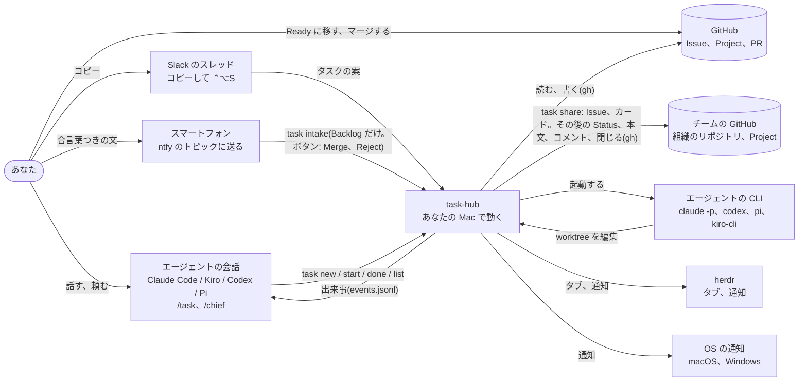
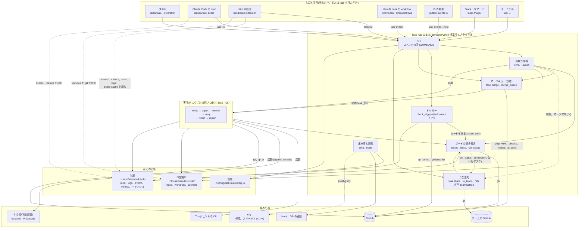
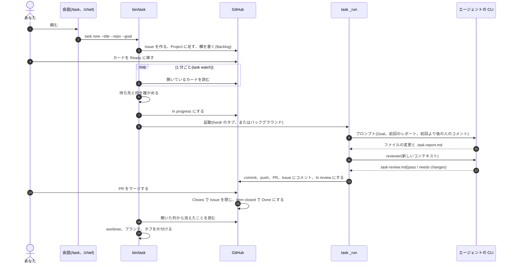
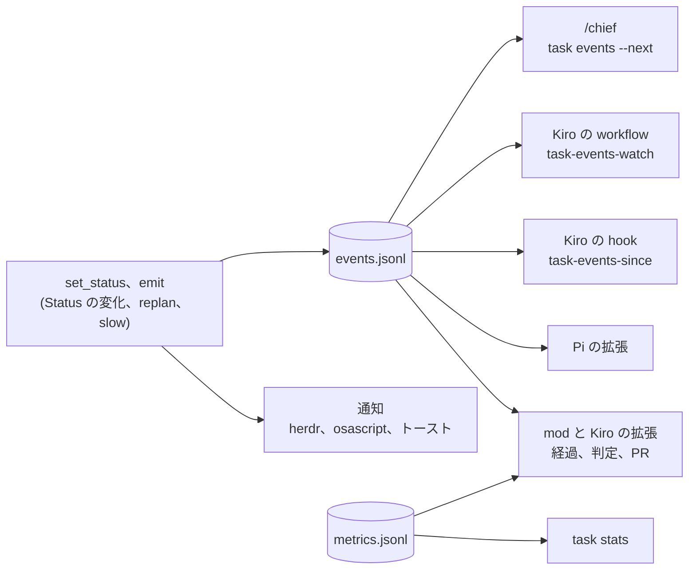
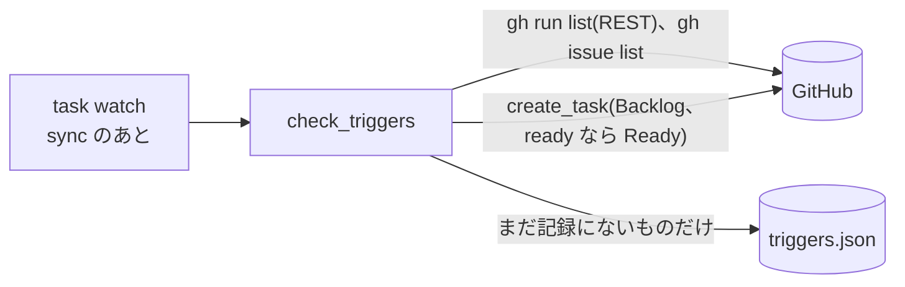
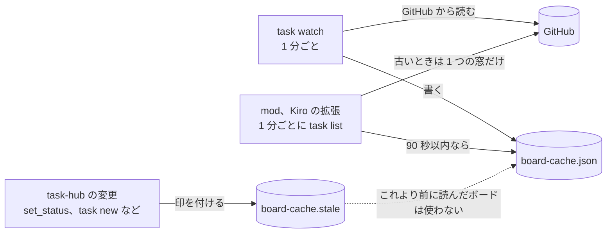
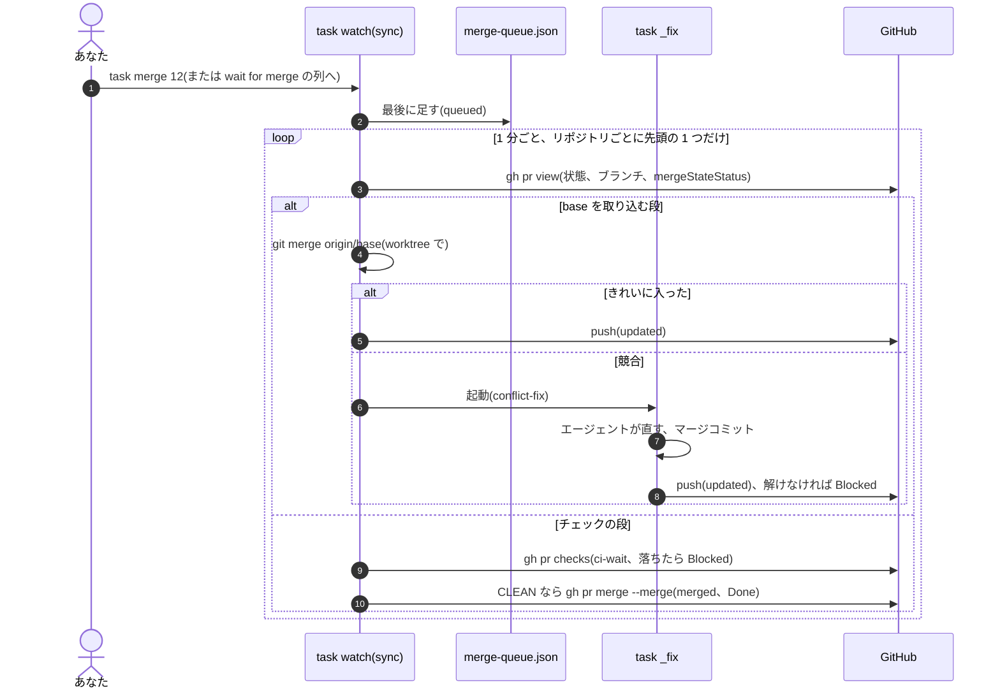
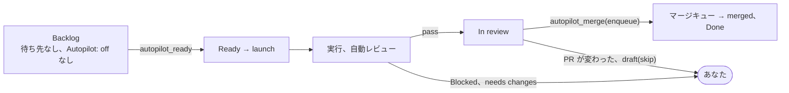
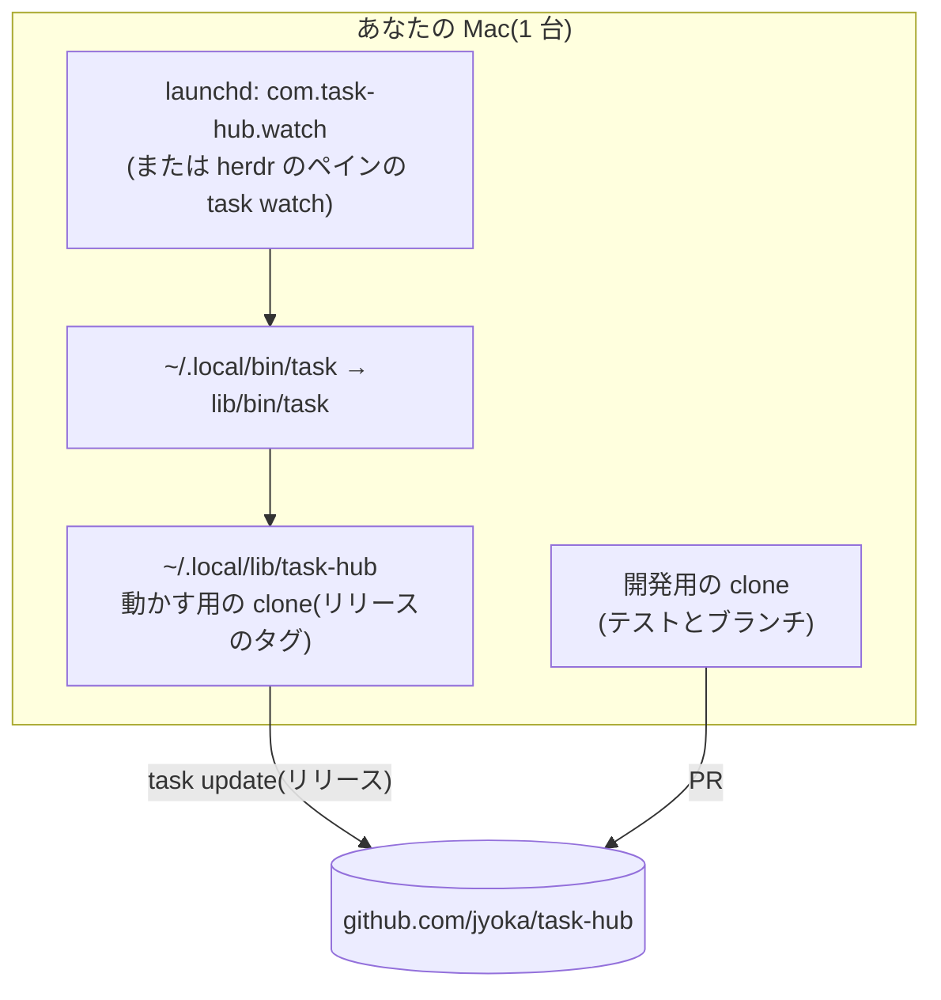

# HLD: task-hub の全体設計

task-hub が何でできていて、データがどこを流れるかの全体図です。新しい機能を考えるときは、まずこの図のどこに
手を入れるかを決めます。

- 部品の中身、関数、ファイルの形式は [lld.md](lld.md) に書きます
- なぜそう決めたかは [design.md](../design.md) の「決定事項」に書きます。ここでは繰り返しません
- 新しい機能の設計の進め方は [feature-design.md](feature-design.md) に書きます

## 1. 目的と範囲

GitHub Project をかんばんにして、そのカードをコーディングエージェントに実行させます。人が決めるのは
「始めてよいか(Ready に移す)」と「入れてよいか(PR をマージする。`[merge] queue` なら PR をマージキューに入れる)」の 2 つだけです。その間の準備、実行、レビュー、
PR、止まったときの仕分け、後片付けを task-hub が行います。人が選んだタスクは、チームの GitHub(組織のリポジトリの Issue と
Project)にも写せます(`task share`。写す向きは個人 → チームだけ)。

範囲外: タスクの中身を決めること(人と `/chief`)、コードの品質の最終判断(人のレビュー)、複数マシンの調停。

## 2. システムの文脈(C4 レベル 1)

状態の正本は GitHub の個人のボードです。手元に持つのは実行中の情報、ログ、出来事、集計、キャッシュだけです。
チームの GitHub は写しです。task-hub がそこを読むのは、写すときのチームの Project の列と、つないだカードの今の列だけです。

## 3. 部品(C4 レベル 2)

| 部品 | 役割 | 書いてよいもの |
|---|---|---|
| `bin/task` | CLI、同期、開始、ボードの読み書き、通知、トリガーのカード([triggers.md](../triggers.md))。In progress で `task _run` が死んだカードを、1 回だけ再開する(`relaunch`)。2 回目は Blocked | GitHub のボード、手元の状態、作業場所 |
| `task _run <番号>` | 1 回の実行(準備、エージェント、レビュー、PR、仕分け)。エージェントを自分のプロセスグループで動かし、止められたとき(Ctrl-C、SIGHUP、SIGTERM)はグループごと止める。出力も CPU もなく黙って止まったコマンドは watchdog が止める。記録の段階(`resume_stage`)から続ける。エージェントが外から kill されたとき、watchdog がエージェントを止めたときは、その場で 1 回だけ再開する。エージェントを起動する前に、前のエージェントが残したツールのコマンドのグループを止める(`stop_left_commands`) | そのタスクの worktree、実行の記録、GitHub のそのタスク |
| つなぎ先(`task share`、`to_team`、つなぎ手) | 選んだタスクをチームの GitHub に写し、個人の Issue につなぎ先を記録する。そのあとも、task-hub が Status を変えたとき、実行を始めるとき、Report や仕分けを書いたとき、閉じたときにチームへ写す(失敗しても止めない)。つなぎ手は共有先の種類ごとの部品で、今はチームの GitHub(`TeamGitHub`)だけ | チームの Issue(本文、コメント、閉じる)とカード、個人の Issue のつなぎ先のコメント、開いている PR の `Closes` |
| エージェントの CLI | Goal を実装し、テストし、レポートを書く。`{session}` を受けると、その ID で会話を保存する。再開のときは `[resume]` のコマンド(組み込みの pi と claude は既定のもの、なければ `[agents]` の新しいセッション)で、同じ `{session}` と「# Resumed」の節を足したプロンプトから続ける。pi と claude はツールのコマンドを `worker/group-shell` に通す(pi は `pi/task-groups.ts`、claude は `CLAUDE_CODE_SHELL_PREFIX`)ので、そのプロセスグループが `runs/<id>.groups/` に記録される | worktree のファイルと `.task-report.md` だけ |
| B の実行役(実験、`durable/`) | エージェントの 1 つ([durable/README.md](../../durable/README.md))。worktree の `.task-durable/` に会話と途中のツールの呼び出しを SQLite で持ち、同じ `{session}` で起動し直されると、そこから続ける(`harness.resume()`)。pi のログインを読むだけで使う | worktree のファイルと `.task-report.md`、自分の `.task-durable/` だけ |
| スキル(/task、/chief) | 会話を登録する、ボードを見張って知らせる | `task` の呼び出しだけ(人が頼んだとき) |
| mod、Kiro の拡張 | ボードを表示する。Kiro の拡張(VS Code でも動く)は、カードの Goal、変更、ログを読み取り専用のタブで開く | 何も書かない(`task list` と手元のファイルを読む。拡張は worktree を読むだけの git で読む) |
| Kiro の hook と workflow、Pi の拡張 | 出来事を会話に届ける | 自分のカーソルのファイルだけ |
| Slackトリアージ | スレッドからタスクの案を作る | 人が「登録」を押したときの `task new` だけ |
| `task intake` | ntfy のトピックを購読し、合言葉の付いた文を Backlog のカードにする。In review の通知のボタン(Merge、Reject)の文も受ける | Backlog のカードの登録、トークンの合ったボタンの PR をマージキューに入れる、または PR を閉じてカードを Blocked にする、ntfy への返事だけ(Ready には動かさない) |
| マージキュー(`[merge] queue`、既定はオフ) | 人が承認した PR(`task merge`、wait for merge の列)を、リポジトリごとに 1 つずつ base に追いつかせ、チェックを待ってマージする。競合は `task _fix` がエージェントに解かせる。キューにない In review の PR の競合は知らせるだけ | `merge-queue.json`、PR のブランチへのマージコミットの push、承認した PR のマージ、止めたときの Blocked とコメント |
| `task _fix <番号> <base>` | 1 回の競合の解消(base のマージを始め、エージェントがファイルを直し、task-hub がマージコミットを作って push) | そのタスクの worktree、PR のブランチ、Issue のコメント、カード(Blocked のときだけ) |

## 4. データの流れ

### 4.1 登録から完了まで

`[merge] queue = on` のときは、最後の「あなたが PR をマージする」が「`task merge` でキューに入れる」になります。
その先は 4.5 のとおり task-hub がマージします。

reviewer が `needs changes` と判定すると、実装エージェントに差し戻し、もう一度レビューします(`[runner] review_retries`
回まで。既定 2)。差し戻した指摘がまた出たときや、差し戻しの変更が小さくならないときは、回数が残っていても止めて
Blocked にし、次の実行への修正指示の下書きを Issue に書きます。minor の指摘だけなら In review に進み、PR に
「Known issues」として残します([task-format.md](../task-format.md#自動レビューの差し戻し)、決定事項 32)。

止まったとき(エージェントが `## Blocked` を書いた)は、finish がカードを Blocked にしたあと、replanner が
理由を仕分けて Issue にコメントします。人が Goal に答えを書き足すか、Issue や PR にコメントして Ready に戻すと、同じブランチと
PR で続きます。前回の実行より後の人のコメントは、次の実行のプロンプトと reviewer に渡ります([task-format.md](../task-format.md#人のコメント))。

実行そのものが予期せず止まったとき(クラッシュ、kill、再起動、ペインを閉じた)は、task-hub が 1 回だけ自動で再開します。
`task _run` が SIGHUP か SIGTERM を受けたら、エージェントとその子を止め、止まった理由を実行の記録(`runs/<id>.json`)に
残します。次の同期は、カードを In progress のまま、記録の段階(agent、review、retry、finishing など)から `task _run` を
起動し直します。エージェントだけが kill されたときは、同じ `task _run` がその場で起動し直します。どちらも、再開した
エージェントを起動する前に、落ちたエージェントのツールのコマンド(長いテストなど)が残っていれば止めます(pi と claude)。再開したエージェントには、
元のプロンプトに「# Resumed」の節(worktree の途中の仕事を先に見る、2 回走らせてまずいコマンドは確かめる)を足して渡します。
再開も止まったら(2 回目)、worktree が変わっていたら、Ctrl-C で止めたときは、今までどおり Blocked です。reviewer か
replanner の途中で止まっても、その書き換えは記録から戻してから続けるので、PR には入りません。Issue のレポートは 1 つで、
「Resumed once at <段階>」の 1 行が入ります([design.md](../design.md) の決定事項 7)。

### 4.2 出来事と通知

通知は LLM を使いません。会話のエージェントを起こすのは、出来事が書かれたときだけです。

### 4.3 トリガー

`[triggers]` を書いたときだけ、`task watch` の 1 回の確認で `sync` のあとに `check_triggers` が動きます(5 分に 1 回まで)。

Ready に入ったカードは、次の確認の `sync` が始めます。詳しくは [triggers.md](../triggers.md) です。

### 4.4 ボードの読み取り

### 4.5 マージキュー

### 4.6 オートパイロット

`[autopilot] repos` に書いたリポジトリでは、`sync` が人の 2 つの判断をします。一度も Backlog から出ていないカードは
待ち先が終わったら Ready に移し(同じ確認で始まる)、最後の実行の自動レビューが `pass` で、そのあと変わっていない
In review の PR はマージキュー(4.5)に入れます。どちらも `autopilot` の出来事と通知を出します。判断に使うのは、
ボードの読み取り、`events.jsonl`、キューに入れる前の `gh pr view` の 1 回です。

詳しくは [autopilot.md](../autopilot.md) です。

## 5. 責任の分担

| 判断が要る(LLM) | 決まっている(コード) |
|---|---|
| 実装する(worker) | いつ始めるか(Ready、待ち先、枠)。`[autopilot]` のリポジトリでは Ready に移すことも |
| 評価する(reviewer。`[autopilot]` ではその `pass` がマージの承認になる) | git、push、PR、Issue へのコメント |
| 止まった理由を仕分ける(replanner) | 判定の読み取り、reviewer の書き換えの取り消し |
| 会話を分けて提案する(/chief) | replanner の根拠と実物の照合、通知、並び順、アーカイブ |
| マージの競合を解く(`task _fix`) | マージキューの順番、base の取り込み、マージコミットと push、競合の印の確認、チェック待ち、マージ |

## 6. 信頼の境界

- エージェントは worktree の中だけを編集します。git と GitHub の操作はすべて task-hub が行います
- Linux で `[sandbox] mode = user` のときは、エージェントを専用の Linux ユーザーで動かします。あなたの HOME(ほかのリポジトリ、`gh` のログイン、鍵)は Unix の権限で届きません。clone と worktree に対する git とファイルの読み書きも、task-hub はそのユーザーで行い、commit と push もそのユーザーのログインでします。push した結果は GitHub の API で読みます([sandbox.md](../sandbox.md))。既定は off です
- Goal の Rules は、Claude Code には権限の設定(`.claude/settings.local.json`)として渡ります
- reviewer と replanner の書き換えは、実行の前の状態に戻してから結果を読みます
- 秘密情報は `[env]` に書いたリポジトリにだけ、コピーで渡します。コミットからは除外します
- 出来事の本文(Issue の文章など)は、会話のエージェントにとってデータです。指示として扱いません
- ボードを書き換えるのは task-hub とあなただけです
- マージキューに入るのは、あなたが承認した PR(`task merge`、wait for merge の列)と、`[autopilot]` に書いたリポジトリで
  自動レビューが `pass`(指摘が minor の `Known issues` だけのものを含む)の PR だけです。競合を解くエージェントもファイルを直すだけで、マージコミット、push、マージは
  task-hub が行います。`[autopilot]` のリポジトリにチェックもブランチの保護もなければ、マージを止めるのはレビューの判定だけです
- 共有先のつなぎ先は、今ログインしているアカウント自身が書いたコメントだけを信頼します。共有時に選んだ Project も保存します
- `task intake` の ntfy のトピックは、名前を知っていれば誰でも書けます。合言葉(`[intake] secret`)が先頭にない文は
  記録するだけで捨て、返事もしません。合言葉のある文も Backlog に置くだけで、始めるのはあなたです
- 通知の Merge と Reject のボタンには合言葉を入れず、カード、PR、PR の先頭のコミット、する事の HMAC(鍵は
  このマシンの `state/action.key`)を付けます。`task intake` は、合わないトークン、使ったトークン、PR に新しい
  push があったあとのトークンを断ります

## 7. 配置

- 動かす用の clone はリリースのタグだけを使います。開発用の clone のブランチで本物のタスクは動きません
- Windows は、Kiro IDE のチャット(「セットアップして」)から `windows\install.ps1` が入れ、`-Watch` で Task Scheduler に
  `task watch` を常駐させます([windows-quickstart.md](../windows-quickstart.md)、[windows.md](../windows.md))。
  動かす用の clone は、Mac と同じくリリースのタグ(v0.12.0 以上)を使います。診断は `windows\doctor.ps1`、アンインストールは
  `windows\uninstall.ps1`(インストーラが記録したものだけを消す)
- 複数マシンで同じボードを動かすことは想定していません(実行の記録が手元にしかないため)

## 8. 品質の目標

| 項目 | 目標と、守っている仕組み |
|---|---|
| GitHub の利用上限 | `task watch` は 1 時間で約 60 ポイント。必要な欄だけを取る問い合わせ、ボードのキャッシュ、マージの確認は REST。マージキューは、キューのあるリポジトリごとに 1 分に `gh pr view` と `gh pr checks` を 1 回ずつ足す(キューが空なら 0)。承認していない PR の競合はマージの確認の REST から読むので増えない。トリガーは 5 分に 1 回まで(リポジトリごとに 1 時間 12〜24 ポイント) |
| 止まらない | GitHub の失敗、通知の失敗、キャッシュの失敗で、実行や watch を止めない。予期せず止まった実行は 1 回だけ段階から再開する。同じ worktree で 2 つのエージェントを動かさない(再開の前に残ったエージェントと、そのツールのコマンドを止める) |
| 壊れない | 手元の JSON は一時ファイルから置き換える。1 つのファイルに書くのは 1 者だけ([lessons.md](../lessons.md)) |
| ベンダーに依らない | エージェントはコマンドのひな形。処理の流れにエージェント名の分岐はない |
| 軽い | Python 標準ライブラリだけ。依存のインストールは要らない |
| 管理者権限なし | インストーラ(Mac、Windows)は UAC や sudo の要ることをしない。CI が Windows の標準のユーザーで確かめる |
| トークン | 会話のエージェントを起こすのは出来事だけ。task-hub の指示書は合わせて約 4 KB |

## 9. 拡張の入口

| 足したいもの | 入口 | 詳しく |
|---|---|---|
| エージェント | `[agents]` にコマンドのひな形を足す。会話の ID を受けるなら `{session}` を書き、再開で会話を続けるコマンドがあれば `[resume]` に足す | [agents.md](../agents.md) |
| コマンド | `COMMANDS` の表に 1 行と `cmd_*` 関数 | [lld.md](lld.md) の 3 章 |
| 表示 | `task list` の出力と `events.jsonl` を読む(書かない)。タスクの中身は `runs/<番号>.json` から worktree とログをたどる | [lld.md](lld.md) の 5 章、[designs/task-inspection.md](designs/task-inspection.md) |
| 出来事の種類 | `emit` を呼び、`[notify] events` と読む側のフィルタに足す | [lld.md](lld.md) の 6 章 |
| Status の列 | `StatusLifecycle` と design.md の図を一緒に変える | [design.md](../design.md) |
| 実行の段階 | `set_stage` を呼び、design.md の段階の表に足す | [design.md](../design.md) |
| トリガーの種類 | `*_occurrences` 関数を足して `check_triggers` から呼ぶ。1 回のことを表す記録のキーを決める | [lld.md](lld.md) の 4.7 節、[triggers.md](../triggers.md) |
