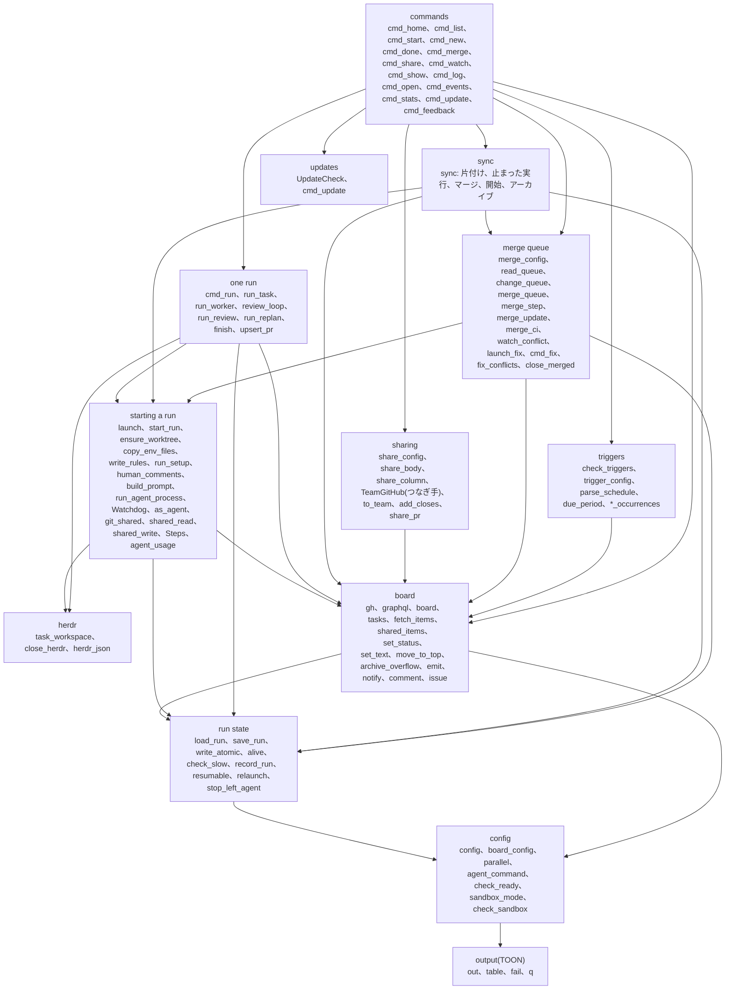
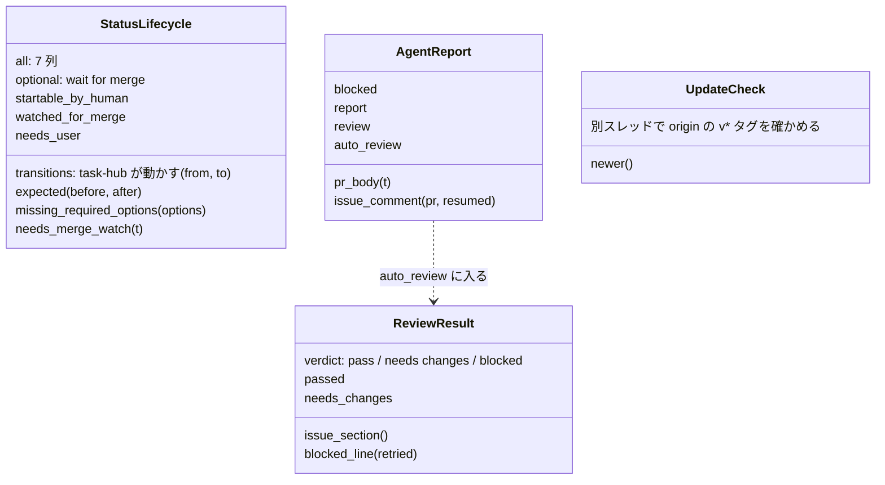
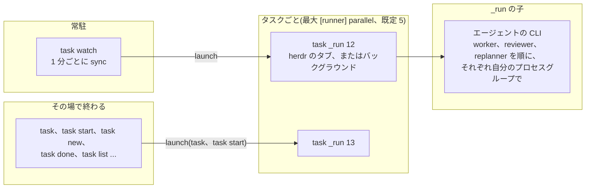
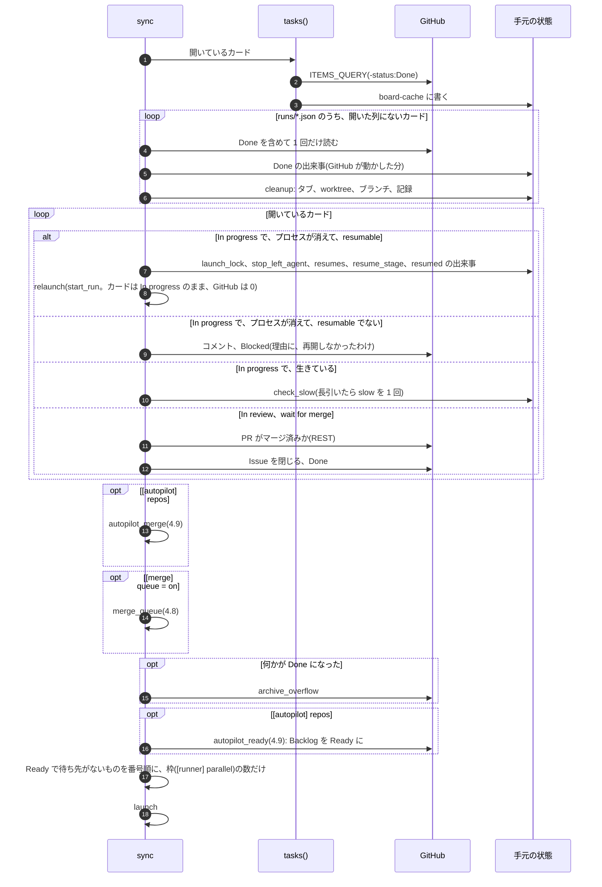
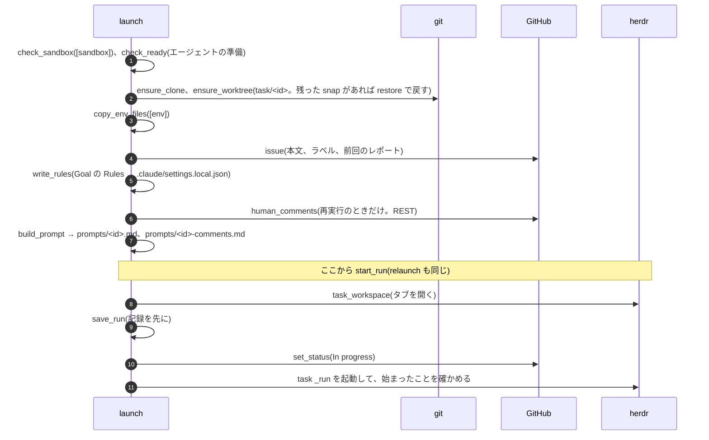
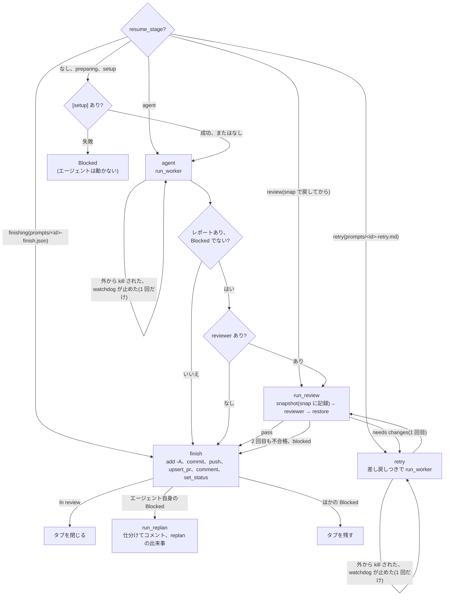
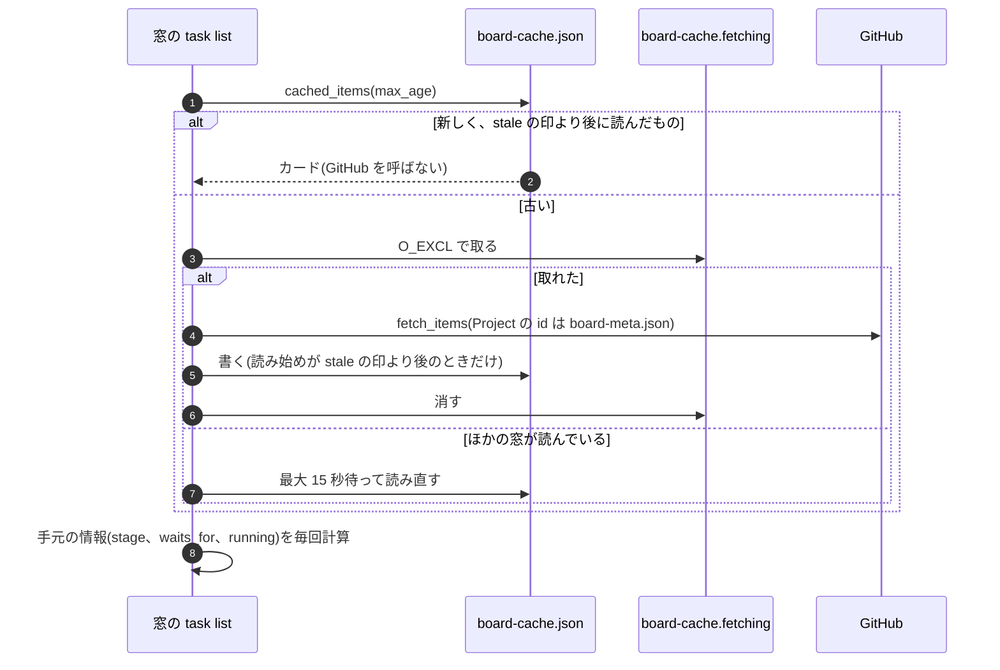
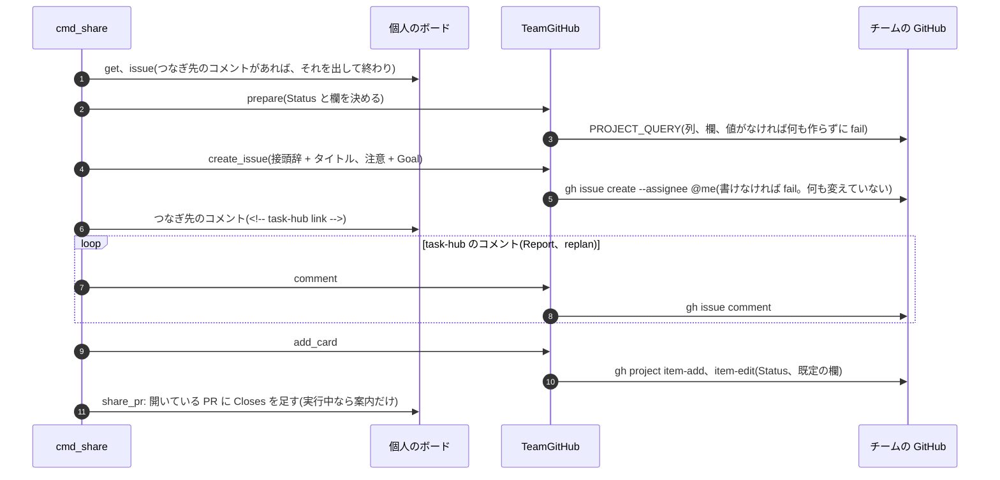
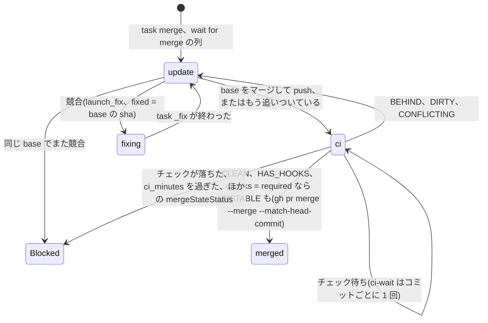

# LLD: task-hub の詳細設計

[hld.md](hld.md) の部品の中身です。関数、プロセス、ファイルの形式、外部の呼び出し、守るべき約束を書きます。
関数名は `bin/task` のものです。行番号は変わるので書きません(`grep -n "^def <名前>" bin/task` で探します)。

## 1. bin/task の構成

1 ファイル(約 5,700 行、Python 3.10 以上の標準ライブラリだけ)を、見出しのコメント `# ---------- ... ----------` で
分けています。上の層は下の層だけを呼びます。



### クラス



タスクは dict で持ちます(クラスにしていません)。ボードの値(`tasks()` が作る)と、手元の実行の記録(`load_run`)を
`{**load_run(id), **ボードの値}` で重ねたものです。

| キー | 出どころ | 意味 |
|---|---|---|
| `id`、`title`、`url` | GitHub(Issue) | Issue の番号、タイトル、URL |
| `item` | GitHub(Project) | カードの id(`set_status` などで使う) |
| `status`、`repo`、`agent`、`base` | GitHub(欄) | Status、Target repo、Agent、Base branch |
| `updated`、`closed` | GitHub | カードを最後に変えた時刻、Issue が閉じているか |
| `blockers`、`waits_for` | GitHub + 計算 | Blocked by のリンク、まだ始められない理由 |
| `branch`、`worktree`、`pid`、`tab`、`workspace`、`log`、`pr`、`stage`、`started` | 手元(`runs/<id>.json`) | 実行の情報 |
| `agent_pid`、`agent_started`、`head`、`snap`、`review_attempt`、`interrupted` | 手元(`runs/<id>.json`。`task _run` が書き、`launch` が空に戻す) | 今のエージェントのプロセス(グループ)と開始時刻、エージェントを起動する前の HEAD、reviewer か replanner の間の `snapshot`(`<tree> <HEAD>`)、レビューの何回目か(`0`、`1`)、実行かエージェントが最後に止まった理由(`SIGHUP`、`SIGTERM`、`SIGINT`、`the agent was killed (SIGKILL)`、watchdog がエージェントを止めたときの `silent`、`the run process is gone`)。5 章 |
| `resumes`、`resumed`、`resume_stage`、`resumed_at` | 手元(`runs/<id>.json`。`relaunch` と `task _run` が書き、`launch` が空に戻す) | この実行を再開した回数(`MAX_RESUMES` まで)、再開した段階(空白で区切る)、次の `task _run` が続ける段階(読んだら空にする)、`relaunch` が起動し直した時刻。4.3 |
| `session`、`session_role` | 手元(`runs/<id>.json`。`task _run` が実装エージェントの起動の前に書き、`launch` が空に戻す) | その起動の `{session}`(UUID)と段階(`agent`、`retry`)。再開は同じ段階なら同じ値をコマンドに渡す。4.3 |
| `link` | 手元(`runs/<id>.json`。`launch` が `issue()` のつなぎ先のコメントから)。`task done` は自分で読む `issue()` から | チームの Issue(`org/app#12`)。`finish` が PR の本文に `Closes` を足す。`set_status`、`comment`、`sync` のマージの処理が `to_team` でチームに写す。つないでいなければ空 |
| `link_project` | `link` と同じコメントの `Project: owner/number` | 共有時に選んだ Project。実行の記録にも保存し、後の設定変更で共有先を変えない |
| `running` | 計算(`alive`) | 実行のプロセスが生きているか |

## 2. プロセス



- `launch` は実行の記録を書いてから In progress にし、`task _run` を起動します。herdr があればタブで、
  なければログ付きのバックグラウンドプロセスで動かします
- `sync` はカードごとに `launch_lock`(`runs/<id>.lock` のロック)を取ってから `launch` を呼びます。取れないとき、
  または取ったあとで実行が生きている(`alive`)ときは、別の task-hub(`task watch` と `task start` など)が始めたので
  `skipped:` と出して何もしません。2 つ目の開始が 1 つ目のタブを閉じて、1 つ目が「could not start」になるのを防ぎます(#43)
- herdr のタブでは、ペインに `sh <ランチャー>`(`share/run/<id>.sh`)を打ち込みます。ランチャーは最初に自分を消し、
  消せなければ(もうなければ)終わります。`launch` はランチャーが消えたら始まったとみなします。画面の文字は見ません
  (出力が流れたり描き直されたりすると、最初の行が画面から消えるため)。8 秒たっても消えなければ Enter を送ってもう 8 秒待ち、
  それでも残っていれば自分で消して開始の失敗にします。先に消した方が決まるので、あきらめたあとに実行が遅れて始まることはありません。
  ランチャーがすでに消えていたら(直前に始まった)、失敗にしません
- `task _run` は自分の pid を記録します。同期は `alive` でプロセスを確かめ、消えていてカードが In progress なら、
  `resumable` が通れば 1 回だけ `relaunch` で再開し、通らなければ Blocked にします(4.1)。`relaunch` は残ったエージェントの
  グループを先に止め(`stop_left_agent`)、`launch` と同じ起動の部分(`start_run`)で `task _run <id>` を始めます。
  コマンドの形は同じなので、`alive` と task-rs はそのまま実行と見なします
- エージェントだけが外から kill されたとき(POSIX で終了コードが負、task-hub が止めたのではない)と、watchdog がエージェントを
  止めたとき(下)は、同じ `task _run` がその場で 1 回だけ起動し直します(`run_worker`)。Windows は終了コードでシグナルを見分けられないので、その場では再開しません
- エージェントは自分のプロセスグループで動きます(`AGENT_GROUP`。POSIX は `start_new_session`、Windows は
  `CREATE_NEW_PROCESS_GROUP`)。ペインの Ctrl-C と、閉じたペインの SIGHUP は `task _run` にだけ届き、`task _run` がグループごと
  止めます(`stop_agent`: SIGTERM、`AGENT_STOP_SECONDS` の 10 秒待って SIGKILL。Windows は `taskkill /T /F`)。
  `[sandbox] mode = user` では、グループのうち専用ユーザーのプロセスへは `as_agent` の `kill` でも送ります。
  `task _run` は起動したエージェントの pid と開始時刻を `agent_pid`、`agent_started` に書き、終わったら空に戻します。
  エージェントには制御端末がありません(`/dev/tty` に問いかけるコマンドは失敗します。stdin は今までどおり空です)
- `agent_process` はエージェントの出力を別のスレッドで読み、`task _run` の側で watchdog(`Watchdog`)を動かします。
  出力が `SILENT_SECONDS`(45 分)なく、かつエージェントの子孫(ppid をたどった先と、グループに残ったもの。エージェント自身と、
  `[sandbox] mode = user` の `sudo` は除く)が前の確認から CPU を使っていない(`ps -o time` の値もプロセスの顔ぶれも同じ)ときだけ、
  その子孫に SIGTERM、`AGENT_STOP_SECONDS` 後に残っていれば SIGKILL を送ります(`signal_pids`)。`ps` は黙っている間だけ
  `SILENT_CHECK`(60 秒)ごとに動かします。出力が来たら数え直します。子孫を止めてから(止めるものがなければ `SILENT_SECONDS` から)
  さらに `SILENT_GRACE`(10 分)黙っていて、子孫も CPU を使っていなければ、`stop_agent` でグループを止め、`interrupted` に `silent` を書きます。
  そのあとは外から kill されたエージェントと同じく、`run_worker` がその場で 1 回だけ起動し直します(理由は `silent`)。
  再開のあとも止められてレポートがなければ、`finish` が「the watchdog stopped the agent」で Blocked にします。
  `ps` がない(Windows)か失敗したときは、子孫の CPU が分からないので、どちらの段も動きません。テストは `TASK_SILENT_SECONDS` と `TASK_SILENT_GRACE_SECONDS` で短くします
- `task _run` が SIGHUP か SIGTERM を受けたら(ペインを閉じた、シャットダウン、`kill`)、`interrupted` にシグナルの名前を
  書いて、その場で終わります。エージェントが動いていれば、先にそのグループを止めます(`Interrupted`)。ほかの間(`[setup]`、
  git、GitHub)は待たずに終わり、動いている git は止めません。push もカードの移動もしないので、In progress のカードは
  そのままで、次の同期が 1 回だけ再開します(ペインを閉じたときも。design.md の決定事項 7)。終わったあと(In review でタブを閉じるとき)の SIGHUP は記録しません。
  シグナルを受けた中では `say` を使わず、「stopped by」の 1 行を `os.write` で stdout とログに直接書きます
  (シグナルが `print` の途中に届くと、同じバッファへの書き込みが「reentrant call」で失敗し、記録せずに終わるため)。
  Ctrl-C は今までどおり、途中までを push して Blocked にします。エージェントの外(`[setup]`、git)で受けた Ctrl-C は
  `interrupted` に `SIGINT` を書いて終わり、次の同期は再開せずに Blocked にします
- herdr のタブで動かすときは、環境変数を `HOME`、`PATH`、`TASK_*`、`GIT_AUTHOR_*`、`GIT_COMMITTER_*`、`[runner] pass_env` だけに絞ります

## 3. コマンド

| コマンド | 主な関数 | GitHub | 手元に書くもの |
|---|---|---|---|
| `task` | `sync(started_here=True)`、`cmd_home` | ボードを読む、開始、片付け | runs、events、asked |
| `task watch` | `archive_overflow`、ループで `sync` と `check_triggers` | 同上 + 開始時のアーカイブの確認 + トリガー(4.7 節) | 同上 + triggers |
| `task list [--max-age]` | `shared_items`、`tasks`、`list_lines` | キャッシュが古いときだけ読む | board-cache |
| `task start <id>` | `get`、`set_status(Ready)`、`sync` | 読む、Status | runs、events |
| `task new` | `cmd_new`、`create_task` | Issue、カード、欄、Blocked by | events、asked |
| `task intake` | `intake_config`、`intake_stream`(ntfy の購読)、`parse_intake`、`intake_message`、`create_task`。ボタンの文(`task-hub ` で始まる)は `action_message`(`action_token` で確かめ、`pr_view`、`queue_entry`、`enqueue` か `gh pr close` と `set_status(Blocked)`) | 文ごとに Issue、カード、欄(Backlog)。ボタンごとにボードを読む、`gh pr view`、Merge は `cmd_merge` と同じ、Reject は PR を閉じる、Issue のコメント、Status | intake、intake-actions、merge-queue、events |
| `task merge [<id>] [--cancel]` | `merge_config`、`get`、`enqueue`(`queue_entry`。PR がなければ `find_pr`)、`change_queue`、`set_status(wait for merge)`(列があるとき。Blocked からは列がなければ In review) | 読む、Status | merge-queue、events |
| `task done <id>` | `cleanup`、`issue`、`set_status(Done)`、`archive_overflow` | Issue を閉じる、Status、アーカイブ。つないだタスクはチームの Issue も閉じ、カードを Done に | runs を消す、events |
| `task share <id> --to` | `get`、`issue`、`share_config`、`TeamGitHub`、`share_pr` | 読む、チームの Project を読む、チームの Issue とコメントとカード、個人の Issue につなぎ先のコメント、開いている PR の本文 | なし(つなぎ先は GitHub のコメント) |
| `task show` | `get`、`issue` | 読むだけ | なし |
| `task log`、`task open` | `load_run`(手元の記録だけ) | なし | なし |
| `task events`、`task stats` | `events_named`、`cmd_stats` | なし | なし |
| `task update` | `cmd_update`、`restart_watch`、`copy_kiro`。かんたんセットアップで入れた clone は `update_by_installer`(新しい版のインストーラを動かす) | なし(origin のタグを読む) | LIB を新しい版に、Kiro のフックとワークフローのコピー |
| `task feedback` | `cmd_feedback`、`open_in_browser` | なし(ブラウザで Issue の画面を開くだけ) | なし |
| `task _run <id>` | `cmd_run` | 3.3 の図 | runs、logs、metrics、events |
| `task _fix <id> <base>` | `cmd_fix`、`fix_conflicts`、`build_fix_prompt`(`launch_fix` が起動) | `issue`(Goal)、git push、Issue にコメント、Blocked のときだけ Status | runs、logs、events |

新しいコマンドは `COMMANDS` の表に `名前: (関数, 位置引数, フラグ, 使い方)` を 1 行足し、`cmd_<名前>(a)` を書きます。
引数の解析、`--help`、エラーの形(`error:` と `help:` を stdout)は `main` が共通で行います。

## 4. 主な流れ

### 4.1 同期(`sync`、`task watch` の 1 回)



### 4.2 開始(`launch`)



### 4.3 1 回の実行(`cmd_run`)



再開(`resume_stage` が空でない、または、その場の再開)のエージェントには、元のプロンプト全体に「# Resumed」の節
(`worker/PROMPT.md` の 3 つ目の部分と `It stopped during: <段階> (<理由>)`)を足して渡します(`resume_prompt`)。
コマンドは `[resume] <名前>` があればそれ(空なら、なし)、なければ `[agents] <名前>` が組み込みのままの `pi` と `claude` は
`DEFAULT_RESUME`、どれでもなければ `[agents] <名前>`(新しいセッション)です(`resume_command`)。`{session}` は
`agent_command` が起動ごとの UUID に置き換えます。実装エージェントの起動(`run_worker`)は、新しい値を `session` と
`session_role` に残してから起動し(`start_session`)、再開(`run_resumed_worker`)は `session_role` が同じ段階なら
`session` を渡します(なければ新しい値)。reviewer、replanner、conflict fixer は毎回新しい値です。`[resume]` のコマンドが
手順(`· ` の行)を 1 つも出さず、レポートもなく 0 以外で終わったら、同じ再開の中で 1 回だけ `[agents]` のコマンドで、
新しい `{session}` で起動し直します(claude の `--session-id` は使われている ID を断る)。再開の回数は実行全体で `MAX_RESUMES`(1)回です。

| `resume_stage` | 続け方 |
|---|---|
| `preparing`、`setup` | 最初から(`[setup]` は何度動かしても同じ結果になる約束。プロンプトは作り直さない) |
| `agent` | エージェントを再開のコマンドで起動。そのあとは今までどおり review、finish |
| `review` | `snap` で worktree を戻し(`release_snapshot`)、reviewer を新しく起動。`review_attempt` が 1 なら 2 回目のレビュー(差し戻しは増えない) |
| `retry` | 差し戻しのプロンプト(`prompts/<id>-retry.md`)で、エージェントを再開のコマンドで起動。そのあと 2 回目のレビュー |
| `finishing` | `prompts/<id>-finish.json`(`review_loop` の結果とエージェントの終了コード)で `finish` をもう一度。commit、push、PR は同じ結果になる。Issue の最後のレポートが「Resumed once」の行のほかは同じ本文なら、コメントを書かない |

再開した実行の Issue のレポート(`finish`、`report_comment`)には、`Resumed once at <段階>: <理由>.` の 1 行が入ります
(`resumed_line`)。`finishing` で止まったときに、レポートがもう Issue にあれば書き直さないので、その行は入りません
(出来事 `resumed` とログには残ります)。

その場の再開の前に、kill されたエージェントのグループに残ったもの(エージェントが始めたテストやサブエージェント)を
SIGKILL で止めます。止まらなければ再開しません。

`finish` の判定:

| 条件 | 結果 |
|---|---|
| レポートがない | Blocked(`agent exited without a report`) |
| reviewer が 2 回不合格、または blocked | Blocked(review) |
| レポートに `## Blocked` | Blocked(エージェント自身)→ replanner |
| 変更なし、research ラベルなし | Blocked(`changed no files`) |
| それ以外 | In review(変更があれば PR、research ならレポートだけ) |

### 4.4 ボードの読み取り(`task list`)



### 4.5 チームに出す(`task share`)



- Status は `<repo>.status.<列>`、`status.<列>`、チームの同じ名前の列、`SHARE_STATUS` の順で決めます
- つなぎ先のコメントは Issue を作った直後に書きます。そのあとの失敗でも、もう一度の `task share` は Issue を作りません
- つなぎ先は `viewerDidAuthor` が true のコメントだけから読みます。公開のコメントから別の Issue への書き込みを許しません
- 実行の中では GitHub を読み直しません。`launch` が `issue()` で読んだつなぎ先を `runs/<id>.json` の `link` に入れ、
  `finish` の `AgentReport.pr_body` がそれで `Closes` を足します。実行中に共有したタスクは、その実行の PR に足りないので、
  終わってからもう一度 `task share` を呼ぶと `add_closes` が足します
- つなぎ手(`TeamGitHub`)は共有先の種類ごとの部品で、`prepare`、`create_issue`、`comment`、`add_card`、`edit`、`move`、
  `close` を持ちます。Jira などは同じ形のつなぎ手を足します([designs/team-sync.md](designs/team-sync.md))

### 4.6 つないだタスクのその後(`to_team`)

つないだあとの変化は、`to_team(t, 何を, 変更)` がチームに写します。`t["link"]` が空なら何もしません。つなぎ先を知るために
GitHub を読むことはありません(実行の中は `launch` が読んで `runs/<id>.json` に入れた `link`、`task done` は自分で読む
`issue()` の `link`)。失敗は止めずに stderr に `warning: task <id>: could not copy <何を> to <org/app#12>: ...` を 1 行出します
(8 章)。

| いつ | 呼ぶところ | チームへ |
|---|---|---|
| 実行を始めるとき | `launch`(`issue()` を読んだ直後) | `edit`: タイトル(`[share]` の接頭辞 + 個人のタイトル)と本文(`share_body`: 注意 + 今の Goal)を上書き |
| Status を変えたとき | `set_status` の最後(出来事とカードの並べ替えのあと) | `move`: `TEAM_CARD_QUERY` でカード、列、今の列を読み、`share_column` の列と違うときだけ `gh project item-edit` |
| task-hub がコメントを書いたとき | `comment`(本文が `<!-- task-hub report -->` か `<!-- task-hub replan -->` で始まるときだけ) | `comment`: 同じ本文。人のコメントとつなぎ先のコメントは写さない |
| `task done` | `cmd_done` | `close`、そのあと `set_status(Done)` の `move` |
| マージを見つけた同期(GitHub が閉じなかった) | `sync` | `close`、そのあと `set_status(Done)` の `move` |
| GitHub がカードを Done にした | `sync`(片付けの前) | `move`(Done) |

- 列の決め方は `task share` と同じ `share_column` です(`<repo>.status.<列>`、`status.<列>`、チームの同じ名前の列、
  `SHARE_STATUS`)。`[share]` に書いた列がチームにないときは、写さずに warning を出します
- チームの Issue が複数の Project にあるときは、共有時に保存した Project のカードだけを動かします。古いコメントでは `[share]` の Project を使い、どちらにも指定がないときだけ最初のカードを使います。指定した Project のカードがなければ、ほかのカードは動かしません
- 実行中に共有したタスクは、その実行の `link` が空なので、その実行の間は写しません(PR の `Closes` と同じ)

### 4.7 トリガー(`check_triggers`)

`task watch` の 1 回の確認で、`sync` が返した開いているカードを渡して呼びます。`trigger_config` が `None`
(`[triggers]` がない、または何も書いていない)なら、GitHub にもファイルにも触りません。
`trigger_config` は `ci` と `issues` のリポジトリを、大文字と小文字を区別せずに 1 つにまとめます(最初の書き方を使う)。

1. `triggers.json` の `checked_at` から `TRIGGER_SECONDS`(既定 300、テストは `TASK_TRIGGER_SECONDS`)たっていなければ何もしない
2. `checked_at` を先に書く(失敗するリポジトリにも 5 分に 1 回しか聞かない)
3. 1 回のこと(occurrence)を集める。どれも `seen` にあるキーは除く
   - `ci_occurrences`: 同じタイトルの開いたカードがあれば何もしない。`default_branch`(1 日取っておく)の
     `gh run list` から、ワークフローごとに最後に終わった実行を取り、`CI_FAILED` のものを 1 枚にまとめる。キーは `ci:<repo>:<run id>`
   - `issue_occurrences`: `gh issue list --assignee @me`、`issue_label` があれば `--label` も。キーは `issue:<repo>#<番号>`
   - `recurring_occurrences`: `due_period` が今の周期を返したもの。キーは `every:<名前>:<周期>`
4. occurrence ごとに `create_task`。キーがもう `seen` にあれば(同じ確認の前の occurrence が書いた)作らない。`created` で Issue の URL が分かった直後に `seen` に書く。`ready` なら Backlog のあと `set_status(Ready)`

GitHub の失敗はリポジトリごと、カードごとに `trigger_errors` に出し、ほかは続けます。`triggers.json` が書けなければ
何も作らずに `error:` を返します。

### 4.8 マージキュー(`merge_queue`、`[merge] queue = on` のときだけ)

`sync` は、カードごとの確認(マージの確認を含む)のあとで `merge_queue` を呼びます。wait for merge の列にあって
キューにないカードを、動かした順(`updated`)にキューの最後に足し(`queued`)、そのあとリポジトリごとに先頭の 1 つだけ
`merge_step` で 1 段進めます。1 つの段の GitHub か git の失敗は `github_errors` に出し、次の確認で同じ段をやり直します。



- 図の `fixing` はキューの `step` には書きません(`step` は `update` のまま)。`task _fix` が生きている間は、`tasks()` の
  `running` で待ちます
- キューに残す条件は、カードが `queue_column()`(列があれば wait for merge、なければ In review)にあることです。
  ほかの列に動いたカードは何もせずに外します
- `merge_block` は Issue に `<!-- task-hub merge -->` のコメントを書き、カードを Blocked(理由は `merge queue: ...`)に
  してから、最後にキューから外します(GitHub の失敗のときは残して、次に試し直す)
- マージしたら、`sync` のマージの確認と同じ `close_merged`(Issue を閉じる、Done、`cleanup`)を呼びます
- `watch_conflict`: キューにない In review のカードは、マージの確認(`pr_merged` の REST)の `mergeable_state` が
  `dirty` のとき、`conflict` を PR の先頭のコミット(`sha`)ごとに 1 回書きます。`[merge] prefix = on` なら、その `sha` で
  `conflict-fix` をまだ出していなければ `launch_fix` します。どちらも `events.jsonl` で「1 回」を判定します(`check_slow` と同じ)
- `launch_fix` は `launch` と同じく `launch_lock` を取ってから、実行の記録(`stage: conflict-fix`、`started`、空の
  `pid`、`branch` は PR のブランチ)を書き、`task _fix <id> <base>` をログ付きのバックグラウンドで起動します(herdr の
  タブは開きません)。カードは動かしません
- `[sandbox] mode = user` では、キューの git(`merge_worktree`、`merge_update`、`push_failed`、`fix_conflicts`、`cmd_fix`)も
  `git_shared` で専用ユーザーから動かし、push はそのユーザーのログインで行います。レポートと競合の印は `shared_read` で読み、
  `task _fix` の作業フォルダは `launch` と同じく worktree の外です(約束 14)
- `cmd_fix`(`fix_conflicts`)は `git merge --no-ff --no-commit origin/<base>` で止まった競合をエージェントに渡し、
  レポートに `## Blocked` がない、`MERGE_HEAD` が残っている、`git add -A` のあとに未解決のファイルも
  `<<<<<<<`、`>>>>>>>` の行もない、を確かめてから `git commit --no-edit`(親が 2 つ)と push をします。どれかが
  だめなら `git merge --abort`、`reset --hard`、`clean -fd` で元に戻し、カードを Blocked にします。push だけが
  失敗したときは、作ったマージコミットを戻さずに worktree に残して Blocked にします(`push_failed`。`merge_update` も同じ)
  理由に入れる git の出力は `git_said` で整えます。`\r` で描き直された行は最後の描画だけ、ANSI の消去コードと
  sideband の空白は消し、300 文字ほどに収まるよう行ごとに `remote:`(フックのことば)、`! [rejected]` の順に残します。
  長すぎる行は 300 文字で切るので、少なくとも 1 行は必ず残ります。`run(..., check=True)` が失敗したときの
  例外の文(競合の修正の `git add`、`git commit` のフックの失敗など)も `git_said` を通します。`run` は
  `text=True` を使わずに自分で読みます(`text=True` の universal newlines は `\r` を改行に変え、描き直しが別の行になるため)

### 4.9 オートパイロット(`autopilot_merge`、`autopilot_ready`、`[autopilot] repos` があるときだけ)

`sync` の最初に `autopilot_config` が `repos`(小文字の owner/name の集合)を返します。書き間違い、`[merge] queue` が
オフ、`[runner] reviewer` が空なら `fail` します(`cmd_watch` も始めるときに呼ぶ)。

- `autopilot_merge`: カードごとの確認のあと、`merge_queue` の前に呼びます。`repos` の In review のカードで、
  `autopilot_off` でない、`events.jsonl` でカードの最後の Status の出来事が `In review` で、その digest の `verdict` が
  `pass` で `pr` がある、その時刻より後に `queued` も `autopilot`(`merge`、`skip`)もない、`running` でも
  `alive(load_run(id))` でもない(同じ確認で `watch_conflict` が始めた競合の解決は `running` に出ないため)、なら
  `pr_view` を 1 回読みます。実行の `pr` が digest の `pr` と違う、draft、開いていない、`headRefOid` が In review の
  出来事の `sha` と違う、のどれかなら `autopilot`(`action: skip`)を書いて人に任せ、どれでもなければ `enqueue`
  (`task merge` と同じ)をして `autopilot`(`action: merge`、`pr`)を書きます。`enqueue` の ValueError(PR がない、
  実行が戻った)は飛ばし、RuntimeError は `github_errors` に出します。キューに入ったカードは同じ確認の `merge_queue` が進めます
- `autopilot_ready`: 始める前のボード(`board_`)で、`repos` の Backlog のカードを番号順に見ます。Issue が開いている、
  待ち先(`waits_for`)がない、動いていない、`autopilot_off` でない、`runs/<id>.json` がない、`events.jsonl` に Backlog
  以外の Status の出来事がない(`left_backlog`)、なら `set_status(Ready)` と `autopilot`(`action: ready`)。カードの
  辞書の Status が変わるので、同じ確認の開始の一覧に入ります。`sync` は `autopilot_ready` のあとで `updated` と
  `github_errors` の表を出すので、その失敗も表に出ます
- `autopilot_off` は `tasks()` が Issue の本文(ITEMS_QUERY ですでに読んでいる)から `AUTOPILOT_OFF`(行全体が
  `autopilot: off`。大文字と小文字、前後の空白、箇条書きの印、`*`、`_`、`` ` ``、終わりの `.` を問わない)で求めます。
  実行の記録には保存しません

## 5. 手元のファイル

| ファイル | 書く者 | 読む者 | 形式 |
|---|---|---|---|
| `~/.config/task-hub/config.ini` | 人、インストーラ | すべて | INI(`[board]`、`[runner]`、`[agents]`、`[resume]`(再開のときのエージェントのコマンド。なければ `[agents]`)、`[env]`、`[setup]`、`[check]`、`[ide]`、`[notify]`(`events`、`ntfy`、`ntfy_token`)、`[share]`、`[intake]`(`topic`、`secret`、`repo`)、`[triggers]`、`[autopilot]`(`repos`)、`[sandbox]`)。`[share]` は `task share` の共有先ごとのチームの Project、`<repo>.title`、`<repo>.field.<欄>`、`status.<列>`、`<repo>.status.<列>`([usage.md](../usage.md#チームのボードに出すtask-share))。`[runner] parallel` は同時に動かすタスクの数(既定 5、1 未満や数でない値は `sync` の前に `fail`) |
| `state/runs/<id>.json` | `launch`、`task _run`(順番に)、`relaunch`(実行が生きていないとき)、`cleanup` が消す | すべて(Kiro の拡張は `worktree`、`base`、`branch`、`log`、`repo` を読む) | JSON(`RUN_KEYS`)。`link` は共有先の Issue、`link_project` は共有時に選んだ Project(古い記録では空)。`agent_pid`、`agent_started`(`started` と同じ形の UTC)、`head`、`snap`、`review_attempt`、`interrupted`、`resumes`(数の文字列)、`resumed`、`resume_stage`、`resumed_at`、`session`、`session_role` は 1 章の表のとおり。古い記録にない欄は空として読む。task-rs は知らない欄を読み飛ばす(task-rs の `alive` は `resumed_at` を見ないので、再開の直後の数秒は「動いていない」と出る。表示だけ) |
| `state/runs/<id>.lock` | `launch_lock`(中身は空。ロックだけに使う)、`cleanup` が消す | `launch_lock` | 空のファイル |
| `state/merge-queue.json` | `cmd_merge`、`merge_queue`(どちらも `change_queue` で `merge-queue.lock` を持って読み、変えて書く) | `cmd_merge`、`sync` | `{queue: [{id, repo, pr, queued, step, since, fixed, ci_wait}]}`。`step` は `update` か `ci`、`fixed` は競合を解かせたときの base の sha、`ci_wait` は `ci-wait` を出したコミット |
| `state/merge-queue.lock`、`state/merge-queue.work.lock` | `file_lock`(中身は空) | 同じ | `.lock` は 1 回の読み書きのあいだ、`.work.lock` はキューを進める 1 つの task-hub(`task watch` と `task`)が持つ |
| `share/run/<id>.sh` | `launch`(herdr のときだけ。0600) | ペインの `sh`(読んだら自分を消す) | シェルスクリプト |
| `state/logs/<id>.log` | `task _run` | `task log`、task-rs の `log_tail`、Kiro の拡張(ログのタブ) | テキスト。エージェントの出力は 1 行ずつ。コマンドに JSON の出力のフラグがあるエージェント(組み込みの 4 つ。`step_format`)は、`Steps` が手順ごとの 1 行(`LOG_LINE_MAX` 字まで)と最後の結果の全文に直したもの |
| `state/events.jsonl` | `emit`(追記) | /chief、Kiro、Pi、mod、`task events` | JSON Lines |
| `state/metrics.jsonl` | `record_run`(追記) | `task stats`、mod の実績、`slow_threshold` | JSON Lines |
| `state/board-cache.json` | `fetch_items`(開いているカードを読んだとき) | `task list`、Kiro の拡張(Goal のタブ。`items[].content.body`) | `{key, fetched_at, items}` |
| `state/board-cache.stale` | `gh()`(ボードを変える呼び出しのあと) | `cached_items` | UNIX 時刻 |
| `state/board-meta.json` | `board()` | `task list` だけ | `{key, at, board}` |
| `state/asked/<id>.json` | `task new`、`task`、`task start` | `task_workspace` | herdr の workspace |
| `state/update.json` | `UpdateCheck` | `task list`、`task watch` | 新しい版 |
| `state/triggers.json` | `check_triggers`(`task watch` だけ) | `check_triggers` | `{checked_at, seen: {キー: {at, issue}}, default_branch: {repo: [名前, UNIX 時刻]}}` |
| `state/intake.json` | `cmd_intake`(文を 1 つ扱う前に) | `cmd_intake`(つなぎ直すとき、起動したとき) | `{since}`。最後に扱った ntfy の文の id(ntfy の `since=` に渡す) |
| `state/action.key` | `action_key`(初めて要るとき。0600。一時ファイルから `os.link` で置くので、2 つのプロセスが同時に作っても 1 つ) | `action_token`(`task _run` の通知、`task intake`) | 64 文字の 16 進。ボタンのトークンの HMAC-SHA256 の鍵。どこにも送らない |
| `state/intake-actions.json` | `action_message`(ボタンを実行したあと) | `action_message` | `{used: {トークン: 時刻}}`。実行したトークン(新しい順に `ACTIONS_USED_MAX` 個) |
| `share/repos/<owner>/<name>` | `ensure_clone`(`[sandbox] mode = user` では専用ユーザー) | worktree の元 | git |
| `share/worktrees/<id>` | `ensure_worktree`、エージェント(`[sandbox] mode = user` ではどちらも専用ユーザー。task-hub の読み書きも `shared_read`、`shared_write` でそのユーザーから) | `finish`、`cleanup`、Kiro の拡張(変更のタブ。読むだけの git) | git worktree |
| `share/worktrees/<id>/.claude/settings.local.json` | `write_rules`(Goal に Rules があるとき) | エージェント(Claude Code) | JSON。`permissions` の `allow` / `ask` / `deny`。`.git/info/exclude` でコミットしない |
| `share/worktrees/<id>/.task-durable/` | B の実行役(`durable/`、`[agents] durable` のときだけ) | B の実行役、比べる実験(`*.usage.json`) | `<session>.sqlite`(と `-wal`、`-shm`。Pi Durable の会話とタスク)、`<session>.lock`(持ち主の pid。O_EXCL で作り、死んだ持ち主のものは取り直す)、`<session>.groups/<番号>`(動いている bash のコマンドのプロセスグループ。`group-shell` がコマンドの間だけ置き、中身はグループの先頭の開始時刻(`ps` の `lstart`)。次の起動は、先頭がまだその `group-shell`(pid、pgid、開始時刻が同じ)のグループだけを止め、ファイルは全部消す。Pi Durable が SIGKILL で止めたコマンド(timeout、SIGTERM での close)のファイルは残るため)、`<session>.usage.json`(`harness.usage()`)、`.gitignore`(`*`。task-hub はコミットしない)。`cleanup` が worktree と一緒に消す |
| `share/sandbox-used` | `check_sandbox`(`[sandbox] mode = user` のときと、`off` で専用ユーザーの ACL を見つけたとき) | `refuse_after_user`(読むだけ)、`check_sandbox`(`off` で ACL がなく `repos` と `worktrees` が無くなったら消す) | 空のファイル |
| `share/prompts/<id>.md` | `build_prompt` | `task _run` | Markdown |
| `share/prompts/<id>-comments.md` | `launch`(渡す人のコメントがあるときだけ。ないときは消す) | `build_review_prompt` | Markdown(`comments_text`) |
| `share/prompts/<id>-retry.md` | `review_loop`(差し戻しの前)。`launch` が消す | 再開した `task _run`(`retry` から) | Markdown(差し戻しのプロンプト) |
| `share/prompts/<id>-finish.json` | `task _run`(`finishing` の前)。`launch` が消す | 再開した `task _run`(`finishing` から) | `{code, review, blocked}`: エージェントの終了コード、自動レビューの節、レビューの Blocked の理由 |
| `state/install-manifest.json` | Mac: `kiro/install.sh`、`note_install_copy`(フックとワークフローの SHA-256 だけ)。Windows: `windows/install.ps1`、`note_install_copy` | アンインストール、診断、インストーラ自身 | JSON。`python`(`task` が使う Python)、`installed`(インストーラが置いたものだけ。すでにあった git、Python、gh は書かない。`uv-python` は uv にその版がなかったときだけ。`git-credential` はインストーラの gh を git のログインに使う設定をしたときの gh。アンインストールはその gh を指す `credential.<URL>.helper` だけを外す。Mac も同じ)、`sha256`。Windows の `installed` は `git`、`git-path`、`uv`、`uv-python`、`gh`、`git-credential`、`kiro-cli`、`kiro-cli-path`、`task-hub`、`task`(`task.cmd`)、`task-sh`(Git Bash 用)、`user-path`(`*-path` はユーザーの PATH に足した項目)、`config`(作ったときだけ)、`kiro-skill-task`、`kiro-skill-chief`(ジャンクション)、`kiro-steering`、`kiro-hook`、`kiro-workflow`(コピー。`sha256` に中身。フックとワークフローは `task _kiro-copy` が書く Windows の形)、`kiro-settings`(Workflows を有効にした settings.json。消さない)、`watch`(`scheduled-task:task-hub watch` か、スタートアップの `.lnk`)、`slack-triage`(`slack-triage.cmd`)、`slack-triage-autostart`(`scheduled-task:task-hub slack-triage` か `.lnk`) |
| `state/gh-login.ps1`、`state/kiro-login.ps1` | `windows/install.ps1`(ログインが要るとき) | 別の PowerShell の窓(動き出すと自分を消す)。ログインが済むとインストーラが消す | PowerShell(BOM 付き UTF-8) |

`state` は `~/.local/state/task-hub`、`share` は `~/.local/share/task-hub` です。

GitHub に置く task-hub の印: Issue のコメントの先頭の `<!-- task-hub report -->`(レポート)、`<!-- task-hub replan -->`
(仕分け)、`<!-- task-hub link -->`(つなぎ先。次の行に `Shared to org/app#12: <URL>`)。チームの Issue の本文の先頭の
`<!-- task-hub shared -->` と上書きの注意(`SHARE_NOTICE`)。`human_comments` は、`<!-- task-hub` で始まるコメントを
人のものとして数えません(task-hub は人と同じアカウントで書くので、書いた人では分けられません)。

### 出来事(events.jsonl の 1 行)

```json
{"time": "2026-10-10T02:33:41Z", "id": "156", "title": "...", "repo": "jyoka/x", "event": "In review",
 "pr": "https://github.com/...", "reason": "...", "digest": {"verdict": "pass", "review": "...", "pr": "..."}}
```

`event` は Status の名前(Backlog、Ready、In progress、In review、wait for merge、Blocked、Done)、`replan`、`slow`、
再開の `resumed`(`stage` と `reason`。既定の `[notify] events` には入れない)、
マージキューの `queued`、`updated`、`conflict-fix`、`ci-wait`、`merged`、`conflict`、オートパイロットの `autopilot`
(`action` は `ready` か `merge`)のどれかです。`conflict` と
`[merge] prefix` の `conflict-fix` には、1 回だけにする判定に使う `sha`(PR の先頭のコミット)が入ります。
空の欄は書きません。

### 実行の集計(metrics.jsonl の 1 行)

`id`、`title`、`repo`、`agent`、`reviewer`、`started`、`finished`、`seconds`、`status`、`reviews`(判定の列)、
`retried`、`blocked_by`、`replan`、`usage`(起動ごとのトークン、呼び出し、モデル)、`files`、`added`、`removed`、
`resumed`(再開した段階の列。再開しなければ空)、`interrupted`(最後に止まった理由)。`relaunch` で再開した実行の
`started`、`seconds`、`reviews`、`usage` は、再開のあとの分だけです(前の `task _run` のメモリにあったため)。その場の再開の
起動は、`usage` に `agent, resumed` のような役で入ります。

### Kiro の拡張がタスクの中身を読むところ

`kiro/board-extension/src/tabs.ts`(VS Code の API)と `src/inspect.ts`(ファイルと git)。何も書きません。

| タブ | URI | 読むもの | 見つからないとき |
|---|---|---|---|
| Goal | `taskhub-goal:/<id>/#<id> Goal · <repo>.md` | `board-cache.json` の `key[2]`(Issue のリポジトリ)の、番号が `<id>` の項目 | 知らせてタブを開かない(`task show <id> --full` を案内) |
| 変更 | `taskhub-diff:/<id>/{base,worktree}/<path>?<分かれ目のコミット>` | `runs/<id>.json` の `worktree` を git で。base は `runs/<id>.json` の `base` を `base_ref` と同じ決め方で | `runs/<id>.json` がない、worktree が消えた: 知らせて何もしない(別の checkout を使わない) |
| ログ | `taskhub-log:/<id>/#<id> Log · <repo>.log` | `runs/<id>.json` の `log`、なければ `state/logs/<id>.log`(片付けのあとも残る) | 「まだない」と書いて、できるまで待つ |

- タブの URI がタスクの番号を持つので、ボードで別のカードを選んでも、開いているタブの中身は変わりません
- 変更の一覧は `git diff --name-status <分かれ目>`(コミット済みと作業中)と `git ls-files --others --exclude-standard`(未追跡)。
  `git diff` は stat の古い index を読むと index を書き直す(`GIT_OPTIONAL_LOCKS=0` でも)ので、index を一時ファイルに写して
  `GIT_INDEX_FILE` で読ませます。`core.fsmonitor`、外部の diff、textconv は使わず、属性は空の tree から読ませて
  (`GIT_ATTR_SOURCE`)clean フィルタも動かしません。IDE の環境の `GIT_*` は渡しません
- 作業中の側は、worktree の外を指すシンボリックリンクの先を読みません。信頼していないワークスペースでは git を動かしません
- ログのタブは、タブがある間だけ `fs.watchFile`(1 秒ごと)で見ます(`tabGroups.onDidChangeTabs` で閉じたことを知る)。
  止めている間は中身を読み直しません。ログのコマンドを通らずに出てきたログのタブ(ウィンドウの復元など)は、
  `onDidChangeTabs`、拡張の起動、「追う」「止める」のときに見つけて、見はじめます

## 6. 並行と所有

- 1 つのファイルを書くのは 1 者だけにします。`runs/<id>.json` は `launch` が作り、そのあとは `task _run` だけが
  書きます(同期は書かない。`slow` を 1 回だけにする判定も `events.jsonl` を見る)。ただし `relaunch` は、`launch_fix` と
  同じく、`launch_lock` を持って実行が生きていないことを確かめてから書きます(`resumes`、`resume_stage`、`resumed_at`、
  空の `pid`)。そのあとは、起動した `task _run` だけが書きます。マージキューも同じで、実行が
  生きていないときに `merge_worktree` か `launch_fix` が書き、そのあとは `task _fix` だけが書きます。`alive` は
  `_run <id>` と `_fix <id> <base>` のどちらも、そのタスクの実行と見なします
- `merge-queue.json` だけは `task merge` と同期の 2 者が書くので、読んで変えて書く間 `merge-queue.lock` を持ちます。
  キューを進めるのは `merge-queue.work.lock` を取れた 1 つの task-hub だけです
- JSON はすべて `write_atomic`(一時ファイルから置き換え。Windows は置き換えを試し直す)で書きます。読む側は
  古いか新しいかの完全なファイルだけを見ます
- 追記のファイル(events、metrics)は 1 行ずつ書きます。書けなくても実行もコマンドも止めません
- 同じタスクの実行は 1 つだけです。プロセスが生きているタスク(`alive`)は、Status が何でも開始しません
- 同じマシンの 2 つの task-hub(`task watch` と `task start` など)が同じ Ready のカードを読んでも、開始するのは
  `launch_lock` を取った 1 つだけです。ロックは OS のファイルロック(POSIX は `flock`、Windows は `msvcrt.locking`)なので、
  持っていたプロセスが落ちても残りません。開始の失敗で Blocked にするまでロックを持ちます。止まった実行の再開も同じで、
  再開するのはロックを取った 1 つだけです
- 同じ worktree で 2 つのエージェントは動きません。`relaunch` は、残ったエージェントのグループ(`agent_pid`)を止めてから
  始めます。pid の使い回しは `ps -o etime` の開始時刻を `agent_started` と比べて避けます(5 秒より離れていれば別のプロセス)。
  止まらなければ再開せず Blocked にします
- キャッシュは正しさに関わりません。書けない、読めない、壊れているときは GitHub から読むだけです

## 7. 外部の呼び出し

| 呼び出し | API | 費用 | いつ |
|---|---|---|---|
| `PROJECT_QUERY`(Project の id と欄) | GraphQL | 1 | コマンドごと(`task list` は 1 時間取っておく) |
| `ITEMS_QUERY`(カード) | GraphQL | 100 枚ごとに 1 | 同期ごと、キャッシュが古い `task list` |
| `project item-edit`(Status、欄) | GraphQL(gh) | 1 前後 | Status を変えるとき |
| `MOVE_TO_TOP` | GraphQL | 1 | Status を変えるとき |
| `ARCHIVE_ITEM` | GraphQL | 1 枚ごとに 1 | 100 枚を超えたとき |
| `ADD_BLOCKED_BY` | GraphQL | 1 | `task new --blocked-by` |
| `gh run list`(既定のブランチの 20 件) | REST | 1 回 | `[triggers] ci` のリポジトリごと、5 分に 1 回まで |
| `gh repo view`(既定のブランチ) | GraphQL(gh) | 1 前後 | `[triggers] ci` のリポジトリごと、1 日 1 回 |
| `gh issue list`(割り当て、ラベル) | GraphQL(gh) | 1 前後 | `[triggers] issues` のリポジトリごとに 1〜2、5 分に 1 回まで |
| PR がマージ済みか | REST | 1 回 | In review と wait for merge のカードごと、同期ごと |
| 人のコメント(`human_comments`): Issue のコメント、PR の会話のコメント、レビュー、行へのコメント | REST | Issue に 1 回、手元の記録に PR があれば 3 回 | 再実行の開始ごと(初めての実行と毎分の同期では呼ばない) |
| Issue の作成、コメント、閉じる、PR の作成と更新 | `gh issue`、`gh pr`(gh の中で GraphQL) | gh 任せ(測っていない) | 登録、実行の終わり |
| `git fetch`、`push` | git | - | 開始、終わり |
| マージキュー: `gh pr view --json ...mergeable,mergeStateStatus`、`gh pr checks --json name,bucket,link`(`[merge] checks = required` なら `--required`)、`gh pr merge --merge --match-head-commit`、`git fetch`、`merge`、`push` | gh(GraphQL)、git | キューのあるリポジトリごとに 1 分に GraphQL 2 前後(キューが空なら 0)。マージ 1 回につき 1 | `[merge] queue = on` の同期ごと。`conflict` の判定はマージの確認の REST の結果を使うので増えない |
| チームの `PROJECT_QUERY`、`gh issue create`、`gh issue comment`(task-hub のコメントの数)、`gh project item-add`、`item-edit`(Status と既定の欄の数)、個人の Issue へのコメント、開いている PR があれば `gh pr view` と `gh pr edit` | GraphQL、gh | 1 回あたり GraphQL 1 + 内容を作る要求が数回 | `task share` だけ。watch と実行の呼び出しは増えない |
| つないだタスクの写し(4.6): `TEAM_CARD_QUERY`、列が変わるときだけ `item-edit`、`gh issue edit`、`gh issue comment`、`gh issue close` | GraphQL、gh | Status の変化 1 回につき GraphQL 1 + mutation 0〜1。開始ごとに `issue edit` 1、task-hub のコメントごとに 1、閉じるとき 1 | つないだタスクの Status が変わるとき、開始、コメント、閉じるときだけ。つなぎ先は読み直さない。つないでいないタスクと、動かないタスクの毎分の同期では呼ばない |
| `task list`(Kiro の拡張) | 子プロセス。Mac は `~/.local/bin/task`、Windows は `~\.local\bin\task.cmd` を `cmd.exe` で(Node は .cmd をシェルなしで動かせない。引数は `list` と `--max-age 0` だけ) | `task list` と同じ | 1 分ごと、更新ボタン |
| `git merge-base`、`diff`、`ls-files`、`cat-file` など(読むだけ) | git(Kiro の拡張。`src/inspect.ts` の `READ_ONLY` だけ、index の写しで) | - | 人が変更のタブを開いたとき |
| エージェントの CLI(`[agents]` のコマンド) | 子プロセス(自分のプロセスグループ。stdout と stderr を 1 行ずつ読む) | エージェント側の課金 | 実行ごと(agent、retry、reviewer、replanner) |
| 再開のエージェント(`[resume]` のコマンド、組み込みの `pi` と `claude` は `DEFAULT_RESUME`、なければ `[agents]`) | 同上。`{session}` で前の会話を続ける(pi は `--session-id`、claude は `--resume`) | 元のプロンプト(数 KB)を 1 回送り直す。会話を続けると、前の会話もモデルに送る(pi 1.4.0 では cache の読み込みになった) | 再開ごと(1 実行に 1 回まで) |
| B の実行役のモデル(`durable/`、既定は `openai-codex/gpt-6-luna`、thinking `medium`) | pi-ai の `openai-codex` provider。pi の `auth.json` を読むだけ(`CredentialStore` の `modify` を断るので、切れかけたトークンは更新せず理由つきで 1 で終わる) | ChatGPT のサブスクリプション。再開では元のプロンプトを送り直さず、SQLite の会話から続ける | エージェントのターンごと |
| `ps -p <pid> -o etime=`、`ps -A -o pgid=,stat=`(`stop_left_agent`) | 子プロセス。GitHub は 0 | - | `relaunch` のとき、`agent_pid` が残っていれば |
| 通知(herdr、`osascript`、PowerShell のトースト、`notify-send`) | 切り離した子プロセス(待たない) | - | `notify`、`[notify] events` に入っている出来事ごと |
| ntfy の購読(`task intake`) | `urllib` で `GET <サーバー>/<[intake] topic>/json?since=...` を開いたまま、1 行ずつ読む(トークンは `[notify] ntfy_token`。120 秒何も来なければ切ってつなぎ直す。失敗のあとは 5 秒から倍にして 300 秒まで待つ) | ntfy 側。GitHub は文ごとに `task new` と同じ | 常駐のあいだずっと |
| ntfy への送信(`[notify] ntfy` があるときだけ) | 切り離した `python -I -c NTFY_POST` が `urllib` で JSON を POST(`ntfy_post` が作る。10 秒で切る)。`finish` が push した In review の出来事には `sha` が付き、`task intake` を設定していれば `review_actions` が `actions`(ntfy のボタン)を足す | ntfy 側(ntfy.sh は無料の範囲で回数の上限あり) | 上と同じ出来事ごと、このマシンの通知に加えて |
| ボタンの文(`task intake`) | `gh pr view`(PR の今の先頭のコミット)、Merge は `cmd_merge` と同じ呼び出し、Reject は `gh pr close --comment`、`gh issue comment`、Status | ボタン 1 回につき ボードの読み 1 + GraphQL 1 + 操作の分 | 人がボタンを押したときだけ。合わないトークン、使ったトークンは GitHub を呼ばない |
| `sudo -n -u <user> -H -D <dir> --`(`[sandbox] mode = user` のときだけ) | エージェントの CLI、`[check]`、`[setup]`、clone と worktree への git、そこのファイルの読み書き(`as_agent`)。開始の前に `check_sandbox` が共有のフォルダに書けるかを試す | - | エージェントの起動ごと、git ごと |
| `ps -A -o pid=,ppid=,pgid=,stat=,time=,comm=`(Windows にはない) | `agent_descendants`: watchdog がエージェントの子孫と CPU 時間を読む | - | エージェントの出力が 45 分近く途切れている間だけ、60 秒ごと |
| `gh api repos/<repo>/compare/<base>...<branch>`(`[sandbox] mode = user` のときだけ) | `branch_compare`: 専用ユーザーが push したあと、先に進んでいるか(`ahead_by`)と PR の大きさ(`files`)を GitHub から読む | REST 1 回 | 実行の終わりに 2 回 |

GraphQL は 1 時間 5000 ポイント、REST は 1 時間 5000 回です(アカウント全体で共有)。

組み込みのエージェントは、手順ごとに JSON の 1 行を出すフラグ付きで動きます。`agent_process` は、コマンド(プロンプトは
見ない)からどの CLI の JSON かを `step_format` で決め、`STEPS` のクラス(`Steps` の子)で 1 行ずつ直します。
どれでもなければ `Steps` そのもので、出力をそのまま書きます。

| `step_format` | コマンドの条件 | クラス | 確かめた版 |
|---|---|---|---|
| `claude` | `--output-format stream-json`(kiro-cli でない) | `ClaudeSteps`(`stream_json_lines`) | claude 2.1.296 |
| `codex` | `codex`、`exec`、`--json` | `CodexSteps` | codex-cli 0.160.0 |
| `pi` | `pi`、`--mode json` | `PiSteps` | pi 1.1.0、1.4.0 |
| `kiro` | `kiro-cli`、`--output-format stream-json` | `KiroSteps` | kiro-cli 2.28.0 |

- ツールの呼び出しは `· <名前>: <入力の 1 つ>`(`tool_step`。パスは worktree からの相対、`shown_path`)。
  - claude: `assistant` の `tool_use`。
  - codex: `item.started` の項目(`command_execution` は `shell` で、`/bin/zsh -lc '...'` の中のコマンド(`unwrapped`)、
    `file_change` は `apply_patch` とパス、`mcp_tool_call` は `<server>.<tool>`)。
  - pi: `tool_execution_start`。
  - kiro: `sessionUpdate` の `tool_call`(`_meta.kiro.toolName`。`execute` でなければ `rawInput.command` は使わない)。
- エージェントの文は先頭の 1 行(`first_line`)。最後の結果は全文。
  - claude: `assistant` の `text` が 1 行、`result` の `result` が全文。
  - codex: `agent_message` を次の項目まで持ち、次の項目が来たら 1 行、`turn.completed` で全文。
  - pi: ツールを呼ぶ `message_end` の文が 1 行。`agent_end` の最後のメッセージは持つだけで、`willRetry` なら持たない。
    `agent_settled` か出力が閉じたときに、持っているものを全文で書く。pi は context overflow や `length` で
    止まった後に compact して続けることがある。そのときは次の `agent_start` で、持っていたものを 1 行にする
    (`error` なら書かない)。失敗かどうかも、最後に持っているメッセージの `stopReason` で決める。
  - kiro: `agent_message_chunk` をためて、`tool_call` で 1 行、`runFinished` で全文。
- pi 1.4.0 の `--mode json` は 1.1.0 と同じ出来事で、`PiSteps` は同じに直す(本物の出力で確かめた)。違いは、最初に
  `role: system` の `message_start` と `message_end` が出る(assistant でないので書かない)ことと、`message_update` に
  `usage` が付くことだけ。`--session-id` の初回は stderr に `Warning: No project session found with id ...` が出る
  (JSON でない行なのでそのまま書く)。
- pi 1.4.0 の `--session-id` の動き(本物で確かめた): その ID の会話がなければ作り、あれば読んで続ける。会話は
  `~/.pi/agent/sessions/--<cwd の / を - にしたもの>--/<時刻>_<id>.jsonl`。kill -9 で終わっていないツールの呼び出しは、
  結果のないまま記録に残り、次の起動で pi-ai が `No result provided`(`isError`)の結果を補ってモデルに送る。
  使った量は、記録の assistant のメッセージの `usage`(`input`、`output`、`cacheRead`、`cacheWrite`、`reasoning`、
  `totalTokens`、`cost`)と `model`、`provider`。`agent_usage` はまだ読まない。
- pi 1.4.0 の `bash` ツールのコマンドは自分のプロセスグループで動く。エージェントのグループを止めても(`stop_group`、
  `stop_left_agent`)そのコマンドは残り、親が launchd に替わって最後まで動く(本物で確かめた)。
- B の実行役(`durable/`)は `step_format` が None(`Steps` そのもの)で、自分で `· <名前>: <入力の 1 つ>` と文の 1 行、
  最後の答えの全文をテキストで出す。Pi Durable 1.4.0 の `NodeExecutionEnv` も bash のコマンドを自分のプロセスグループで
  動かす(`detached`)ので、実行役はシェルを `durable/scripts/group-shell` にして、そのグループを `.task-durable/<session>.groups`
  に残す。同じ `{session}` の次の起動が、続ける前にそれを止める(task-hub の `stop_group` は届かないため)。
  止めるのは先頭の開始時刻が記録と同じグループだけで、別のプロセスに渡った古い番号は止めない。
- 失敗: claude は `== claude ended with <subtype>`、codex は `ERROR: <message>`(`error` と `turn.failed` の同じ文は 1 回)、
  pi は `== pi ended with <stopReason>: <errorMessage>`、kiro は `== kiro ended with an error: <message>`。
  pi の `--mode json` は失敗でも 0 で終わる(`pi -p` は 1)ので、`Steps.failed` が立ったら `agent_process` は 1 を返す。
- 書かないもの: ツールの結果(claude の `user`、codex の `item.completed` のコマンドの出力、pi の `tool_execution_end`、
  kiro の `tool_call_update`)、考えたこと(`thinking`、`reasoning`、`agent_thought_chunk`)、途中の差分(`stream_event`、
  `message_update`、`agent_message_chunk` そのもの)、セッションの情報(`system`、`session`、`metadata` など)。
- JSON でない行(stderr の警告など)はそのまま、知らない種類や形の JSON は `LOG_LINE_MAX` 字に切って書く。
- 出力が終わったときにまだ持っている文(codex、pi、kiro)は全文で書く(`Steps.end`)。
- `agent_process` は `Steps.read` と `Steps.close` を呼ぶ。中の `lines` と `end` がどんな例外を出しても、run は続く。
  `lines` ならその行を `LOG_LINE_MAX` 字に切って書き、`end` なら `== cannot show the end of the agent's output (...)`
  を書く。ログの見せ方のせいで、エージェントの作業が push されないことはない。

使った量はこの出力からは読まず、今までどおり `agent_usage` が手元の記録から読みます(kiro の stream-json の実行も、
v2 のセッションのファイルに残ることを 2.28.0 で確かめた)。

## 8. 失敗の扱い

| 失敗 | 扱い |
|---|---|
| GitHub の失敗(同期の中) | その回の `github_errors` に出し、次の回にまた試す。watch は止めない |
| GitHub の失敗(実行の終わり) | レポートを worktree に残し、次の同期が止まった実行として Blocked にする(段階が空なので再開しない) |
| 開始の失敗 | カードを Blocked にし、理由をコメントする。herdr のペインが 2 回とも実行を始めなかったときは「the run did not start in herdr ...」。`[sandbox]` が使えない、Goal の Rules に知らない語がある、もここ(エージェントは起動しない) |
| 通知、キャッシュ、集計、カードの並べ替えの失敗 | 無視する(実行とコマンドを止めない) |
| `task intake` の購読の失敗(サーバーが落ちた、トークンが違う、切れた) | 1 行記録して、待ってからつなぎ直す。`since` があるので、その間に来た文も取りこぼさない(ntfy が持っている間) |
| `task intake` の登録の失敗(GitHub) | 1 行記録し、ntfy に「not registered」を返す。その文はもう試さない(同じカードを 2 枚作らないため) |
| `task intake` のボタンの失敗(GitHub)、断った(古いコミット、閉じた PR、キューがオフなど) | 1 行記録し、ntfy に「refused」を理由つきで返す。トークンは使ったことにしないので、理由を直せば同じボタンをまた押せる。合わないトークンは記録だけで返事なし |
| エージェントの異常終了 | レポートがなければ Blocked。途中までの変更は push する |
| エージェントが黙って止まった(出力も CPU もない) | watchdog が子孫を止め、エージェントは続ける。さらに 10 分黙っていればエージェントのグループを止め、`interrupted: silent` として、同じ `task _run` がその場で 1 回だけ起動し直す。再開のあとも同じなら、レポートがなければ Blocked。`ps` が動かないとき(Windows)は子孫の CPU が分からないので、何も止めない |
| `task _run` が SIGHUP、SIGTERM を受けた | エージェントが動いていればグループを止め、`interrupted` を書いて終わる。カードは In progress のままで、次の同期が 1 回だけ再開する |
| `task _run` が落ちた(kill -9、クラッシュ、再起動) | 次の同期が `resumable` を確かめ、通れば `relaunch` で段階から 1 回だけ再開する。カードは In progress のまま |
| エージェントだけが外から kill された | 同じ `task _run` がその場で 1 回だけ起動し直す(POSIX) |
| 再開も止まった(2 回目) | Blocked。理由は `the run stopped unexpectedly again, after resuming once at <段階>`。残ったレポートはコメントに載せる |
| `resumable` でない(段階、Ctrl-C、worktree がない、HEAD が動いた、`snap` や再開に要るプロンプトがない) | Blocked。理由は `the run stopped unexpectedly; not resumed: <わけ>` |
| `relaunch` の失敗(残ったエージェントが止まらない、herdr のタブが開かない、ファイルが書けない) | Blocked。理由は `the run stopped unexpectedly; could not resume it: <わけ>`。同期の残りは止めない |
| 再開のコマンドが何もせずに失敗した(会話が見つからないなど) | 同じ再開の中で 1 回だけ `[agents]` のコマンド(新しいセッション)で起動し直す |
| 出来事 `resumed`、metrics の失敗 | 無視する(実行とコマンドを止めない) |
| reviewer か replanner の途中で `task _run` が落ちた(kill -9、クラッシュ) | worktree に書き換えが残る。reviewer なら、再開が `snap` で戻してからレビューし直す。再開しないとき(replanner、2 回目)は、記録の `snap` が残っているので、次の `launch` が `ensure_worktree` で `restore` してから始める |
| トリガーの GitHub の失敗 | `trigger_errors` に出し、ほかのリポジトリとトリガーは続ける。次は 5 分後 |
| Project の id が古い | 書き込みが失敗したら `forget_board` で捨て、次は読み直す |
| マージキューの段の失敗(GitHub、git) | `github_errors` に出し、キューの同じ段を次の確認でやり直す。解けない競合、落ちたチェック、時間切れ、マージできない `mergeStateStatus`、失敗した push はカードを Blocked(`merge queue: ...`)にしてキューから外す。push が失敗したマージコミットは worktree に残し、`reset --hard` で捨てない。入れ直すと、push するかを `origin/<head>` と比べて決めるので、残したコミットが push される |
| `task _fix` の失敗 | マージを取り消して何も push しない。カードを Blocked にしてコメント。それも書けなければカードは元の列のまま、キューの次の確認が同じ base でまた競合を見つけて Blocked にする |
| `task share` の失敗 | チームの Project の列、欄、値がない、チームのリポジトリに書けない: 何も作らずに `error:` と `help:`。Issue を作ったあとの失敗: 作った Issue の URL を出して終わる(つなぎ先のコメントは書いてあるので、もう一度でも Issue は増えない) |
| つないだタスクの写しの失敗(4.6) | 無視して stderr に `warning:` を 1 行(実行の中ならログに)。個人のカード、コメント、PR、実行は写しがないときと同じに進む。次の変化のときにまた写す(`move` は今の列を読むので、取りこぼした Status も次で合う) |

## 9. 守る約束(テストで確かめているもの)

1. エージェントが git と GitHub を操作しなくても、PR の形式はコードで決まる
2. reviewer と replanner の書き換えは結果に残らない。その途中で `task _run` が落ちても、次の実行が始める前に戻す
3. task-hub が動かす Status の遷移は `StatusLifecycle.transitions` の表と、design.md の図と一致する
4. 生きている実行のあるタスクで、2 つ目の実行は始まらない。2 つの task-hub が同じカードを同時に始めても、実行は 1 つで、カードは Blocked にならない
5. 変更の前に読み始めたボードは、変更のあとに表示されない
6. 開いているカードと、Issue が開いている Done のカードはアーカイブされない
7. Ready のカードは作った順に始まる
8. 手元の JSON は、書き込みの途中で読んでも壊れていない
9. アンインストールは、インストーラが記録したものだけを消す。ジャンクションは先を消さずに外す。作業中のタスクがある
   あいだ、Windows のアンインストールは見張りだけを止める
10. `task share` でつないでいないタスクの PR、Status、GitHub の呼び出しは、`task share` を足す前と同じ(`[share]` を書いただけでは何も変わらない)。
    チームのリポジトリに書けないとき、個人のカードと PR は変わらない。同じタスクを 2 回出しても、チームの Issue は 1 つ
11. つないだタスクの Status はチームのカードに対応表で写り、チームの列が変わらない変化では mutation を呼ばない。Report と仕分けは
    同じ本文がチームの Issue にも付き、人のコメントは写らない。開始ごとにチームの本文が今の Goal になる。`task done` と、GitHub が
    閉じなかったマージでチームの Issue も閉じる。チームへの写しが失敗しても、個人のカードと実行は写しがないときと同じに進む
12. トリガーは同じ CI の実行、Issue、周期にカードを 2 枚作らない。`ci` と `issues` のカードは Backlog に入る。`[triggers]` がなければ何も変わらない
13. マージキューは、人が承認した PR(`task merge`、wait for merge の列)だけをマージし、リポジトリごとに承認した順に 1 つずつ
    マージする。解けない競合と落ちたチェックではマージせず、カードを Blocked にする。`[merge] queue` がオフ(既定)なら、
    GitHub の呼び出しもカードの動きも足す前と同じ
14. `[sandbox] mode = user` のとき、task-hub は自分のユーザーで、clone と worktree に git を動かさず、そこのファイルを直接読み書きしない(`git_shared`、`shared_read`、`shared_write`、`shared_unlink`、`as_agent` を通して専用ユーザーで)。エージェントの用意した hook や git の設定は、動いても専用ユーザーの権限でしか動かない。task-hub 自身のプロセス(herdr のペイン、`task _run`)の作業フォルダも worktree の外に置く。それでも commit、push(専用ユーザーのログイン)、PR(あなたの `gh` で API だけ)はできる。`mode = off` でも、`repos` か `worktrees` に専用ユーザーかそのグループの ACL(access か default)が残る間と、`share/sandbox-used` があって `repos` か `worktrees` がまだある(空でも)間は、あなたのユーザーでそこに git を動かさず、ファイルも触らない(`refuse_after_user`、`agent_acl`)
15. Goal の Rules は `.claude/settings.local.json` になり、コミットされない
16. `[autopilot]` は、書いたリポジトリの一度も Backlog から出ていないカードだけを Ready に移し、最後の実行の自動レビューが
    `pass` で、その後に変わっていない PR だけをレビューごとに 1 回マージキューに入れる。待ち先のあるカード、`Autopilot: off`
    のカード、前に動いたカード、閉じた Issue、人がキューから外した PR、レビューのあとに変わった PR、draft、Blocked のカードは
    動かさない。`[merge] queue` か `reviewer` がなければ何もせずに止まる。
    `[autopilot]` がなければ何も変わらない
17. 予期せず止まった実行は 1 回だけ自動で再開し、2 回目は Blocked にする。Ctrl-C で止めた実行は再開しない。同じ worktree で 2 つのエージェントは動かない
18. 再開しても、reviewer と replanner の書き換えは結果に残らず、Issue のレポートは 1 つ

## 10. テストの仕組み

- `tests/test_task.py`: `bin/task` を別プロセスで動かすブラックボックスのテスト。GitHub は 1 つの JSON ファイルを
  持つ偽物の `gh`、作業先は手元の bare リポジトリ、エージェントはゴールの `MODE:` で動きを変える偽物の CLI です。
  偽物の `gh` の `pr merge` は bare リポジトリに本当のマージコミットを作り、`mergeStateStatus` と REST の `mergeable_state` も
  bare リポジトリのブランチから計算します(マージキューのテスト)。偽物のエージェントは競合の解消を Goal の `FIX=` で変えます。`MODE:slowtree` は子のプロセスを 1 つ持って待ち続け
  (グループごと止まるかのテスト)、偽物の reviewer の `REVIEW=edithang` は 1 回目だけ書き換えてから待ち続けます(約束 2、18 のテスト)。
  `MODE:hang` は黙って `sleep` を待ち、`MODE:busy` は黙って CPU を使う子を待ち、`MODE:silent` は自分が黙って止まり、
  `MODE:silentonce` は「# Resumed」のプロンプトでは `ok` と同じに終わります(watchdog のテスト)。
  再開のテスト(約束 17、18)は、`task _run` とエージェントを外から kill します。`MODE:slow` と `MODE:slowtree` は
  「# Resumed」のプロンプトでは `ok` と同じに終わり、`MODE:frozen` は再開でも待ち続け、`MODE:retryhang` は差し戻しの
  あとで待ち続けます。偽物の `gh` の `hang_status` は、カードをその Status に動かす呼び出しで 1 回だけ止まります(`finishing` の再開のテスト)
- `tests/test_task.py` の `test_durable_runner_*`: B の実行役を `[agents] durable` と `[resume] durable` で動かす。モデルは
  pi-ai の faux provider(`durable/test/faux-agent.ts`。会話の記録だけから答えるので、kill -9 のあとの起動も同じに続く)。
  K1(エージェントのグループだけ)と K2(`task _run` ごと)で kill -9 して、In review まで続くことを確かめる。`durable/` を
  入れていなければ飛ばす。実行役そのものは `durable/` の `npm test`(同じ faux provider。ツールの途中の kill、ロック、
  `restart_limit`、ログイン)
- `tests/test_install.py`: インストーラ、`doctor`、アンインストール
- `tests/test_windows.py`: Windows だけ(GitHub Actions の windows-latest)。`windows/install.ps1` の段階と
  `windows/doctor.ps1`(診断。ユーザーフォルダーの下のファイルを何も変えないことも確かめる)は、
  一時的なユーザーフォルダー、偽物の GitHub Releases(手元の HTTP サーバー)、HKCU の下のテスト用の鍵を
  ユーザーとマシンの環境(PATH)にして動かし、本物の PATH を変えない。CI の `standard-user` のジョブは、同じテストを
  管理者でない標準のユーザーで動かす(`tests/ci/as-standard-user.ps1`。タスク スケジューラでそのユーザーとして)
- `tests/live_board.py`: テストではない。本物の GitHub の試験用ボードで、カードを 1 枚 PR まで進めて片付ける
  (windows.yml の `live`。ボタンで動かす。[release.md](../release.md#windows-を本物のボードで確かめる))
- `tests/test_run.py`: `tests/run.py` そのもの(既定の並べる数、低い優先度、全部のテストのロック)。Windows の CI でも動く
- `claude/task-board/hooks/*.test.tsx`(`claude plugin test`)、`kiro/board-extension/test`(`npm test`。偽物の `vscode` と
  一時的な git リポジトリで、Goal、変更、ログのコマンドを動かす)。`kiro/board-extension/test/host/check.mjs` は、VSIX を
  本物の VS Code か Kiro の使い捨てのプロファイルに入れて同じ流れを確かめる(手で動かす。`npm test` には入らない)
- `python3 tests/run.py`: テストを 1 件ずつ別プロセスで 2 つずつ、低い優先度で動かす(約 8 分)。全部のテストは 1 台に同時に 1 つ
  (一時ディレクトリの `task-hub-tests.lock`、持ち主の pid が死んでいれば取り直す)
- `tests/bench.py`: 弱い PC 向けの計測。使い捨ての HOME と偽物の `gh` で、1 度に 1 プロセスずつ動かす([benchmark.md](../benchmark.md))。テストではない
- `tests/durable_bench.py`: 止まった実行の再開の A、B、C を、本物のエージェントとモデルで比べる実験。使い捨ての HOME、偽物の `gh`、手元の bare リポジトリで、
  同じ課題を同じ落とし方(T1〜T4 × K1〜K3)で 63 回動かし、1 回ごとに 1 行の JSON を残す([durable-runs-comparison.md](../durable-runs-comparison.md))。テストではない
