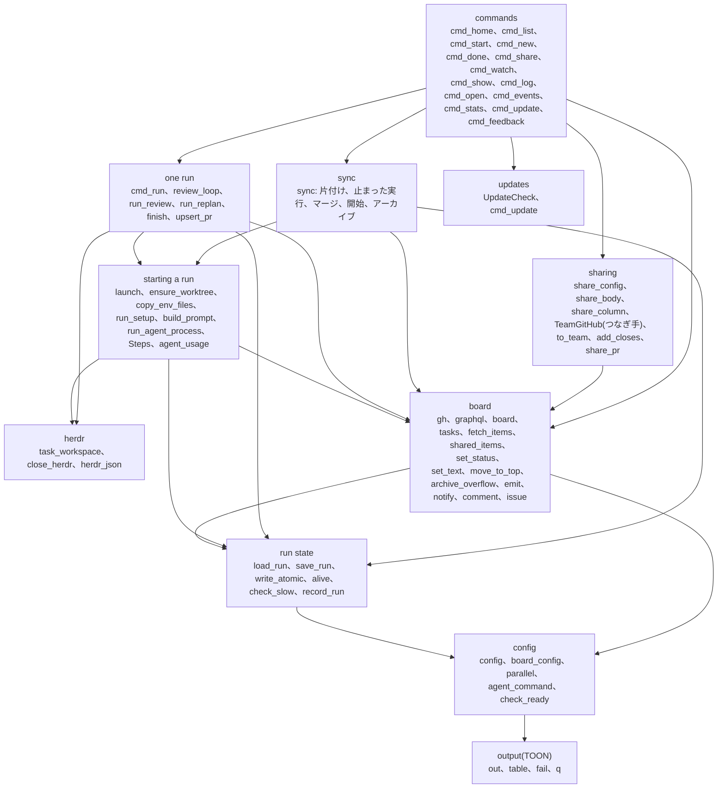
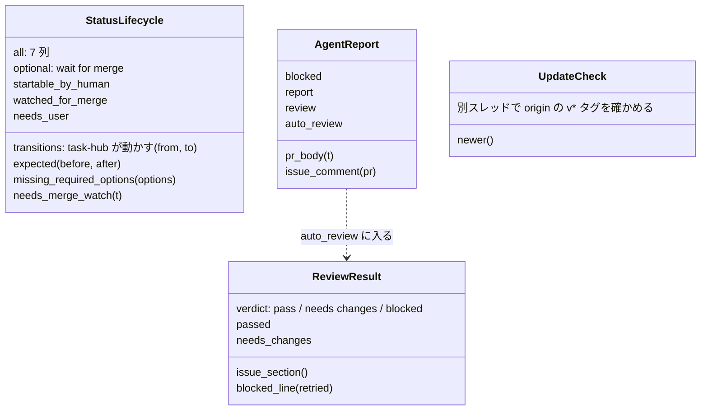
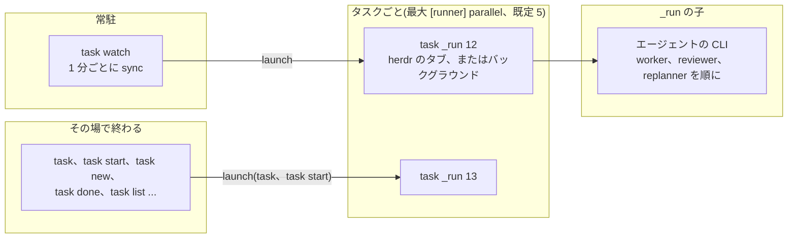
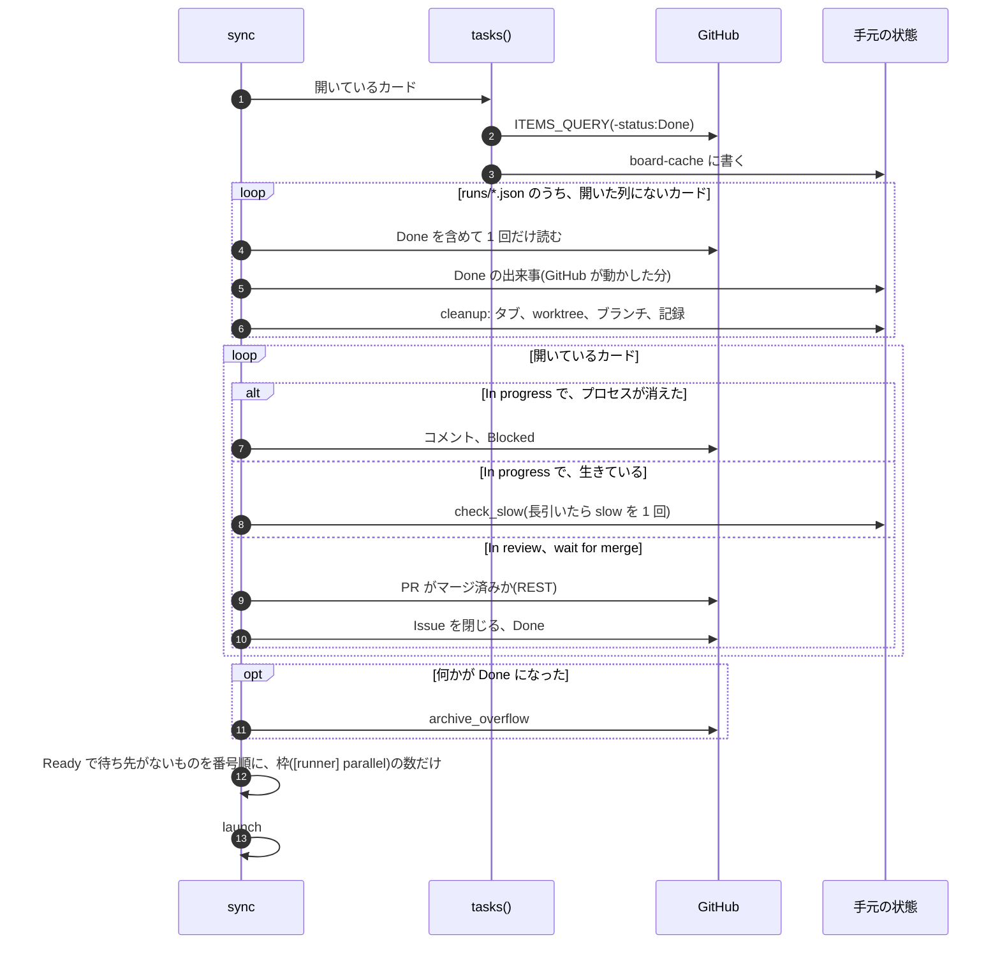
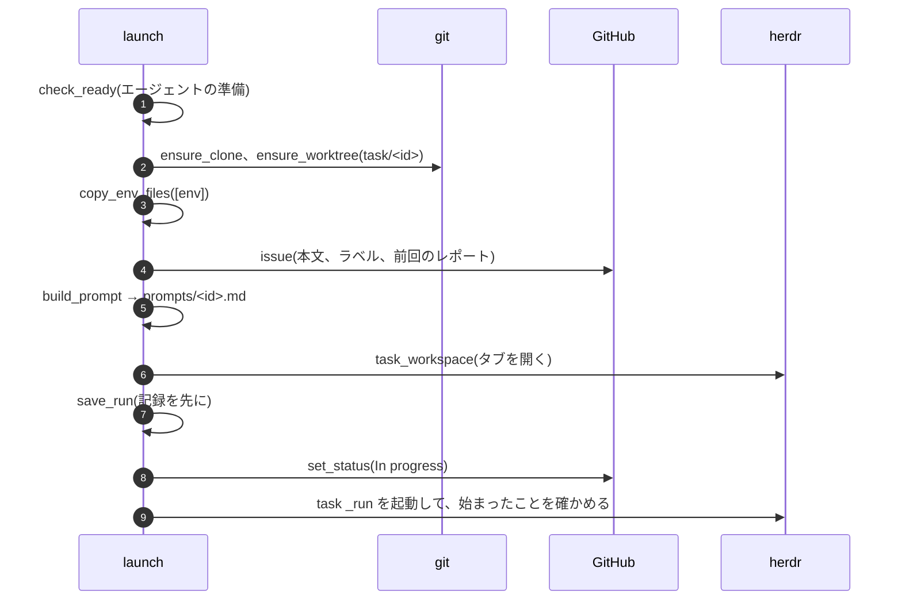
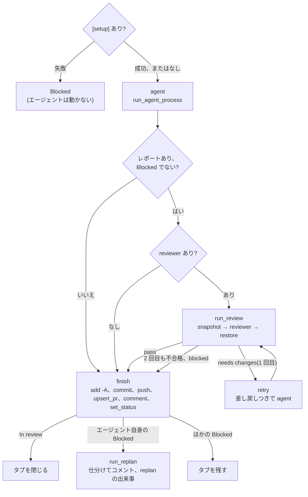
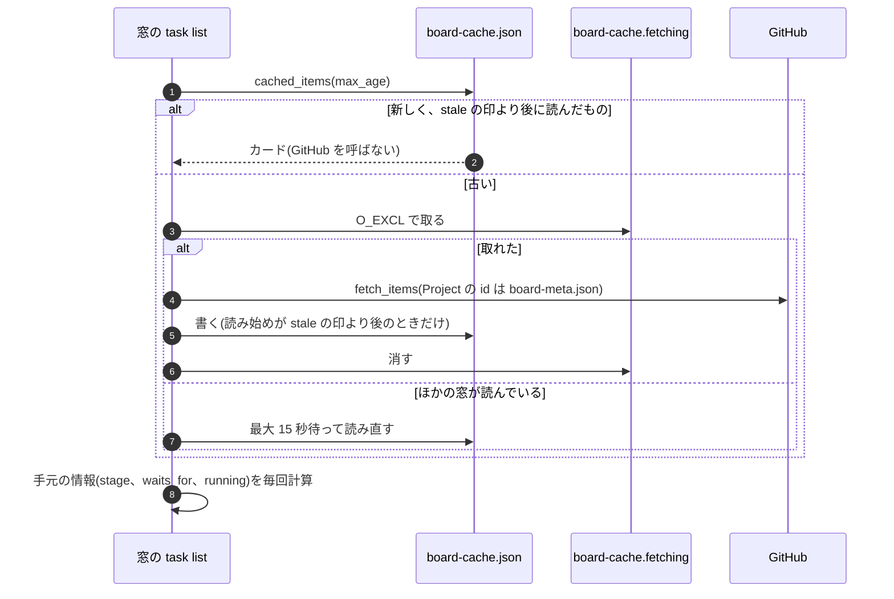
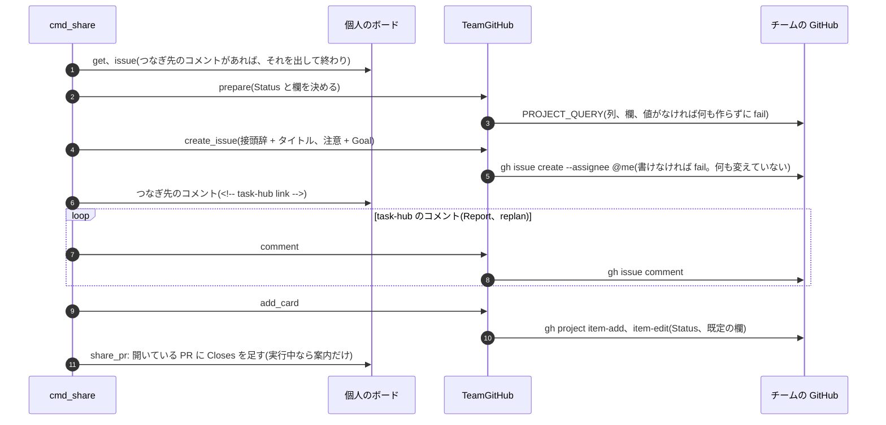

# LLD: task-hub の詳細設計

[hld.md](hld.md) の部品の中身です。関数、プロセス、ファイルの形式、外部の呼び出し、守るべき約束を書きます。
関数名は `bin/task` のものです。行番号は変わるので書きません(`grep -n "^def <名前>" bin/task` で探します)。

## 1. bin/task の構成

1 ファイル(約 2,900 行、Python 3.10 以上の標準ライブラリだけ)を、見出しのコメント `# ---------- ... ----------` で
分けています。上の層は下の層だけを呼びます。



### クラス



タスクは dict で持ちます(クラスにしていません)。ボードの値(`tasks()` が作る)と、手元の実行の記録(`load_run`)を
`{**load_run(id), **ボードの値}` で重ねたものです。

| キー | 出どころ | 意味 |
|---|---|---|
| `id`、`title`、`url` | GitHub(Issue) | Issue の番号、タイトル、URL |
| `item` | GitHub(Project) | カードの id(`set_status` などで使う) |
| `status`、`repo`、`agent`、`base` | GitHub(欄) | Status、Target repo、Agent、Base branch |
| `updated`、`closed` | GitHub | カードを最後に変えた時刻、Issue が閉じているか |
| `blockers`、`waits_for` | GitHub + 計算 | Blocked by のリンク、まだ始められない理由 |
| `branch`、`worktree`、`pid`、`tab`、`workspace`、`log`、`pr`、`stage`、`started` | 手元(`runs/<id>.json`) | 実行の情報 |
| `link` | 手元(`runs/<id>.json`。`launch` が `issue()` のつなぎ先のコメントから)。`task done` は自分で読む `issue()` から | チームの Issue(`org/app#12`)。`finish` が PR の本文に `Closes` を足す。`set_status`、`comment`、`sync` のマージの処理が `to_team` でチームに写す。つないでいなければ空 |
| `running` | 計算(`alive`) | 実行のプロセスが生きているか |

## 2. プロセス



- `launch` は実行の記録を書いてから In progress にし、`task _run` を起動します。herdr があればタブで、
  なければログ付きのバックグラウンドプロセスで動かします
- `sync` はカードごとに `launch_lock`(`runs/<id>.lock` のロック)を取ってから `launch` を呼びます。取れないとき、
  または取ったあとで実行が生きている(`alive`)ときは、別の task-hub(`task watch` と `task start` など)が始めたので
  `skipped:` と出して何もしません。2 つ目の開始が 1 つ目のタブを閉じて、1 つ目が「could not start」になるのを防ぎます(#43)
- herdr のタブでは、ペインに `sh <ランチャー>`(`share/run/<id>.sh`)を打ち込みます。ランチャーは最初に自分を消し、
  消せなければ(もうなければ)終わります。`launch` はランチャーが消えたら始まったとみなします。画面の文字は見ません
  (出力が流れたり描き直されたりすると、最初の行が画面から消えるため)。8 秒たっても消えなければ Enter を送ってもう 8 秒待ち、
  それでも残っていれば自分で消して開始の失敗にします。先に消した方が決まるので、あきらめたあとに実行が遅れて始まることはありません。
  ランチャーがすでに消えていたら(直前に始まった)、失敗にしません
- `task _run` は自分の pid を記録します。同期は `alive` でプロセスを確かめ、消えていてカードが In progress なら Blocked にします
- herdr のタブで動かすときは、環境変数を `HOME`、`PATH`、`TASK_*`、`GIT_AUTHOR_*`、`GIT_COMMITTER_*`、`[runner] pass_env` だけに絞ります

## 3. コマンド

| コマンド | 主な関数 | GitHub | 手元に書くもの |
|---|---|---|---|
| `task` | `sync(started_here=True)`、`cmd_home` | ボードを読む、開始、片付け | runs、events、asked |
| `task watch` | `archive_overflow`、ループで `sync` | 同上 + 開始時のアーカイブの確認 | 同上 |
| `task list [--max-age]` | `shared_items`、`tasks`、`list_lines` | キャッシュが古いときだけ読む | board-cache |
| `task start <id>` | `get`、`set_status(Ready)`、`sync` | 読む、Status | runs、events |
| `task new` | `cmd_new` | Issue、カード、欄、Blocked by | events、asked |
| `task done <id>` | `cleanup`、`issue`、`set_status(Done)`、`archive_overflow` | Issue を閉じる、Status、アーカイブ。つないだタスクはチームの Issue も閉じ、カードを Done に | runs を消す、events |
| `task share <id> --to` | `get`、`issue`、`share_config`、`TeamGitHub`、`share_pr` | 読む、チームの Project を読む、チームの Issue とコメントとカード、個人の Issue につなぎ先のコメント、開いている PR の本文 | なし(つなぎ先は GitHub のコメント) |
| `task show` | `get`、`issue` | 読むだけ | なし |
| `task log`、`task open` | `load_run`(手元の記録だけ) | なし | なし |
| `task events`、`task stats` | `events_named`、`cmd_stats` | なし | なし |
| `task update` | `cmd_update`、`restart_watch`、`copy_kiro`。かんたんセットアップで入れた clone は `update_by_installer`(新しい版のインストーラを動かす) | なし(origin のタグを読む) | LIB を新しい版に、Kiro のフックとワークフローのコピー |
| `task feedback` | `cmd_feedback`、`open_in_browser` | なし(ブラウザで Issue の画面を開くだけ) | なし |
| `task _run <id>` | `cmd_run` | 3.3 の図 | runs、logs、metrics、events |

新しいコマンドは `COMMANDS` の表に `名前: (関数, 位置引数, フラグ, 使い方)` を 1 行足し、`cmd_<名前>(a)` を書きます。
引数の解析、`--help`、エラーの形(`error:` と `help:` を stdout)は `main` が共通で行います。

## 4. 主な流れ

### 4.1 同期(`sync`、`task watch` の 1 回)



### 4.2 開始(`launch`)



### 4.3 1 回の実行(`cmd_run`)



`finish` の判定:

| 条件 | 結果 |
|---|---|
| レポートがない | Blocked(`agent exited without a report`) |
| reviewer が 2 回不合格、または blocked | Blocked(review) |
| レポートに `## Blocked` | Blocked(エージェント自身)→ replanner |
| 変更なし、research ラベルなし | Blocked(`changed no files`) |
| それ以外 | In review(変更があれば PR、research ならレポートだけ) |

### 4.4 ボードの読み取り(`task list`)



### 4.5 チームに出す(`task share`)



- Status は `<repo>.status.<列>`、`status.<列>`、チームの同じ名前の列、`SHARE_STATUS` の順で決めます
- つなぎ先のコメントは Issue を作った直後に書きます。そのあとの失敗でも、もう一度の `task share` は Issue を作りません
- 実行の中では GitHub を読み直しません。`launch` が `issue()` で読んだつなぎ先を `runs/<id>.json` の `link` に入れ、
  `finish` の `AgentReport.pr_body` がそれで `Closes` を足します。実行中に共有したタスクは、その実行の PR に足りないので、
  終わってからもう一度 `task share` を呼ぶと `add_closes` が足します
- つなぎ手(`TeamGitHub`)は共有先の種類ごとの部品で、`prepare`、`create_issue`、`comment`、`add_card`、`edit`、`move`、
  `close` を持ちます。Jira などは同じ形のつなぎ手を足します([designs/team-sync.md](designs/team-sync.md))

### 4.6 つないだタスクのその後(`to_team`)

つないだあとの変化は、`to_team(t, 何を, 変更)` がチームに写します。`t["link"]` が空なら何もしません。つなぎ先を知るために
GitHub を読むことはありません(実行の中は `launch` が読んで `runs/<id>.json` に入れた `link`、`task done` は自分で読む
`issue()` の `link`)。失敗は止めずに stderr に `warning: task <id>: could not copy <何を> to <org/app#12>: ...` を 1 行出します
(8 章)。

| いつ | 呼ぶところ | チームへ |
|---|---|---|
| 実行を始めるとき | `launch`(`issue()` を読んだ直後) | `edit`: タイトル(`[share]` の接頭辞 + 個人のタイトル)と本文(`share_body`: 注意 + 今の Goal)を上書き |
| Status を変えたとき | `set_status` の最後(出来事とカードの並べ替えのあと) | `move`: `TEAM_CARD_QUERY` でカード、列、今の列を読み、`share_column` の列と違うときだけ `gh project item-edit` |
| task-hub がコメントを書いたとき | `comment`(本文が `<!-- task-hub report -->` か `<!-- task-hub replan -->` で始まるときだけ) | `comment`: 同じ本文。人のコメントとつなぎ先のコメントは写さない |
| `task done` | `cmd_done` | `close`、そのあと `set_status(Done)` の `move` |
| マージを見つけた同期(GitHub が閉じなかった) | `sync` | `close`、そのあと `set_status(Done)` の `move` |
| GitHub がカードを Done にした | `sync`(片付けの前) | `move`(Done) |

- 列の決め方は `task share` と同じ `share_column` です(`<repo>.status.<列>`、`status.<列>`、チームの同じ名前の列、
  `SHARE_STATUS`)。`[share]` に書いた列がチームにないときは、写さずに warning を出します
- チームの Issue が複数の Project にあるときは、`[share]` の `<repo>` の Project のカードを、なければ最初のカードを動かします
- 実行中に共有したタスクは、その実行の `link` が空なので、その実行の間は写しません(PR の `Closes` と同じ)

## 5. 手元のファイル

| ファイル | 書く者 | 読む者 | 形式 |
|---|---|---|---|
| `~/.config/task-hub/config.ini` | 人、インストーラ | すべて | INI(`[board]`、`[runner]`、`[agents]`、`[env]`、`[setup]`、`[check]`、`[ide]`、`[notify]`、`[share]`)。`[share]` は `task share` の共有先ごとのチームの Project、`<repo>.title`、`<repo>.field.<欄>`、`status.<列>`、`<repo>.status.<列>`([usage.md](../usage.md#チームのボードに出すtask-share))。`[runner] parallel` は同時に動かすタスクの数(既定 5、1 未満や数でない値は `sync` の前に `fail`) |
| `state/runs/<id>.json` | `launch`、`task _run`(順番に)、`cleanup` が消す | すべて(Kiro の拡張は `worktree`、`base`、`branch`、`log`、`repo` を読む) | JSON(`RUN_KEYS`) |
| `state/runs/<id>.lock` | `launch_lock`(中身は空。ロックだけに使う)、`cleanup` が消す | `launch_lock` | 空のファイル |
| `share/run/<id>.sh` | `launch`(herdr のときだけ。0600) | ペインの `sh`(読んだら自分を消す) | シェルスクリプト |
| `state/logs/<id>.log` | `task _run` | `task log`、task-rs の `log_tail`、Kiro の拡張(ログのタブ) | テキスト。エージェントの出力は 1 行ずつ。コマンドに JSON の出力のフラグがあるエージェント(組み込みの 4 つ。`step_format`)は、`Steps` が手順ごとの 1 行(`LOG_LINE_MAX` 字まで)と最後の結果の全文に直したもの |
| `state/events.jsonl` | `emit`(追記) | /chief、Kiro、Pi、mod、`task events` | JSON Lines |
| `state/metrics.jsonl` | `record_run`(追記) | `task stats`、mod の実績、`slow_threshold` | JSON Lines |
| `state/board-cache.json` | `fetch_items`(開いているカードを読んだとき) | `task list`、Kiro の拡張(Goal のタブ。`items[].content.body`) | `{key, fetched_at, items}` |
| `state/board-cache.stale` | `gh()`(ボードを変える呼び出しのあと) | `cached_items` | UNIX 時刻 |
| `state/board-meta.json` | `board()` | `task list` だけ | `{key, at, board}` |
| `state/asked/<id>.json` | `task new`、`task`、`task start` | `task_workspace` | herdr の workspace |
| `state/update.json` | `UpdateCheck` | `task list`、`task watch` | 新しい版 |
| `share/repos/<owner>/<name>` | `ensure_clone` | worktree の元 | git |
| `share/worktrees/<id>` | `ensure_worktree`、エージェント | `finish`、`cleanup`、Kiro の拡張(変更のタブ。読むだけの git) | git worktree |
| `share/prompts/<id>.md` | `build_prompt` | `task _run` | Markdown |
| `state/install-manifest.json` | Mac: `kiro/install.sh`、`note_install_copy`(フックとワークフローの SHA-256 だけ)。Windows: `windows/install.ps1`、`note_install_copy` | アンインストール、診断、インストーラ自身 | JSON。`python`(`task` が使う Python)、`installed`(インストーラが置いたものだけ。すでにあった git、Python、gh は書かない。`uv-python` は uv にその版がなかったときだけ。`git-credential` はインストーラの gh を git のログインに使う設定をしたときの gh。アンインストールはその gh を指す `credential.<URL>.helper` だけを外す。Mac も同じ)、`sha256`。Windows の `installed` は `git`、`git-path`、`uv`、`uv-python`、`gh`、`git-credential`、`kiro-cli`、`kiro-cli-path`、`task-hub`、`task`(`task.cmd`)、`task-sh`(Git Bash 用)、`user-path`(`*-path` はユーザーの PATH に足した項目)、`config`(作ったときだけ)、`kiro-skill-task`、`kiro-skill-chief`(ジャンクション)、`kiro-steering`、`kiro-hook`、`kiro-workflow`(コピー。`sha256` に中身。フックとワークフローは `task _kiro-copy` が書く Windows の形)、`kiro-settings`(Workflows を有効にした settings.json。消さない)、`watch`(`scheduled-task:task-hub watch` か、スタートアップの `.lnk`)、`slack-triage`(`slack-triage.cmd`)、`slack-triage-autostart`(`scheduled-task:task-hub slack-triage` か `.lnk`) |
| `state/gh-login.ps1`、`state/kiro-login.ps1` | `windows/install.ps1`(ログインが要るとき) | 別の PowerShell の窓(動き出すと自分を消す)。ログインが済むとインストーラが消す | PowerShell(BOM 付き UTF-8) |

`state` は `~/.local/state/task-hub`、`share` は `~/.local/share/task-hub` です。

GitHub に置く task-hub の印: Issue のコメントの先頭の `<!-- task-hub report -->`(レポート)、`<!-- task-hub replan -->`
(仕分け)、`<!-- task-hub link -->`(つなぎ先。次の行に `Shared to org/app#12: <URL>`)。チームの Issue の本文の先頭の
`<!-- task-hub shared -->` と上書きの注意(`SHARE_NOTICE`)。

### 出来事(events.jsonl の 1 行)

```json
{"time": "2026-10-10T02:33:41Z", "id": "156", "title": "...", "repo": "jyoka/x", "event": "In review",
 "pr": "https://github.com/...", "reason": "...", "digest": {"verdict": "pass", "review": "...", "pr": "..."}}
```

`event` は Status の名前(Backlog、Ready、In progress、In review、Blocked、Done)、`replan`、`slow` のどれかです。
空の欄は書きません。

### 実行の集計(metrics.jsonl の 1 行)

`id`、`title`、`repo`、`agent`、`reviewer`、`started`、`finished`、`seconds`、`status`、`reviews`(判定の列)、
`retried`、`blocked_by`、`replan`、`usage`(起動ごとのトークン、呼び出し、モデル)、`files`、`added`、`removed`。

### Kiro の拡張がタスクの中身を読むところ

`kiro/board-extension/src/tabs.ts`(VS Code の API)と `src/inspect.ts`(ファイルと git)。何も書きません。

| タブ | URI | 読むもの | 見つからないとき |
|---|---|---|---|
| Goal | `taskhub-goal:/<id>/#<id> Goal · <repo>.md` | `board-cache.json` の `key[2]`(Issue のリポジトリ)の、番号が `<id>` の項目 | 知らせてタブを開かない(`task show <id> --full` を案内) |
| 変更 | `taskhub-diff:/<id>/{base,worktree}/<path>?<分かれ目のコミット>` | `runs/<id>.json` の `worktree` を git で。base は `runs/<id>.json` の `base` を `base_ref` と同じ決め方で | `runs/<id>.json` がない、worktree が消えた: 知らせて何もしない(別の checkout を使わない) |
| ログ | `taskhub-log:/<id>/#<id> Log · <repo>.log` | `runs/<id>.json` の `log`、なければ `state/logs/<id>.log`(片付けのあとも残る) | 「まだない」と書いて、できるまで待つ |

- タブの URI がタスクの番号を持つので、ボードで別のカードを選んでも、開いているタブの中身は変わりません
- 変更の一覧は `git diff --name-status <分かれ目>`(コミット済みと作業中)と `git ls-files --others --exclude-standard`(未追跡)。
  `git diff` は stat の古い index を読むと index を書き直す(`GIT_OPTIONAL_LOCKS=0` でも)ので、index を一時ファイルに写して
  `GIT_INDEX_FILE` で読ませます。`core.fsmonitor`、外部の diff、textconv は使わず、属性は空の tree から読ませて
  (`GIT_ATTR_SOURCE`)clean フィルタも動かしません。IDE の環境の `GIT_*` は渡しません
- 作業中の側は、worktree の外を指すシンボリックリンクの先を読みません。信頼していないワークスペースでは git を動かしません
- ログのタブは、タブがある間だけ `fs.watchFile`(1 秒ごと)で見ます(`tabGroups.onDidChangeTabs` で閉じたことを知る)。
  止めている間は中身を読み直しません。ログのコマンドを通らずに出てきたログのタブ(ウィンドウの復元など)は、
  `onDidChangeTabs`、拡張の起動、「追う」「止める」のときに見つけて、見はじめます

## 6. 並行と所有

- 1 つのファイルを書くのは 1 者だけにします。`runs/<id>.json` は `launch` が作り、そのあとは `task _run` だけが
  書きます(同期は書かない。`slow` を 1 回だけにする判定も `events.jsonl` を見る)
- JSON はすべて `write_atomic`(一時ファイルから置き換え。Windows は置き換えを試し直す)で書きます。読む側は
  古いか新しいかの完全なファイルだけを見ます
- 追記のファイル(events、metrics)は 1 行ずつ書きます。書けなくても実行もコマンドも止めません
- 同じタスクの実行は 1 つだけです。プロセスが生きているタスク(`alive`)は、Status が何でも開始しません
- 同じマシンの 2 つの task-hub(`task watch` と `task start` など)が同じ Ready のカードを読んでも、開始するのは
  `launch_lock` を取った 1 つだけです。ロックは OS のファイルロック(POSIX は `flock`、Windows は `msvcrt.locking`)なので、
  持っていたプロセスが落ちても残りません。開始の失敗で Blocked にするまでロックを持ちます
- キャッシュは正しさに関わりません。書けない、読めない、壊れているときは GitHub から読むだけです

## 7. 外部の呼び出し

| 呼び出し | API | 費用 | いつ |
|---|---|---|---|
| `PROJECT_QUERY`(Project の id と欄) | GraphQL | 1 | コマンドごと(`task list` は 1 時間取っておく) |
| `ITEMS_QUERY`(カード) | GraphQL | 100 枚ごとに 1 | 同期ごと、キャッシュが古い `task list` |
| `project item-edit`(Status、欄) | GraphQL(gh) | 1 前後 | Status を変えるとき |
| `MOVE_TO_TOP` | GraphQL | 1 | Status を変えるとき |
| `ARCHIVE_ITEM` | GraphQL | 1 枚ごとに 1 | 100 枚を超えたとき |
| `ADD_BLOCKED_BY` | GraphQL | 1 | `task new --blocked-by` |
| PR がマージ済みか | REST | 1 回 | In review と wait for merge のカードごと、同期ごと |
| Issue の作成、コメント、閉じる、PR の作成と更新 | `gh issue`、`gh pr`(gh の中で GraphQL) | gh 任せ(測っていない) | 登録、実行の終わり |
| `git fetch`、`push` | git | - | 開始、終わり |
| チームの `PROJECT_QUERY`、`gh issue create`、`gh issue comment`(task-hub のコメントの数)、`gh project item-add`、`item-edit`(Status と既定の欄の数)、個人の Issue へのコメント、開いている PR があれば `gh pr view` と `gh pr edit` | GraphQL、gh | 1 回あたり GraphQL 1 + 内容を作る要求が数回 | `task share` だけ。watch と実行の呼び出しは増えない |
| つないだタスクの写し(4.6): `TEAM_CARD_QUERY`、列が変わるときだけ `item-edit`、`gh issue edit`、`gh issue comment`、`gh issue close` | GraphQL、gh | Status の変化 1 回につき GraphQL 1 + mutation 0〜1。開始ごとに `issue edit` 1、task-hub のコメントごとに 1、閉じるとき 1 | つないだタスクの Status が変わるとき、開始、コメント、閉じるときだけ。つなぎ先は読み直さない。つないでいないタスクと、動かないタスクの毎分の同期では呼ばない |
| `task list`(Kiro の拡張) | 子プロセス。Mac は `~/.local/bin/task`、Windows は `~\.local\bin\task.cmd` を `cmd.exe` で(Node は .cmd をシェルなしで動かせない。引数は `list` と `--max-age 0` だけ) | `task list` と同じ | 1 分ごと、更新ボタン |
| `git merge-base`、`diff`、`ls-files`、`cat-file` など(読むだけ) | git(Kiro の拡張。`src/inspect.ts` の `READ_ONLY` だけ、index の写しで) | - | 人が変更のタブを開いたとき |
| エージェントの CLI(`[agents]` のコマンド) | 子プロセス(stdout と stderr を 1 行ずつ読む) | エージェント側の課金 | 実行ごと(agent、retry、reviewer、replanner) |

GraphQL は 1 時間 5000 ポイント、REST は 1 時間 5000 回です(アカウント全体で共有)。

組み込みのエージェントは、手順ごとに JSON の 1 行を出すフラグ付きで動きます。`agent_process` は、コマンド(プロンプトは
見ない)からどの CLI の JSON かを `step_format` で決め、`STEPS` のクラス(`Steps` の子)で 1 行ずつ直します。
どれでもなければ `Steps` そのもので、出力をそのまま書きます。

| `step_format` | コマンドの条件 | クラス | 確かめた版 |
|---|---|---|---|
| `claude` | `--output-format stream-json`(kiro-cli でない) | `ClaudeSteps`(`stream_json_lines`) | claude 2.1.296 |
| `codex` | `codex`、`exec`、`--json` | `CodexSteps` | codex-cli 0.160.0 |
| `pi` | `pi`、`--mode json` | `PiSteps` | pi 1.1.0 |
| `kiro` | `kiro-cli`、`--output-format stream-json` | `KiroSteps` | kiro-cli 2.28.0 |

- ツールの呼び出しは `· <名前>: <入力の 1 つ>`(`tool_step`。パスは worktree からの相対、`shown_path`)。
  - claude: `assistant` の `tool_use`。
  - codex: `item.started` の項目(`command_execution` は `shell` で、`/bin/zsh -lc '...'` の中のコマンド(`unwrapped`)、
    `file_change` は `apply_patch` とパス、`mcp_tool_call` は `<server>.<tool>`)。
  - pi: `tool_execution_start`。
  - kiro: `sessionUpdate` の `tool_call`(`_meta.kiro.toolName`。`execute` でなければ `rawInput.command` は使わない)。
- エージェントの文は先頭の 1 行(`first_line`)。最後の結果は全文。
  - claude: `assistant` の `text` が 1 行、`result` の `result` が全文。
  - codex: `agent_message` を次の項目まで持ち、次の項目が来たら 1 行、`turn.completed` で全文。
  - pi: ツールを呼ぶ `message_end` の文が 1 行。`agent_end` の最後のメッセージは持つだけで、`willRetry` なら持たない。
    `agent_settled` か出力が閉じたときに、持っているものを全文で書く。pi は context overflow や `length` で
    止まった後に compact して続けることがある。そのときは次の `agent_start` で、持っていたものを 1 行にする
    (`error` なら書かない)。失敗かどうかも、最後に持っているメッセージの `stopReason` で決める。
  - kiro: `agent_message_chunk` をためて、`tool_call` で 1 行、`runFinished` で全文。
- 失敗: claude は `== claude ended with <subtype>`、codex は `ERROR: <message>`(`error` と `turn.failed` の同じ文は 1 回)、
  pi は `== pi ended with <stopReason>: <errorMessage>`、kiro は `== kiro ended with an error: <message>`。
  pi の `--mode json` は失敗でも 0 で終わる(`pi -p` は 1)ので、`Steps.failed` が立ったら `agent_process` は 1 を返す。
- 書かないもの: ツールの結果(claude の `user`、codex の `item.completed` のコマンドの出力、pi の `tool_execution_end`、
  kiro の `tool_call_update`)、考えたこと(`thinking`、`reasoning`、`agent_thought_chunk`)、途中の差分(`stream_event`、
  `message_update`、`agent_message_chunk` そのもの)、セッションの情報(`system`、`session`、`metadata` など)。
- JSON でない行(stderr の警告など)はそのまま、知らない種類や形の JSON は `LOG_LINE_MAX` 字に切って書く。
- 出力が終わったときにまだ持っている文(codex、pi、kiro)は全文で書く(`Steps.end`)。
- `agent_process` は `Steps.read` と `Steps.close` を呼ぶ。中の `lines` と `end` がどんな例外を出しても、run は続く。
  `lines` ならその行を `LOG_LINE_MAX` 字に切って書き、`end` なら `== cannot show the end of the agent's output (...)`
  を書く。ログの見せ方のせいで、エージェントの作業が push されないことはない。

使った量はこの出力からは読まず、今までどおり `agent_usage` が手元の記録から読みます(kiro の stream-json の実行も、
v2 のセッションのファイルに残ることを 2.28.0 で確かめた)。

## 8. 失敗の扱い

| 失敗 | 扱い |
|---|---|
| GitHub の失敗(同期の中) | その回の `github_errors` に出し、次の回にまた試す。watch は止めない |
| GitHub の失敗(実行の終わり) | レポートを worktree に残し、次の同期が止まった実行として Blocked にする |
| 開始の失敗 | カードを Blocked にし、理由をコメントする。herdr のペインが 2 回とも実行を始めなかったときは「the run did not start in herdr ...」 |
| 通知、キャッシュ、集計、カードの並べ替えの失敗 | 無視する(実行とコマンドを止めない) |
| エージェントの異常終了 | レポートがなければ Blocked。途中までの変更は push する |
| Project の id が古い | 書き込みが失敗したら `forget_board` で捨て、次は読み直す |
| `task share` の失敗 | チームの Project の列、欄、値がない、チームのリポジトリに書けない: 何も作らずに `error:` と `help:`。Issue を作ったあとの失敗: 作った Issue の URL を出して終わる(つなぎ先のコメントは書いてあるので、もう一度でも Issue は増えない) |
| つないだタスクの写しの失敗(4.6) | 無視して stderr に `warning:` を 1 行(実行の中ならログに)。個人のカード、コメント、PR、実行は写しがないときと同じに進む。次の変化のときにまた写す(`move` は今の列を読むので、取りこぼした Status も次で合う) |

## 9. 守る約束(テストで確かめているもの)

1. エージェントが git と GitHub を操作しなくても、PR の形式はコードで決まる
2. reviewer と replanner の書き換えは結果に残らない
3. task-hub が動かす Status の遷移は `StatusLifecycle.transitions` の表と、design.md の図と一致する
4. 生きている実行のあるタスクで、2 つ目の実行は始まらない。2 つの task-hub が同じカードを同時に始めても、実行は 1 つで、カードは Blocked にならない
5. 変更の前に読み始めたボードは、変更のあとに表示されない
6. 開いているカードと、Issue が開いている Done のカードはアーカイブされない
7. Ready のカードは作った順に始まる
8. 手元の JSON は、書き込みの途中で読んでも壊れていない
9. アンインストールは、インストーラが記録したものだけを消す。ジャンクションは先を消さずに外す。作業中のタスクがある
   あいだ、Windows のアンインストールは見張りだけを止める
10. `task share` でつないでいないタスクの PR、Status、GitHub の呼び出しは、`task share` を足す前と同じ(`[share]` を書いただけでは何も変わらない)。
    チームのリポジトリに書けないとき、個人のカードと PR は変わらない。同じタスクを 2 回出しても、チームの Issue は 1 つ
11. つないだタスクの Status はチームのカードに対応表で写り、チームの列が変わらない変化では mutation を呼ばない。Report と仕分けは
    同じ本文がチームの Issue にも付き、人のコメントは写らない。開始ごとにチームの本文が今の Goal になる。`task done` と、GitHub が
    閉じなかったマージでチームの Issue も閉じる。チームへの写しが失敗しても、個人のカードと実行は写しがないときと同じに進む

## 10. テストの仕組み

- `tests/test_task.py`: `bin/task` を別プロセスで動かすブラックボックスのテスト。GitHub は 1 つの JSON ファイルを
  持つ偽物の `gh`、作業先は手元の bare リポジトリ、エージェントはゴールの `MODE:` で動きを変える偽物の CLI です
- `tests/test_install.py`: インストーラ、`doctor`、アンインストール
- `tests/test_windows.py`: Windows だけ(GitHub Actions の windows-latest)。`windows/install.ps1` の段階と
  `windows/doctor.ps1`(診断。ユーザーフォルダーの下のファイルを何も変えないことも確かめる)は、
  一時的なユーザーフォルダー、偽物の GitHub Releases(手元の HTTP サーバー)、HKCU の下のテスト用の鍵を
  ユーザーとマシンの環境(PATH)にして動かし、本物の PATH を変えない。CI の `standard-user` のジョブは、同じテストを
  管理者でない標準のユーザーで動かす(`tests/ci/as-standard-user.ps1`。タスク スケジューラでそのユーザーとして)
- `tests/live_board.py`: テストではない。本物の GitHub の試験用ボードで、カードを 1 枚 PR まで進めて片付ける
  (windows.yml の `live`。ボタンで動かす。[release.md](../release.md#windows-を本物のボードで確かめる))
- `tests/test_run.py`: `tests/run.py` そのもの(既定の並べる数、低い優先度、全部のテストのロック)。Windows の CI でも動く
- `claude/task-board/hooks/*.test.tsx`(`claude plugin test`)、`kiro/board-extension/test`(`npm test`。偽物の `vscode` と
  一時的な git リポジトリで、Goal、変更、ログのコマンドを動かす)。`kiro/board-extension/test/host/check.mjs` は、VSIX を
  本物の VS Code か Kiro の使い捨てのプロファイルに入れて同じ流れを確かめる(手で動かす。`npm test` には入らない)
- `python3 tests/run.py`: テストを 1 件ずつ別プロセスで 2 つずつ、低い優先度で動かす(約 8 分)。全部のテストは 1 台に同時に 1 つ
  (一時ディレクトリの `task-hub-tests.lock`、持ち主の pid が死んでいれば取り直す)
- `tests/bench.py`: 弱い PC 向けの計測。使い捨ての HOME と偽物の `gh` で、1 度に 1 プロセスずつ動かす([benchmark.md](../benchmark.md))。テストではない
