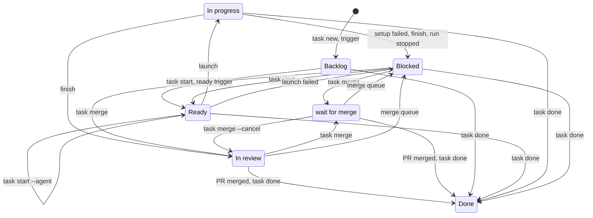
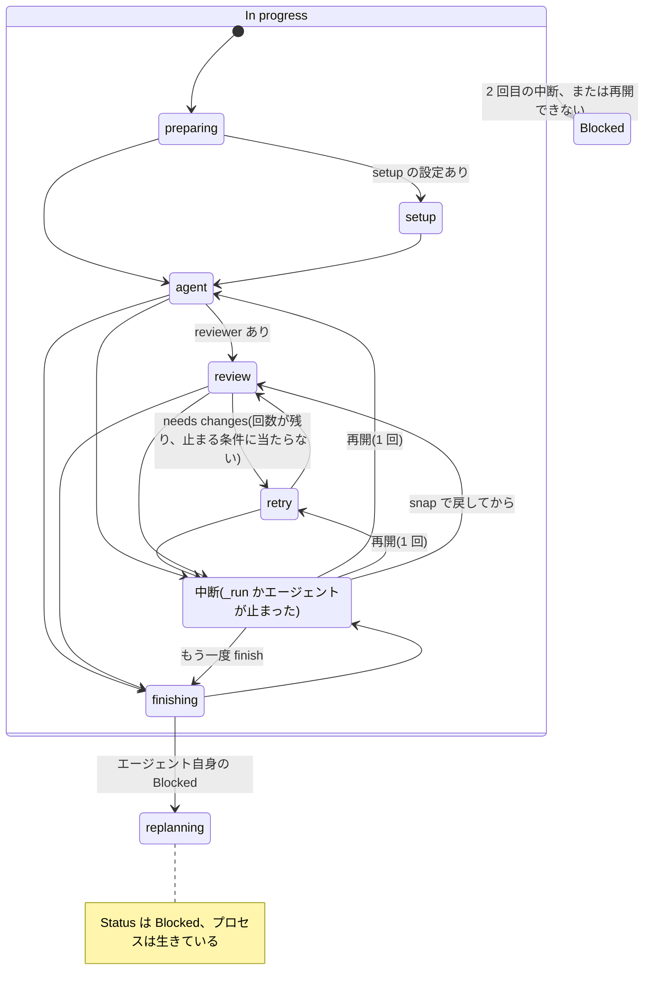

# 設計

ここには「なぜこの作りなのか」を書きます。部品とデータの流れの全体図は [architecture/hld.md](architecture/hld.md)、
関数・ファイル・呼び出しの詳細は [architecture/lld.md](architecture/lld.md) にあります。

## 課題

エージェントによるコーディングのセッションはチャット形式です。これを Jira のようなタスク形式にすることが目的です。

1. タスクは自分で決めたときに登録します (エージェントへの単なる質問でタスクが作られてはいけません)。
2. すべてのタスクとそのステータスを一覧できます。
3. 空いているエージェントが、承認済みの次のタスクを自分で取りにいきます。
4. 完了したら、エージェントは結果を報告し、どこをレビューしてほしいかを具体的に伝えます。

ユーザーからの制約は次のとおりです。

- ボードは Jira のようなかんばん画面で見たい。ただし自分で作るより、GitHub Project をそのまま使いたい
  (どこからでも、どのエージェントからでも使えるため)。タスクは非公開の Issue リポジトリに置きます。
- エージェントはユーザーが承認したタスクだけを扱います。エージェントがタスクを作成・分割することはありません。
- タスクは複数のリポジトリを対象にできます。
- 同時に実行できるタスクの数には上限があり、コードで強制します。既定は 5 つで、`[runner] parallel` で変えられます
  (性能の低い PC でメモリが足りなくならないように)。
- **特定のベンダーに縛られない**: ユーザーは Claude Code、Codex、Pi を使っており、仕事用の Mac
  では Kiro しか使えません。同じツールが両方のマシンで動く必要があります。
- ブランチの扱いはシンプルにします。共有ブランチに push するエージェントはいません。
- ユーザーは herdr で作業しているので、実行は herdr 上に表示されるべきです。
- ボードはマシン(アカウント)ごとに分けます。マシンがスリープしたときに止まるのは許容します。
- カードを Ready に移したら、Mac が自動で始めます(`task watch`)。

## 検討したもの (2026-09) と採用しなかった理由

| 選択肢 | 概要 | 単体で採用しなかった理由 |
|---|---|---|
| [Vibe Kanban](https://github.com/BloopAI/vibe-kanban) | カンバンボード、カードごとの worktree、レビュー列 | カードの割り当ては手動です。開発元は 2026 年 4 月に閉鎖しました (現在はコミュニティがメンテナンス) |
| [Beads](https://github.com/steveyegge/beads) | git ベースのエージェント向け課題トラッカー、`bd ready` | タスクの保存だけで、実行する仕組みも同時実行数の上限もありません |
| Backlog.md, Task Master | Markdown のタスクファイル / PRD からタスクへの分解 | 計画のみで、タスクを実行するものがありません |
| [OpenAI Symphony](https://openai.com/index/open-source-codex-orchestration-symphony/) | Linear をポーリングし、課題ごとに Codex エージェントを実行 | Codex と Linear 専用です |
| [Claude Code Projects](https://code.claude.com/docs/en/claude-projects) / [routines](https://code.claude.com/docs/en/routines) | claude.ai 上のクラウドセッション | Claude 専用で、状態は claude.ai にあります。task-hub 0.1 と 0.2 は routines を使っていましたが、ベンダー中立のため 0.3 でやめました |
| GitHub Actions + エージェント CLI | CI 上のエージェント | API キーをリポジトリのシークレットに置く必要があり、職場では許可されない可能性があります |

## 決定事項

1. **ボードは GitHub Project です(0.4)。** タスクは非公開の Issue リポジトリの Issue、状態は Project の Status 列、
   作業先、エージェント、始めるブランチはカードの Target repo / Agent / Base branch 欄です。かんばん画面、スマホアプリ、履歴、コメントを GitHub が
   用意してくれるので、自分では何も作りません。`gh` が使えるエージェントなら、どれでもボードを読み書きできます。
   手元に残すのは実行中の情報(pid、worktree、ログ)だけです。0.3 までの手元の markdown ボードは廃止しました。
   保存先を 1 か所にしたので、2 か所を同期する仕組みもありません。(0.1 ではエージェントが共有ブランチ経由で
   ボードに書き込んでいましたが、ロックと競合への対処が必要でした。今もボードを書き換えるのは task-hub と
   あなただけで、エージェントは書きません。)
2. **エージェントはローカルで動き、task-hub が起動します。** カードを Ready に移す(または `task start`)ことが承認です。
   `task watch`(1 分ごと)、`task`、`task start` は、In progress が上限(`[runner] parallel`、既定 5)未満の間、Ready のカードを番号順に起動します。
   Mac が起きていれば、外出先でスマホからカードを動かすだけで作業が始まります。
3. **エージェントはファイルを編集するだけです。git と GitHub の作業はすべて task-hub が行います。** エージェントごとに
   サンドボックスの仕組みが違います (Codex のサンドボックスはネットワークを使えず、フォルダ外に書き込めないため、
   worktree 内でコミットすることさえできませんでした)。そこでエージェントとの約束事はどのエージェントでも同じにしました。
   ファイルを編集し、テストを実行し、`.task-report.md` を書くことです。そのあと task-hub がコミットと push を行い、
   PR を作成または更新します。そのため PR の形式はプロンプトではなくコードで保証されます。
4. **エージェントは単なるコマンドテンプレートです。** `{prompt}` は 1 つの引数として渡されます。組み込みで
   claude、codex、pi、kiro に対応しており、設定で上書きしたり追加したりできます。コードの処理経路には
   ベンダー固有のものは一切ありません。
5. **1 タスク = 1 ブランチ (`task/<id>`) = 1 worktree = 1 PR です。** ブロックされたタスクの再実行は
   同じブランチで続きを行い、同じ PR を更新します。プロンプトには前回のレポートとブロックの理由が
   含まれます。最初の実行後に Target repo を変えたカードは、元の作業先に戻すまで開始しません。別の
   リポジトリの仕事は新しいタスクとして登録します。片付けにはカードの現在値ではなく保存した実行の情報を使います。
   worktree を作った時点で作業先を記録し、環境ファイル不足などで開始に失敗しても片付けられるようにします。
   旧版が記録を残さなかった worktree は、実際の Git の所属先を確認してから再利用します。
   同じ名前のブランチが、そのタスク自身の前回の実行以外で作られていた場合(以前の別ボード、
   ほかの人の作業など)は、上書きせずにカードを Blocked にします。
6. **herdr は表示役であって、依存先ではありません。** herdr が動いているときは、実行ごとにタブを 1 つ持ちます(0.6)。
   タブは、`/task` を頼んだ workspace(登録時の `HERDR_WORKSPACE_ID`)、なければそのリポジトリの checkout を開いて
   いる workspace に置きます。話している場所の隣にタスクが並び、サイドバーがタスクの数だけ増えないようにするためです。
   どちらもなければ、以前と同じくタスク専用の workspace を作ります。`herdr pane current` は herdr の外で呼ぶと
   フォーカスのあるペインを返すので使いません。workspace の id は herdr の再起動で別の workspace に使い回されうるので、
   名前も一緒に記録して確かめます。In review で終わったタブは閉じ、Blocked のタブは残します。
   Issue は `task new` 以外(`gh issue create`、ほかのスキル、GitHub の画面)でも作られるので、登録時の記録に
   頼り切らず、`task start` と `task` を手で実行したときにも、記録がなければその workspace を記録します
   (登録時の記録があればそちらが優先)。`task watch` は、動いている場所と頼んだ場所が無関係なので記録しません。
   (`herdr worktree create` は親リポジトリ用に 2 つ目のワークスペースも開いてしまうため使っていません。)herdr が
   ない場合、実行はログ付きのバックグラウンドプロセスになります。task-hub は自分が作成したタブと workspace だけを
   閉じます。
7. **予期せず止まった実行は、1 回だけ自動で再開します。2 回目は Blocked にします。** `task _run` は自分の pid を記録します。
   そのプロセスが消えているのにカードがまだ In progress の場合(クラッシュ、kill、再起動、herdr のペインを閉じた)、
   次の確認でカードを In progress のまま、記録の段階から `task _run` を起動し直します(`relaunch`)。エージェントだけが
   外から kill されたときは、生きている `task _run` がその場で起動し直します。回数は定数の `MAX_RESUMES`(1)で、設定は
   ありません(決定事項 19 と同じく、実績を見るまで線を引かない)。再開した実行が止まったとき、Ctrl-C で止めたとき、
   worktree が変わっていた(消えた、HEAD が動いた)とき、続けるのに要る記録がないときは、今までどおりログへの案内と
   理由をコメントして Blocked にします。知らせ方は Issue のレポートの「Resumed once at <段階>」の 1 行と出来事 `resumed`
   で、既定の通知には入れません(終わったときの In review か Blocked の通知で足りるため)。ペインを閉じても止まらなく
   なったので、実行を止めるのは Ctrl-C です。やめるなら、そのあと `task done` です(2026-10-25 の決めたこと 1、2、11。
   [architecture/designs/durable-runs.md](architecture/designs/durable-runs.md))。
8. **登録は明示的に行います。** `/task` スキルは、明示的な依頼があったときだけ実行するようすべてのエージェントに指示します。
   明示的な依頼は、`/task` と打つことと、「タスクにして」のように言葉で頼むことです。そのため、Claude Code でも
   `disable-model-invocation: true` は付けず(付けると `/task` と打ったときしか動かない)、skill の説明で約束します。
   `/chief` は、`disable-model-invocation: true` でユーザーが呼んだときだけに限っています。
9. **結果は Issue と PR の両方に残します。** レポートは Issue へのコメント(`<!-- task-hub report -->` 付き)と
   PR の説明の両方に書きます。PR には `Closes <issues repo>#<番号>` を入れるので、マージすると別リポジトリの
   Issue でも GitHub が閉じ、Project のワークフローでカードが Done に移ります(PR の向き先がデフォルトブランチの
   場合に有効。docs.github.com で確認済み)。
10. **GitHub の利用上限に合わせて呼び出しを減らします。** Projects は GraphQL API だけで操作でき、GraphQL には
   1 時間あたりの上限があります。そこで `task watch` の 1 回の確認は、開いているカードの一覧取得 1 回だけにしました。
   点数は取り出す量で決まるので、`gh project item-list`(1 回 101 ポイント)は使わず、必要な欄だけを名前で取る
   問い合わせを自分で書いています(1 回 1 ポイント)。一覧表示もその結果を使い、表示だけのために再取得しません。
   状態の変化で依存関係を読み直す必要があるときは再取得します。開始時の Issue は一度取得して
   research の判定とプロンプトに使います。設定も一つのコマンド内では同じものを使い、watch は各確認の開始時に
   runner などの設定を読み直します。監視するボードのメタデータは起動時に固定するので、[board] を変えたら watch を再起動します。
   マージで Done にする処理はふつう GitHub の `Closes` とワークフローが行い、task-hub は「カードが開いた列から消えた」
   ことを見て手元を片付けます。ただし task-hub も、In review と wait for merge のカードすべての PR を確認し、
   マージされていれば Issue を閉じてカードを Done にします。デフォルトブランチ以外へのマージでは GitHub が Issue を
   閉じないうえ(0.5)、デフォルトブランチへのマージでも、GitHub が Issue を閉じないことがあったからです
   (jyoka/tasks#81。PR の本文は編集されておらず、原因は分かっていません)。初めは Base branch 付きのカードだけを
   確認していました。この確認は GraphQL ではなく、上限が別枠の REST API で行います(カード 1 枚につき 1 分に 1 回)。REST の上限は
   1 時間 5000 回なので、In review と wait for merge が合わせて 80 枚近くたまると上限に届きます(`task watch` を
   動かすマシンの数だけ倍になります)。届いても、その回の確認が `github_errors` に出てカードが残るだけです。PR は手元の記録の URL で引き、記録に PR がなければ(別のマシンで
   実行した場合、変更なしで終わった実行のあとに人が PR を作った場合など)ブランチ名 `task/<番号>` で探します。探すときは
   そのブランチのいちばん新しい PR だけを見て、本文に `Closes <issues repo>#<番号>` があり、手元の最後の実行より後に
   マージされたものだけを数えます。同じブランチ名の古いマージ済み PR で、やり直し中のカードを閉じないためです
   (人が書いた本文で `Closes` がない PR は数えません)。
11. **PR の前に、別のコンテキストでレビューします(0.6)。** `[runner] reviewer` を設定すると、実装エージェントのあとに
   reviewer が Goal と PR 全体の差分(`add -A` 後にベースからの分岐点と比較)を読み、`pass` / `needs changes` /
   `blocked` を `.task-review.md` に書きます。`needs changes` なら実装エージェントに差し戻します(回数と止め方は
   決定事項 32)。
   `reviewer = agent` はタスクと同じエージェントを新しいコンテキストで使います。見逃しの多く(自分の判断の正当化、
   確認の手抜き)は新しいコンテキストで防げ、ベンダーを変える必要はないためです。判定の読み取り、reviewer の
   書き換えの取り消しはコードで行います。マージの判断は人に残します。
12. **エージェントの Blocked は、仕分けてコメントするだけです(0.6)。** `[runner] replanner` を設定すると、
   エージェント自身が `## Blocked` を書いた実行のあとに、replanner が `answered` / `human` / `goal-conflict` に
   仕分けます。Blocked の実績(jyoka/tasks、2026-09-25 まで)では、リポジトリから答えられるものは 0 件だったので、
   第 1 段階はコメントだけにしました。カードを Ready に戻すのは人です。`answered` の根拠(`path:行番号` と引用)は
   task-hub が実物と照らし合わせ、合わなければ答えを捨てます。Goal の本文は書き換えず、タスクの作成や分割もしません。
13. **作業ツリーのファイルはすべてコミットします。git の index は関係ありません。** エージェントとの約束事は「ファイルを
   編集する」だけなので、index を操作しても意味がないことを指示に書き、コミットしないファイルはコードで除外します
   (`.git/info/exclude`: task-hub 自身のファイル、Python の `__pycache__/` と `*.pyc`、`[env]` でコピーしたファイル)。
14. **秘密情報は設定に書いたリポジトリにだけ、コピーで渡します(0.6)。** task-hub は自分用の clone で作業するので、
   手元のチェックアウトの `.env` は届きません。`[env]` に書いたファイルを実行のたびに worktree へコピーします
   (リンクではないので、エージェントが書き換えても本物は変わりません)。
15. **`task` は動かす用の clone から動かします(0.6)。** `~/.local/bin/task` が開発用の clone を指していると、
   ブランチを切り替えるたびに本物のタスクがマージ前のコードで動きます。動かす用の clone(`~/.local/lib/task-hub`)は
   PR のマージ後に pull するだけにします。
16. **調べもののタスクは、Issue の `research` ラベルで明示します(0.6)。** ファイルを変えずにレポートだけを書いた
   実行は、普通のタスクなら「Goal が伝わっていない」しるしなので Blocked のままにし、ラベルのあるタスクだけ PR なしで
   In review にします。エージェントの出力から推測しないのは、同じ「変更なし」でも失敗と成果の両方がありうるからです。
   ラベルは Project の設定を増やさずに、`task new --research` でも GitHub の画面でも付けられます。
17. **タスクの前後関係は GitHub の「Blocked by」で持ち、開始の判定はコードで行います(0.6)。** 開始するかどうかを
   決めるのは `task` のコードで、エージェントが本文を読むのは開始したあとです。本文に文章で書くだけでは、並行して
   始まってしまいます。そこで、PRD やひとまとまりの作業を分けるときに決めた前後関係を、Issue の依存関係として
   構造化して残し(`task new --blocked-by`)、Ready のカードは待ち先がすべて完了として閉じるまで始めません。
   ボードの読み取りに相乗りするので GitHub の API の消費は増えません(2026-09-27 に確認、1 回 1 ポイントのまま)。
   開始後に Blocked にしてから replan する方式にしなかったのは、実行の枠とトークンを使い、エージェントが前提の
   不足に気づくことに頼り、再開も人の手になるうえ、再実行は前提が入る前のブランチで続くためです。コードで判定
   できない条件(決まっているべき仕様、キーなど)は Goal の Ready conditions に書き、エージェントと `/chief` が読みます。
   Issue は `task new` 以外(`gh issue create`、to-issues などのスキル、GitHub の画面)でも作られ、そのときの
   前後関係は本文の文章にしかありません。そこで、本文の `Blocked by` / `Ready conditions` の見出しの下にある、
   ボード上の開いたカードの番号は、リンクがなくても開始を待たせます(安全側に倒すだけで、開始の許可には使わない)。
   ほかのスキルには [issue-tracker.md](issue-tracker.md) で `task new --blocked-by` から登録させ、入口によらず
   同じデータになるようにします。
18. **エージェントの使用量は、エージェントの CLI が手元に残す記録を外から読みます。予算を超えたら知らせるだけで、止めません(0.6、予算はタスク 251)。**
   task-hub が抑えているのは 1 回の実行で起動する回数(実装と reviewer は最大で `1 + [runner] review_retries`、既定で 3。
   replanner は 1)だけで、
   1 回の起動の大きさ(トークン数、API 呼び出しの数、内側のサブエージェント、使ったモデル)は見えていませんでした。
   止める前にまず測ります。エージェントに自己申告させないのは、数え間違いも省略もありうるうえ、指示を増やすだけだからです。
   起動ごとに、Claude Code の記録(`~/.claude/projects/**/*.jsonl`、`CLAUDE_CONFIG_DIR` があればその下)のうち、
   `cwd` がその worktree で、時刻がその起動の間の行を数えます。reviewer と replanner は同じ worktree で順番に動くので、
   時間の窓で分けられます。ディレクトリ名の符号化の規則には頼りません。今読めるのは Claude Code だけです。headless の
   `claude -p` が対話と同じ場所と形式で書くことは 2.1.283 で確かめました(サブエージェントは `<session>/subagents/` の
   別ファイルで、`isSidechain: true`)。Kiro(kiro-cli)はトークン数を残さず、リクエストごとのクレジットを残すので、
   クレジット、リクエスト数、モデルを読みます(tasks#43)。保存先は版で違い、v1 の SQLite(2.2.0 の
   `--no-interactive` で実物を確認。`conversations_v2` の行の `key` と `created_at` / `updated_at`)と、v2 の
   `~/.kiro/sessions/cli/<id>.json`(新しい版。`cwd` とユーザーのターンの `end_timestamp`)の両方を読みます。SQLite は
   読み取り専用で開きます。使用量は stream-json からは読みません。公式のスキーマがなく、独自のコマンドでは出ないからです
   (組み込みのエージェントは途中経過のログのために JSON を出します。決定事項 20)。
   Pi は `~/.pi/agent/sessions/` のセッション(1 行目の見出しの `cwd`、行ごとの `usage` と `cost.total`)を読みます
   (タスク 251。pi 1.4.0 の `docs/session-format.md` と、このマシンの実物で確かめた)。トークンのほかに、pi が
   モデルの価格から出した費用(USD)も残します。Codex は記録の形式を実物で確かめてから足します。それまでは秒数だけを
   残します。記録にない欄(Kiro のトークン、Claude Code のクレジットと費用)は 0 ではなく「なし」にし、`task stats` は
   トークン、クレジット、費用を測れた実行を分けて数えます。処理の流れにエージェント名の分岐はなく、どの起動でも同じ読み取りを
   試します(決定事項 4)。予算を超えたら出来事 `over budget` を出します。止めるのは、出来事の数を見てから別に決めます
   (下の「1 タスクあたりの時間とトークンの上限」)。
   読み取りの失敗(壊れた行、読めないファイル、ロックされたデータベース、形式の変化)は、`metrics.jsonl` への書き込みと同じく実行を止めません。
19. **長引いている実行は知らせるだけで、止めるのは人です(0.6)。ただし、黙って止まったコマンドは watchdog が止めます。** 1 回の実行に時間の上限はなく、暴走した
   エージェント(特に月単位のクレジットで動く Kiro)に誰も気づかないことがありました。`task` の同期(`task watch`)が、
   このマシンで生きている In progress の実行ごとに経過時間を見て、そのエージェントの終わった実行(`metrics.jsonl`)の
   所要時間の中央値の 3 倍(最低 15 分、実績が 3 件未満なら 30 分。開始や準備で失敗してエージェントが動かなかった実行は数えない)を超えたら、出来事 `slow` を 1 回だけ出します。
   `/chief` と Kiro の見張りが受け取り、既定の通知(`[notify] events`)にも入れて、エージェントが見ていなくても届くように
   します。**設定なし**にしたのは、上限を人が決めて調整する手間を増やさないためで、値はコードの定数です。**止めない**のは、
   長いだけで正しく進んでいる実行もあり、知らせた実績(`task stats` の `slow` の件数)を見てから自動で止めるかを別に
   決めるためです(観測してから強制する)。止めるときは herdr のそのタブで Ctrl-C で、途中までの変更は push されて
   Blocked になります。「1 回だけ」は `events.jsonl` にその実行の開始以降の `slow` があるかで判定し、`runs/<番号>.json`
   には書きません。そのファイルは実行中の `task _run` も書くので、同期からも書くと上書きし合うからです
   ([lessons.md](lessons.md)「1 つのファイルに書き込むのは 1 者だけ」)。
   **黙って止まったコマンド**(テストの後片付けの `waitpid` など。lessons.md の tasks#170)だけは、人を待たずに
   `task _run` の watchdog(`Watchdog`)が止めます。長さではなく静けさで決めます。エージェントの出力が `SILENT_SECONDS`(45 分)
   なく、かつエージェントの子孫が前の確認から CPU を使っていない(`ps -o time`)ときだけ、子孫(エージェント自身ではない)に
   SIGTERM、10 秒後に SIGKILL を送り、ログに `== watchdog: ...` を書きます。エージェントはコマンドの失敗を受け取って続けます。
   45 分は、claude の Bash が前景で 30 分まで黙って待ちうるためです。CPU の条件は、出力なしで進む長いテストやビルドを止めない
   ためです(lessons.md「ログが静かなだけでハングとは決めず、プロセスで確かめる」)。子孫を止めてから(止めるものがなければ 45 分から)さらに `SILENT_GRACE`(10 分)黙っていて、
   子孫も CPU を使っていなければ、エージェントのグループを止め、`runs/<番号>.json` の `interrupted` に `silent` を書きます。
   そのエージェントは、外から kill されたときと同じく、その場で 1 回だけ再開します(決定事項 7、31)。再開したエージェントも
   止められてレポートがなければ、「the watchdog stopped the agent」で Blocked になります。値は今までどおり設定なしの定数です(テストだけ環境変数
   `TASK_SILENT_SECONDS`、`TASK_SILENT_GRACE_SECONDS` で短くする)。`ps` のない Windows(と `ps` が失敗したとき)は
   子孫が CPU を使っているか分からないので、watchdog は何も止めません。静けさだけでは止めないためです
   (2026-10-25 の決定。設計メモの「決めたこと」8)。
20. **claude の実行は、途中の手順を 1 行ずつログに出します。** `claude -p` は最後の結果の文しか出さないので、
   40 分かかった実行のログが起動の 2 行のままで、`slow` が届いても進んでいるのか固まったのかを判断できませんでした
   (タスク 169)。組み込みの claude に `--output-format stream-json --verbose` を付け、`agent_process` が JSON の行を
   短い 1 行に直します。ツールの呼び出しは `· Bash: cargo test`、assistant の文は先頭の 1 行、最後の結果は今までどおり
   全文で、ツールの結果の中身(ファイルの中身、コマンドの出力)と system の行は書きません。1 行は `LOG_LINE_MAX`(200 字)まで
   です。直すかどうかはエージェントの名前ではなく、コマンドに `--output-format stream-json` があるかで決めます
   (プロンプトは見ません)。決定事項 4 の「エージェント名の分岐なし」を保ち、`config.ini` で書いた独自の claude の
   コマンドは今までどおりの出力になります。`--include-partial-messages` は使いません。1 手順 1 行で、進んでいるかを
   見るには十分だからです。JSON でない行はそのまま書きます。知らない種類や形の JSON(新しい Claude Code、ほかの CLI の
   stream-json)は捨てずに、200 字に切って書きます。
   codex、pi、kiro も同じ形にしました(タスク 173)。それぞれ `codex exec --json`、`pi -p --mode json`、
   `kiro-cli chat --output-format stream-json` を付け、CLI ごとのクラスが同じ 1 行に直します。どの CLI の JSON かも
   コマンド(CLI の名前とフラグ)で決めます。kiro-cli と Claude Code は同じ `--output-format stream-json` なので、
   `kiro-cli` があるかで分けます。text のままにしなかった理由は 3 つです。`pi -p` は最後の答えしか出しません。
   codex の text はプロンプト全体とツールの出力をそのまま stderr に出します。kiro の text は手順を出しますが、形が
   ほかと違い、長さの上限もありません。
21. **Windows のセットアップも Kiro IDE のチャットから行い、管理者権限を使いません。** 同僚の多くは Windows で、
    IT に詳しくない人でも Mac と同じく「セットアップして」と「続けて」だけで入れられるようにしました。インストーラ
    (`windows\install.ps1`)は PowerShell 5.1 で、Mac と同じ段階の番号で進み、ボードと設定は Mac と同じ Python の
    helper(`kiro/install-board`)を使います。無いものは自分のフォルダーに入れます: git は MinGit の zip、gh と uv は
    Releases の zip(公開されている SHA-256 で確かめる)、Kiro CLI は公式の MSI を `msiexec /a` で展開だけ(公式の
    手順は Program Files に入れるので管理者権限が要る)。winget と、MSI をふつうに入れることは使いません(実機で、
    winget の GitHub CLI を消すのに UAC が要った)。入れたものは記録し、アンインストールはそれだけを消します。
    Windows の実機を毎回借りなくてよいように、CI が標準のユーザーでもインストーラを通し、版を出す前に本物のボードで
    1 枚を PR まで進めます([windows-easy-setup.md](architecture/designs/windows-easy-setup.md))。
28. **Linux では、エージェントを専用の Linux ユーザーで動かせます(`[sandbox] mode = user`)。既定は off です。**
    誰も見ていない実行でも、エージェントはあなたの権限で HOME 全体(ほかのリポジトリ、`~/.ssh`、`gh` のログイン、
    デスクトップ)に届いていました。`mode = user` では、エージェント(実装、reviewer、replanner)を権限の低いユーザー
    `task-agent` で動かします(`sudo -n -u task-agent -H -D <worktree>`)。あなたの HOME には、Unix の権限で届きません。
    検討した選択肢です(2026-10)。

    | 選択肢 | エージェント CLI のログイン | git push と PR | `[env]` | ネットワーク | 判定 |
    |---|---|---|---|---|---|
    | 専用の Linux ユーザー | そのユーザーで一度ログイン。記録はそのユーザーの HOME に残る | そのユーザーが自分の GitHub のトークンで commit と push。PR はあなたの `gh` で API だけ | 共有のフォルダにコピー | 絞れない | **採用**。root での用意が要るが、外で動く git の抜け道を、動かす主体を分けて閉じられる |
    | bubblewrap(`bwrap`) | 同じパスに bind するだけ | 外のあなたの git が、エージェントの書いた worktree で commit と push | worktree にコピー | そのまま | 実装したが取りやめ(下記) |
    | rootless podman | イメージかマウントで渡す。ログインの更新が外に残るよう工夫が要る | bwrap と同じ問題か、中に資格情報を入れる | 届く | `--network` で絞れる | 不採用。言語とエージェント CLI 入りのイメージを保つ手間。ネットワークを絞る段階で再検討 |
    | エージェント自身のサンドボックス(Claude Code の `/sandbox`、Codex の `-s`) | 要らない | そのまま | 届く | Claude Code は許可リスト | 不採用(決定事項 4: ベンダーごとに設定が違う)。併用はできる |
    | `systemd-run --user` の `ProtectHome` など | bind で渡す | bwrap と同じ問題 | 届く | 絞れる | 不採用。ユーザーのサービスでは多くの項目が使えない |

    **bwrap をやめた理由(2026-10-17、人が選択)。** 最初は bwrap で、エージェントに worktree だけを見せ、commit と push は
    決定事項 3 のとおり task-hub が外で行う作りにしました。ところが、外のあなたの git が、エージェントの書いた
    ファイルの上で動きます。git は worktree の `.git`、`commondir`、clone の config、入れ子のリポジトリの config を読み、
    `core.fsmonitor`、hook、`filter.*.clean`、`diff.*.textconv` などのコマンドを動かします。`.git` の向け替えを
    読むだけの bind と `-c core.fsmonitor= -c core.hooksPath=/dev/null` で塞ぐと、次は入れ子のリポジトリの
    `filter.*.clean` が見つかり、コマンドを動かす設定の種類は `-c` では尽くせませんでした。根の問題は、**あなたの
    ユーザーが、エージェントの握るファイルの上でコードを動かしうる git を動かす**ことです。

    そこで、次の約束にしました(2026-10-17、人が選択)。

    - **あなたのユーザーは、エージェントの握るファイルの上で git を動かさない。** clone と worktree への git
      (clone、fetch、worktree、`add`、`commit`、`diff`、reviewer の後の `restore`、`cleanup`)は、すべて `task-agent` で
      動かします(`git_shared`)。エージェントの仕込んだ hook や filter が動いても、`task-agent` の権限です。
      そこのファイルの読み書き(レポート、Rules、`[env]` のコピー、`.git/info/exclude`)も `task-agent` で行います
      (`shared_read`、`shared_write`)。エージェントの置いたリンクが、あなたのファイルに届かないようにするためです。
      `[check]` と `[setup]` も `task-agent` で動きます。
    - **commit と push は `task-agent` が自分のトークンで行う。** トークンは、タスクのリポジトリの contents と
      pull requests だけの fine-grained にします。あなたの `gh` は、PR を開くこと、Issue とカードだけに使い、
      push した結果(先に進んでいるか、PR の大きさ)は GitHub の API(`compare`)から読みます。決定事項 3 の
      「エージェントは commit しない」は、エージェントの実行の中では変わりません。commit するのは、エージェントが
      終わったあとの task-hub で、それを `task-agent` の権限で行うだけです。
    - **task-hub 自身のプロセスは worktree の外で動く。** herdr のペインと `task _run` の作業フォルダは
      `~/.local/share/task-hub` です。git を見るシェルのプロンプトが、worktree の中であなたの git を動かさないためです。

    代償です。ユーザー、共有のフォルダ(グループと ACL)、NOPASSWD の sudo を、人がマシンごとに一度 root で
    用意します(workenv_setting の `setup_agent_user.sh`)。エージェント CLI にも `task-agent` で一度ログインします。
    使用量の記録は `task-agent` の HOME に残るので、`task stats` はトークンを読めません(フォローアップ)。
    エージェントは、共有のフォルダにあるほかのタスクの worktree にも届きます。ネットワークは絞りません。
    `user` から `off` に戻すときは、`setup_agent_user.sh uninstall` でセットアップを戻し、そのうえで `repos` と
    `worktrees` を消します。`off` では task-hub があなたのユーザーで git を動かすので、エージェントが clone に
    仕込んだ設定や hook があれば、あなたの権限で動くからです。uninstall は ACL を外すだけで、仕込まれたものは
    残ります。`off` の task-hub は、`repos` と `worktrees` の実際の ACL(access と default)に `task-agent` か
    `task-agents` のエントリーが残る間と、`user` が動いた印(`share/sandbox-used`)があって両方のどちらかが
    まだある間は、開始と後片付けを断ります。空にしただけでは足りません。既定の ACL や残ったプロセスから、
    次の clone もエージェントが書けるからです。印は、開始のときにモードを決めるところ(`check_sandbox`)で、
    `user` のときと、`off` で ACL を見つけたときにだけ作るので、印ができる前に `user` を使ったマシンも ACL から
    拾えます。断るメッセージの手順(uninstall、プロセスを止める、フォルダを消す)は人がするもので、task-hub は
    どれも動かしません。
    task-hub のボードの画面のうち、task-rs の diff の欄と `g`、Kiro の拡張の inspect の画面は、まだあなたの
    ユーザーで worktree に git を動かします。`user` の間はエージェントの worktree で使わないよう sandbox.md に
    書き、直すのは別のタスクにしました。
    詳しくは [sandbox.md](sandbox.md)。
29. **タスクごとの決まりは、Goal の `Rules` に書き、Claude Code には権限の設定として渡します。** OpenAI の「dots」の
    Custom Rules(ひとりでしてよい、承認が要る、禁止)と同じ 3 段階を、`can:` / `ask:` / `never:` の行で書きます。
    カードのラベルにしなかったのは、規則には中身(どのコマンドか、どのドメインか)があり、ラベルでは書けないからです。
    task-hub は開始のたびに worktree の `.claude/settings.local.json` に allow / ask / deny として書き、コミットから
    除外します。deny は `--dangerously-skip-permissions` でも効き、ask は誰も答えない `-p` の実行では断られます
    (どちらも code.claude.com の permissions と permission-modes の文書で確認し、deny は 2026-10-17 に Claude Code
    2.1.302 で確認)。書くファイルはエージェント名で分けません(決定事項 4)。ほかのエージェントには Goal の文章として
    届き、指示書([worker/PROMPT.md](../worker/PROMPT.md))が従うよう求めます。Codex の `-c` や Kiro の
    `--trust-tools` への変換は、それぞれの形式を実物で確かめてから足します。

22. **スマートフォンからの登録(`task intake`)は、LLM を使わず、合言葉で受け付け、Backlog にだけ置きます。** 外出先から
    「Y で X をして」と送れるように、ntfy のトピックを購読して文をカードにします。通知(決定事項 19 のあとの ntfy)と
    同じサーバーとトークンを使い、返事もそこに出します。文の形は `<合言葉> [owner/name:] ゴール` だけです。タイトルは
    ゴールの 1 行目(ntfy の見出しがあればそれ)で、整えるのにエージェントは使いません: 登録のたびに費用がかからず、
    外から書ける入口でエージェントに文を読ませない(指示を混ぜられても何も実行できない)ためです。公開の ntfy.sh の
    トピックは名前を知っていれば誰でも読み書きできるので、先頭が `[intake] secret` でない文は記録して捨て、返事も
    しません(合言葉があるかを外から確かめられないように)。合言葉が合っても Ready には動かさず、始めるのはいつも
    人です(決定事項 2)。同じ文から 2 枚作らないよう、カードを作る前に文の id を `state/intake.json` に書き、
    GitHub の失敗でもその文はもう試しません([operations.md](operations.md#スマートフォンからカードを作るtask-intake))。
23. **正本は個人の Project のままで、チームへは人が選んだタスクを一方向に写します(`task share`)。** チームの Project を
    task-hub のボードにすると、チームに task-hub の欄と列が要り、ボードごとに毎分の読み取りが増えます。正本を手元に移すと、
    今の入口(スマホで Ready に移す)と同期の仕組みを作り直すことになります。そこで、チームの GitHub には人が選んだタスクの
    写し(Issue とカード)だけを作り、つなぎ先を個人の Issue のコメントに残します(別のマシンでも読め、実行の中は `launch`
    が読んだものを使うので呼び出しが増えません)。PR の `Closes` を 2 つにして、マージで両方を閉じます。写すのは task-hub が
    書いたもの(Goal、Report、仕分け)だけで、人のコメントはどちらにも写しません。チームの Issue の本文は task-hub が
    上書きするので、先頭に「意見はコメントへ」と書きます。つないだあとは、task-hub が Status を変えたとき、実行を始めるとき、
    コメントを書いたとき、閉じたときに写し、写しの失敗では個人のカードも実行も止めません。共有先は「つなぎ手」の部品にして、GitHub 以外の道具に移っても
    `task share` を変えずに済むようにしました([team-sync.md](architecture/designs/team-sync.md))。
24. **再実行では、前回の実行より後の人のコメントもエージェントに渡します。** それまでエージェントが見るのは Goal と
    リポジトリ(と前回のレポート)だけで、人の答えは Goal に書き足すことにしていました。けれども PR を読んだ人は、
    行へのコメントやレビューで直してほしいところを書きます。それを Goal に書き写させるのは手間で、どの行の話かも
    失われます。そこで再実行のとき、Issue のコメントと、タスクの PR の会話のコメント、レビューの本文、行へのコメント
    (ファイルと行を添えて)をプロンプトに入れます。「前回」は手元の記録の前回の開始(なければ最後のレポートのコメント)で、
    その実行が始まってから書かれたもの(実行中に書かれたものを含む)を渡します。前の実行に渡したものをまた渡すのは、
    開始からコメントを読むまでの数秒に書かれたものだけです。task-hub のコメントは人と同じアカウントで書かれるので、書いた人ではなく `<!-- task-hub` の目印で除き、
    bot は GitHub のユーザーの種類で除きます。エージェントはコメントを Goal への追加の指示として扱い、レポートでコメント
    ごとに対応を答え、reviewer はそれを受け入れ条件と同じように確かめます。そのための指示は worker/PROMPT.md と
    worker/REVIEW.md の最後の部分にあり、コメントがあるときだけ送ります。コメントがなければプロンプトは今までと同じです。
    コメントは写さず、Goal も書き換えません(Goal は人が書いたままの正本です)。読むのは REST で、再実行 1 回につき
    最大 4 回です(毎分の同期では呼びません)。読めなければ開始の失敗として Blocked にします。黙って渡さずに始めると、
    人の指示が抜けたまま進むからです([task-format.md](task-format.md#人のコメント))。
25. **task-hub が自分で作るカードは、Backlog に入れます。** `[triggers]`([triggers.md](triggers.md))を書くと、
    `task watch` が CI の失敗、割り当てられた Issue、繰り返しの目標に気づいてカードを作ります。カードを Ready に移すことが
    承認(決定事項 2)なのは変わりません。Ready に入れられるのは、人が設定に目標の文まで書いた繰り返しの目標で、
    `ready` に名前を書いたものだけです。Issue の文章はボードの外で誰かが書いたものなので、いつも人が読んでから
    Ready に移します。同じことに 2 枚作らないよう、Issue ができた直後に `triggers.json` に記録します。Project に足す前に
    失敗すると、Issue だけが残ることがあります(2 枚目を作るよりよい)。確かめるのは `task watch` だけで、5 分に 1 回までです
    (1 つの Project を見張る 1 台のマシン、GitHub の費用は 1 時間に数十)。
26. **承認した PR は、マージキューが 1 つずつ新しくしてマージします(`[merge] queue`、既定はオフ)。** 6 つほどの
    タスクを並べて動かすと、1 つがマージされるたびに残りの PR が古くなり、main と競合しました。そのたびに「競合を解く」
    タスクを手で登録し(PR のブランチから、origin/main を 2 つの親を持つ本当のマージコミットで取り込み、PR のブランチに
    戻す)、2 回マージしていました。reviewer は PR を作る前に 1 回動くだけで、あとから見直しません。そこで、人が承認した
    PR(`task merge <番号>`、または wait for merge の列に動かす)をキューに入れ、`task watch` がリポジトリごとに先頭の 1 つだけを
    進めます。1 つずつなのは、マージのたびに次の PR が取り込む base が変わるからです。手順は、base を PR のブランチに
    マージして push する → 競合したら同じ手順(本当のマージコミット、両方の機能を残す、ぶつかった設計の決定事項の番号を
    付け直す)をエージェントに頼む(`task _fix`。エージェントはファイルを直すだけで、マージコミットと push は task-hub が
    行う。決定事項 3)→ PR のチェックを待つ → `gh pr view` の `mergeStateStatus` が CLEAN なら、チェックが通ったコミットに
    限って(`--match-head-commit`)`gh pr merge --merge` します。解けない競合、残った競合の印、落ちたチェック、時間内に
    終わらないチェックは、理由(チェックならそのリンク)を付けてカードを Blocked にし、マージしません。キューに入るのは
    人が承認したものだけで、自動で入れるのは後の段階(Merge pipeline の 2/4 以降)です。チェックは既定で PR のすべてを
    待ちます(`[merge] checks = required` で必須のものだけ。このときは必須でないチェックが動いている、落ちている
    `UNSTABLE` でも、必須のものが通ればマージします)。ブランチの保護がないリポジトリでは「必須」が 1 つもなく、
    落ちた CI のままマージしてしまうからです。キューに入れていない In review の PR が競合したことは、毎分すでに読んでいる
    マージの確認(REST)の `mergeable_state` から分かるので、呼び出しを増やさずに `conflict` で 1 回知らせます(PR の
    コミットごとに 1 回)。`[merge] prefix = on` なら承認の前に解いておきますが、マージはしません
    ([operations.md](operations.md#マージキュー))。
27. **スマートフォンからの承認は、In review の通知のボタンで、PR とコミットごとの使い捨てのトークンで受け付けます。**
    マシンが 1 日中開発を続けても、マージを決めるのは人のままにしたいからです。それまでは /chief の会話か GitHub の画面が
    要りました。ntfy の通知に Merge(マージキューに入れる)、Reject、View PR のボタンを付け、Merge と Reject は
    `[intake] topic` に文を送り、`task intake` が受けます(決定事項 22 の入口を使い、常駐を増やさない)。トピックは
    誰でも書けるので、ボタンには合言葉を入れず、する事、カード、リポジトリ、PR、PR の先頭のコミットの HMAC を付けます。
    鍵はこのマシンだけにある `state/action.key` で、通知のトピックを読める人にも作れません。受けたら `gh pr view` で
    今の先頭のコミットと比べ、違えば断ります: 新しい push のあとに、見ていないコミットを古い承認でマージしないためです。
    実行したトークンは `state/intake-actions.json` に記録して 2 度は使わせません(`task merge --cancel` のあとに同じ
    ボタンでまた入れられないように)。合わないトークンは記録だけして返事をしません(決定事項 22 と同じ)。Reject は PR を
    閉じてカードを Blocked にします。Done にしないのは、PR が要らないことと、タスクが要らないことは別だからです。直して
    再実行するか、`task done` でやめるかは人が選びます
    ([operations.md](operations.md#スマートフォンから-pr-を承認するボタン))。
30. **`[autopilot]` に書いたリポジトリでは、人の 2 つの判断(決定事項 2)を task-hub がします。既定は空です。**
    大きなプロジェクトでは、人が承認とマージをする間だけ開発が止まり、終わった PR と始められるカードがたまっていました。
    そこで、書いたリポジトリの Backlog のカードは待ち先が終わったら Ready に移し、自動レビュー(reviewer)が `pass` の
    In review の PR はマージキュー(決定事項 26)に入れます。マージはキューだけが行うので、base への追いつき、競合の解決、
    チェック待ちは人が承認したときと同じです。レビューなしでマージしないよう、`[merge] queue = on` と `[runner] reviewer` が
    ないときは何もせずに止めます。Blocked の答えは決めません(replanner のまま)。Ready に移すのは一度も Backlog から
    出ていないカードだけ、キューに入れるのはレビューごとに 1 回だけで、前に動いたカード、人が Backlog に戻したカード、
    キューから外した PR はもう動かしません。止める手段を人に残すためです。マージするのはレビューした中身だけです:
    カードの最後の Status がその In review で、PR の先頭のコミットが実行の push したもの、draft でない(違えば `skip` を
    出して人に任せる)。「1 回」は `events.jsonl` の出来事(`autopilot`、`In review` の digest、`queued`)で決め、新しいファイルと
    毎分の GitHub への問い合わせを足しません(`watch_conflict` と同じ。キューに入れる前の `gh pr view` だけ、レビューごとに 1 回)。カードごとに外すのは Goal の `Autopilot: off` の行です。
    ラベルにしなかったのは、ラベルを読むと毎分のボードの読み取り(ITEMS_QUERY)が重くなり、本文はすでに読んでいるからです。
    チェックもブランチの保護もないリポジトリ(無料のプランの private)では、マージを止めるのはレビューの判定だけです。
    この弱さは [autopilot.md](autopilot.md) に書き、守りを足すなら GitHub Actions のテストを足すよう案内します
    ([architecture/designs/autopilot.md](architecture/designs/autopilot.md))。
31. **再開は task-hub が起こし、段階から続け、会話はエージェントに任せます。** 止まった実行を最初からやり直すと、
    それまでの調べものと試したことを捨て、人が気づくまで止まったままでした。そこで、再開を起こすのはエージェントでなく
    task-hub(同期と `task _run`)にし、どこから続けるかは今の `stage` の記録で決めます(`resume_stage`。`review` は
    `snap` で reviewer の書き換えを戻してから、`retry` は保存した差し戻しのプロンプトで、`finishing` は保存した
    レビューの結果で)。会話の続きはエージェントの CLI の仕事にして、task-hub は `[resume] <名前>` のコマンドを使うだけです
    (なければ `[agents]` の新しいセッション)。どちらでも、元のプロンプトに「# Resumed」の節(`worker/PROMPT.md`)を
    足すので、会話が残っていなくても worktree から続けられます。エージェントの名前で分ける処理はありません(決定事項 4)。
    同じ worktree で 2 つのエージェントが書かないよう、再開の前に残ったエージェントのプロセスグループを止めます。
    pi と claude はツールのコマンドをさらに自分のプロセスグループで動かすので、task-hub はそれを `worker/group-shell` に
    通して記録し、次のエージェントを起動する前に止めます(タスク 238。pi は `-e pi/task-groups.ts`、claude は
    `CLAUDE_CODE_SHELL_PREFIX`。どちらも利用者の設定ファイルは変えない)。比べた実験で、長いテストが 2 つ同時に動いたのは
    このためでした([durable-runs-comparison.md](durable-runs-comparison.md))。
    会話の ID は `{session}` で渡します。task-hub が起動ごとに UUID を決めて `runs/<id>.json` に残し、再開で同じ値を
    渡すので、CLI の出力から ID を拾う処理は要りません。組み込みの `pi`(`--session-id`)と `claude`(`--session-id`、
    `--resume`)は既定の `[resume]` を持ち、`[agents]` が組み込みのままのときだけ使います。Pi Durable の実行役(B)は
    別のタスクで足し、どちらを本採用するかは比べてから人が決めます
    ([architecture/designs/durable-runs.md](architecture/designs/durable-runs.md))。
32. **自動レビューの差し戻しは回数を設定でき、進まなくなったら早めに止め、止めたら次の指示の下書きを残します(タスク 249)。**
    差し戻しが 1 回だけだった頃、jyoka/tasks の #129〜#248 で Blocked を経験した 33 枚のうち 27 枚の理由が
    `automated review did not pass` でした。調べると、指摘の約 9 割は本物で(lessons.md の第 10 項)、
    1 回では直りきらないものが多かったため、回数を `[runner] review_retries`(既定 2)にしました。
    一方、#130、#211、#229、#242 のように、直すたびに同じ所に別の穴が出て、差し戻しても終わらない形もありました。
    そこで回数とは別に、差し戻した指摘がまた出たとき、最後の差し戻しが何も変えなかったとき、差し戻しの変更が前より
    小さくならないときに止めます。「また出た」は reviewer の `(again)` の印と、文の一致で数えます。言い換えを
    似ているかで比べないのは、同じ所への別の指摘を、同じ指摘と取り違えるからです。
    指摘は blocking と minor に分け、minor だけなら In review に進めて PR に「Known issues」として残します。
    止めたときは、最後の blocking の指摘から次の実行への修正指示の下書き(`## Suggested instructions`)を
    コードで組み立て、Issue のレポートに書きます。LLM を使わないので費用は増えません。人は確かめて Ready に戻すだけです。
    下書きには「レビューの直し方は手がかりとして扱い、原因を直す」と書きます。#242 で、レビューの直し方を
    そのまま指示に写したら、それが次の後退を生んだためです。
33. **Ready の前に、Goal を文脈のない Goldfish に判定させます(`task check`、タスク 252)。開始の門は既定でオフです。**
    自動レビューの不合格(決定事項 32)は実装のあとに見つかります。そのうち Goal の曖昧さが原因のものは、実装の前に
    見つけられるはずです。Goal を書く側(人、`/chief`)は会話の文脈を持つので、抜けに気づきにくい。そこで
    Elephant-Goldfish Model の `/egm-review` に倣い、Goal とコードしか持たないエージェントに 3 段(Comprehension、
    3 視点の批評を同時に、Readiness)で読ませます。EGM のプラグインには頼らず、指示は `worker/READINESS.md` に置きます。
    - 判定は Issue の印つきコメント(`Verdict:` と Goal のハッシュ)を正とし、Project の `Readiness` 欄は見るためのものです。
      欄だけでは、判定のあとに Goal が編集されたかが分からないためです。
    - 門(`[runner] readiness`)の既定は `off` です。オフでは Issue を読み足さず、今までと同じに動きます。`require` でも、
      task-hub はカードを Backlog に戻しません。NO-GO を Goal の直しで解くか、やめるかは人が決めます。
    - `--research` のカードは門の対象外です。答えの見つけ方を決めるのも調べものの仕事のうちで、実装の Readiness の物差しが
      合わないためです。
    - 判定の記録は `checks.jsonl` に分け、`metrics.jsonl` に入れません。そこを読むもの(`task stats`、「いつもの時間」、
      予算の中央値、mod の実績)は実行を数えるので、判定が混ざると数字がずれるためです。
34. **文書とコードの食い違いは、週に 1 回の drift report で Goldfish に調べさせます(タスク 254)。新しいスケジューラは作りません。**
    毎回のレビューは変えたところしか見ないので、変えていない文書に残った古い記述(#249 の README と
    `roadmap-statecharts.md` の「1 回だけ差し戻す」)は拾えません。Elephant-Goldfish Model の `/egm-drift-report` に倣い、
    `[triggers]` の繰り返しの目標を `drift_report` に書くと、その周期のカードを research にし、Goal を
    `worker/DRIFT.md` の指示と対象の文書とコードにします([triggers.md](triggers.md#文書とコードの食い違いdrift-report))。
    - 指示はカードを作るときに Issue に写します。プロンプトに足す別の仕組み(ラベルや手元のファイルの形式)を増やさずに済み、
      エージェントが何を言われたかを Issue で読めます。別のリポジトリのカードでも同じに動きます
    - 周期ごとに新しい Issue なので、エージェントは前の週のレポートを持ちません。git の履歴、PR、Issue も読ませません。
      経緯を知ると、食い違いを説明して片付けてしまうためです
    - 見つけた食い違いは直させません。どちらを直すか(文書かコードか)は人が決め、直すならカードを別に作ります
    - EGM の AST スキャナは持ち込みません。`bin/task` は標準ライブラリだけで、文書の主張とコードの突き合わせは
      エージェントが検索と読みで行います
35. **実装後の自動レビューにも Goldfish の形を選べるようにします(`[runner] review_mode`、タスク 253)。既定は今までの `agent` です。**
    今までの reviewer は新しいコンテキストで動きますが、実装エージェントのレポートを読みます。「テストを通した」のような
    説明が先入観になりえます。`goldfish` では、レポートを渡さず、Goal とコードだけを読む視点(Goal Auditor、
    Codebase Auditor)を別々のコンテキストで動かし、結果をコードで 1 つの判定にまとめます。
    - まとめた判定は `ReviewResult` の形のまま `review_loop` に渡します。差し戻しの回数、止まる条件、修正指示の下書き
      (決定事項 32)は変えません。カードも流れも 1 つのままです。
    - 視点は同時に動かさず、実行の worktree で 1 体ずつ動かします。テストに要る `[setup]` と `[env]` がそこにしかないこと、
      起動ごとの使った量を worktree と時刻で見分けていること(lld の 4 章)が理由です。時間は視点の数だけ延びます。
    - 判定は Project の `Review` 欄と、レポートのコメントの機械が読む 1 行に残します。`Readiness` 欄(決定事項 33)と
      同じく、欄は見るためのもので、`digest()` は 1 行のほうを読みます。欄は、ほかのマシンで動いたカードの判定も
      `task list` に出すために使います。
    - 既定をどちらにするかはユーザーが決めます。比べた結果は lessons.md にあります。

### 1 タスクあたりの時間とトークンの上限(第 1 段階まで実装)

決定事項 18 と 19 のとおり、上限は `task stats` の実績を見てから決めます。2026-10-17 に次の形を提案し、
2026-10-26 にタスク 251 で第 1 段階(出来事 `over budget` を出すだけ)を入れました。その時点のこのマシンの実績は
claude の 245 回で、所要時間の中央値は約 21 分、トークン(input、cache_creation、cache_read、output の合計)の
中央値は約 560 万、最大は約 5300 万でした。cache_read が大半を占めます。

| 上限 | 線の引き方 | 超えたとき |
|---|---|---|
| 時間 | `slow` と同じく、エージェントごとの中央値の倍数。10 倍、最低 1 時間。実績が 10 回未満なら 3 時間 | 第 1 段階(実装済み)は出来事 `over budget` を出すだけ。第 2 段階で、エージェントを止めて途中までを push し、Blocked(`budget`) |
| トークン | エージェントごとの中央値の 5 倍、最低 200 万。実績が 10 回未満なら 2000 万(上の中央値の約 4 倍) | 同じ |
| 費用(USD、pi) | 中央値の 5 倍、最低 $1。実績が 10 回未満なら $10 | 同じ |
| クレジット(Kiro) | 中央値の 5 倍、最低 5。実績が 10 回未満なら 20 | 同じ |
| タスクごとの上書き | Goal の `Budget` の見出しに `2h, 3M tokens, $5` のような行(`Rules` の中には書けない。`can` / `ask` / `never` 以外の語は開始を止めるため) | 上の線の代わりに使う |

設定ではなくコードの定数から始めるのは、決定事項 19 と同じ理由です。比べるのは、エージェントの起動が終わるたびです
(`run_agent_process` が使用量を読んだ直後)。実行中に読み続けると、同期が毎分 `~/.claude/projects` をたどることに
なるので、第 1 段階ではしません。1 回の起動が長いときは `slow` が先に知らせます。出来事は測るものごとに実行 1 回に
つき 1 回で、どれを出したかは `runs/<番号>.json` の `over_budget` に残します(書くのは `task _run` だけ)。
`task stats` の `slow` と `over budget` の件数を見て、第 2 段階で止めるかを決めます。

同じ `Budget` の見出しの `paid api: <名前>` は、実行の中で有料 API を使うカードの印です。OpenAI の残高切れ(429 の
`insufficient_quota`)で Blocked になったカードが 3 回あり、どれもエージェントが途中まで動いてから分かりました。
そこで、エージェントを起動する前に `[balance]` のコマンドで確かめ、足りなければ理由をつけて Blocked にします
(`blocked_by` は `balance`)。確かめ方を task-hub に持たないのは、OpenAI に API キーで残高を読む公式の API が
見当たらず、確かめ方がリポジトリと API ごとに違うからです。`[balance]` にその名前がないカードは、確かめられないまま
始めずに、開始の前に Blocked にします。

## Status の遷移

task-hub 自身がカードを動かす遷移は、`StatusLifecycle.transitions` の表にあるものだけです(0.6)。`set_status` は
今の Status からの遷移を表と照らし合わせ、表にない遷移では stderr に 1 行の警告を出します。カードは止めずに動かし、
警告は `events.jsonl` に書きません(`/chief` を起こして費用が増えるため)。今の Status は、ボードを読んだときの値を
使います。`task _run` は実行の記録しか持たないので、すでに取っているカードの一覧の値を使い、GitHub の呼び出しは
増やしません(決定事項 10)。それでも分からないときは照らし合わせません。人が GitHub の画面で動かす遷移と、
GitHub のワークフローによる遷移は、task-hub が書かないので表にありません。下の図は表と同じもので、テストで
一致を確かめています。

### In progress の段階と、生きている実行のガード

In progress の中には段階があります(0.6)。ステートチャートの階層(状態の中の状態)の考え方で、今どこにいるかを
実行の記録(`~/.local/state/task-hub/runs/<番号>.json` の `stage`)に書きます。GitHub には書かず、段階の変化は
`events.jsonl` にも書きません(`/chief` を起こす回数が増えて費用が上がるため)。`task list` と `task show` は、
実行がまだ生きているときだけ `In progress › review` のように出します。実行が終わると `stage` は空に戻ります。

予期せず止まった実行は、`stage` が `preparing` から `finishing` までなら、その段階から 1 回だけ続けます(決定事項 7、31)。
`preparing` と `setup` は最初から、`agent` と `retry` はエージェントを再開のコマンドで、`review` は記録の `snap`
(`<tree> <HEAD>`)で worktree を戻してから reviewer を新しく、`finishing` は `finish` をもう一度(Issue のレポートは
同じ本文なら書かない)です。`replanning` と `conflict-fix` では再開しません(カードはもう In progress にないため)。

| 段階 | 中身 | 書くところ |
|---|---|---|
| `preparing` | worktree、`[env]`、プロンプト、herdr のタブ、実行の開始を確かめる | `launch` |
| `setup` | `[setup]`(設定があるときだけ) | `run_setup` |
| `agent` | 実装エージェント | `cmd_run` |
| `review` | reviewer(設定があるときだけ。差し戻しのあとにもう一度) | `run_review` |
| `retry` | 差し戻しを受けた実装エージェント(`[runner] review_retries` 回まで。既定 2) | `review_loop` |
| `finishing` | commit、push、PR、Issue へのコメント、カードを動かす | `cmd_run` |
| `replanning` | エージェント自身の Blocked を replanner が仕分ける(カードはもう Blocked) | `run_replan` |
| `conflict-fix` | マージキュー(または `[merge] prefix`)の競合の解消。カードは In review か wait for merge のまま(`task _fix`) | `launch_fix` |

Status と実行中のプロセスは、2 つの期間でずれます。`launch` は herdr で実行が始まったことを確かめる前に
In progress にし、始まらなければ Blocked にしますが、ペインではあとから実行が始まることがあります。replanner は
`finish` がカードを Blocked にした **あと** に走ります。どちらの間にも人が Ready に戻せるので、0.6.0 では同じ
worktree で 2 つ目の実行が始まりえました(replanner の場合はテストで再現)。そこで、プロセスが生きている
(`alive`: 記録した pid が `task _run` のまま、または pid を書く前で開始から 2 分以内)タスクは、Status が何であっても
開始しません。`task list` と `task` の `waits_for` に `its last run, still running (replanning)` と出し、Ready の
カードはプロセスが終わったあとの確認で始まります。`task done` も In progress のときと同じく断ります。
判定はボードを読むたびに `ps` を呼ぶだけで、GitHub の呼び出しは増えません。

## CLI の形

`bin/task` はエージェント向け CLI の AXI の規約に従います。コンパクトな TOON 出力、現在の状態を表示する
ホーム画面 (引数なしの `task`)、空の状態の明示、`help:` 行付きで stdout に出すエラー、
未知のフラグの拒否、同じ状態変更の繰り返しは何もしない、stdin が端末でないときはプロンプトを出さない
(その場合、id なしの `task start` は候補を一覧して id を求めます)、といった点です。
Python 3 の標準ライブラリだけを使い、あとは git、gh、そして必要に応じて herdr と fzf を使います。

## 既知の制限

- マシンがスリープすると実行は一時停止し、起きると続きます(エージェントの CLI が切れた接続を再試行します)。Ready のカードは、
  Mac が起きて `task watch`(または `task`)が動くまで始まりません。スリープの時間も実行の時間に数えるので、長いスリープの
  あとは起きた直後に `slow` が出ることがあります。再起動すると実行は止まり、ログインして `task watch` が動いた最初の
  同期で 1 回だけ再開します。これはまねで確かめたことで、本物の再起動では未確認です(全部を kill -9 して `task watch` を
  起動し直す、[durable-runs-comparison.md](durable-runs-comparison.md) の K3)。herdr はタブを空のシェルで戻すことがあります。
- 組み込みのエージェントコマンド (Codex を除く) は承認のプロンプトをスキップします。[agents.md](agents.md#安全性) を参照してください。
  Linux では `[sandbox] mode = user` で、エージェントを専用のユーザーで動かし、HOME に届かないようにできます
  (決定事項 28)。Mac と Windows にはまだありません。`[autopilot]`(決定事項 30)では人の見ていない実行が増えるので、
  Goal の Rules で、してはいけないことを書いておきます。
- ネットワークが必要なテストコマンドは、Codex のデフォルトのサンドボックスでは失敗することがあります。そのコマンドを調整してください。
- Blocked by は、最初の実行より前に付けたときだけ効きます。一度実行したタスクの再実行は、同じブランチの続きから
  なので、あとから付けた前提の変更は入りません。PR を閉じてリモートの `task/<番号>` を消しても、Base branch が
  同じなら手元の worktree が再利用されます。前提を取り込んで最初からやり直す仕事は、新しいタスクとして登録してください。
- 前後関係のない並行のタスクが同じファイルを変えると、先にマージされた PR とあとの PR が競合することがあります。
  `[merge] queue = on` のときは、In review の PR が競合したことを `conflict` の出来事で知らせ、承認した PR は
  マージキューが競合を解いてからマージします(決定事項 26)。既定(オフ)では検知しません(GitHub の PR の画面で分かります)。
- 実行中の情報はマシンごとです。あるマシンで In progress のカードを別のマシンの `task` が見ると、
  「このマシンでは動いていない」として Blocked にします。1 つの Project は 1 台のマシンで使ってください。
  トリガー([triggers.md](triggers.md))の記録もマシンごとなので、2 台の `task watch` は同じことにカードを 2 枚作ります。

### 未対応の指摘 (2026-09-23 のレビュー)

コミット前のレビューで見つかり、今は直さずに記録だけしているものです。「確認済み」はコードかテストで確かめたもの、
「推測」はまだ確かめていないものです。

- herdr の起動待ちがタイムアウトしても、ペインではあとから実行が始まることがあります(推測)。カードは Blocked
  なのに実行が進みます。その間の再実行は、生きている実行のガード(「In progress の段階と、生きている実行の
  ガード」)で始まらなくなりました(0.6)。
- 起動の失敗を GitHub に書く途中でさらに GitHub エラーが起きると、その回の確認の残り(ほかの Ready のカードの開始など)が
  止まります(確認済み)。次の回には再開します。
- 小さなクラッシュ経路(確認済み): エージェント起動の直前に Ctrl-C するとトレースバックが出る。`gh` が JSON でない
  出力を返すとトレースバックが出る。`task done` は Issue を閉じる前に手元を片付けるので、閉じるのに失敗すると
  カードが Done にならない。
- PR を使わずに Issue を閉じたときの片付けは、Project のワークフロー「Item closed」が有効であることが前提です
  (PR のマージは task-hub も確認して Done にします。本物で確認済み: 無効のままの
  ことがあり、ほかの Status を変えるワークフローは task-hub の Status を上書きします)。コードは確認しません。
- 0.3 のころのログ `~/.local/state/task-hub/logs/<番号>.log` が残っていると、0.4 で同じ番号になった別のタスクの
  `task log` に、昔のログが混ざります(本物で確認済み)。0.3 から移るときに一度消せば起きません。
- [operations.md](operations.md) の「1 回の確認で一覧の取得は 1 回」は、変化がなかったときの話です。状態の変化で
  依存関係を読み直す回は 2 回取得します。引数なしの `task` の表示は取得済みの一覧を使います。
