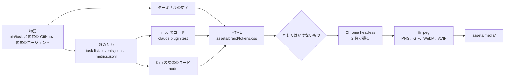

# 画像と動く画像を撮る

README と LP の画像は、task-hub が自分で撮る。画面が変わったら、1 つのコマンドで撮り直す。

```sh
python3 tests/media.py
```

- 置き場所: [`assets/media/`](../assets/media/)。28 個のファイルを毎回まとめて書き直す
- 架空のカードを、テストの偽物の GitHub(`tests/test_task.py` の `FAKE_GH`)と、筋書きどおりに動く偽物のエージェントで動かす。
  モデルも本物の GitHub も呼ばないので、費用はかからない
- 撮る前と撮った後に、写してはいけないもの(運営者のボード、手元のパス、日付、メールアドレス)がないかを確かめる。
  1 つでもあれば、`assets/media/` を変えずに止まる
- 文とデータは毎回同じ。同じ Mac で 2 回撮ると、どのファイルもバイト単位で同じになった(2026-10-29)
- 撮るのに 1 分ほどかかる。Chrome と ffmpeg が要る(「要る道具」)

## 撮るもの

| ファイル | 中身 | 合う機能のカード([brand.md](brand.md) の 3 節) |
|---|---|---|
| `flow.gif`、`flow.webm`、`flow.avif` | 動く画像(15 秒)。カード #12 を Ready に移してから、エージェントが作り、レビューで 1 回差し戻され、PR になり、マージキューでマージされるまで。左にターミナル、右に Claude Code の mod の盤。上の印は誰がしたか(You、task-hub、Agent) | 全体。README の一番上(太字の 1 文の下) |
| `list-dark.png`、`list-light.png` | `task list`。#12 が In review(判定 `pass`)、#13 が実行中、#14 が Blocked、#15 が Backlog | 1 タスク 1 PR |
| `review-dark.png`、`review-light.png` | 1 回目のレビュー(`.task-review.md` の `needs changes` と `Please fix`)と、最後の判定(`task show 12 --digest` の `pass` と PR) | PR の前のレビュー |
| `claude-board-dark.png`、`claude-board-light.png` | Claude Code の mod の盤。船の絵、要対応(Blocked の理由、In review の判定と PR)、実行中(経過時間と普段の時間) | Blocked の仕分け、エージェントの選択 |
| `kiro-board-dark.png`、`kiro-board-light.png` | Kiro の拡張のサイドバーの盤とステータスバー | Blocked の仕分け、エージェントの選択 |
| `layers/1-card-*.png` 〜 `layers/8-merge-*.png` | 分解の絵の素材。[brand.md](brand.md) の 4 節の 8 層の順に 1 枚ずつ(下の表) | LP の分解の絵 |
| `text.json` | 各画像に写っている文字。`tests/test_media.py` が画像を読まずに検査するのに使う。撮り直したときの差分で、何が変わったかも分かる | - |

動く画像はダークだけ。画面の 4 枚と層は、ダークとライトの 2 枚ずつ。画像は 2 倍の解像度で撮る。

### 分解の絵の層

| ファイル | 層([brand.md](brand.md) の 4 節) | 写っているもの |
|---|---|---|
| `layers/1-card-*.png` | 1. GitHub Project のカード | mod の盤。#12 が「待ち」(Ready)、船の桟橋にいる |
| `layers/2-runner-*.png` | 2. task-hub の runner | `task list`。#12 が `In progress › agent` |
| `layers/3-worktree-*.png` | 3. worktree | worktree の中の `git branch --show-current`(`task/12`)と `git status --short` |
| `layers/4-agent-*.png` | 4. 手元のエージェント | エージェントが書いた `.task-report.md` |
| `layers/5-review-*.png` | 5. 新しい文脈のレビュー | `task log 12`。1 回目 `needs changes`、やり直し、2 回目 `pass` |
| `layers/6-pr-*.png` | 6. PR | `task show 12 --digest`。判定 `pass` と PR |
| `layers/7-merge-queue-*.png` | 7. マージの順番待ち | `task merge 12` と、`wait for merge` の列の `task list` |
| `layers/8-merge-*.png` | 8. マージ | `task events` の最後の 3 行(`merged`、`Done`、ブランチの削除) |

### README と LP での出し方

ダークとライトは `<picture>` で出し分ける。動く画像は AVIF を出し、AVIF を出せないブラウザーには GIF を出す。
WebM は LP の `<video>` 用。README には 2026-10-29 に置いた(一番上の動く画像と、「特長」の画面 4 枚の表)。
`prefers-reduced-motion` のときは、動く画像の代わりに `list-*.png` を出す。下は短い例。README の alt は、絵の中身を書いた長い文にしている。

```html
<picture>
  <source media="(prefers-reduced-motion: reduce) and (prefers-color-scheme: dark)" srcset="assets/media/list-dark.png">
  <source media="(prefers-reduced-motion: reduce)" srcset="assets/media/list-light.png">
  <source type="image/avif" srcset="assets/media/flow.avif">
  
</picture>

<picture>
  <source media="(prefers-color-scheme: dark)" srcset="assets/media/list-dark.png">
  
</picture>
```

## 撮り方

```sh
python3 tests/media.py           # 撮る。assets/media/ を書き直す(1 分ほど)
python3 tests/media.py --text    # カードを動かして、画面に出る文字だけを出す。Chrome と ffmpeg は要らない(10 秒ほど)
python3 tests/media.py --check   # assets/media/ の今のファイルだけを確かめる(大きさ、写してはいけないもの)
python3 tests/run.py test_media  # 同じ確かめと、カードを 2 回動かして同じ文字になること(20 秒ほど)
```

画面が変わったら(`task list` の列、mod の盤、Kiro の拡張の盤など)、撮り直して、同じ PR に入れる。
`git diff assets/media/text.json` で、どの画像の何の文字が変わったかを確かめてから入れる。

`task` のコマンドの出力が変わっても、撮り直さないと画像は古いまま。CI は画像が古いことを確かめない
(撮るのに Chrome と ffmpeg が要るため)。確かめるのは、写してはいけないものがないことと、大きさだけ。

## 要る道具

`bin/task` は Python の標準ライブラリだけのまま。撮る道具は、リポジトリに入れず、手元の Mac にあるものを使う。

| 道具 | 何に使うか | 入れ方(macOS) | 確かめた版(2026-10-29) |
|---|---|---|---|
| Python 3.10 以上、git | カードを動かす(`bin/task` と偽物の GitHub) | task-hub と同じ | 3.10.4 |
| Google Chrome か Chromium | 画面を HTML にして撮る(ウィンドウを出さない headless) | `brew install --cask google-chrome`。ほかの場所なら `TASK_MEDIA_CHROME` に実行ファイルを書く | Chrome 156 |
| ffmpeg(GIF、VP9、AV1 と AVIF を書けるもの) | 動く画像を書く。PNG を小さくし、メタデータを消す | `brew install ffmpeg` | 9.0.2 |
| Node.js 22.18 以上 | Kiro の拡張の盤を、拡張のコード(`kiro/board-extension/src/board.ts`)で作る | `brew install node` | 23.11.0 |
| Claude Code の CLI | mod の盤を、mod のコードとテストの道具(`claude plugin test`)で作る | [Claude Code](https://claude.com/claude-code) | 2.1.312 |

無いときの動き:

- 1 つでも無いか、ffmpeg が GIF、VP9(`libvpx-vp9`)、AV1(`libsvtav1`)、AVIF のどれかを書けないと、無いものと入れ方を出して
  終わる(終了コード 2)。何も撮らず、`assets/media/` は変えない
- `--text`、`--check`、`tests/test_media.py` は、Python と git だけで動く
- 途中で失敗したとき(Chrome が撮れない、検査に引っかかったなど)も、`assets/media/` は変えない。全部を一時フォルダーで作り、
  検査が通ってから入れ替える

ほかの OS では確かめていない(2026-10-29 は macOS 26.6 だけ)。字は OS に入っている字で描くので、ほかの Mac でも字の形が少し違うことがある。

## 架空のデータ

例のカードは [brand.md](brand.md) の 4 節と同じ。画像は英語にした。1 組で英語と日本語の README の両方に使うため。
ただし mod と Kiro の拡張の盤は、拡張そのものが日本語なので日本語のまま写る。

| 項目 | 値 |
|---|---|
| ボードと Issue | Project `you/1`、Issue は `you/tasks`。カードは #12(その前の 11 枚は閉じた Issue) |
| 作業先 | `you/notes-app`(架空のメモのアプリ。手元の bare リポジトリ) |
| 題 | Add a search box to the notes list |
| 受け入れ条件 | 題名か本文に入っているメモだけを出す。大文字と小文字を区別しない(`milk` で `Buy Milk` が見つかる)。テストがある |
| 起きること | 1 回目は大文字と小文字を区別していて `needs changes`。やり直しで `casefold()` を使い、2 回目で `pass` |
| ほかのカード | #13 Export a note as Markdown(#12 が In review になってから動き出す)、#14 Sync notes between two devices(どのサービスで同期するかを聞いて Blocked)、#15 Pin a note to the top of the list(Backlog) |
| エージェント | `[agents]` の名前は `claude`(作る)と `codex`(レビュー)。中身はどちらも `tests/media.py` の偽物 |
| 普段の時間 | 手元の `metrics.jsonl` に、前の 5 回の実行(8〜11 分)を入れておく。盤に「普段9分」と出る |

毎回同じにするために、本物の出力から次のものを外すか、置き換えた。

| もの | 扱い |
|---|---|
| `task log 12` の 1 行目と 2 行目(ログのファイルと、日付と時刻の見出し) | `task log 12 \| tail -n +3` として外す。画面にもそのコマンドを書く |
| 引数なしの `task` の出力 | 写さない。`bin:` の行に手元のパスが出るため。代わりに `task list`、`task events` を写す |
| events.jsonl の時刻 | 盤に渡す前に、物語の時計(架空の朝の 9:00 から何分)に置き換える。盤に出るのは経過の分だけ |
| mod の盤の「09:14 時点」 | mod のテストの道具はマシンの時間帯で時刻を出す(`TZ` を渡せない)。物語の時計の時刻に置き換える |
| `task list --watch` | 写さない。見出しの行に日付が出るため。同じ表を `task list` で写す |

## 写してはいけないものの検査

`tests/media.py` が撮る前と後に、`tests/test_media.py` が CI で確かめる。

| どこを | 何を |
|---|---|
| 各画像に写る文字(`text.json`) | 運営者の名前とボード(`jyoka`、`aica` など)、日付(`2026-10-29`、`2026/10/29`、`20261029`、`10月29日` など。時刻は数えない)、メールアドレス、手元のパス(`/Users/`、`/home/`、`/var/folders/`、`/tmp/` など)、このマシンのホーム、一時フォルダー、ログイン名、git のメールアドレス |
| 各ファイルのバイト(メタデータ) | 今日の日付、手元のパス、このマシンの名前、運営者の名前。PNG の文字のチャンク(`tEXt`、`iTXt`、`zTXt`、`tIME`、`eXIf`) |
| ファイルの数と大きさ | `tests/media.py` が書くファイルが全部あり、それ以外がない。大きさの上限は下の表 |

| 種類 | 上限 | 2026-10-29 に撮った大きさ |
|---|---|---|
| GIF | 5 MB | 約 0.4 MB |
| WebM、AVIF | 2 MB | 約 0.4 MB、約 0.3 MB |
| PNG | 1 枚 700 KB | 37〜165 KB |

ファイルのメタデータは、ffmpeg の `-map_metadata -1` と `bitexact` で書かない(日付と道具の版が入らない)。

## 作り



- ターミナルは、本物の `bin/task` と git の出力をそのまま写す。色は付けない
- mod の盤は、mod のコード(`claude/task-board/hooks/register.tsx`)が描いた要素の木(Box、Text、船の Raster)を、
  mod のテストの道具で取り出し、HTML に描き直す。船の絵は Raster の画素をそのまま描く
- Kiro の拡張の盤は、拡張のコード(`kiro/board-extension/src/board.ts` の `tree()` と `statusBar()`)が作る木を、
  VS Code の木の形に描き直す。アイコンは VS Code の字(codicon)を使えないので、近い形を自分で描いた
- 色と字は `assets/brand/tokens.css` だけ。外から読み込むもの(Web フォント、CDN)はない
- 偽物のエージェントは、決まった所(ゲート)で待つ。待っている間に撮り、撮り終えたら先へ進める。だから時間で待たない
